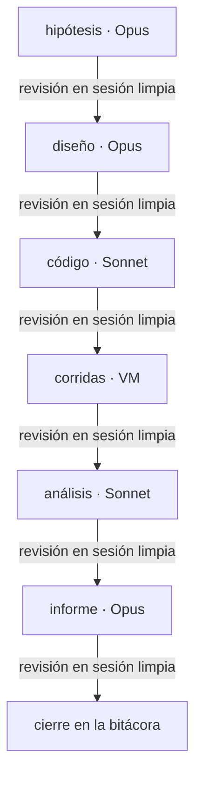
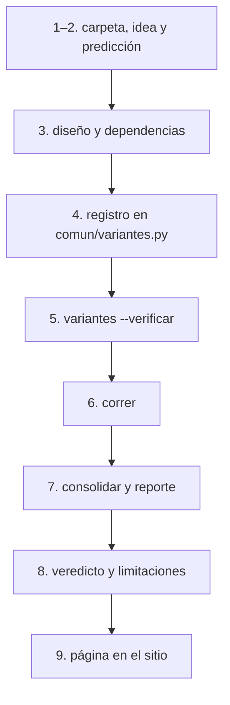

# Cómo trabajamos

El método vale para todos los experimentos del repo. Cada experimento vive en `experimentos/<nombre>/`, depende solo de
`comun/` y de su propia carpeta, y se puede borrar sin romper a los demás. Si un cambio toca `comun/`, el mensaje del
commit lo dice y cada experimento activo anota en su bitácora si lo afecta.

## Etapas



Hipótesis, diseño, código, corridas, análisis, informe. Cada etapa:

1. Arranca en una sesión nueva de Claude Code, a partir de los artefactos de `openspec/` y de la bitácora del
   experimento.
2. Termina con una revisión en sesión limpia (una sesión nueva, un subagente `general-purpose` o un integrante que no la
   ejecutó), usando la lista de
   [`docs/revision.md`](https://github.com/agustinarazanov/dmeyf-experimento-sampling/blob/main/docs/revision.md). No se
   cierra con un ✗ abierto.
3. Se cierra en la bitácora del experimento con el formato de cierre: fecha, sesión, revisor, hallazgos, correcciones,
   tokens y devolución del curso.

Los cambios grandes (un experimento nuevo, una ronda, una reorganización) se proponen como cambio de OpenSpec, con
propuesta, diseño, specs y tareas, y se archivan al cerrar.

## Modelo por etapa

- Opus: hipótesis, diseño, revisiones e informe.
- Sonnet: código, tablas y tareas mecánicas.
- Fable: solo si una decisión de diseño lo amerita.

## Tokens

- Salidas largas a archivo, nunca al chat. Leerlas con `head`, `tail` o un resumen.
- Subagentes solo para búsquedas o revisiones sin contexto.
- Lo repetido va a scripts. Las corridas las hace la VM, no una conversación.
- `/clear` al cerrar cada etapa.
- Las etapas que no necesitan a una persona se corren headless: `scripts/etapas.sh <exp> <cambio>` recorre todos los
  grupos pendientes de `tasks.md`; `scripts/etapa.sh <grupo> …` corre uno solo. Cada grupo se aplica en una sesión y se
  revisa en otra; si hace falta una decisión, la sesión escribe `bloqueo.txt` y el recorrido se detiene, y si lanzó
  corridas, escribe `en_curso.txt` y el recorrido espera a que terminen las VMs:

  ```mermaid
  flowchart TB
      E["scripts/etapas.sh"] --> G["scripts/etapa.sh, un grupo"]
      G --> AP["aplicar (sesión nueva)"]
      AP --> RV["revisar (sesión limpia)"]
      RV --> S{"¿quedan grupos?"}
      S -- sí --> G
      AP -. decisión .-> B["bloqueo.txt: se detiene"]
      AP -. corridas .-> EC["en_curso.txt: espera las VMs"]
      EC --> G
  ```
- `comun/tokens.py` escribe el `ledger/tokens.csv` de cada experimento. Clasifica cada sesión según la etapa que declara
  la bitácora de algún experimento (o su `ledger/sesiones/costos.csv`); la que nadie declara va a `sampling_1` y si dos
  la declaran falla.
- Objetivo: menos de 100.000 tokens de contexto por turno. La línea de base de octubre ronda los 400.000.

## Registros

Lo que no se publica en el sitio queda en el repo:

- **Bitácoras**, una por experimento:
  [control](https://github.com/agustinarazanov/dmeyf-experimento-sampling/blob/main/experimentos/control/docs/bitacora.md),
  [h1](https://github.com/agustinarazanov/dmeyf-experimento-sampling/blob/main/experimentos/h1/docs/bitacora.md),
  [h2](https://github.com/agustinarazanov/dmeyf-experimento-sampling/blob/main/experimentos/h2/docs/bitacora.md),
  [h3](https://github.com/agustinarazanov/dmeyf-experimento-sampling/blob/main/experimentos/h3/docs/bitacora.md),
  [h4](https://github.com/agustinarazanov/dmeyf-experimento-sampling/blob/main/experimentos/h4/docs/bitacora.md) y
  [sampling_1](https://github.com/agustinarazanov/dmeyf-experimento-sampling/blob/main/experimentos/sampling_1/docs/bitacora.md).
- **Specs vigentes** (OpenSpec):
  [protocolo experimental](https://github.com/agustinarazanov/dmeyf-experimento-sampling/blob/main/openspec/specs/protocolo-experimental/spec.md),
  [ledger de resultados](https://github.com/agustinarazanov/dmeyf-experimento-sampling/blob/main/openspec/specs/ledger-resultados/spec.md),
  [corrida reproducible](https://github.com/agustinarazanov/dmeyf-experimento-sampling/blob/main/openspec/specs/corrida-reproducible/spec.md),
  [reporte visual](https://github.com/agustinarazanov/dmeyf-experimento-sampling/blob/main/openspec/specs/reporte-visual/spec.md),
  [sitio de informes](https://github.com/agustinarazanov/dmeyf-experimento-sampling/blob/main/openspec/specs/sitio-informes/spec.md),
  [registro de tokens](https://github.com/agustinarazanov/dmeyf-experimento-sampling/blob/main/openspec/specs/registro-tokens/spec.md)
  y [dependencias entre experimentos](https://github.com/agustinarazanov/dmeyf-experimento-sampling/blob/main/openspec/specs/dependencias-entre-experimentos/spec.md).
  Los cambios cerrados están en
  [`openspec/changes/archive/`](https://github.com/agustinarazanov/dmeyf-experimento-sampling/tree/main/openspec/changes/archive).
- **Listas de revisión** por compuerta:
  [`docs/revision.md`](https://github.com/agustinarazanov/dmeyf-experimento-sampling/blob/main/docs/revision.md).
- **Guion del video**:
  [`experimentos/sampling_1/docs/guion.md`](https://github.com/agustinarazanov/dmeyf-experimento-sampling/blob/main/experimentos/sampling_1/docs/guion.md).
- **Rutas viejas y nuevas**, para reproducir un tag anterior:
  [`experimentos/sampling_1/docs/rutas.md`](https://github.com/agustinarazanov/dmeyf-experimento-sampling/blob/main/experimentos/sampling_1/docs/rutas.md).

## Agregar una hipótesis

Guía para quien suma una hipótesis (`h5`, …) sin tocar las de otros. Todo se corre desde la raíz del repo.

### 1. Qué va en cada carpeta

```
comun/          código y registro compartidos: variantes.py, correr.py,
                consolidar.py, reporte.py, metodos.py, muestreo.py,
                rutas.py, tokens.py, datos/baseline/ganancia/ledger
experimentos/
  control/      el control C (y C-rep) y las reglas comunes:
                README.md, docs/bitacora.md, ledger/
  h1/ … h4/     una hipótesis cada una: README.md, figuras/,
                docs/bitacora.md, ledger/
  sampling_1/   Resultados (README.md), anexo.md, corridas.md,
                exploratorios/, docs/ (bitácora, guion, rutas)
plantilla/      la estructura vacía de un experimento: README.md,
                docs/bitacora.md, ledger/, scripts/, src/
```

- El `README.md` de cada experimento es su página en el sitio: idea, predicción, diseño, dependencias, resultado,
  veredicto y limitaciones. Los nombres de las secciones son fijos, porque los leen `comun/variantes.py`, los
  verificadores y la revisión.
- Cada hipótesis es dueña de **su** carpeta y de **su** `ledger/`: escribe ahí las filas de sus variantes y los
  hiperparámetros de sus estudios. No se editan las carpetas ni los ledgers de los demás experimentos; si hace falta algo
  de ellos, se lee. Única excepción: sumar la línea `` - `hN` `` a `## Dependencias` de `experimentos/sampling_1/README.md`
  (el conjunto depende de todas las hipótesis y `--verificar` lo exige).
- Lo único compartido que se edita es `comun/`, y el cambio se anuncia en el mensaje del commit.

### 2. Pasos, en orden



1. Tomar el siguiente `hN` libre (`ls experimentos/`). El nombre tiene que ser un identificador válido: letras
   minúsculas, dígitos y `_`, sin guiones ni espacios (`h5`, no `h-5`).
2. `cp -r plantilla experimentos/hN` y completar en `README.md` el título (`# HN · título`, que el generador lee para las
   tarjetas), la línea de apertura, § Idea (con el diagrama del pipeline marcando dónde corta) y § Predicción: variable,
   métrica que decide, predicción y reglas de confirmación y refutación, con la fecha y el commit en que quedan fijadas.
   Las definiciones de G, Δ, δ, T, A, N\* y los veredictos se **citan** de
   [Control y reglas](../experimentos/control/README.md), no se copian. Abrir `docs/bitacora.md` con una primera entrada
   bajo `## Entradas` (`### AAAA-MM-DD — apertura`, sesión y etapa `hipotesis`).
3. En § Diseño completar las variantes, la grilla y las rondas, y en § Dependencias declarar de qué experimentos lee: la
   plantilla ya trae `control` (finales de `C`, N\* y δ); sumar uno más por cada estudio ajeno que se use (ver 3). Agregar
   además `` - `hN` `` a `## Dependencias` de `experimentos/sampling_1/README.md`.
4. Registrar en `comun/variantes.py`, y anunciarlo en el commit:
   - cada variante en `VARIANTES`: `Variante(nombre, "hN", método, tasa, estudio)`;
   - cada estudio de Optuna propio en `ESTUDIOS`: `"nombre": "hN"`.

   Por ejemplo, una variante ficticia de `h9` con la tasa 0,02: `Variante("U0.02", "h9", "uniforme", 0.02, "U0.02")` en
   `VARIANTES` y `"U0.02": "h9"` en `ESTUDIOS` (`nombre("uniforme", 0.02)` ya devuelve `U0.02`). Los nombres de variante
   y de estudio no se repiten entre hipótesis. Si la variante es de un `(método, tasa)` nuevo, `nombre()` tiene que saber
   nombrarlo, y un método nuevo además va en `comun/metodos.py` (`METODOS`, `FUNCIONES`, `validar`).
5. `python -m comun.variantes --verificar`: pasa si sale con código 0 y no imprime ninguna línea `PROBLEMA` (las líneas
   «si falta experimentos/X/ se rompen: …» salen siempre). Falla si falta la sección `## Dependencias` del README, si no
   coincide con lo que implica el registro, si hay un ciclo, si falta una carpeta o si queda un `docs/diseno.md` viejo
   con `## Dependencias`.
6. Correr: `python -m comun.correr --metodo M --tasa R --semilla S --etapa optimizar|final` (primero con `--filas 20000`
   en la Mac; en la VM, `scripts/lanzar_fase.sh <lista>`). La fila va al ledger del dueño de la variante. Detalle en
   [Corridas](../experimentos/sampling_1/corridas.md).
7. `python -m comun.consolidar --experimento hN` arma `resultados.csv`, `estudios.csv` y `apareado.csv` de `hN`, y
   `python -m comun.reporte --exp hN` escribe el bloque `resultado` de su README (tabla, mapa del tradeoff y curva de
   diferencia) y sus figuras en `experimentos/hN/figuras/`. Fuera de los marcadores `<!-- generado:… -->` no toca nada;
   si falta un marcador, falla sin escribir.
8. Escribir § Veredicto y § Limitaciones, sin números que no estén en el bloque generado
   (`python -m scripts.verificar_informe_h3 --informe experimentos/hN/README.md` lo comprueba).
   `python -m comun.reporte --exp sampling_1` toma las hipótesis del registro, así que `hN` aparece sola en Resultados y en
   las tarjetas.
9. Sumar la página al sitio: en `mkdocs.yml`, la línea `- HN: experimentos/hN/README.md` bajo `Hipótesis` en `nav`, y
   `!/experimentos/hN/README.md` y `!/experimentos/hN/figuras/**` en `exclude_docs`. Después `scripts/sitio.sh` (busca
   nombres de personas y construye con `mkdocs build --strict`, que falla con un enlace roto o con un enlace relativo a un
   archivo que no se publica; con `serve` lo deja en `localhost:8000`).

### 3. Usar un estudio de otra hipótesis

Una variante puede entrenar con los hiperparámetros de un estudio que corrió otra hipótesis. El caso de la casa es H3
(`H3-0.25`): su variante es de `h3`, pero su estudio es `U0.25`, de `h1`. En el registro,
`Variante("H3-0.25", "h3", "opt-muestra", 0.25, "U0.25")` con `"U0.25": "h1"` en `ESTUDIOS`; `comun.correr` lee
`experimentos/h1/ledger/hp/U0.25.json` y escribe la fila en `experimentos/h3/ledger/`. Consecuencia: `h3` declara `h1`
en `## Dependencias` (`--verificar` lo exige) y no se corre `h3` sin los hiperparámetros de `h1`.

### 4. Ejemplo: H4

H4 prueba muestras que conservan todas las bajas. Los pasos fueron: `h4/` desde la plantilla; los métodos nuevos (búsqueda
con negativos difíciles o uniformes, final fast-retrain con peso) en `comun/metodos.py` y su regla de nombre en
`variantes.nombre()`; variantes `H4H-0.1` y `H4U-0.1` con estudios propios de `h4`, y `H4F-0.05` y `H4F-0.25` con los
estudios `U0.05` y `U0.25` de `h1` y sus réplicas de `h3`, así que `h4` declara `control`, `h1` y `h3`; `--verificar`,
correr, consolidar y regenerar. Ni `control` ni `h1`–`h3` se modificaron. El resultado está en [H4](../experimentos/h4/README.md).

## Bibliografía

- Ke, G. et al. (2017). *LightGBM: A Highly Efficient Gradient Boosting Decision Tree*. NeurIPS 30. (GOSS)
- Friedman, J. H. (2002). *Stochastic Gradient Boosting*. Computational Statistics & Data Analysis 38(4). (bagging por
  iteración)
- Akiba, T. et al. (2019). *Optuna: A Next-generation Hyperparameter Optimization Framework*. KDD.
- Bergstra, J. et al. (2011). *Algorithms for Hyper-Parameter Optimization*. NeurIPS 24. (TPE)
- Baseline oficial del experimento colaborativo, Zulip 208135 (28-oct-2026).
