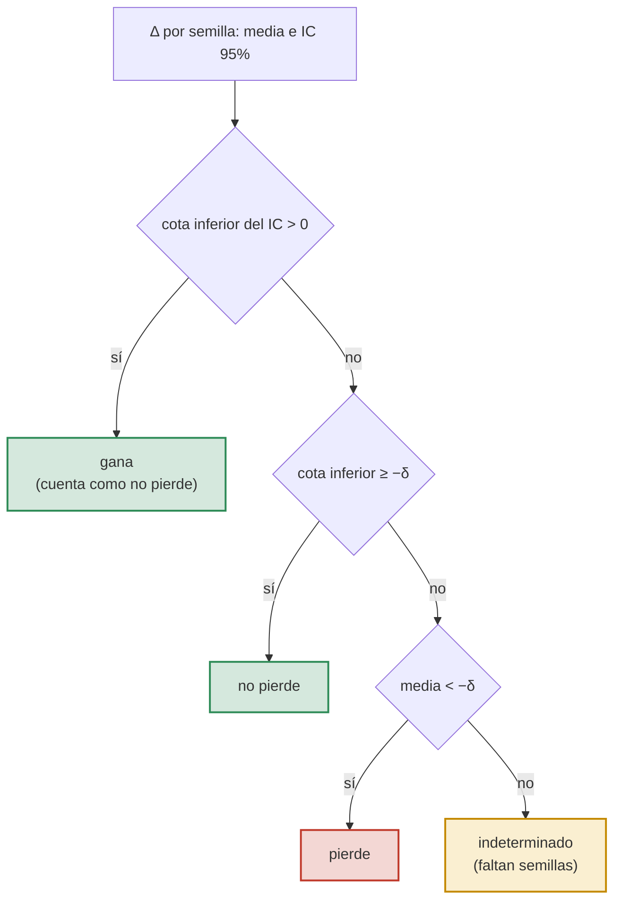

# Control y reglas

El control `C` es el baseline sin cambios, y acá están las reglas con las que se juzga a todas las hipótesis: G, N\*,
Δ, δ, el veredicto, T y A. Las hipótesis enlazan esta página en lugar de repetirlas.

## Baseline

El baseline del curso (Zulip 208135), con train completo (r = 1):

- **Datos**: 2019; train 201903–201906 completo; positivo BAJA+1 ∪ BAJA+2; lags y deltas de orden 2 (201901 y 201902
  solo como historia); validación 201908; test 201910, que no se usa para elegir nada. 201911 y 201912 no se usan.
- **Modelo**: LightGBM con defaults, salvo lo que optimiza Optuna, con `num_iterations = 100` sin early stopping y
  `num_threads = 8`.
- **Optuna**: 40 trials, TPE con semilla de optimización 0, maximiza el AUC en validación (201908). El espacio de
  búsqueda lo fija cada grupo (208135). El nuestro:

  | hiperparámetro | rango | escala |
  |---|---|---|
  | `num_leaves` | 8 – 1024 (entero) | log |
  | `learning_rate` | 0,01 – 0,3 | log |
  | `min_data_in_leaf` | 10 – 5000 (entero) | log |
  | `feature_fraction` | 0,1 – 1,0 | lineal |
  | `bagging_fraction` | 0,1 – 1,0, con `bagging_freq = 1` | lineal |

  Los 40 trials y la semilla única de Optuna son una elección nuestra, porque 208135 no los fija.

- **Final**: el modelo final entrena con 201903–201908 (ronda vigente, ver § Rondas) con los hiperparámetros que eligió
  Optuna, y se evalúa en test (201910).
- **Semillas finales**: 20 semillas fijas, las mismas en todas las variantes (§ Diseño). Cada una fija el `seed` de
  LightGBM, de donde salen el bagging y el `feature_fraction`. En las variantes con muestreo previo, la semilla final
  también vuelve a sortear la muestra, así que el IC incluye la variabilidad de la muestra.

### Meses

<div class="meses-scroll"><div class="meses" role="img" aria-label="Meses de 2019 que usa cada etapa: historia en 201901 y 201902; Optuna entrena con 201903 a 201906 y valida en 201908; el final entrena con 201903 a 201908 y se evalúa en 201910; 201909 no se usa.">
<span class="etapa">2019</span><span class="mes">01</span><span class="mes">02</span><span class="mes">03</span><span class="mes">04</span><span class="mes">05</span><span class="mes">06</span><span class="mes">07</span><span class="mes">08</span><span class="mes sin-uso" title="no se usa">09</span><span class="mes">10</span>
<span class="etapa" style="grid-row:2">Optuna</span><span class="hi" style="grid-row:2;grid-column:2/4">historia</span><span class="tr" style="grid-row:2;grid-column:4/8">train</span><span class="va" style="grid-row:2;grid-column:9/10">AUC</span>
<span class="etapa" style="grid-row:3">Final</span><span class="hi" style="grid-row:3;grid-column:2/4">historia</span><span class="tr" style="grid-row:3;grid-column:4/10">train (N* en 201908)</span><span class="te" style="grid-row:3;grid-column:11/12">test</span>
</div></div>

Optuna entrena con 201903–201906 y elige por AUC en 201908. El final entrena con 201903–201908 y predice 201910. 201909
solo aporta la clase de 201907.

### Parámetros fijos de LightGBM

En todas las variantes, además de los defaults:

- `objective = binary`, `num_iterations = 100`, `num_threads = 8`, `verbosity = -1`, `seed` = la semilla final en las
  corridas finales y 0 en los trials de Optuna.
- `deterministic = true` y `force_col_wise = true`. No cambian el modelo salvo por redondeo: hacen que la misma
  configuración repita el resultado y que LightGBM no cambie de estrategia de histogramas según r, lo que ensuciaría
  los tiempos. Por `force_col_wise`, T(C) no es exactamente el tiempo del baseline con la elección automática de
  LightGBM.
- `feature_pre_filter = false` en el `Dataset`, porque Optuna cambia `min_data_in_leaf` entre trials. El `Dataset` se
  construye una vez por estudio y una vez por corrida final, y ese tiempo entra en T.

Los tres son una adaptación declarada en la etapa de diseño (1-nov).

## Reglas

Escritas antes de cualquier corrida real: fijadas el 2026-11-01 en `sampling_1/docs/hipotesis.md` (commit `2f05cae`) y
pasadas a `control/docs/hipotesis.md` el 2026-11-03 (commit `dc6d9ce`). La ronda 201903–201908 se fijó el 2026-11-12
(commit `159ee0d`), antes del tag `corridas-v4` y de cualquier final de esa ronda. Un cambio posterior se anota en la
[bitácora del control](https://github.com/agustinarazanov/dmeyf-experimento-sampling/blob/main/experimentos/control/docs/bitacora.md)
con su motivo, y las corridas previas quedan marcadas como de la versión anterior.

- **N\***: la cantidad de clientes contactados que maximiza la ganancia media del control en validación (201908). Ese mismo N\* se
  aplica en test (201910) a todas las variantes. En la ronda vigente es N\* = 3.300, fijo (§ Rondas).
- **G** (métrica que decide): ganancia en 201910 al corte fijo N\*, calculada contra BAJA+2 con los valores de la
  cátedra. La ganancia máxima de la curva se reporta pero no decide.
- **Δ**: G(variante) − G(control), apareada por la semilla final. Se reportan la media, el desvío, el IC 95% (t de
  Student con n − 1 g.l.: 19 con 20 semillas) y en cuántas semillas gana la variante.
- **δ**: δ = 0,02 · Ḡ_C, donde Ḡ_C es la ganancia media del control en 201910 al corte N\*. Lo que se fija antes de correr
  es la regla; el valor de δ sale del control y cambia con la ronda.
- **Veredicto**: cuatro casos que cubren todo.
  - *gana*: la cota inferior del IC de Δ es mayor que 0;
  - *no pierde*: la cota inferior del IC de Δ es mayor o igual que −δ (incluye *gana*);
  - *pierde*: la media de Δ es menor que −δ;
  - *indeterminado*: el resto, cuando la cota inferior es menor que −δ y la media es mayor o igual que −δ. Faltan
    semillas para decidir y se informa así.
- **T** (tiempo): tiempo de pared del pipeline de la variante, medido solo en `n2-highmem-8` con CPU Ice Lake. Es la
  optimización (suma de la duración de los 40 trials, incluida la predicción en 201908, más un armado del
  `lgb.Dataset`) más la media del modelo final entre semillas (`Dataset`, entrenamiento y predicción en 201910). Sumar
  trials, y no medir el proceso entero, hace que T no dependa de si la VM se cayó y el estudio se retomó. No incluye
  leer los datos ni generar los lags, que son iguales en todas las variantes. El tiempo de `lgb.train` del modelo final
  se reporta aparte.
- **A** (aceleración): A = T(control) / T(variante), con la misma definición de T en todas las variantes.
- **Vale la pena** una variante que no pierde y tiene A ≥ 2.



## Diseño

### Variantes

| variante | Optuna: datos | Optuna: espacio | final: datos |
|---|---|---|---|
| `C` | r = 1 | 5 hp (§ Baseline) | r = 1 |

`C-rep` es una réplica del control para la compuerta de resultados, no una variante que entre en Δ.

### Grilla

- **Optimización**: el estudio `C`, 40 trials, 100 iteraciones cada uno, sin early stopping. Además, siete réplicas de
  optimización `C@1…7` (cambio `h3-semillas-optuna`, 8-nov): un estudio más por réplica k, con la semilla del sampler
  TPE = k. Los estudios `C@k` son de `control`, sus hiperparámetros van a `ledger/hp/C@k.json` y sus filas llevan
  `replica_opt = k` y el `id` con `@k`. El estudio `C`, sus finales y `C-rep` son la réplica 0, y N\* y δ salen de ella.
  Para qué sirven las réplicas: [H3](../h3/README.md).
- **Finales**: `C` y `C@1…7` × 20 semillas = 160 corridas, y `C-rep` × 20 = 20 corridas, en otra VM. `C-rep` usa el JSON
  de `C` y las mismas semillas, con su propio nombre de variante para que el id de la corrida no choque con el de `C`.
  Sirve para comprobar que el control se repite y para medir cuánto varía el tiempo entre VMs del mismo tipo.
- **Semillas finales**, en este orden: las 10 oficiales (100003, 200003, 300007, 400009, 500009, 600011, 700001, 800011,
  900001, 999983) y 10 más de la fórmula 110017 + i · 19937 con i = 0…9 (110017, 129954, 149891, 169828, 189765, 209702,
  229639, 249576, 269513, 289450). Ninguna choca con las oficiales ni con la semilla 0, que queda reservada para Optuna
  y para las muestras de optimización. Las primeras 10 son las de la ronda anterior, así que la ronda vigente se puede
  reconsolidar con 10 y separar el efecto de la ventana del de las semillas.
- **Consolidado**, en este orden: N\* (fijo en la ronda vigente), G por corrida final, Ḡ_C y δ, Δ por variante apareada
  por semilla contra `C` y solo sobre las semillas que tienen los dos, veredicto y T con su A. Todo sale del
  `ledger/apareado.csv` de cada experimento; nada se calcula a mano. N\* y δ salen siempre del ledger de `control`.
- **Por corrida final**, el ledger guarda AUC 201908 (vacío en la ronda vigente), AUC 201910, las curvas de ganancia
  acumulada (`ledger/curvas/`), la ganancia máxima en 201910, las filas de train, el hash de la muestra, los tiempos por
  fase, la memoria máxima y el modelo de CPU. Por estudio: AUC del mejor trial, hiperparámetros
  (`ledger/hp/<estudio>.json`, versionado) y tiempo total.
- Las corridas en la Mac (`--filas 20000`) son pruebas con `etapa = exploracion` y no entran en `resultados.csv`. La
  ejecución en VMs está en [Corridas](../sampling_1/corridas.md).

### Rondas

- **Ronda 201903–201906** (anterior): final con train 201903–201906, 10 semillas, N\* calculado en validación (201908)
  con esos finales. Se conserva y se sigue pudiendo consolidar.
- **Ronda 201903–201908** (vigente, cambio `final-con-julio-agosto`, 12-nov): cambia solo lo siguiente; Optuna, el
  espacio, G, Δ, la regla de δ, los veredictos, T y A quedan iguales.
  - **Ventana del final 201903–201908.** La consigna pide reentrenar incluyendo 201907 y 201908 para predecir 201910
    (Zulip 211210). Optuna no cambia: sigue entrenando con 201903–201906 y eligiendo por AUC en 201908, y los estudios
    ya guardados (réplicas `@k` incluidas) se reusan.
  - **N\* = 3.300, fijo.** Es el valor de la ronda anterior, calculado en validación con finales que no habían visto
    201908. En la ronda vigente la predicción de 201908 sería dentro de la muestra, así que los finales no la hacen y
    N\* no se recalcula. Recalcularlo en test violaría «201910 solo para comparar».
  - **δ** sigue la regla de siempre con los `C` de la ronda vigente, así que su valor cambia. La tabla de rondas de
    [Resultados](../sampling_1/README.md) muestra los dos δ.
  - **20 semillas** y t de Student con 19 g.l.
  - Cada fila final lleva `meses_final = 201903-201908` y el id la ventana. El consolidado no mezcla rondas.

### Apartamientos del baseline

Cada uno con su id y su motivo. Los tres están justificados. Va a Limitaciones solo el tercero.

- **El veredicto sale de la ganancia G y no del AUC**, aunque el baseline dice «métrica auc» (Zulip 208135). La regla
  de veredicto se escribió en pesos antes de la primera corrida y δ está definido en pesos. Un umbral de AUC sería una
  regla nueva escrita después de haber visto los AUC de la ronda anterior. Optuna sí elige por AUC en validación, como
  pide 208135, y el AUC en 201910 se reporta al lado (ΔAUC con su IC por semilla y con réplicas).
- **Ventana del final 201903–201908** (seis meses; Zulip 211210). La respuesta dice que se reentrena incluyendo 201907 y
  201908, no que se saquen 201903 y 201904. Los seis meses quedaron confirmados el 13-nov-2026.
- **Los hiperparámetros elegidos con cuatro meses se usan sin cambios en un final de seis**, incluido
  `min_data_in_leaf`, que es absoluto (Zulip 211210). Es lo que pide la consigna (reentrenar con los hiperparámetros ya
  elegidos), no una variante. Reescalar sería una variante nueva, y la idea ya está en `H3R` y `H3L`
  ([H3](../h3/README.md)).

## Predicción

### Predicción del experimento (1-nov)

!!! info "Predicción"
    Fijada el 2026-11-01 en `sampling_1/docs/hipotesis.md` (commit `2f05cae`), antes de cualquier corrida real. Las
    predicciones de cada hipótesis están en su página.

- **Qué vale la pena**: H3 con ambas tasas y H1 con r = 0,25. Para un pipeline acotado en tiempo, como el de la segunda
  entrega, lo que más sirve es H3 con r_opt = 0,1, porque la optimización domina el tiempo total.
- **A tiempo igual**: la pregunta no es velocidad contra ganancia sino qué se hace con el tiempo ahorrado. Si no se
  reinvierte, no vale la pena perder ni un 1 %. Por eso, además de la comparación a datos iguales, hay una comparación a
  tiempo igual: el control completo contra la variante rápida con el tiempo sobrante gastado en más semillas (ensamble
  de K modelos de la variante, con K tal que el tiempo total iguale al del control). Predicción: a tiempo igual la
  variante rápida gana, y H3 es la que más rinde. (Nota del 2-nov, después de las fases 1 a 3 y antes de ver ningún
  ensamble: el ledger guardaba curvas y no predicciones, así que se agregó una fase que repite los finales guardando
  predicciones. La predicción no cambió.)
- **Contrastes principales** (9-nov, cambio `incorporar-aportes`, antes de correr H4 y las extensiones de H3): con cuatro
  hipótesis hay más de diez contrastes sin corrección por comparaciones múltiples, así que la respuesta se apoya en
  `H3-0.1`, `H4H-0.1` y `H4F-0.05` contra `C`, con réplicas (y `H4F-0.05` también a tiempo igual), fijados en
  [H4](../h4/README.md). El resto se informa como secundario.
- **Ronda 201903–201908** (12-nov): ningún veredicto cambia de lado, el IC por semilla se angosta del orden de √2 y el de
  réplicas menos. Las reglas están abajo.

Cómo salió está en [Resultados](../sampling_1/README.md#conclusiones).

### Predicción de la ronda 201903–201908

!!! info "Predicción de la ronda 201903–201908"
    Fijada el 2026-11-12, commit `159ee0d`, antes del tag `corridas-v4` y de cualquier final de la ronda.

- **Veredictos estables.** Para cada variante, con Δ por semilla (sin réplicas) y con Δ con réplicas donde existen, se
  compara el veredicto de la ronda anterior con el de la vigente. Un *cambio de lado* es pasar de *gana* o *no pierde* a
  *pierde*, o al revés; los pasos desde o hacia *indeterminado* no cuentan.
  - **Predicción**: 0 cambios de lado.
  - **Se confirma** si hay 0 cambios de lado; **se refuta** si hay 1 o más.
- **IC más angosto.** Para cada variante, la razón ancho del IC 95% de Δ por semilla en la ronda anterior / ancho en la
  vigente. Con el mismo desvío sería 1,53 (2,262/√10 contra 2,093/√20), del orden de √2.
  - **Predicción**: la mediana de la razón entre variantes está entre 1,2 y 1,9.
  - **Se confirma** si está en [1,2; 1,9]; **se refuta** si es menor que 1,2 o mayor que 1,9.
- **Con réplicas el ancho baja menos**, porque entre el 33 y el 40 % de la varianza de `H3` es entre réplicas y las
  réplicas siguen siendo 8.
  - **Predicción**: la mediana de la razón de anchos del IC de Welch de Δ con réplicas es menor que la mediana de la
    razón por semilla, y menor que 1,3.
  - **Se confirma** si se cumplen las dos desigualdades; **se refuta** si no se cumple alguna.
- `H4O-0.5`, que solo existe en la ronda vigente, tiene su predicción y su regla en [H4](../h4/README.md).

Un veredicto que cambie no se descarta ni se reemplaza: la tabla de rondas del
[Anexo de resultados](../sampling_1/anexo.md#rondas) muestra, por variante, Δ y veredicto en las dos rondas, con los dos δ.

### Medición de tiempos (cambio `tiempos-confiables-y-consistencia`, 13-nov-2026)

Escrito el 13-nov-2026, antes de cualquier corrida de la fase 8 y antes de lanzar la VM de la medición. Lo de arriba no
se reescribe: la definición de T no cambia, y § Reglas queda como estaba. Esta sección fija una sola referencia para A,
su intervalo y dos mediciones exploratorias de tiempo. Las predicciones las propuso una sesión que ya había visto la
ronda 201903–201908, y se confirmaron antes de la revisión (bitácora de `sampling_1`).

#### A con una sola referencia

- **Regla nueva.** A(v) = mediana_k T(`C`, k) / T(v). La mediana de T del control se toma **una sola vez**, sobre las 8
  réplicas de `C`, y es la misma en todas las filas del bloque A. T(v) es la mediana entre las réplicas de v, o la T de
  la réplica 0 si v no tiene réplicas. La calcula el reporte; el ledger (`apareado.csv`) no cambia.
- **Motivo.** La regla vieja usaba dos referencias de T(`C`): el ledger calcula A contra la T de la réplica 0, y el
  reporte la reemplazaba por la mediana solo en las variantes con réplicas, y además la tomaba sobre las réplicas que la
  variante tiene en común con el control. Con eso A(`U0.5`) daba 2,25 con la réplica 0 y 2,83 con la mediana, y con
  réplicas incompletas la referencia cambiaría de una fila a otra. La regla nueva no cambia ningún veredicto de "vale la
  pena" de la ronda (`U0.5` pasa de 2,25 a 2,83; `B0.25` queda en 1,54 y `B0.5` en 0,99).
- **Lo que sigue con la réplica 0.** El tiempo igual de las filas sin réplicas (K y bootstrap de clientes) sigue usando
  T(`C`) de la réplica 0, porque se aparea con el Δ de la réplica 0. El tiempo igual con réplicas sigue apareado por k:
  el ensamble de la réplica k se compara con la ganancia del control en esa misma réplica.
- **Intervalo de A.** Bootstrap por percentiles (2,5 y 97,5) del cociente de medianas: se remuestrean con reposición las
  réplicas del control y, por separado, las de la variante, 10.000 veces con semilla fija.
  - Mide la variación entre réplicas, que junta la de Optuna y la de la VM, porque cada réplica corrió en su propia VM.
    Cuánto es de la VM lo dice la calibración (§ Calibración por máquina).
  - No se usa el mínimo y el máximo de T(`C`, k) / T(v, k): aparear por k es arbitrario, porque la misma semilla de TPE
    no relaciona las trayectorias de dos estudios con datos distintos.
  - Límites: con 8 réplicas la mediana remuestreada toma pocos valores y el intervalo queda cerca del segundo y el
    séptimo valor de cada lado, así que una réplica rara lo mueve. Remuestrear por separado supone lados
    independientes; en las fases 5 a 7 la réplica k del control y la de la variante compartían VM, y eso lo hace
    conservador.
  - La fila del control no lleva intervalo (A = 1 por definición). Sin réplicas en la variante solo se remuestrea el
    control, y el intervalo es un piso de la incertidumbre de A.

#### Medición a hiperparámetros fijos (exploratoria)

- **Qué se mide.** Los 8 juegos de hiperparámetros del control (estudios `C` y `C@1…7`), con 3 repeticiones, sobre la
  muestra al azar con r ∈ {1; 0,5; 0,25; 0,1; 0,05} (120 mediciones) y sobre la receta de H4 (todas las bajas + f de
  CONTINUA con peso 1/f), f ∈ {0,5; 0,25; 0,1; 0,05} (96 mediciones). Cada medición reproduce un trial: muestra con la
  semilla 1000 + repetición, `Dataset` con los parámetros del control, entrenamiento de 100 iteraciones y predicción de
  201908. El orden de las 216 mediciones se aleatoriza con semilla fija.
- **Qué se cronometra.** Tres tiempos por separado: el armado del `Dataset`, el entrenamiento y la predicción de 201908.
  El tiempo de la medición t es entrenamiento más predicción, lo mismo que guarda Optuna como duración de un trial (el
  `Dataset` queda fuera del reloj), así que se puede comparar con los trials ya corridos.
- **Definiciones.**
  - A_fijo(r) = mediana, entre los 8 juegos de hiperparámetros, de t(1) / t(r), con t como media de las 3 repeticiones.
  - Cociente entre recetas a la tasa f: mediana entre juegos de t(receta de H4, f) / t(al azar, f), comparado con el
    cociente de filas (al azar contra con bajas: 1,010 en 0,5; 1,031 en 0,25; 1,094 en 0,1 y 1,199 en 0,05).
  - CV entre repeticiones: desvío / media de las 3 repeticiones de cada celda (juego, receta, tasa).
- **Predicción.**
  - A_fijo(0,5) ∈ [1,6; 2,4] y A_fijo(0,05) < 10, porque la predicción de 201908 no se achica con r.
  - El cociente entre recetas queda entre 0,9 y 1,1 veces el cociente de filas en las cuatro tasas (hasta 1,32 en
    0,05): el tiempo sigue a las filas y el peso no lo cambia.
  - La mediana del CV entre repeticiones es ≤ 5 %.
- **Regla.** Cada una de las tres partes se confirma si se cumple y se refuta si no.

#### Calibración por máquina (exploratoria)

- **Qué se mide.** Al empezar y al terminar la lista de cada VM de la fase 8:
  - el trial de calibración: hiperparámetros de `C` réplica 0, r = 1, la semilla del trial original, 2 repeticiones,
    cronometrado como en la medición a hiperparámetros fijos;
  - un final viejo: `C` réplica 0 con la primera semilla final (100003), cronometrado como un final del corredor
    (`Dataset`, entrenamiento y predicción de 201910, sin la carga de datos) y sin escribir en el ledger de `control`.
- **Anclas con las fases anteriores**, sin corridas extra:
  - el trial de calibración contra el mejor trial del estudio `C` (el 31 de 40, 27,15 s en la VM de la fase 1); los
    mejores trials de `C@1…7`, que repite la medición a hiperparámetros fijos, contra su duración en los `.db`;
  - el final viejo contra la misma corrida en el ledger de la fase 7 (50,16 s) y contra `C-rep` con la misma semilla
    (45,14 s).

  **Cada ancla es una sola medición vieja, sin repeticiones**: un cociente fuera de rango puede ser la VM nueva o la
  vieja.
- **Qué se informa.** CV entre VMs (entre las medias de cada VM), cociente fin / inicio por VM y cociente de cada VM
  contra las dos anclas. Las VMs corren en horarios distintos, así que el CV entre VMs junta la máquina y la hora.
- **Predicción.** CV entre VMs ≤ 5 %, cociente fin / inicio en [0,9; 1,1] y cociente contra las anclas en [0,9; 1,1], en
  todas las VMs.
- **Regla.** Se confirma si se cumplen las tres en todas las VMs. Si alguna VM queda fuera, el informe lo dice y marca
  sus filas; no se descarta ninguna corrida, y menos después de ver la ganancia.

#### CV entre semillas dentro de una VM

Lo que ya mide la ronda 201903–201908: el mismo final, con los mismos hiperparámetros y otra semilla, en la misma VM.
Es el CV de `tiempo_entrenamiento_s` entre las 20 semillas de cada celda (variante, réplica). En las 121 celdas la
mediana es 2,43 % (de 0,76 a 6,20 %); en las variantes sin réplicas va de 1,78 a 6,12 % (6,20 % en `C-rep`). Se obtiene
desde la raíz del repo con:

```bash
python -c "
import glob, pandas as pd
d = pd.concat([pd.read_csv(f) for f in glob.glob('experimentos/*/ledger/resultados.csv')])
f = d[(d.etapa == 'final') & (d.meses_final == '201903-201908')]
g = f.groupby(['variante', 'replica_opt']).tiempo_entrenamiento_s.agg(['mean', 'std'])
cv = 100 * g['std'] / g['mean']
print(len(cv), cv.median().round(2), cv.min().round(2), cv.max().round(2))
"
```

#### Alcance

La medición a hiperparámetros fijos y la calibración son **exploratorias**: no cambian ningún veredicto. Dicen cuánto
del A del bloque A es tamaño de los datos y cuánto es la elección de Optuna, y cuánto ruido agrega cambiar de VM.

## Dependencias

Ninguna: el control no lee de otro experimento.

## Estado

<!-- generado:estado -->
Generado por `comun/reporte.py` el 2026-11-14; no editar.

- Final entrenado con 201903-201908, 20 semillas; N* = 3,300 clientes contactados (fijo, de la ronda anterior); δ = 5.65 M$.
- Ḡ_C (réplica 0) = 282.48 M$; T_C = 797 s.
- Finales del control: 20 de 20 semillas.

<!-- /generado:estado -->

## Limitaciones

- **Hiperparámetros de cuatro meses en un final de seis.** Los hiperparámetros que eligió Optuna con train 201903–201906 se usan sin cambios en un final de seis meses
    (§ Apartamientos del baseline). Cambia el régimen del final para todas las variantes por igual.

- **`C-rep` en la misma cuenta.** `C-rep` corre en otra VM de la misma cuenta: prueba el determinismo entre máquinas, no la reproducción entre
    integrantes.
