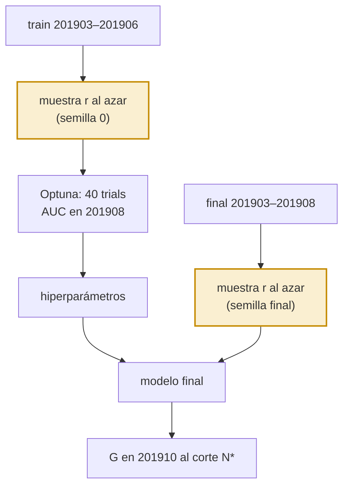
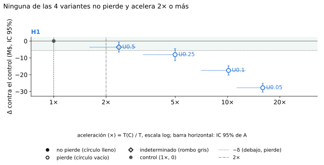
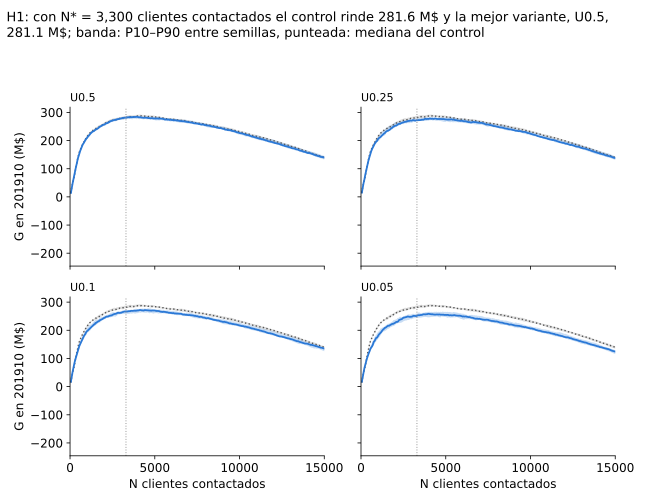
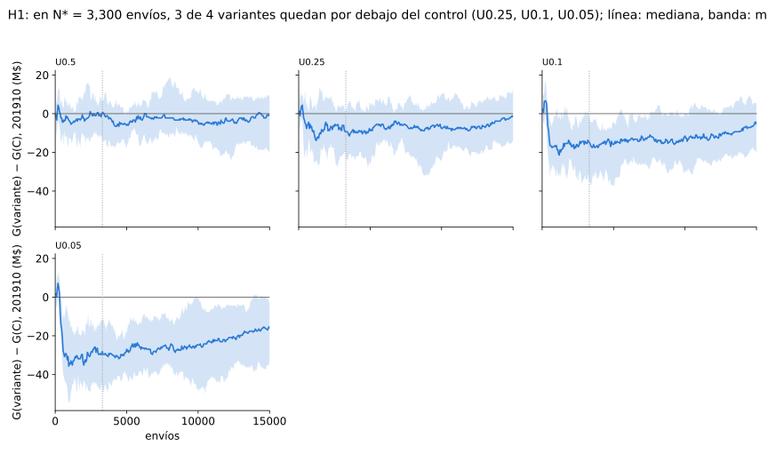

# H1 · Submuestreo uniforme del train

H1 prueba si entrenar con una fracción de las filas de train, tomadas al azar sin mirar la clase, acelera sin perder
ganancia.

Responde a **dónde achicar**: en todo el pipeline, con filas al azar
([Resultados § ¿Dónde achicar?](../sampling_1/README.md#donde-achicar)).

## Idea

El costo de LightGBM crece con las filas: cada iteración arma histogramas sobre todo el train. Si el train tiene más filas
de las que el modelo necesita para ordenar bien a los clientes, quedarse con una fracción r al azar acelera tanto Optuna
como el modelo final y la ganancia casi no cambia. En algún r la muestra deja de alcanzar y la ganancia cae: H1 busca
dónde.

La muestra no distingue clase, así que la proporción de positivos queda igual. H1 achica el train en las dos etapas:
Optuna se corre de nuevo para cada tasa, sobre una muestra sorteada con la semilla 0, y el final entrena con la misma
tasa, sobre una muestra que se vuelve a sortear con cada semilla final.

## Predicción

!!! info "Predicción"
    Fijada el 2026-11-01 en `sampling_1/docs/hipotesis.md` (commit `2f05cae`) y pasada a `h1/docs/hipotesis.md` el
    2026-11-03 (commit `7c34254`), antes de cualquier corrida real. G, Δ, δ, T, A, N\* y los veredictos están en
    [Control y reglas](../control/README.md).

- **Variable**: tasa r de filas de train tomadas al azar sin distinguir clase, r ∈ {0,5, 0,25, 0,1, 0,05}.
- **Métrica que decide**: el veredicto de cada tasa contra el control.
- **Predicción** (pre-registrada): predecía que la variante *no pierde* con r = 0,5 y 0,25 y *pierde* con r = 0,05.
  Como predicciones secundarias, que no deciden, predecía que *pierde* con r = 0,1 y que A ≥ 2 con r = 0,25. La predicción en 201908 tiene un costo fijo, por eso la aceleración no es
  4×.
- **Se confirma** si con r = 0,5 y 0,25 la variante *no pierde* y con r = 0,05 *pierde*: hay margen y después hay caída.
- **Se refuta** si con r = 0,5 la variante *pierde* (no hay margen) o si con r = 0,05 *no pierde* (no hay caída dentro de
  la grilla).
- **Ninguna de las dos** en cualquier otro caso, por ejemplo con r = 0,25 *indeterminado* o con r = 0,25 perdiendo
  mientras r = 0,5 no pierde. Se informa como frontera observada la menor r tal que esa tasa y todas las mayores *no
  pierden*.

### Réplicas de H1 (cambio `tiempos-confiables-y-consistencia`, 13-nov-2026)

Escrito el 13-nov-2026, antes de cualquier corrida de la fase 8, y revisado en sesión limpia antes de la primera. Lo de
arriba no se reescribe. Esta sección suma 8 réplicas de optimización a las cuatro tasas de H1 para que entren en la
grilla común ([`sampling_1/corridas.md`](../sampling_1/corridas.md) § Fases) con el mismo tratamiento que H3 y H4.

**Origen: se agrega después de ver 201910.** Las réplicas de `U*` se deciden después de ver en 201910 todas las celdas
vecinas (los `U*` de la réplica 0, `H3-*` y `H4O-0.5` con réplicas). Entran las cuatro tasas juntas, con predicción y
regla escritas acá antes de correr, y ninguna se elige ni se descarta por su resultado. El informe lo lista entre las
limitaciones ("Ideas que vienen de mirar el test").

- **Qué se corre.** Estudios `U{r}@k` y 20 semillas finales por réplica, k = 0…7, r ∈ {0,5; 0,25; 0,1; 0,05}. Los
  estudios `U0.25@k`, `U0.1@k` y `U0.05@k` ya existen (los corrió `h3`) y pasan a ser de `h1`; falta `U0.5@k`.
- **Qué se mide.** Ronda 201903–201908 ([`control`](../control/README.md) § Predicción de la ronda 201903–201908): 20
  semillas finales, N\* = 3.300 y δ = 0,02 · Ḡ_C de esa ronda (5,65 M$). Δ con réplicas e IC de Welch como en
  [`h3`](../h3/README.md) § H3 con réplicas de optimización. A con una sola referencia y T como mediana entre réplicas
  ([`control`](../control/README.md) § Medición de tiempos). El veredicto con réplicas reemplaza al de la réplica 0, como
  en H3; el de la réplica 0 se sigue informando.
- **Predicción.** Con réplicas, `U0.5` *no pierde* y A ≥ 2; `U0.25`, `U0.1` y `U0.05` *pierden*.
- **Se confirma** si `U0.5` *no pierde* con A ≥ 2 y las otras tres *pierden*. **Se refuta** si `U0.5` *pierde* o si
  alguna de las otras tres *no pierde*. **Ninguna de las dos** en otro caso (alguna *indeterminado*, o `U0.5` *no
  pierde* con A < 2).
- **"Vale la pena".** Si `U0.5` sale *indeterminado* o con A < 2, deja la lista de variantes que valen la pena y se
  informa así.
- Las diferencias directas de `U{r}` con `H3-{r}` y con `H4O-{r}` están en [`h4`](../h4/README.md) § Grilla común.

## Diseño

Lo que no se dice acá (máquina, parámetros fijos de LightGBM, semillas finales, métricas) es lo del
[control](../control/README.md).

### Variantes

| variante | Optuna: datos | Optuna: espacio | final: datos |
|---|---|---|---|
| `U0.5`, `U0.25`, `U0.1`, `U0.05` | muestra r, semilla 0 | 5 hp, el del control | muestra r, sorteada con la semilla final |

Un estudio de Optuna queda definido por sus datos de optimización y su espacio. `H3-0.25` optimiza exactamente lo mismo
que `U0.25` (muestra uniforme r = 0,25 con semilla 0, 5 hp, 40 trials, TPE con semilla 0), y `H3-0.1` lo mismo que
`U0.1`. Se corre un solo estudio y lo usan las dos variantes: H1 entrena el final con la muestra y H3 con todo. Las dos
se comparan contra el control y no entre sí, así que compartir el estudio no acopla ninguna decisión. El tiempo de ese
estudio entra en T de las dos. Los estudios `U{r}` y `U{r}@k` son de `h1` (su `ledger/hp/`) y [H3](../h3/README.md) los
lee de acá, así que H1 no depende de H3.

### Grilla

- **Optimización**: 4 estudios (`U0.5`, `U0.25`, `U0.1`, `U0.05`) × 40 trials en la réplica 0, y 8 réplicas de
  optimización (k = 0…7) por tasa: `U0.5@1…7` sortea el 50 % de train 201903–201906 con la semilla k y corre TPE con
  semilla k, como el resto de las réplicas.
- **Finales**: 4 variantes × 20 semillas por réplica, con la ventana 201903–201908. La muestra de tasa r se sortea sobre
  los seis meses del final con la semilla final. Son 80 corridas en la réplica 0 (lista `fase7_r0`) y 560 en las
  réplicas 1…7 (listas `fase8_r1_a` … `fase8_r7_a`), según [Fases](../sampling_1/corridas.md) § Fases.
- **T y A**: T como mediana entre réplicas y A con una sola referencia ([`control`](../control/README.md) § Medición de
  tiempos).
- **Grilla común**: las cuatro `U{r}` forman la fila «al azar, búsqueda y final» junto con `H3-*` y `H4O-*`. Las
  diferencias directas con `H3-{r}` y `H4O-{r}` están en [`h4`](../h4/README.md) § Grilla común.

Los apartamientos de la consigna (208135, 211210) están justificados en el [control](../control/README.md).

## Dependencias

- `control`: finales de `C`, N\* y δ.

## Resultado

<!-- generado:resultado -->
Final entrenado con 201903-201908, 20 semillas; N* = 3,300 clientes contactados (fijo, de la ronda anterior); δ = 5.65 M$. Vale la pena: no pierde y acelera 2× o más.

<table><tr><th>variante</th><th>R</th><th>G media (M$)</th><th>Δ [IC 95%] (M$)</th><th>ΔAUC [IC 95%]</th><th>T mediana (s)</th><th>aceleración (×)</th><th>ganancia contra el control</th><th>vale la pena (no pierde y ≥ 2×)</th></tr><tr><td>C</td><td>—</td><td>281.78</td><td>—</td><td>—</td><td>1,002</td><td>1.00</td><td>—</td><td>—</td></tr><tr><td>U0.5</td><td>8</td><td>278.13</td><td class='sig-neg'>-3.64[-6.58; -0.71]</td><td class='sig-neg'>-0.0018[-0.0029; -0.0007]</td><td>423</td><td>2.37[1.60; 2.98]</td><td>indeterminado</td><td>no</td></tr><tr><td>U0.25</td><td>8</td><td>273.69</td><td class='sig-neg'>-8.09[-11.58; -4.60]</td><td class='sig-neg'>-0.0054[-0.0066; -0.0042]</td><td>201</td><td>4.99[3.26; 5.84]</td><td>pierde</td><td>no</td></tr><tr><td>U0.1</td><td>8</td><td>264.31</td><td class='sig-neg'>-17.47[-20.23; -14.71]</td><td class='sig-neg'>-0.0108[-0.0123; -0.0094]</td><td>99</td><td>10.13[7.02; 12.69]</td><td>pierde</td><td>no</td></tr><tr><td>U0.05</td><td>8</td><td>254.04</td><td class='sig-neg'>-27.74[-30.35; -25.13]</td><td class='sig-neg'>-0.0166[-0.0184; -0.0149]</td><td>63</td><td>15.94[11.28; 18.29]</td><td>pierde</td><td>no</td></tr></table>

<!-- /generado:resultado -->

## Veredicto

!!! warning "Veredicto con réplicas: ninguna de las dos"
    Con 8 réplicas de optimización, `U0.5` queda *indeterminado*: Δ con réplicas −3,64 [−6,58; −0,71], con
    A = 2,37 [1,60; 2,98] (una sola referencia de T del control). `U0.25` (−8,09), `U0.1` (−17,47) y `U0.05` (−27,74)
    *pierden*, con A de 4,99; 10,13 y 15,94. La pérdida crece a medida que baja r, y el AUC en 201910 va en la misma
    dirección que la ganancia en las cuatro tasas: menos filas ordena peor y gana menos. Por la regla de § Réplicas de
    H1, `U0.5` queda fuera de las variantes que valen la pena. Las cifras salen del bloque A de
    [Resultados](../sampling_1/README.md); la tabla de la réplica 0 está en el
    [Anexo](../sampling_1/anexo.md).

    - `U0.5` y `U0.25` *no pierden*: **no se cumplió** (`U0.5` *indeterminado*, `U0.25` *pierde*).
    - `U0.05` *pierde*: **se cumplió**.
    - `U0.1` *pierde* (secundaria): **se cumplió**.
    - A ≥ 2 con r = 0,25 (secundaria): **se cumplió**, con A = 4,99.
    - Réplicas: `U0.25`, `U0.1` y `U0.05` *pierden*: **se cumplió**; `U0.5` *no pierde* con A ≥ 2: **no se cumplió**.

## Limitaciones

- **Réplicas agregadas después de mirar 201910.** Las 8 réplicas de `U*` se decidieron después de ver el test en las
  celdas vecinas; entraron las cuatro tasas juntas con regla previa. Los veredictos con réplicas se suman a los de la
  grilla común sin corrección por comparaciones múltiples.

- **Réplica 0 aparte.** La tabla de la réplica 0 (una sola búsqueda por variante) está en el Anexo: su Δ incluye la suerte
  de la optimización y el IC no la mide. La tabla de § Resultado usa las 8 réplicas.

- **Estudios compartidos con H3.** Los estudios de `U0.25` y `U0.1` los usa también H3: Δ(`U0.25`) y Δ(`H3-0.25`) no son evidencia independiente entre
    sí.
