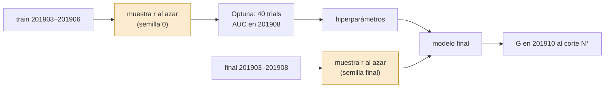
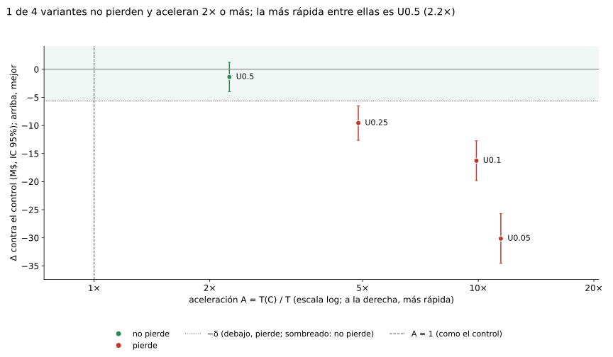
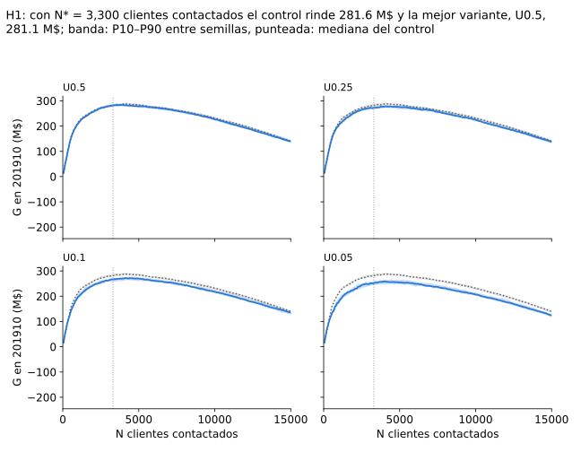
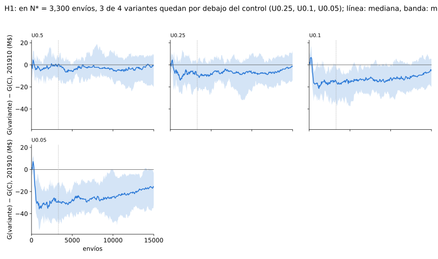

# H1 · Submuestreo uniforme del train

H1 prueba si entrenar con una fracción de las filas de train, tomadas al azar sin mirar la clase, acelera sin perder
ganancia.

## Idea

El costo de LightGBM crece con las filas: cada iteración arma histogramas sobre todo el train. Si el train tiene más filas
de las que el modelo necesita para ordenar bien a los clientes, quedarse con una fracción r al azar acelera tanto Optuna
como el modelo final y la ganancia casi no cambia. En algún r la muestra deja de alcanzar y la ganancia cae: H1 busca
dónde.

La muestra no distingue clase, así que la proporción de positivos queda igual. H1 achica el train en las dos etapas:
Optuna se corre de nuevo para cada tasa, sobre una muestra sorteada con la semilla 0, y el final entrena con la misma
tasa, sobre una muestra que se vuelve a sortear con cada semilla final.

## Predicción

!!! info "Predicción"
    Fijada el 2026-11-01 en `sampling_1/docs/hipotesis.md` (commit `2f05cae`) y pasada a `h1/docs/hipotesis.md` el
    2026-11-03 (commit `7c34254`), antes de cualquier corrida real. G, Δ, δ, T, A, N\* y los veredictos están en
    [Control y reglas](../control/README.md).

- **Variable**: tasa r de filas de train tomadas al azar sin distinguir clase, r ∈ {0,5, 0,25, 0,1, 0,05}.
- **Métrica que decide**: el veredicto de cada tasa contra el control.
- **Predicción**: *no pierde* con r = 0,5 y 0,25; *pierde* con r = 0,05. Como predicciones secundarias, que no deciden:
  *pierde* con r = 0,1, y A ≥ 2 con r = 0,25. La predicción en 201908 tiene un costo fijo, por eso la aceleración no es
  4×.
- **Se confirma** si con r = 0,5 y 0,25 la variante *no pierde* y con r = 0,05 *pierde*: hay margen y después hay caída.
- **Se refuta** si con r = 0,5 la variante *pierde* (no hay margen) o si con r = 0,05 *no pierde* (no hay caída dentro de
  la grilla).
- **Ninguna de las dos** en cualquier otro caso, por ejemplo con r = 0,25 *indeterminado* o con r = 0,25 perdiendo
  mientras r = 0,5 no pierde. Se informa como frontera observada la menor r tal que esa tasa y todas las mayores *no
  pierden*.

## Diseño

Lo que no se dice acá (máquina, parámetros fijos de LightGBM, semillas finales, métricas) es lo del
[control](../control/README.md).

### Variantes

| variante | Optuna: datos | Optuna: espacio | final: datos |
|---|---|---|---|
| `U0.5`, `U0.25`, `U0.1`, `U0.05` | muestra r, semilla 0 | 5 hp, el del control | muestra r, sorteada con la semilla final |

Un estudio de Optuna queda definido por sus datos de optimización y su espacio. `H3-0.25` optimiza exactamente lo mismo
que `U0.25` (muestra uniforme r = 0,25 con semilla 0, 5 hp, 40 trials, TPE con semilla 0), y `H3-0.1` lo mismo que
`U0.1`. Se corre un solo estudio y lo usan las dos variantes: H1 entrena el final con la muestra y H3 con todo. Las dos
se comparan contra el control y no entre sí, así que compartir el estudio no acopla ninguna decisión. El tiempo de ese
estudio entra en T de las dos. Los estudios `U0.25` y `U0.1` son de `h1` (su `ledger/hp/`) y [H3](../h3/README.md) los
lee de acá.

### Grilla

- **Optimización**: 4 estudios (`U0.5`, `U0.25`, `U0.1`, `U0.05`) × 40 trials, sin réplicas de optimización.
- **Finales**: 4 variantes × 20 semillas = 80 corridas, en la lista `fase7_r0` de la fase 7
  ([Corridas](../sampling_1/corridas.md)). La muestra de tasa r se sortea sobre los seis meses del final con la semilla
  final.

### Rondas

En la ronda 201903–201906 los finales eran 4 × 10 semillas = 40 corridas. La ronda vigente (201903–201908) no corre
estudios nuevos: reusa los cuatro y repite los finales con la ventana y las semillas nuevas. Los apartamientos (208135,
211210) están justificados en el [control](../control/README.md).

## Dependencias

- `control`: finales de `C`, N\* y δ.

## Resultado

<!-- generado:resultado -->
Generado por `comun/reporte.py` el 2026-11-13; no editar.

Final entrenado con 201903-201908, 20 semillas; N* = 3,300 clientes contactados (fijo, de la ronda anterior); δ = 5.65 M$. Vale la pena: no pierde y acelera 2× o más.

<table><tr><th>variante</th><th>G media (M$)</th><th>Δ [IC 95%] (M$)</th><th>semillas ganadas</th><th>ΔAUC [IC 95%]</th><th>T (s)</th><th>aceleración (×)</th><th>ganancia contra el control</th><th>vale la pena (no pierde y ≥ 2×)</th></tr><tr><td>C</td><td>282.48</td><td>—</td><td>—</td><td>—</td><td>797</td><td>1,00</td><td>—</td><td>—</td></tr><tr><td>U0.5</td><td>281.11</td><td class='mejor'>-1.38[-3.99; 1.24]</td><td>10/20</td><td class='sig-neg'>-0.0019[-0.0023; -0.0015]</td><td>354</td><td class='mejor'>2.25</td><td>no pierde</td><td>sí</td></tr><tr><td>U0.25</td><td>272.91</td><td class='sig-neg'>-9.57[-12.65; -6.49]</td><td>1/20</td><td class='sig-neg'>-0.0055[-0.0060; -0.0050]</td><td>164</td><td>4.87</td><td>pierde</td><td>no</td></tr><tr><td>U0.1</td><td>266.20</td><td class='sig-neg'>-16.28[-19.83; -12.73]</td><td>0/20</td><td class='sig-neg'>-0.0103[-0.0111; -0.0095]</td><td>81</td><td>9.89</td><td>pierde</td><td>no</td></tr><tr><td>U0.05</td><td>252.34</td><td class='sig-neg'>-30.14[-34.56; -25.72]</td><td>0/20</td><td class='sig-neg'>-0.0176[-0.0186; -0.0166]</td><td>70</td><td>11.45</td><td>pierde</td><td>no</td></tr></table>
Todas las variantes con 20 semillas.

<!-- /generado:resultado -->

## Veredicto

!!! success "Veredicto: ninguna de las dos"
    `U0.5` *no pierde*, pero `U0.25` ya *pierde*, así que la predicción para r = 0,25 no se cumple. La frontera observada
    es r = 0,5: la menor tasa que *no pierde* con todas las mayores. La pérdida crece a medida que baja r, y el AUC en
    201910 va en la misma dirección que la ganancia en las cuatro tasas: menos filas ordena peor y gana menos. En la
    ronda anterior `U0.5` quedaba *indeterminado* y no había frontera: con 20 semillas el IC se angosta lo suficiente
    para decidir.

    Entrenar con menos filas al azar pierde desde r = 0,25; solo r = 0,5 *no pierde*, con A = 2,25.

## Limitaciones

!!! warning "Limitación"
    Una sola semilla de Optuna por variante: Δ incluye la suerte de la optimización y el IC no la mide.

!!! warning "Limitación"
    Los estudios de `U0.25` y `U0.1` los usa también H3: Δ(`U0.25`) y Δ(`H3-0.25`) no son evidencia independiente entre
    sí.
