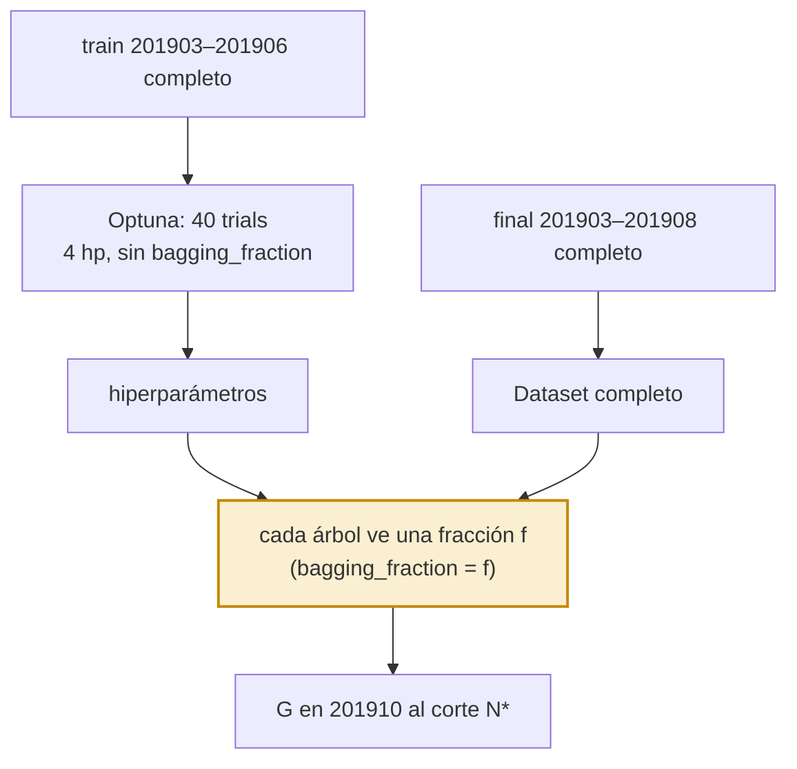
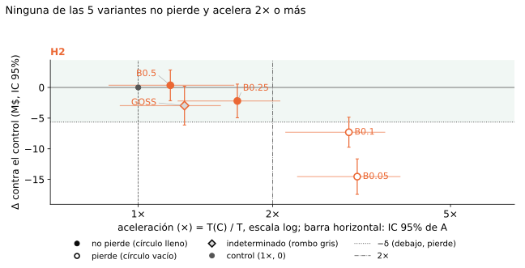
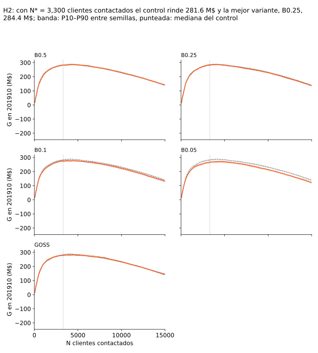
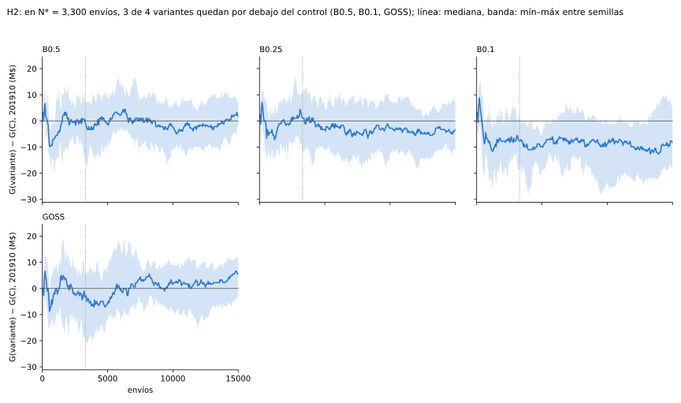

# H2 · Muestrear dentro de LightGBM

H2 prueba si dejar que LightGBM muestree filas en cada árbol (`bagging_fraction` fijo y bajo), en lugar de achicar el
train antes, acelera sin perder ganancia.

Responde a **dónde achicar**: dentro de LightGBM, sin tocar el train
([Resultados](../sampling_1/README.md#donde-achicar) § ¿Dónde achicar?).

## Idea

LightGBM ya sabe muestrear: con `bagging_fraction = f` y `bagging_freq = 1`, cada árbol se arma con una fracción f de
las filas, distinta en cada iteración, pero el modelo en conjunto ve todas. Si el costo está en armar los árboles, fijar
f bajo acelera, y como ninguna fila queda afuera del todo, la ganancia debería aguantar más que con el muestreo previo
de [H1](../h1/README.md).

En el baseline `bagging_fraction` es uno de los cinco hiperparámetros que optimiza Optuna. En H2 es la variable
experimental, así que sale del espacio y Optuna busca los otros cuatro con los mismos rangos. El train y el `Dataset`
quedan completos.

GOSS es otra forma de muestrear dentro de LightGBM: se queda con las filas de gradiente alto y una parte al azar del
resto. Va como variante descriptiva, que no decide H2.

## Predicción

!!! info "Predicción"
    Fijada el 2026-11-01 en `sampling_1/docs/hipotesis.md` (commit `2f05cae`) y pasada a `h2/docs/hipotesis.md` el
    2026-11-03 (commit `7c34254`), antes de cualquier corrida real. G, Δ, δ, T, A, N\* y los veredictos están en
    [Control y reglas](../control/README.md).

- **Variable**: `bagging_fraction` fijo en f ∈ {0,5, 0,25, 0,1}, con `bagging_freq = 1`.
- **Adaptación declarada del baseline**: en estas variantes `bagging_fraction` es la variable experimental, así que sale
  del espacio de Optuna; los otros cuatro hiperparámetros se siguen optimizando con los mismos rangos.
- **Métrica que decide**: el veredicto de cada f contra el control.
- **Predicción**: *no pierde* con las tres fracciones, también con f = 0,1, donde H1 predice que el muestreo previo
  pierde. Como predicción secundaria, que no decide: A ≥ 1,5 con f = 0,1, porque el `Dataset` completo se construye
  igual.
- **Se confirma** si con f = 0,1 *no pierde*.
- **Se refuta** si con f = 0,1 *pierde*.
- **Ninguna de las dos** si con f = 0,1 sale *indeterminado*.
- **Lectura conjunta con H1, descriptiva**: en el mapa del tradeoff se mira si los puntos de `bagging` quedan por encima
  de los de `uniforme` al mismo tiempo. No es una prueba, porque `uniforme` sigue optimizando `bagging_fraction` y no
  tiene la misma fracción efectiva por iteración.
- **Variante descriptiva `GOSS`** (`top_rate = 0,2`, `other_rate = 0,1`, sin bagging porque LightGBM no lo admite): se
  reporta su veredicto contra el control, pero no decide H2. A partir de la iteración 1/`learning_rate` usa un 30% de
  filas por iteración; antes no muestrea. También cambia la mezcla de clases de cada árbol, porque se queda con los
  casos de gradiente alto.

### Réplicas de H2 y `B0.05` (cambio `tiempos-confiables-y-consistencia`, 13-nov-2026)

Escrito el 13-nov-2026, antes de cualquier corrida de la fase 8, y revisado en sesión limpia antes de la primera. Lo de
arriba no se reescribe. Esta sección suma 8 réplicas de optimización a `B0.5`, `B0.25`, `B0.1` y `GOSS`, y una fracción
nueva, `B0.05`, para que H2 tenga las cuatro tasas de la grilla común ([`sampling_1/corridas.md`](../sampling_1/corridas.md)
§ Fases).

**Origen: se agrega después de ver 201910.** Las réplicas y `B0.05` se deciden después de ver en 201910 todas las celdas
vecinas. Entran todas juntas, con predicción y regla escritas acá antes de correr, y ninguna se elige ni se descarta por
su resultado. El informe lo lista entre las limitaciones ("Ideas que vienen de mirar el test").

- **Qué se corre.** `B0.05`: `bagging_fraction` fijo en 0,05 con `bagging_freq = 1`, fuera del espacio de Optuna como
  las otras `B`. Estudios `B{f}@k` y `GOSS@k` y 20 semillas finales por réplica, k = 0…7 (k = 0 solo falta para
  `B0.05`).
- **Qué se mide.** Ronda 201903–201908 ([`control`](../control/README.md) § Predicción de la ronda 201903–201908): 20
  semillas finales, N\* = 3.300 y δ = 0,02 · Ḡ_C de esa ronda (5,65 M$). Δ con réplicas e IC de Welch como en
  [`h3`](../h3/README.md) § H3 con réplicas de optimización. A con una sola referencia y T como mediana entre réplicas
  ([`control`](../control/README.md) § Medición de tiempos). El veredicto con réplicas reemplaza al de la réplica 0; el
  de la réplica 0 se sigue informando.
- **Predicción.** Con réplicas, `B0.5` y `B0.25` *no pierden* con A < 2; `B0.1` y `B0.05` *pierden*. O sea, ninguna `B`
  vale la pena (*no pierde* y A ≥ 2). Con la regla de A de una sola referencia, en la réplica 0 `B0.1` ya tenía A ≥ 2 y
  `B0.25`, A < 2 (cuenta de la sesión de diseño, sin tabla generada; los A con réplicas están en § Veredicto).
- **Se confirma** si se cumplen las cuatro partes. **Se refuta** si alguna `B` vale la pena, o si `B0.5` o `B0.25`
  *pierde*. **Ninguna de las dos** en otro caso (alguna *indeterminado*, o `B0.1` o `B0.05` *no pierde* con A < 2).
- La regla de H2 de arriba (sobre `B0.1`) se vuelve a decidir con el Δ con réplicas y se informa al lado del veredicto de
  la réplica 0.
- **`GOSS`** recibe réplicas y se informa sin regla, como hasta ahora.
- **H2 no entra en los pares directos** de la grilla común: `bagging_fraction` sale del espacio de Optuna en las `B`, así
  que la comparación con `U*` sigue siendo descriptiva. La tabla de cobertura la muestra al lado.

## Diseño

Lo que no se dice acá (máquina, parámetros fijos de LightGBM, semillas finales, métricas) es lo del
[control](../control/README.md).

### Variantes

| variante | Optuna: espacio | final: parámetros fijos |
|---|---|---|
| `B0.5`, `B0.25`, `B0.1`, `B0.05` | 4 hp (sin `bagging_fraction`) | `bagging_fraction = f`, `bagging_freq = 1` |
| `GOSS` (descriptiva) | 4 hp (sin `bagging_fraction`) | `data_sample_strategy = goss`, `top_rate = 0,2`, `other_rate = 0,1` |

Todas optimizan y entrenan con train completo (r = 1). «4 hp» son los rangos del espacio del control sin
`bagging_fraction`. En `GOSS` sale porque LightGBM no admite bagging con GOSS; es la misma adaptación que en `B*` y se
declara igual.

### Grilla

- **Optimización**: `B0.5`, `B0.25`, `B0.1`, `B0.05` y `GOSS` con 8 réplicas de optimización (k = 0…7), 40 trials cada
  una. Réplica k: TPE con semilla k; no hay muestra previa que sortear. Son 36 estudios nuevos además de los de la
  réplica 0 (`B0.05` en k = 0 y `B{f}@k` y `GOSS@k` en k = 1…7), todos sobre el train completo con el espacio de 4 hp.
- **Finales**: 20 semillas por réplica, con la ventana 201903–201908: 80 corridas en la réplica 0 más 720 nuevas
  (`B0.05` en k = 0 y las cinco variantes en k = 1…7), en las listas `fase7_r0` y `fase8_r0_b` … `fase8_r7_b`
  ([Fases](../sampling_1/corridas.md) § Fases). Ninguna lista `_a` lee nada de una `_b`.
- **T y A**: T como mediana entre réplicas y A con una sola referencia ([`control`](../control/README.md) § Medición de
  tiempos).
- **Grilla común**: H2 forma la fila «dentro de LightGBM», al lado de las otras y sin pares directos: `bagging_fraction`
  sale del espacio de Optuna en las `B`, así que la comparación con `U*` es descriptiva.

Los apartamientos de la consigna (208135, 211210) están justificados en el [control](../control/README.md).

## Dependencias

- `control`: finales de `C`, N\* y δ.

## Resultado

<!-- generado:resultado -->
Final entrenado con 201903-201908, 20 semillas; N* = 3,300 clientes contactados (fijo, de la ronda anterior); δ = 5.65 M$. Vale la pena: no pierde y acelera 2× o más.

<table><tr><th>variante</th><th>R</th><th>G media (M$)</th><th>Δ [IC 95%] (M$)</th><th>ΔAUC [IC 95%]</th><th>T mediana (s)</th><th>aceleración (×)</th><th>ganancia contra el control</th><th>vale la pena (no pierde y ≥ 2×)</th></tr><tr><td>C</td><td>—</td><td>281.78</td><td>—</td><td>—</td><td>1,002</td><td>1.00</td><td>—</td><td>—</td></tr><tr><td>B0.5</td><td>8</td><td>282.13</td><td class='mejor'>0.35[-2.16; 2.86]</td><td>-0.0005[-0.0015; +0.0004]</td><td>849</td><td>1.18[0.86; 1.64]</td><td>no pierde</td><td>no</td></tr><tr><td>B0.25</td><td>8</td><td>279.58</td><td>-2.20[-4.95; 0.55]</td><td class='sig-neg'>-0.0026[-0.0038; -0.0015]</td><td>601</td><td class='mejor'>1.67[1.23; 2.08]</td><td>no pierde</td><td>no</td></tr><tr><td>B0.1</td><td>8</td><td>274.47</td><td class='sig-neg'>-7.31[-9.76; -4.86]</td><td class='sig-neg'>-0.0068[-0.0079; -0.0056]</td><td>338</td><td>2.96[2.13; 3.57]</td><td>pierde</td><td>no</td></tr><tr><td>B0.05</td><td>8</td><td>267.23</td><td class='sig-neg'>-14.55[-17.44; -11.66]</td><td class='sig-neg'>-0.0109[-0.0124; -0.0093]</td><td>324</td><td>3.09[2.27; 3.86]</td><td>pierde</td><td>no</td></tr><tr><td>GOSS</td><td>8</td><td>278.82</td><td>-2.96[-6.13; 0.21]</td><td>+0.0003[-0.0008; +0.0014]</td><td>790</td><td>1.27[0.91; 1.53]</td><td>indeterminado</td><td>no</td></tr></table>

<!-- /generado:resultado -->

## Veredicto

!!! success "Veredicto con réplicas: refutada, y ninguna `B` vale la pena"
    Con 8 réplicas, `B0.1` *pierde* (−7,31 [−9,76; −4,86]), así que la regla de H2 queda **refutada**. `B0.5` (0,35) y
    `B0.25` (−2,20) *no pierden*, con A = 1,18 [0,86; 1,64] y 1,67 [1,23; 2,08]; `B0.1` y `B0.05` (−14,55) *pierden*,
    con A = 2,96 [2,13; 3,57] y 3,09 [2,27; 3,86]. `GOSS` queda *indeterminado*, con A = 1,27 [0,91; 1,53]. Las cifras
    salen del bloque A de [Resultados](../sampling_1/README.md), con una sola referencia de T del control.

    Muestrear dentro de LightGBM ahorra poco donde no pierde: el `Dataset` completo se arma igual, y A pasa de 2 solo en
    las fracciones que pierden. El AUC mide el orden de todos los clientes y G solo los 3.300 de arriba; el veredicto es
    el de ganancia.

    - Con f = 0,1 *no pierde*: **no se cumplió** (`B0.1` *pierde*).
    - A ≥ 1,5 con f = 0,1 (secundaria): **se cumplió**, con A = 2,96.
    - Réplicas: `B0.5` y `B0.25` *no pierden* con A < 2: **se cumplió**.
    - Réplicas: `B0.1` y `B0.05` *pierden*: **se cumplió**.
    - Réplicas: ninguna `B` vale la pena: **se cumplió**.

## Limitaciones

- **GOSS es descriptiva.** `GOSS` es descriptiva: no tiene una regla que decida, y su fila se lee como referencia y no como veredicto de H2.
    Cambia la mezcla de clases por iteración. Si Optuna elige `learning_rate` cerca de 0,01, las 100 iteraciones caen
    antes de 1/`learning_rate` y GOSS nunca muestrea.

- **`bagging_fraction` fuera de Optuna.** En las variantes `B*`, `bagging_fraction` es la variable y sale del espacio de Optuna, mientras que el control y
    `uniforme` la siguen optimizando. Por eso `bagging` y `uniforme` no tienen la misma fracción efectiva por iteración y
    la comparación entre ellas es solo descriptiva.

- **Réplica 0 aparte.** La tabla de la réplica 0 (una sola búsqueda por variante) está en el Anexo: su Δ incluye la suerte
  de la optimización y el IC no la mide. La tabla de § Resultado usa las 8 réplicas.

- **Réplicas y `B0.05` agregadas después de mirar 201910.** Se decidieron después de ver el test en las celdas vecinas,
  todas juntas y con regla previa. Sus veredictos se suman a los de la grilla común sin corrección por comparaciones
  múltiples.
