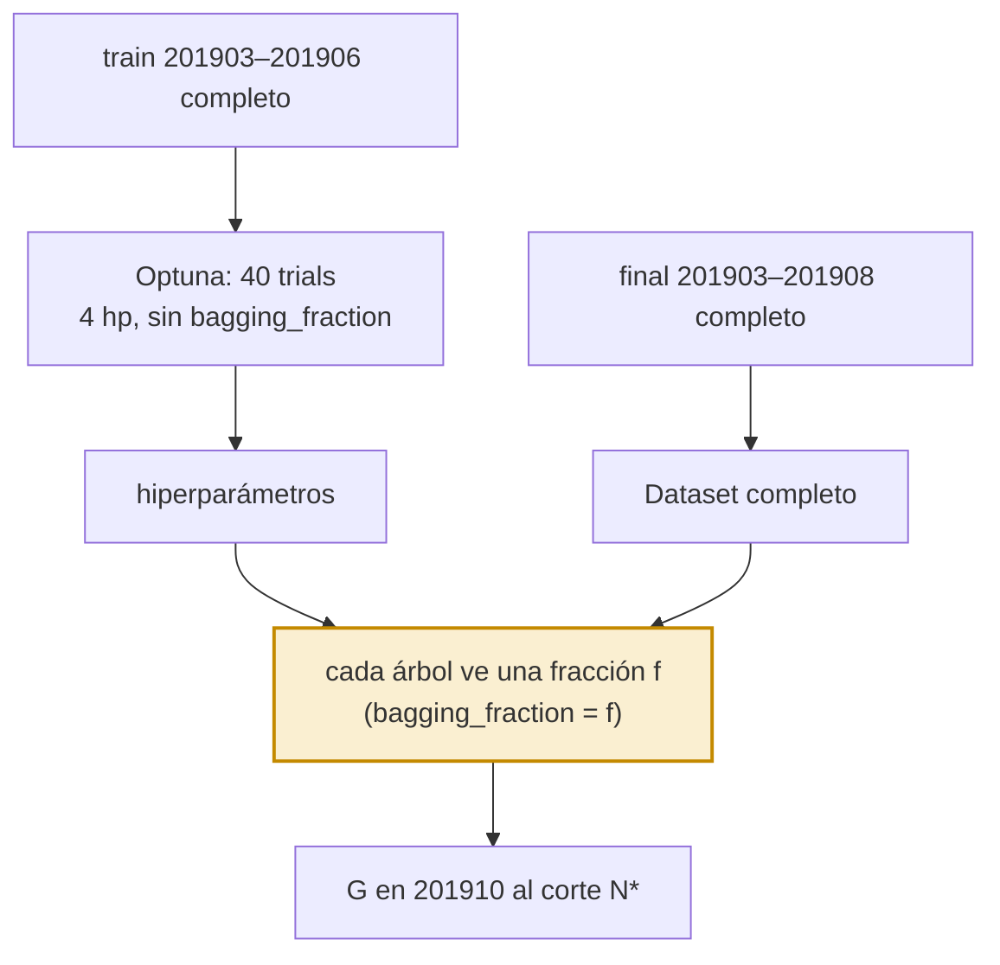
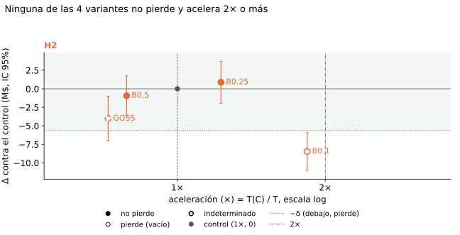
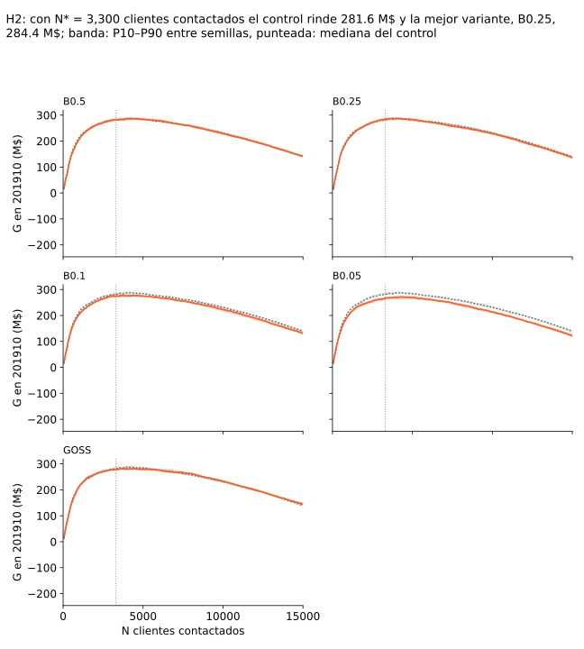
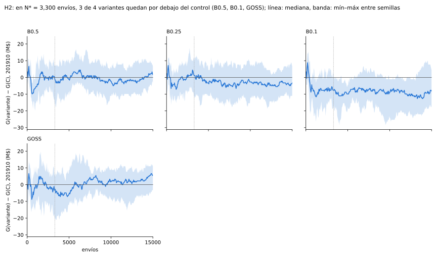

# H2 · Muestrear dentro de LightGBM

H2 prueba si dejar que LightGBM muestree filas en cada árbol (`bagging_fraction` fijo y bajo), en lugar de achicar el
train antes, acelera sin perder ganancia.

## Idea

LightGBM ya sabe muestrear: con `bagging_fraction = f` y `bagging_freq = 1`, cada árbol se arma con una fracción f de
las filas, distinta en cada iteración, pero el modelo en conjunto ve todas. Si el costo está en armar los árboles, fijar
f bajo acelera, y como ninguna fila queda afuera del todo, la ganancia debería aguantar más que con el muestreo previo
de [H1](../h1/README.md).

En el baseline `bagging_fraction` es uno de los cinco hiperparámetros que optimiza Optuna. En H2 es la variable
experimental, así que sale del espacio y Optuna busca los otros cuatro con los mismos rangos. El train y el `Dataset`
quedan completos.

GOSS es otra forma de muestrear dentro de LightGBM: se queda con las filas de gradiente alto y una parte al azar del
resto. Va como variante descriptiva, que no decide H2.

## Predicción

!!! info "Predicción"
    Fijada el 2026-11-01 en `sampling_1/docs/hipotesis.md` (commit `2f05cae`) y pasada a `h2/docs/hipotesis.md` el
    2026-11-03 (commit `7c34254`), antes de cualquier corrida real. G, Δ, δ, T, A, N\* y los veredictos están en
    [Control y reglas](../control/README.md).

- **Variable**: `bagging_fraction` fijo en f ∈ {0,5, 0,25, 0,1}, con `bagging_freq = 1`.
- **Adaptación declarada del baseline**: en estas variantes `bagging_fraction` es la variable experimental, así que sale
  del espacio de Optuna; los otros cuatro hiperparámetros se siguen optimizando con los mismos rangos.
- **Métrica que decide**: el veredicto de cada f contra el control.
- **Predicción**: *no pierde* con las tres fracciones, también con f = 0,1, donde H1 predice que el muestreo previo
  pierde. Como predicción secundaria, que no decide: A ≥ 1,5 con f = 0,1, porque el `Dataset` completo se construye
  igual.
- **Se confirma** si con f = 0,1 *no pierde*.
- **Se refuta** si con f = 0,1 *pierde*.
- **Ninguna de las dos** si con f = 0,1 sale *indeterminado*.
- **Lectura conjunta con H1, descriptiva**: en el mapa del tradeoff se mira si los puntos de `bagging` quedan por encima
  de los de `uniforme` al mismo tiempo. No es una prueba, porque `uniforme` sigue optimizando `bagging_fraction` y no
  tiene la misma fracción efectiva por iteración.
- **Variante descriptiva `GOSS`** (`top_rate = 0,2`, `other_rate = 0,1`, sin bagging porque LightGBM no lo admite): se
  reporta su veredicto contra el control, pero no decide H2. A partir de la iteración 1/`learning_rate` usa un 30% de
  filas por iteración; antes no muestrea. También cambia la mezcla de clases de cada árbol, porque se queda con los
  casos de gradiente alto.

### Réplicas de H2 y `B0.05` (cambio `tiempos-confiables-y-consistencia`, 13-nov-2026)

Escrito el 13-nov-2026, antes de cualquier corrida de la fase 8, y revisado en sesión limpia antes de la primera. Lo de
arriba no se reescribe. Esta sección suma 8 réplicas de optimización a `B0.5`, `B0.25`, `B0.1` y `GOSS`, y una fracción
nueva, `B0.05`, para que H2 tenga las cuatro tasas de la grilla común ([`sampling_1/corridas.md`](../sampling_1/corridas.md)
§ Fases).

**Origen: se agrega después de ver 201910.** Las réplicas y `B0.05` se deciden después de ver en 201910 todas las celdas
vecinas. Entran todas juntas, con predicción y regla escritas acá antes de correr, y ninguna se elige ni se descarta por
su resultado. El informe lo lista entre las limitaciones ("Ideas que vienen de mirar el test").

- **Qué se corre.** `B0.05`: `bagging_fraction` fijo en 0,05 con `bagging_freq = 1`, fuera del espacio de Optuna como
  las otras `B`. Estudios `B{f}@k` y `GOSS@k` y 20 semillas finales por réplica, k = 0…7 (k = 0 solo falta para
  `B0.05`).
- **Qué se mide.** Ronda 201903–201908 ([`control`](../control/README.md) § Predicción de la ronda 201903–201908): 20
  semillas finales, N\* = 3.300 y δ = 0,02 · Ḡ_C de esa ronda (5,65 M$). Δ con réplicas e IC de Welch como en
  [`h3`](../h3/README.md) § H3 con réplicas de optimización. A con una sola referencia y T como mediana entre réplicas
  ([`control`](../control/README.md) § Medición de tiempos). El veredicto con réplicas reemplaza al de la réplica 0; el
  de la réplica 0 se sigue informando.
- **Predicción.** Con réplicas, `B0.5` y `B0.25` *no pierden* con A < 2; `B0.1` y `B0.05` *pierden*. O sea, ninguna `B`
  vale la pena (*no pierde* y A ≥ 2). Con la regla de A de una sola referencia, en la réplica 0 `B0.1` ya tiene A = 2,31
  y `B0.25`, 1,54.
- **Se confirma** si se cumplen las cuatro partes. **Se refuta** si alguna `B` vale la pena, o si `B0.5` o `B0.25`
  *pierde*. **Ninguna de las dos** en otro caso (alguna *indeterminado*, o `B0.1` o `B0.05` *no pierde* con A < 2).
- La regla de H2 de arriba (sobre `B0.1`) se vuelve a decidir con el Δ con réplicas y se informa al lado del veredicto de
  la réplica 0.
- **`GOSS`** recibe réplicas y se informa sin regla, como hasta ahora.
- **H2 no entra en los pares directos** de la grilla común: `bagging_fraction` sale del espacio de Optuna en las `B`, así
  que la comparación con `U*` sigue siendo descriptiva. La tabla de cobertura la muestra al lado.

## Diseño

Lo que no se dice acá (máquina, parámetros fijos de LightGBM, semillas finales, métricas) es lo del
[control](../control/README.md).

### Variantes

| variante | Optuna: espacio | final: parámetros fijos |
|---|---|---|
| `B0.5`, `B0.25`, `B0.1` | 4 hp (sin `bagging_fraction`) | `bagging_fraction = f`, `bagging_freq = 1` |
| `GOSS` (descriptiva) | 4 hp (sin `bagging_fraction`) | `data_sample_strategy = goss`, `top_rate = 0,2`, `other_rate = 0,1` |

Todas optimizan y entrenan con train completo (r = 1). «4 hp» son los rangos del espacio del control sin
`bagging_fraction`. En `GOSS` sale porque LightGBM no admite bagging con GOSS; es la misma adaptación que en `B*` y se
declara igual.

### Grilla

- **Optimización**: 4 estudios (`B0.5`, `B0.25`, `B0.1`, `GOSS`) × 40 trials, sin réplicas de optimización.
- **Finales**: 4 variantes × 20 semillas = 80 corridas, en la lista `fase7_r0` de la fase 7
  ([Corridas](../sampling_1/corridas.md)).
- **Fuera de la grilla**: si la devolución del curso pide mantener `bagging_fraction` optimizado, salen `B0.5`, `B0.25` y
  `B0.1`, y H2 queda solo con `GOSS`. H1 y H3 no cambian.

### Rondas

En la ronda 201903–201906 los finales eran 4 × 10 semillas = 40 corridas. La ronda vigente (201903–201908) no corre
estudios nuevos: reusa los cuatro y repite los finales con la ventana y las semillas nuevas. Los apartamientos (208135,
211210) están justificados en el [control](../control/README.md).

### Réplicas y `B0.05` (cambio `tiempos-confiables-y-consistencia`, 13-nov-2026)

Predicción y regla: § Réplicas de H2 y `B0.05`. H2 forma la fila "dentro de LightGBM" de la grilla común
([`sampling_1/corridas.md`](../sampling_1/corridas.md) § Fases), al lado de las otras y sin pares directos.

| variante | método | tasa | estudio (k = 0 / k ≥ 1) | final: params fijos |
|---|---|---|---|---|
| `B0.05` | `bagging` | 0,05 | `B0.05` / `B0.05@k` | `bagging_fraction = 0,05`, `bagging_freq = 1` |

- **Réplicas**: `B0.5`, `B0.25`, `B0.1`, `B0.05` y `GOSS` con 8 réplicas (k = 0…7). Réplica k: TPE con semilla k; no
  hay muestra previa que sortear.
- **Estudios nuevos**: `B0.05` en k = 0 y `B{f}@k` y `GOSS@k` en k = 1…7: 1 + 5 × 7 = **36 estudios**, todos sobre el
  train completo con el espacio de 4 hp.
- **Finales nuevos**, con las 20 semillas de la ronda 201903–201908: `B0.05` en k = 0 y las cinco variantes en
  k = 1…7: 20 + 5 × 7 × 20 = **720 finales**.
- **T y A**: T como mediana entre réplicas y A con una sola referencia ([`control`](../control/README.md) § Medición de
  tiempos).
- Van en las listas `fase8_r0_b` … `fase8_r7_b` de la fase 8 ([`sampling_1/corridas.md`](../sampling_1/corridas.md)
  § Fases). Ninguna lista `_a` lee nada de una `_b`.
- Las réplicas de `B*` y `GOSS`, que `h3` dejaba fuera de la grilla, entran ahora.

## Dependencias

- `control`: finales de `C`, N\* y δ.

## Resultado

<!-- generado:resultado -->
Generado por `comun/reporte.py` el 2026-11-14; no editar.

Final entrenado con 201903-201908, 20 semillas; N* = 3,300 clientes contactados (fijo, de la ronda anterior); δ = 5.65 M$. Vale la pena: no pierde y acelera 2× o más.

<table><tr><th>variante</th><th>G media (M$)</th><th>Δ [IC 95%] (M$)</th><th>semillas ganadas</th><th>ΔAUC [IC 95%]</th><th>T (s)</th><th>aceleración (×)</th><th>ganancia contra el control</th><th>vale la pena (no pierde y ≥ 2×)</th></tr><tr><td>C</td><td>282.48</td><td>—</td><td>—</td><td>—</td><td>797</td><td>1.00</td><td>—</td><td>—</td></tr><tr><td>B0.5</td><td>281.55</td><td>-0.94[-3.62; 1.75]</td><td>8/20</td><td class='sig-neg'>-0.0012[-0.0017; -0.0008]</td><td>1,011</td><td>0.79</td><td>no pierde</td><td>no</td></tr><tr><td>B0.25</td><td>283.36</td><td class='mejor'>0.88[-1.95; 3.71]</td><td>10/20</td><td class='sig-neg'>-0.0044[-0.0047; -0.0041]</td><td>650</td><td class='mejor'>1.23</td><td>no pierde</td><td>no</td></tr><tr><td>B0.1</td><td>274.01</td><td class='sig-neg'>-8.47[-11.02; -5.92]</td><td>1/20</td><td class='sig-neg'>-0.0088[-0.0094; -0.0083]</td><td>434</td><td>1.84</td><td>pierde</td><td>no</td></tr><tr><td>B0.05</td><td>266.14</td><td class='sig-neg'>-16.34[-19.86; -12.81]</td><td>0/20</td><td class='sig-neg'>-0.0141[-0.0148; -0.0135]</td><td>341</td><td>2.33</td><td>pierde</td><td>no</td></tr><tr><td>GOSS</td><td>278.46</td><td class='sig-neg'>-4.01[-7.03; -1.00]</td><td>5/20</td><td class='sig-pos'>+0.0005[+0.0003; +0.0008]</td><td>1,102</td><td>0.72</td><td>indeterminado</td><td>no</td></tr></table>
Todas las variantes con 20 semillas.

<!-- /generado:resultado -->

## Veredicto

!!! success "Veredicto: refutada"
    Con f = 0,1 pierde. Con 0,5 y 0,25 no pierde, pero casi no acelera (A ≤ 1,23), porque el `Dataset` completo se arma
    igual. `GOSS` queda *indeterminado* (en la ronda anterior, *no pierde*) y es más lento que el control.

    El AUC y la ganancia van en direcciones distintas en dos variantes. En `B0.25`, Δ de ganancia positivo (0,88 M$) con
    ΔAUC negativo y distinguible de 0 (−0,0044); en `GOSS`, al revés: ΔAUC positivo y distinguible de 0 (+0,0005) con Δ
    de ganancia negativo (−4,01 M$, IC debajo de 0). El AUC mide el orden de todos los clientes y G solo los 3.300 de
    arriba; el veredicto es el de ganancia.

    Muestrear dentro de LightGBM no ahorra tiempo: el `Dataset` completo se arma igual, así que A queda en 1,84 o menos
    aun con f = 0,1, donde además pierde.

## Limitaciones

- **GOSS es descriptiva.** `GOSS` es descriptiva: no tiene una regla que decida, y su fila se lee como referencia y no como veredicto de H2.
    Cambia la mezcla de clases por iteración. Si Optuna elige `learning_rate` cerca de 0,01, las 100 iteraciones caen
    antes de 1/`learning_rate` y GOSS nunca muestrea.

- **`bagging_fraction` fuera de Optuna.** En las variantes `B*`, `bagging_fraction` es la variable y sale del espacio de Optuna, mientras que el control y
    `uniforme` la siguen optimizando. Por eso `bagging` y `uniforme` no tienen la misma fracción efectiva por iteración y
    la comparación entre ellas es solo descriptiva.

- **Una sola búsqueda por variante.** Una sola semilla de Optuna por variante: Δ incluye la suerte de la optimización y el IC no la mide.
