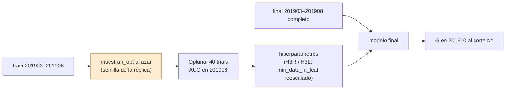
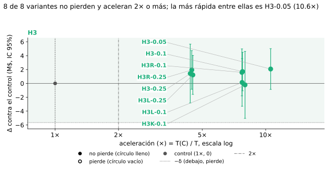
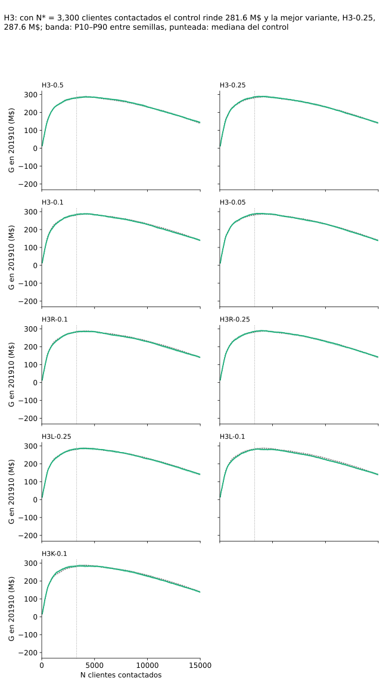
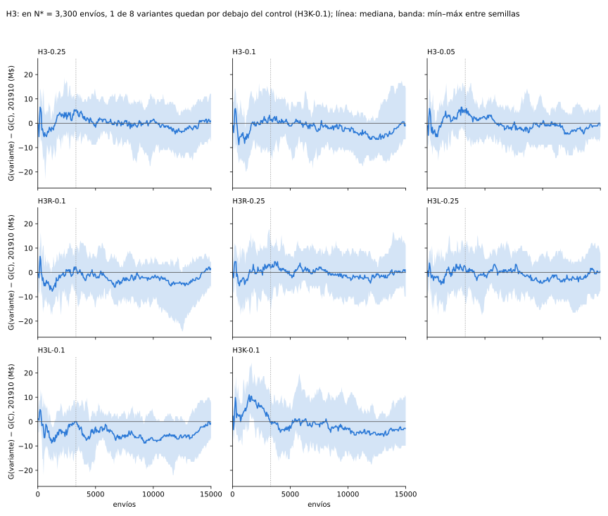

# H3 · Optimizar sobre una muestra, entrenar con todo

H3 prueba si alcanza con correr Optuna sobre una muestra chica del train y entrenar el modelo final con todas las filas.

## Idea

En el baseline, casi todo el tiempo se va en Optuna: 40 trials, cada uno un entrenamiento entero. El modelo final es un
solo entrenamiento. Si los hiperparámetros que elige Optuna sobre una muestra al azar sirven también para el train
completo, se puede achicar solo la búsqueda: se acelera casi tanto como con [H1](../h1/README.md) y el final no pierde
filas.

El riesgo conocido es `min_data_in_leaf`, que es absoluto: el valor que se elige sobre la muestra puede quedar chico
para el train completo. Por eso se suman variantes que lo reescalan (`H3R`, raíz; `H3L`, lineal). Como la suerte de
Optuna pesa en el resultado, cada variante se repite con 8 réplicas de la optimización.

H3 achica solo la optimización: el final entrena con todas las filas.

## Predicción

Las reglas comunes (G, Δ, δ, T, A, N\*, veredictos) están en [Control y reglas](../control/README.md). H3 se fijó en tres
momentos, cada uno antes de las corridas que decide; lo anterior no se cambió al sumar lo nuevo.

### H3 (réplica 0)

!!! info "Predicción"
    Fijada el 1-nov en `sampling_1/docs/hipotesis.md` (commit `2f05cae`) y pasada a `h3/docs/hipotesis.md` el 3-nov
    (commit `7c34254`), antes de cualquier corrida real.

- **Variable**: tasa de la muestra uniforme sobre la que corre Optuna, r_opt ∈ {0,1, 0,25}. La muestra de optimización
  se sortea con la semilla 0. El modelo final se entrena con r = 1 y con los hiperparámetros tal como salen de la
  muestra, sin reescalar `min_data_in_leaf`.
- **Métrica que decide**: el veredicto de cada r_opt contra el control.
- **Predicción**: *no pierde* con ambas tasas. Como predicción secundaria, que no decide: A ≥ 2 con r_opt = 0,25 y
  A ≥ 4 con r_opt = 0,1.
- **Se confirma** si con r_opt = 0,25 *no pierde*.
- **Se refuta** si con r_opt = 0,25 *pierde*.
- **Ninguna de las dos** si con r_opt = 0,25 sale *indeterminado*.
- **Riesgo conocido**: el `min_data_in_leaf` que se elige sobre la muestra queda chico para el train completo. Si eso
  hace perder a r_opt = 0,1, el reescalado se propone como trabajo futuro y no como una variante nueva. (El 8-nov el
  reescalado entró como variante fijada de antemano, `H3R-0.1`, en § H3 con réplicas.)

### H3 con réplicas de optimización

!!! info "Predicción"
    Fijada el 8-nov (cambio `h3-semillas-optuna`, commit `ca60a45`), antes de cualquier corrida con réplicas, y revisada en sesión limpia
    antes de la primera. Lo de la réplica 0 no cambia. Esta parte suma réplicas de la optimización para medir la suerte
    de Optuna, que el IC por semilla no ve.

**Qué queda fijo.** δ = 5,52 M$ (δ = 0,02 · Ḡ_C con Ḡ_C = 276,10 M$, la media del control en la réplica 0 de la ronda
201903–201906) y N\* = 3.300 no se recalculan con las réplicas nuevas de `C`. R = 8 réplicas (k = 0…7) queda cerrado: no
se agregan réplicas después de mirar resultados, aunque el IC quede ancho (§ Diseño › Grilla). El espacio de Optuna, los
40 trials, las semillas finales y los veredictos son los del control. En la ronda vigente las reglas se aplican con el δ
de la ronda (§ Diseño › Rondas).

**Qué es una réplica y cómo se mide.**

- **Réplica k**: la semilla del sampler TPE y la del sorteo de la muestra de optimización valen k. La réplica 0 es la ya
  corrida. Las semillas finales son las mismas en todas las réplicas.
- **Ḡ_{v,k}**: media de G en las semillas finales de la variante v en la réplica k.
- **Δ con réplicas**: media_k Ḡ_{v,k} − media_k Ḡ_{C,k}, con IC 95% de Welch entre las réplicas de cada uno (sin aparear
  por k: la réplica k de `C` y la de H3 no comparten datos). El veredicto se toma de este Δ con las reglas comunes.
- **Descomposición de la varianza** de G de cada variante: var_entre(Ḡ_{v,k}) + media_k var_dentro, con la suma de
  cuadrados exacta. Se informa; no decide ningún veredicto.

**Reglas.**

1. **H3 con réplicas** (`H3-0.1` y `H3-0.25`).
   - **Predicción**: las dos *no pierden* con réplicas: cota inferior del IC de Welch de Δ con réplicas ≥ −δ.
   - **Se confirma** la respuesta del experimento (el tradeoff vale la pena) si las dos cumplen esa regla.
   - **Se corrige** la conclusión si alguna sale *pierde* (media de Δ con réplicas < −δ) o *indeterminado* (cota
     inferior < −δ y media ≥ −δ).
2. **A contra B** (el mecanismo), sobre `H3-0.1`:
   - **Apoya (A), la muestra regulariza**: Δ con réplicas *gana* (cota inferior del IC de Welch > 0) **y** la mediana de
     `feature_fraction` entre las 8 réplicas es menor en `H3-0.1` (estudios `U0.1`, `U0.1@k`) que en `C` (estudios `C`,
     `C@k`).
   - **Apoya (B), el control tuvo mala suerte**: el IC de Welch de Δ con réplicas contiene a 0 **y** Ḡ_{C,0} queda debajo
     de la mediana de las 8 Ḡ_{C,k}.
   - **Cualquier otro resultado**: «mecanismo sin resolver». La respuesta práctica sale de la regla 1.
3. **`H3-0.05`** (Optuna sobre la muestra del 5 %, estudios `U0.05` / `U0.05@k`, final con r = 1).
   - **Predicción**: *no pierde* con réplicas **y** A ≥ 8, con A = T(`C`) / T(`H3-0.05`) y la T de cada una como mediana
     entre sus 8 réplicas.
   - **Se confirma** si se cumplen las dos condiciones; **se refuta** si sale *pierde* o A < 8; si no, *indeterminado*.
4. **`H3R-0.1`** (los estudios de `H3-0.1` con `min_data_in_leaf` × √(1/r) = × √10 en el final, recortado a
   [1; 8000]). Se mide la diferencia D = G(`H3R-0.1`) − G(`H3-0.1`), apareada por semilla dentro de cada réplica; se toma
   la media de D por réplica y el IC t 95% entre las 8 réplicas (7 g.l.).
   - **Mejora** si la cota inferior del IC de D es > 0; **empeora** si la cota superior es < 0; **no cambia** en
     cualquier otro caso.
   - **Predicción**: *mejora* (el riesgo conocido). Además, `H3R-0.1` recibe su propio veredicto con réplicas contra
     `C`, con la regla 1.

### Extensiones del exploratorio `validacion_50_semillas`

!!! info "Predicción"
    Fijada el 9-nov (cambio `incorporar-aportes`, commit `d9d9303`), antes de cualquier corrida de estas variantes, y revisada en sesión
    limpia antes de la primera. Lo anterior no cambia.

**Origen: vienen de mirar 201910.** Las cuatro variantes salen del exploratorio
[`validacion_50_semillas`](https://github.com/agustinarazanov/dmeyf-experimento-sampling/blob/main/experimentos/sampling_1/exploratorios/validacion_50_semillas/README.md)
(origen en el commit `9e1889e`), que eligió el reescalado √(1/r) frente al lineal y descartó el muestreo por cliente
mirando su ganancia en 201910. Por eso estos contrastes no cuentan con un mes de test que no se haya mirado. No se usa
otro mes (consigna, Zulip 208135): entran todas, con regla escrita antes de correr, y ninguna se elige ni se descarta
por 201910.

Para las diferencias apareadas se usa el esquema de la regla 4: D = G(v₁) − G(v₂) por semilla dentro de cada réplica,
media de D por réplica e IC t 95% entre las 8 réplicas (7 g.l.).

5. **Raíz contra lineal** (`H3R-r` − `H3L-r`, r ∈ {0,25, 0,1}, apareada: comparten estudios). **Gana la raíz** si la cota
   inferior del IC de D es > 0; **gana la lineal** si la cota superior es < 0; **no cambia** en otro caso.
   **Predicción**: gana la raíz con las dos tasas, que es lo que reporta el exploratorio.
6. **Raíz contra nada en r = 0,25** (`H3R-0.25` − `H3-0.25`, apareada), con la regla de la 4. **Predicción**: *mejora*,
   por el mismo riesgo conocido.
7. **Por cliente** (`H3K-0.1` − `H3-0.1`). D_K = media_k Ḡ_{`H3K-0.1`,k} − media_k Ḡ_{`H3-0.1`,k}, con IC 95% de Welch
   entre las 8 réplicas de cada una (sin aparear: no comparten estudios). **Empeora** si la cota superior del IC de D_K
   es < 0; **mejora** si la cota inferior es > 0; **no cambia** en otro caso. **Predicción**: *empeora*, que es lo que
   reporta el exploratorio.
8. Cada variante nueva recibe además su veredicto con réplicas contra `C` con la regla 1. Se informa; no cambia el
   veredicto de H3, que es el de la regla 1 sobre `H3-0.1` y `H3-0.25`.

**Comparaciones múltiples.** Con `h4` son más de diez contrastes, sin corrección. La respuesta del experimento se apoya
en los contrastes principales fijados en [H4](../h4/README.md) (`H3-0.1`, `H4H-0.1`, `H4F-0.05` contra `C`); las reglas 5
a 8 son secundarias.

## Diseño

Lo que no se dice acá (máquina, parámetros fijos de LightGBM, semillas finales, métricas) es lo del
[control](../control/README.md).

### Variantes

| variante | estudio (réplica 0 / réplica k ≥ 1) | final |
|---|---|---|
| `H3-0.25` | `U0.25` / `U0.25@k` | r = 1 |
| `H3-0.1` | `U0.1` / `U0.1@k` | r = 1 |
| `H3-0.05` | `U0.05` / `U0.05@k` | r = 1 |
| `H3R-0.1` | `U0.1` / `U0.1@k` | r = 1, `min_data_in_leaf` × √10 |
| `H3R-0.25` | `U0.25` / `U0.25@k` | r = 1, `min_data_in_leaf` × 2 (raíz) |
| `H3L-0.25` | `U0.25` / `U0.25@k` | r = 1, `min_data_in_leaf` × 4 (lineal) |
| `H3L-0.1` | `U0.1` / `U0.1@k` | r = 1, `min_data_in_leaf` × 10 (lineal) |
| `H3K-0.1` | `K0.1` / `K0.1@k` | r = 1, sin reescalar |

- Todas optimizan con el espacio del control (5 hp) y tienen 8 réplicas.
- **Reescalados**: el `min_data_in_leaf` del estudio se multiplica por el factor, se redondea y se recorta a [1; 8000];
  los demás hiperparámetros no cambian. Los efectivos quedan en la fila del ledger. `H3R-r` y `H3L-r` leen el mismo
  estudio que `H3-r`, así que las tres se aparean por réplica y semilla.
- **Muestra por cliente (`K0.1`)**: en la réplica k se sortea, con semilla k, el 10 % de los `numero_de_cliente` del train
  201903–201906, y se toman todas las filas de esos clientes. La cantidad de filas queda cerca del 10 % del train y se
  registra la exacta. Optuna de 40 trials sobre esa muestra, TPE con semilla k, AUC en 201908. Es una reconstrucción: el
  exploratorio describe el muestreo por cliente («a igual volumen» que el muestreo por filas) pero no trae el código.

### Estudios y réplicas

- **Réplica 0**: H3 no tiene estudios propios. `H3-0.25` usa el estudio `U0.25`, `H3-0.1` y `H3R-0.1` el `U0.1`, y
  `H3-0.05` el `U0.05`, que son de `h1` y se leen de su `ledger/hp/`. Por qué se comparten está en [H1](../h1/README.md).
- **Réplica k**: semilla del sampler TPE = semilla del sorteo de la muestra de optimización = k. Las réplicas k ≥ 1 se
  llaman `<estudio>@k` (`U0.1@3`); el `id` de la fila suma `@k` solo si k ≥ 1 y la columna `replica_opt` guarda k.
- **Dueños**: el estudio base `U{r}` es de `h1`; sus réplicas `U{r}@k` (k ≥ 1) son de `h3`, sirven solo a H3 y así `h1`
  queda intacto: sus hiperparámetros van a `experimentos/h3/ledger/hp/U{r}@k.json`. `K0.1` y `K0.1@k` son de `h3`.
  `C@k` es de `control`. La regla vive en el registro (`comun/variantes.py`) y la cubre un test.
- Pedir una réplica k ≥ 1 de una variante que no la admite falla antes de cargar datos.

### Grilla

- **Réplicas, primera tanda** (fase 5, `corridas-v2`): `C`, `H3-0.25`, `H3-0.1`, `H3-0.05` y `H3R-0.1` × 8 réplicas, con
  28 estudios nuevos (`C@k`, `U0.25@k`, `U0.1@k`, `U0.05@k` con k = 1…7). Estimado: ~5,6 h de VM.
- **Extensiones** (fase 6, `corridas-v3`): `H3R-0.25`, `H3L-0.25`, `H3L-0.1` y `H3K-0.1` × 8 réplicas, con 8 estudios
  nuevos (`K0.1`, `K0.1@1…7`). Estimado: ~3,3 h de VM.
- **Ronda vigente** (fase 7, `corridas-v4`): sin estudios nuevos. Las 8 variantes × 8 réplicas × 20 semillas = 64 celdas,
  1.280 finales, en las listas `fase7_r0` … `fase7_r7`, una por réplica ([Corridas](../sampling_1/corridas.md)).
- **Por qué R = 8.** Si el desvío entre réplicas fuera de unos 4 M$ (la escala que sugería el exploratorio
  [`sensibilidad_muestra`](https://github.com/agustinarazanov/dmeyf-experimento-sampling/blob/main/experimentos/h3/sensibilidad_muestra/README.md)),
  con 8 contra 8 el IC de Welch tiene una semiamplitud cercana a ±4,3 M$: alcanza para decidir *no pierde* si el Δ real
  está cerca de 0. Con 5 réplicas la semiamplitud sube a unos ±5,8 y *no pierde* deja de ser decidible; con 10 el costo
  crece un 30 % para ganar poco.
- **Fuera de la grilla**: réplicas de `U*`, `B*` y `GOSS` (pierden o no aceleran, y las réplicas no cambian eso).

### Rondas

En la ronda 201903–201906 los finales tenían 10 semillas. La ronda vigente (201903–201908) reusa todos los estudios tal
como están (Optuna con 201903–201906 y AUC en 201908) y repite los finales con la ventana y las 20 semillas nuevas. Los
reescalados de `H3R` y `H3L` siguen calculándose con la r del estudio.

**Por qué `H3` no reoptimiza para el final (Zulip 211718).** La consigna pide reoptimizar siempre que cambia el dataset
(«siempre OP»). En `H3` el dataset de la búsqueda (una muestra de tasa r de 201903–201906) y el del final (201903–201908
completo) difieren a propósito: esa diferencia es la hipótesis. H3 pregunta si los hiperparámetros elegidos sobre una
muestra sirven para entrenar con todo; reoptimizar con el set del final convertiría a `H3` en el control y dejaría la
pregunta sin respuesta. Por eso no es un apartamiento a corregir ni una limitación. El caso de `h4`, donde 211718 sí da
lugar a una variante (`H4O-0.5`), está en [H4](../h4/README.md).

## Dependencias

- `control`: finales de `C` y de sus réplicas `C@1…7`, N\* y δ.
- `h1`: los estudios base de la réplica 0, `U0.25`, `U0.1` y `U0.05` (`ledger/hp/U0.25.json`, `ledger/hp/U0.1.json`,
  `ledger/hp/U0.05.json`). Las réplicas `U{r}@k` con k ≥ 1 y el estudio `K0.1` son de este experimento, así que no
  agregan dependencias.

## Resultado

<!-- generado:resultado -->
Generado por `comun/reporte.py` el 2026-11-13; no editar.

Final entrenado con 201903-201908, 20 semillas; N* = 3,300 clientes contactados (fijo, de la ronda anterior); δ = 5.65 M$. Vale la pena: no pierde y acelera 2× o más.

<table><tr><th>variante</th><th>G media (M$)</th><th>Δ [IC 95%] (M$)</th><th>semillas ganadas</th><th>ΔAUC [IC 95%]</th><th>T (s)</th><th>aceleración (×)</th><th>ganancia contra el control</th><th>vale la pena (no pierde y ≥ 2×)</th></tr><tr><td>C</td><td>282.48</td><td>—</td><td>—</td><td>—</td><td>797</td><td>1,00</td><td>—</td><td>—</td></tr><tr><td>H3-0.25</td><td>287.21</td><td class='sig-pos'>4.73[2.48; 6.98]</td><td>17/20</td><td class='sig-neg'>-0.0011[-0.0015; -0.0007]</td><td>183</td><td>4.37</td><td>gana</td><td>sí</td></tr><tr><td>H3-0.1</td><td>283.75</td><td>1.26[-1.95; 4.48]</td><td>13/20</td><td class='sig-neg'>-0.0033[-0.0036; -0.0030]</td><td>99</td><td>8.04</td><td>no pierde</td><td>sí</td></tr><tr><td>H3-0.05</td><td>287.70</td><td class='sig-pos mejor'>5.22[2.96; 7.49]</td><td>17/20</td><td class='sig-neg'>-0.0025[-0.0028; -0.0021]</td><td>98</td><td class='mejor'>8.15</td><td>gana</td><td>sí</td></tr><tr><td>H3R-0.1</td><td>283.31</td><td>0.82[-1.79; 3.44]</td><td>12/20</td><td class='sig-neg'>-0.0028[-0.0031; -0.0024]</td><td>101</td><td>7.90</td><td>no pierde</td><td>sí</td></tr><tr><td>H3R-0.25</td><td>284.51</td><td>2.04[-0.81; 4.88]</td><td>12/20</td><td class='sig-neg'>-0.0004[-0.0007; -0.0000]</td><td>182</td><td>4.38</td><td>no pierde</td><td>sí</td></tr><tr><td>H3L-0.25</td><td>283.80</td><td>1.32[-1.36; 4.00]</td><td>13/20</td><td>-0.0003[-0.0006; +0.0001]</td><td>182</td><td>4.38</td><td>no pierde</td><td>sí</td></tr><tr><td>H3L-0.1</td><td>281.05</td><td>-1.43[-4.02; 1.16]</td><td>8/20</td><td class='sig-neg'>-0.0028[-0.0031; -0.0025]</td><td>100</td><td>7.96</td><td>no pierde</td><td>sí</td></tr><tr><td>H3K-0.1</td><td>282.92</td><td>0.44[-1.91; 2.79]</td><td>9/20</td><td class='sig-neg'>-0.0036[-0.0039; -0.0033]</td><td>297</td><td>2.68</td><td>no pierde</td><td>sí</td></tr></table>
Todas las variantes con 20 semillas.

<!-- /generado:resultado -->

Las tablas con réplicas, la varianza entre réplicas y las diferencias entre variantes están en
[Resultados](../sampling_1/README.md).

## Veredicto

!!! success "H3 (réplica 0): confirmada"
    Las dos tasas no pierden y aceleran 4,37 y 8,04 veces; `H3-0.25` además *gana*. Ese IC solo ve la semilla final:
    el estudio de Optuna es uno por variante, así que la suerte de la optimización queda adentro de Δ sin medir.

!!! success "Reglas 1 a 4, con réplicas y el δ de la ronda (5,65 M$)"
    1. **H3 con réplicas: confirmada.** `H3-0.1` y `H3-0.25` *no pierden* con réplicas: las cotas inferiores del IC de
       Welch (−1,07 y −2,82 M$) quedan por encima de −5,65 M$. Con réplicas, Δ pasa de 4,73 a 1,42 M$ en `H3-0.25` (la
       réplica 0 había salido arriba de la media) y de 1,26 a 1,71 M$ en `H3-0.1` (había salido abajo): la suerte de
       Optuna mueve Δ en los dos sentidos.
    2. **A contra B: mecanismo sin resolver.** En `H3-0.1`, el IC de Δ con réplicas, [−1,07; 4,49] M$, contiene a 0,
       pero Ḡ_{C,0} = 282,48 M$ queda arriba de la mediana de las 8 Ḡ_{C,k}, 282,40 M$, así que (B) no se cumple. (A)
       tampoco: Δ con réplicas no *gana* (cota inferior −1,07 < 0), aunque la mediana de `feature_fraction` sí es menor
       en `H3-0.1` (0,518) que en `C` (0,641). En la ronda anterior la regla daba (B) por poco; con el final de seis
       meses la réplica 0 de `C` queda casi en la mediana.
    3. **`H3-0.05`: confirmada.** *No pierde* con réplicas (cota inferior −0,87 ≥ −5,65 M$) y A = 10,56 ≥ 8, con T como
       mediana entre réplicas (95 s). En la réplica 0 sale *gana* ([2,96; 7,49] M$); con réplicas ya no.
    4. **`H3R-0.1`: no cambia.** La diferencia apareada `H3R-0.1` − `H3-0.1` es −0,12 M$ con IC t entre réplicas
       [−1,95; 1,71] (7 g.l.). La predicción (*mejora*) no se cumple: reescalar `min_data_in_leaf` × √10 no mueve la
       ganancia. Contra `C`, `H3R-0.1` *no pierde* (cota inferior −1,80 M$).

!!! success "Reglas 5 a 8, extensiones"
    5. **Raíz contra lineal: gana la raíz en r = 0,1; no cambia en r = 0,25.** `H3R-0.1` − `H3L-0.1` = 1,45 M$, IC t
       entre réplicas [0,65; 2,25]. `H3R-0.25` − `H3L-0.25` = 0,72 M$, IC [−0,90; 2,35]. La predicción se cumple solo en
       r = 0,1, igual que en la ronda anterior. La raíz no es mejor que no reescalar (reglas 4 y 6).
    6. **Raíz contra nada en r = 0,25: no cambia.** `H3R-0.25` − `H3-0.25` = 0,52 M$, IC [−1,59; 2,64]. La predicción
       (*mejora*) no se cumple.
    7. **Por cliente: no cambia.** D_K = −1,93 M$, IC de Welch [−6,68; 2,83]. La predicción (*empeora*) no se cumple.
       `H3K-0.1` es la variante con más varianza entre réplicas (58 %, sd 5,51 M$); una explicación posible, que no se
       probó, es que sortear clientes enteros hace más distinta una muestra de otra que sortear filas.
    8. **Contra `C`, cada una *no pierde* con réplicas**: cotas inferiores del IC de Welch −0,85 (`H3R-0.25`), −1,59
       (`H3L-0.25`), −3,30 (`H3L-0.1`) y −5,05 M$ (`H3K-0.1`), todas ≥ −5,65 M$.

    La única diferencia que sale distinta de 0 (raíz contra lineal en r = 0,1) es una de las más de diez sin corrección
    por comparaciones múltiples.

**AUC y ganancia.** El veredicto es el de ganancia (Zulip 208135). Las cuatro variantes de la primera tanda tienen ΔAUC
negativo con Δ de ganancia positivo. En `H3-0.1` la diferencia de AUC es distinguible de 0 (−0,0017, IC [−0,0030;
−0,0003]) mientras Δ de ganancia es 1,71 M$ con IC que contiene a 0. `H3K-0.1` es la única extensión con ΔAUC
distinguible de 0 (−0,0033, IC [−0,0050; −0,0017]) y su Δ de ganancia (−0,21 M$) casi no se mueve. El AUC mide el orden
de todos los clientes; G solo los 3.300 de arriba, así que un modelo puede ordenar algo peor en general y quedar igual o
mejor en la cabeza.

**¿Alcanzan 50 semillas finales?** No, si hay un solo estudio de Optuna. Entre el 24 % (`H3-0.1`) y el 50 % (`H3-0.25`)
de la varianza de una corrida es suerte de Optuna (sd entre réplicas de 2,38 a 4,72 M$; 25 % en `C`). Más semillas
finales achican solo la otra parte: con un estudio, la parte de Optuna es el 77 % (`C`) a 91 % (`H3-0.25`) de la varianza
de Ḡ con 10 semillas y el 94 % a 98 % con 50. El desvío de Ḡ con un estudio baja apenas, de 2,96 a 2,67 M$ en `C` al
pasar de 10 a 50 semillas. Pasar de 10 a 20 semillas en la ronda vigente angostó el IC por semilla pero no el de
réplicas. Para medir Δ hace falta repetir la optimización, no solo el final.

!!! success "Conclusión"
    Optimizar sobre una muestra del 5 %, 10 % o 25 % y entrenar con todas las filas no pierde contra el control, también
    cuando se mide la suerte de Optuna con 8 réplicas, y acelera de 4,38 a 10,56 veces. La réplica 0 sola exagera o
    achica la ventaja según la suerte del estudio; con réplicas Δ queda entre 1,42 y 2,08 M$ con IC que contiene a 0, y
    el mecanismo (regulariza o suerte del control) queda sin resolver. El reescalado √(1/r) de `min_data_in_leaf` no
    cambia contra no reescalar. De las extensiones, todas no pierden contra el control: la raíz no mejora a no reescalar,
    le gana a la lineal solo en r = 0,1, y buscar sobre el 10 % de los clientes no cambia contra buscar sobre el 10 % de
    las filas.

## Limitaciones

!!! warning "Depende de `h1`"
    La réplica 0 de H3 usa los estudios `U0.25`, `U0.1` y `U0.05` de `h1`; las réplicas `@k` son de `h3`. Δ(`H3-0.25`) y
    Δ(`U0.25`) de la réplica 0 tienen la misma suerte de optimización y no son evidencia independiente entre sí. Sin
    `h1`, H3 no se puede correr ni consolidar.

!!! warning "Variantes que comparten estudios"
    `H3R-0.1` y `H3-0.1` comparten todos sus estudios: su diferencia aísla el reescalado y no es evidencia independiente
    sobre H3. Lo mismo vale para `H3R-0.25`, `H3L-0.25` y `H3-0.25`, y para `H3L-0.1`.

!!! warning "Reescalado y final de seis meses"
    `H3R` y `H3L` muestran que reescalar `min_data_in_leaf` no mejora a no hacerlo en las muestras de búsqueda, pero eso
    no se probó para el salto de cuatro a seis meses del final.

!!! warning "Test ya mirado"
    Las extensiones salen de un exploratorio que eligió el reescalado √(1/r) frente al lineal y descartó el muestreo por
    cliente mirando su ganancia en 201910. Entraron todas, con reglas escritas antes de correr, y ninguna se eligió ni se
    descartó acá por 201910, pero estos contrastes no cuentan con un mes de test que no se haya mirado.

!!! warning "Comparaciones múltiples"
    Con `h4` son más de diez contrastes sin corrección: con un 5 % de error por contraste, alguno puede salir
    significativo por azar. Las reglas 5 a 8 son secundarias.

!!! warning "Ocho réplicas"
    El IC de Welch quedó lo bastante angosto para decidir *no pierde*, pero no para separar de cero una ventaja del
    tamaño de la medida (1,42 a 2,08 M$). R = 8 quedó cerrado antes de correr y no se agregan réplicas. Los tiempos
    vienen de VMs `n2-highmem-8` distintas; T es la mediana entre réplicas y no se compara entre rondas.
