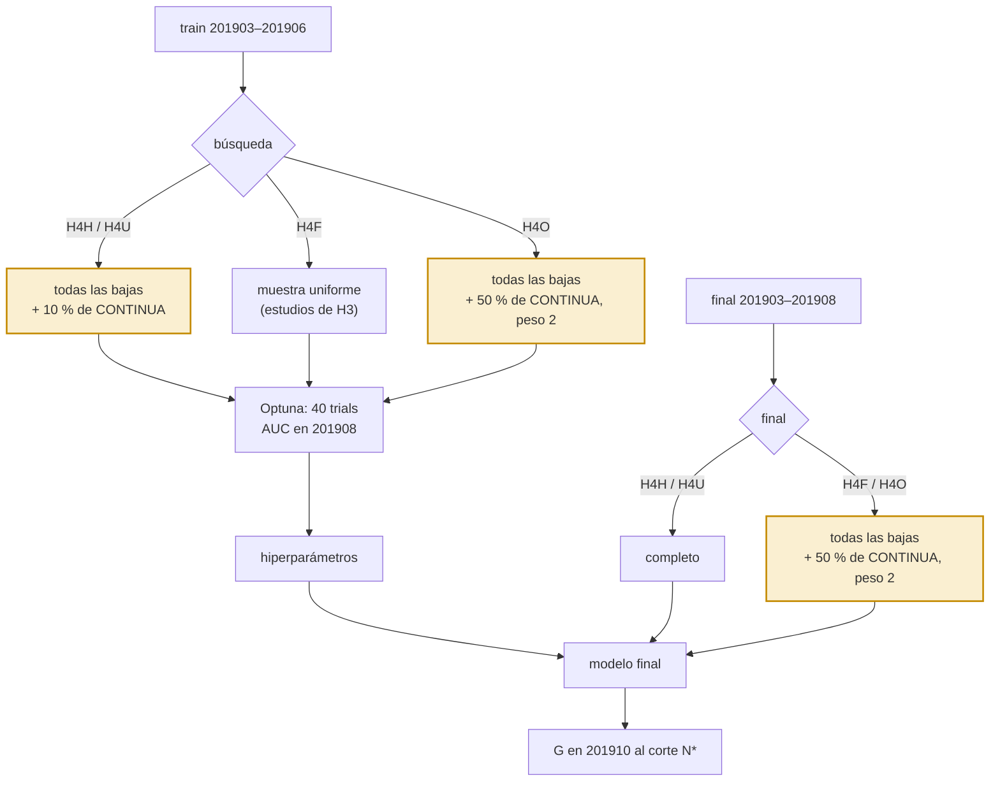
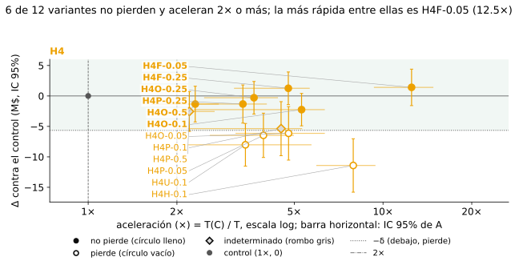
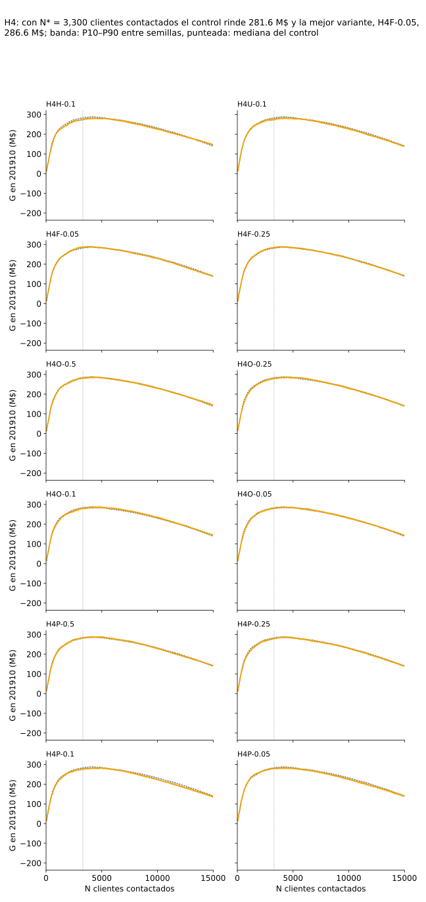
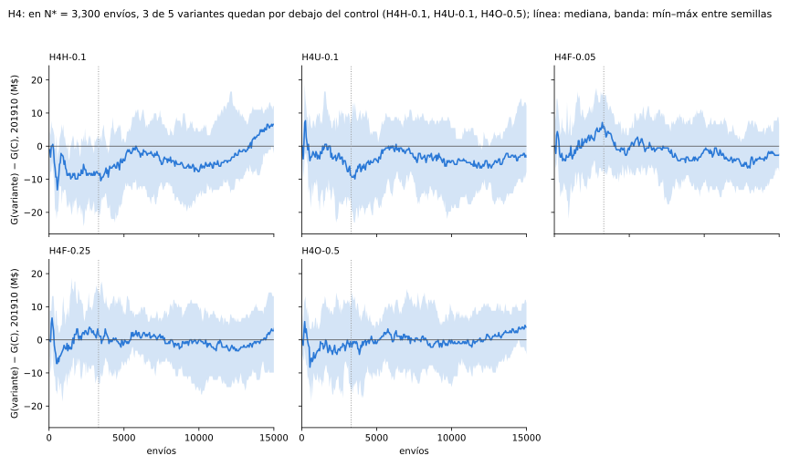

# H4 · Muestras informadas por clase

H4 prueba si conviene que la muestra que acelera el pipeline conserve todas las bajas, en la búsqueda de Optuna o en el
modelo final.

Responde a **cómo muestrear**: qué filas se conservan al achicar la búsqueda o el final
([Resultados § ¿Cómo muestrear?](../sampling_1/README.md#como-muestrear)).

## Idea

[H1](../h1/README.md) y [H3](../h3/README.md) muestrean filas al azar, así que la muestra pierde bajas en la misma
proporción que CONTINUA. Las bajas son pocas y son las que el modelo tiene que encontrar. H4 las conserva todas y recorta
solo CONTINUA, de dos maneras:

- **En la búsqueda** (`H4H-0.1`, `H4U-0.1`): Optuna corre sobre todas las bajas y el 10 % de CONTINUA, elegido dentro de
  un pozo de negativos difíciles o al azar. El final es completo.
- **En el final** (`H4F-*`, fast-retrain): Optuna corre sobre una muestra uniforme, como H3, y el final entrena con todas
  las bajas y la mitad de CONTINUA, con peso 2 en CONTINUA para restituir la proporción ponderada del train.

`H4O-0.5` usa la receta del final también para optimizar, como pide la regla del curso de reoptimizar siempre que cambia
el dataset («siempre OP»).

## Predicción

Las reglas comunes (G, Δ, δ, T, A, N\*, veredictos) están en [Control y reglas](../control/README.md). Las réplicas de
optimización (réplica k, Ḡ_{v,k}, Δ con réplicas con IC de Welch) y los valores fijos δ = 5,52 M$, N\* = 3.300 y R = 8
réplicas (k = 0…7) son los de [H3](../h3/README.md); tampoco se repiten ni se recalculan.

### H4

!!! info "Predicción"
    Fijada el 9-nov (cambio `incorporar-aportes`, commit `c390beb`), antes de cualquier corrida real de sus variantes, y
    revisada en sesión limpia antes de la primera.

!!! warning "Las variantes salen de mirar 201910"
    Las cuatro variantes de H4 vienen del exploratorio
    [`validacion_50_semillas`](https://github.com/agustinarazanov/dmeyf-experimento-sampling/blob/main/experimentos/sampling_1/exploratorios/validacion_50_semillas/README.md)
    (origen en el commit `9e1889e`), que eligió y descartó estrategias mirando su ganancia en 201910: la búsqueda con
    negativos difíciles como la de mayor ganancia (+7,19 M$), la búsqueda con CONTINUA uniforme como descarte
    (−2,31 M$) y el fast-retrain como la arquitectura de producción (283,25 M$ contra 276,65 M$ del control a tiempo
    igual). No se sabe con qué mes se fijaron el pozo del 35 % ni el 10 % de CONTINUA; se mantienen como los dejó el
    exploratorio.

    Por eso el resultado de H4 no cuenta con un mes de test que no se haya mirado: 201910 ya influyó en qué se prueba.
    Se sigue la consigna (Zulip 208135) y no se usa otro mes. Para acotar el sesgo, las cuatro variantes entran juntas,
    con predicción y regla escritas antes de correr, y ninguna se elige ni se descarta por su resultado en 201910; los
    contrastes principales quedan fijados de antemano (§ Comparaciones múltiples); y las Limitaciones de H4 y de
    Resultados listan este origen.

- **Variable**: cómo se arma la muestra (búsqueda con todas las bajas y CONTINUA difícil o uniforme; final con todas
  las bajas y la mitad de CONTINUA con peso 2).
- **Métrica que decide**: el veredicto de cada variante con Δ con réplicas contra `C` (reglas comunes, δ = 5,52 M$) y,
  para `H4F-*`, la aceleración A con T como mediana entre las 8 réplicas.
- **Predicción**: conservar todas las bajas en la búsqueda o en el final mantiene la ganancia y acelera.

1. **Búsqueda informada** (`H4H-0.1` y `H4U-0.1`).
   - **Predicción**: las dos *no pierden* con réplicas: cota inferior del IC de Welch de Δ con réplicas ≥ −δ.
   - **Se confirma** si las dos cumplen eso; **se refuta** si alguna sale *pierde* (media de Δ con réplicas < −δ);
     **ninguna de las dos** en otro caso (alguna *indeterminado*).
2. **Difícil contra uniforme.** D_HU = media_k Ḡ_{`H4H-0.1`,k} − media_k Ḡ_{`H4U-0.1`,k}, con IC 95% de Welch entre las
   8 réplicas de cada una (sin aparear: la réplica k de una y otra no comparten la muestra de búsqueda).
   - **Ayuda** si la cota inferior del IC de D_HU es > 0; **empeora** si la cota superior es < 0; **no cambia** en otro
     caso.
   - **Predicción**: *ayuda*, que es lo que reporta el exploratorio.
3. **Fast-retrain** (`H4F-0.05` y `H4F-0.25`). Tres condiciones por variante:
   - (a) *no pierde* con réplicas: cota inferior del IC de Welch de Δ con réplicas ≥ −δ;
   - (b) acelera más que la H3 de la misma tasa: A(`H4F-0.05`) > A(`H3-0.05`) y A(`H4F-0.25`) > A(`H3-0.25`), con cada T
     como mediana entre sus 8 réplicas;
   - (c) a tiempo igual *gana*: la cota inferior del IC t 95% entre réplicas del tiempo igual (ensamble de K semillas de
     la variante contra la media de `C` en la misma réplica, como lo calcula el generador de Resultados) es > 0.
   - **Predicción**: las dos cumplen (a), (b) y (c).
   - **Se confirma** para una variante si cumple las tres; **se refuta** si sale *pierde* o si A no supera a la de su H3;
     si no, *indeterminado*.

La respuesta de H4 sale de las reglas 1 y 3; la regla 2 explica el mecanismo de la búsqueda y no decide. No hay un
veredicto único que junte las dos: el veredicto da el de la regla 1 y el de la regla 3 por variante, y la respuesta del
experimento usa los contrastes principales.

### `H4O-0.5`

!!! info "Predicción"
    Fijada el 12-nov (cambio `final-con-julio-agosto`, commit `159ee0d`), antes del tag `corridas-v4` y de cualquier
    corrida de la variante. Solo existe en la ronda 201903–201908, con N\* = 3.300 y δ = 0,02 · Ḡ_C de los `C` de esa
    ronda.

**De dónde viene.** La consigna pide reoptimizar siempre que cambia el dataset («siempre OP», Zulip 211718). `H4F-0.05`
busca sobre una muestra uniforme del 5 % y entrena con otra receta, así que no cumple esa indicación. `H4O-0.5` usa la
receta del final también para optimizar. La idea viene de 211718, no de mirar 201910.

4. **`H4O-0.5` contra `C`**, con Δ con réplicas. **Predicción**: *no pierde* (cota inferior ≥ −δ, con el δ de la ronda).
   **Se refuta** si sale *pierde*; *indeterminado* en otro caso.
5. **Reoptimizar sobre el set del final.** D_OF = media_k Ḡ_{`H4O-0.5`,k} − media_k Ḡ_{`H4F-0.05`,k}, con IC 95% de Welch
   entre las 8 réplicas de cada una (sin aparear: las búsquedas no comparten muestra). **Ayuda** si la cota inferior es
   > 0; **empeora** si la cota superior es < 0; **no cambia** en otro caso.
   - **Predicción**: *no cambia*. En la ronda anterior `H4F-0.05` ya *no pierde* con réplicas (IC [−0,83; 4,54] M$) y su
     búsqueda sobre el 5 % es de la misma familia que la de `H3`, que tampoco pierde; no se espera que buscar sobre la
     receta del final mueva la ganancia más que el ruido entre réplicas.
   - Se informa además A(`H4O-0.5`) junto a A(`H4F-0.05`): A no decide la regla 5; dice cuánto cuesta seguir el
     «siempre OP».

El contraste `H4O-0.5` contra `H4F-0.05` es un resultado del experimento, no una limitación. Es secundario.

### Comparaciones múltiples

Entre `h4` y las extensiones de `h3` hay más de diez contrastes, sin corrección por comparaciones múltiples: con un 5 %
de error por contraste, alguno puede salir significativo por azar. La respuesta del experimento se apoya solo en los
**contrastes principales**, fijados acá antes de correr:

- `H3-0.1` contra `C`, con réplicas;
- `H4H-0.1` contra `C`, con réplicas (regla 1);
- `H4F-0.05` contra `C`, con réplicas y a tiempo igual (regla 3).

El resto de los contrastes se informa como secundario.

### Grilla común (cambio `tiempos-confiables-y-consistencia`, 13-nov-2026)

Escrito el 13-nov-2026, antes de cualquier corrida de estas variantes, y revisado en sesión limpia antes de la primera.
Lo de arriba no se reescribe. Esta sección lleva H4 a la grilla común ([`sampling_1/corridas.md`](../sampling_1/corridas.md)
§ Fases): las mismas cuatro tasas {0,5; 0,25; 0,1; 0,05} y 8 réplicas en cada forma de muestrear, para que la receta con
bajas se pueda comparar directamente con la muestra al azar de H1 y H3. Ronda 201903–201908
([`control`](../control/README.md) § Predicción de la ronda 201903–201908): 20 semillas finales, N\* = 3.300 y
δ = 0,02 · Ḡ_C de esa ronda (5,65 M$). Δ con réplicas e IC de Welch como en § `H4O-0.5`; A con una sola referencia y T
como mediana entre réplicas ([`control`](../control/README.md) § Medición de tiempos).

**Origen: se agregan después de ver 201910.** Las variantes nuevas se deciden después de ver en 201910 todas las celdas
vecinas (`H4O-0.5`, `H4U-0.1`, `H3-*`, `U*`). Entran todas juntas, con predicción y regla escritas acá antes de correr, y
ninguna se elige ni se descarta por su resultado. El informe las lista entre las limitaciones ("Ideas que vienen de mirar
el test").

**"Siempre OP" (Zulip 211718).** `H4O-{f}` busca y entrena con la misma receta. `H4P-{f}` busca sobre la receta con bajas
y entrena el final completo: es un apartamiento decidido el 13-nov porque es la hipótesis misma (como H3 y `H4F`), y se
declara con su id en el informe.

#### Variantes nuevas

| variante | búsqueda (Optuna) | final | estudio |
|---|---|---|---|
| `H4O-0.25`, `H4O-0.1`, `H4O-0.05` | todas las bajas + f de CONTINUA, peso 1/f | lo mismo, sobre 201903–201908 | `F{f}` / `F{f}@k` |
| `H4P-0.5`, `H4P-0.25`, `H4P-0.1`, `H4P-0.05` | como `H4O-{f}` (comparte su estudio) | completo, sin peso | `F{f}` / `F{f}@k` |

- `H4O-{f}` generaliza `H4O-0.5`: la fracción de CONTINUA pasa a ser la tasa de la variante. Los hiperparámetros no se
  reescalan. `H4F-*` sigue con la mitad de CONTINUA en el final.
- `H4P-{f}` comparte el estudio de `H4O-{f}`, como `H3-{r}` comparte el de `U{r}`; el tiempo del estudio entra en T de
  las dos. La muestra de búsqueda de `H4P-0.1` es la misma que la de `H4U-0.1` (misma función y misma semilla): solo
  cambia el peso.
- La receta con bajas tiene más filas que la muestra al azar de la misma tasa (506.871 filas, 5.312 bajas):

  | tasa | filas al azar | filas con bajas | cociente |
  |---|---|---|---|
  | 0,5 | 253.436 | 256.092 | 1,010 |
  | 0,25 | 126.718 | 130.702 | 1,031 |
  | 0,1 | 50.687 | 55.468 | 1,094 |
  | 0,05 | 25.344 | 30.390 | 1,199 |

#### Pares directos

Se declaran en el registro antes de correr. Cada par tiene su IC:
- **Welch, sin aparear** (los lados no comparten estudio): D = media_k Ḡ_{a,k} − media_k Ḡ_{b,k}, IC 95% de Welch entre
  las réplicas de cada lado.
- **t, apareado** (comparten estudio): D = G(a) − G(b) por semilla dentro de cada réplica, media de D por réplica e IC t
  95% entre réplicas (n − 1 g.l.), con el esquema de la regla 4 de [`h3`](../h3/README.md) § H3 con réplicas de
  optimización.

Una réplica entra en un par solo si tiene las 20 semillas en los dos lados; el par dice con cuántas réplicas se calculó.
Un par al que le falta un lado sale como pendiente, con el nombre de la variante que falta. **Etiquetas**: *mejora* si la
cota inferior del IC de D es > 0 M$, *empeora* si la cota superior es < 0 M$, *no cambia* en otro caso.

| qué aísla | par (a − b) | tasas | IC | qué no aísla |
|---|---|---|---|---|
| conservar las bajas, búsqueda y final (**principal**) | `H4O-{r}` − `U{r}` | 4 | Welch | qué filas quedan, entre 1 y 20 % más filas y el peso 1/f, todo junto |
| conservar las bajas, solo búsqueda | `H4P-{r}` − `H3-{r}` | 4 | Welch | lo mismo, en la búsqueda; el final es completo en los dos lados |
| muestrear también el final, al azar | `U{r}` − `H3-{r}` | 4 | t apareado | nada más: comparten estudio |
| muestrear también el final, con bajas | `H4O-{r}` − `H4P-{r}` | 4 | t apareado | en el final cambian a la vez las filas y el peso |
| el peso en la búsqueda | `H4P-0.1` − `H4U-0.1` | 1 | Welch | nada más: misma muestra de búsqueda, mismo final |

Los pares "conservar las bajas" se comparan a igual tasa de CONTINUA, y la tabla del informe muestra las filas de entrenamiento de cada lado. Los pares entre experimentos (`h4` con `h1` o `h3`, y `h1`
con `h3`) se calculan en `sampling_1`. H2 no entra en los pares ([`h2`](../h2/README.md) § Réplicas de H2 y `B0.05`).

#### Predicciones y reglas

Para los veredictos contra `C` valen las reglas comunes con Δ con réplicas: una predicción *no pierde* se confirma si la
cota inferior del IC es ≥ −δ y se refuta si sale *pierde*; una predicción *pierde* se confirma si la media de Δ es < −δ y
se refuta si sale *no pierde*; *indeterminado* no confirma ni refuta. Para los pares, una predicción se confirma si sale
la etiqueta predicha y se refuta si sale otra.

6. **Conservar las bajas, búsqueda y final** (`H4O-{r}` − `U{r}`, principal).
   - **Predicción**: *no cambia* en 0,5; *mejora* en 0,1 y 0,05, donde la muestra al azar se queda con unas 531 y 266 de
     las 5.312 bajas. En 0,25 no hay predicción firme y se informa.
7. **`H4O-{r}` contra `C`.**
   - **Predicción**: *no pierde* en 0,5 (ya medido, regla 4) y en 0,25; *pierde* en 0,05. En 0,1 se informa sin
     predicción.
8. **`H4P-{r}` contra `C`.**
   - **Predicción**: *no pierde* en las cuatro tasas.
9. **Conservar las bajas, solo búsqueda** (`H4P-{r}` − `H3-{r}`).
   - **Predicción**: *no cambia* en las cuatro tasas.
10. **El peso en la búsqueda** (`H4P-0.1` − `H4U-0.1`).
    - **Predicción**: *mejora*.
    - Si sale *no cambia*, la explicación del informe de H4 (la proporción distorsionada en la búsqueda hace perder a
      `H4U-0.1`) queda sin sostén, y se dice.
11. **Muestrear también el final** (`U{r}` − `H3-{r}` y `H4O-{r}` − `H4P-{r}`): se informan sin predicción.

Cada variante nueva recibe además su A, con su intervalo. A no decide ninguna de las reglas 6 a 11.

#### Comparaciones múltiples de la grilla común

Escrito el 13-nov-2026, antes de correr. Se suman, sin corrección:
- los **17 contrastes** de los pares directos: 4 `H4O-{r}` − `U{r}`, 4 `H4P-{r}` − `H3-{r}`, 4 `U{r}` − `H3-{r}`,
  4 `H4O-{r}` − `H4P-{r}` y `H4P-0.1` − `H4U-0.1`;
- **9 veredictos nuevos** contra `C`, de las variantes nuevas: `H3-0.5`, `H4O-0.25`, `H4O-0.1`, `H4O-0.05`, las cuatro
  `H4P` y `B0.05`;
- los veredictos que **se vuelven a decidir** con réplicas: `U0.5`, `U0.25`, `U0.1`, `U0.05`, `B0.5`, `B0.25`, `B0.1` y
  `GOSS`.

Los contrastes principales de la grilla común son los cuatro `H4O-{r}` − `U{r}`; las conclusiones sobre la grilla se
apoyan en ellos y el resto es secundario. Los tres principales de § Comparaciones múltiples siguen siéndolo para las
variantes de la ronda anterior.

*Limitación prevista (13-nov):* en `H4O-0.05` y `H4P-0.05` el peso de CONTINUA es 20 en la búsqueda (y en el final de
`H4O-0.05`), con `min_data_in_leaf` sin reescalar. Es parte de la receta y se declara, como en `H4O-0.5`. Los pares
"conservar las bajas" mezclan qué filas quedan, cuántas y el peso.

## Diseño

Lo que no se dice acá (máquina, parámetros fijos de LightGBM, espacio de Optuna) es lo del
[control](../control/README.md); las réplicas, los nombres `@k` y los dueños de `U{r}@k`, lo de [H3](../h3/README.md).

### Variantes

Un *estudio* es una búsqueda de Optuna: `NH0.1` busca sobre todas las bajas y el 10 % de CONTINUA, y `NH0.1@k` es la
misma búsqueda repetida con semilla k. Esas repeticiones son las *réplicas*, que miden cuánto depende el resultado de la
suerte de la búsqueda; la réplica 0 es la búsqueda original.

| variante | búsqueda de hiperparámetros | dueño del estudio | final |
|---|---|---|---|
| `H4H-0.1` | `NH0.1` / `NH0.1@k` | `h4` | completo (r = 1) |
| `H4U-0.1` | `NU0.1` / `NU0.1@k` | `h4` | completo (r = 1) |
| `H4F-0.05` | `U0.05` / `U0.05@k` | `h1` / `h3` | todas las bajas + 50 % de CONTINUA, peso 2 |
| `H4F-0.25` | `U0.25` / `U0.25@k` | `h1` / `h3` | todas las bajas + 50 % de CONTINUA, peso 2 |
| `H4O-0.5` | `F0.5` / `F0.5@k` | `h4` | todas las bajas + 50 % de CONTINUA, peso 2 |

Las filas de las cinco van a `experimentos/h4/ledger/`; los hiperparámetros de `NH0.1`, `NU0.1`, `F0.5` y sus `@k`, a
`experimentos/h4/ledger/hp/`. Los hiperparámetros del estudio se usan tal cual en el final, sin reescalar.

### Búsqueda informada (`H4H-0.1`, `H4U-0.1`)

Positivo = BAJA+1 ∪ BAJA+2; negativo = CONTINUA. Las búsquedas son sobre el train 201903–201906 y el final es completo.
Las dos variantes tienen 8 réplicas (k = 0…7) y 20 semillas finales por réplica, con 16 estudios propios (`NH0.1`,
`NU0.1` y sus `@k`).

- **Búsqueda difícil (`NH0.1`)**, en la réplica k:
  1. **Sonda**: LightGBM de 40 árboles, 31 hojas y `learning_rate` 0,08 (resto como el control), entrenado sobre el
     10 % uniforme del train sorteado con semilla k; la semilla de LightGBM de la sonda también es k.
  2. **Pozo**: el 35 % de los negativos del train con mayor probabilidad según la sonda.
  3. **Muestra**: todos los positivos + una cantidad de negativos igual al 10 % de los negativos del train, sorteados sin
     reposición dentro del pozo con semilla k.
  4. Optuna de 40 trials sobre esa muestra, TPE con semilla k, maximiza el AUC en 201908.
- **Búsqueda uniforme (`NU0.1`)**: igual, sin sonda: los negativos se sortean entre todos con semilla k. Misma cantidad
  de positivos y de negativos que `NH0.1` en la misma réplica.
La sonda y el sorteo dentro del pozo son una reconstrucción: el script del exploratorio define la sonda y el pozo, pero
no el sorteo ni el estudio que produjo sus hiperparámetros.

T es el del control (optimización + media del final). En `H4H-0.1` la optimización suma el tiempo de la sonda: es parte
de la variante.

**Fuera del diseño**: otras fracciones de CONTINUA, otros tamaños de pozo u otra sonda (no están en el exploratorio); las
dos variantes de la propuesta original de H4 (20 % de CONTINUA elegido por un algoritmo; 10 % al azar con pesos), que
quedaron sin definir; los ensambles de más de 10 semillas o el presupuesto de 900 s, que son del exploratorio.

### Final con bajas (`H4F-0.05`, `H4F-0.25`, `H4O-0.5`)

`H4F-*` y `H4O-0.5` entrenan el final sobre todas las bajas y la mitad de CONTINUA con peso 2, sobre los seis meses del
final. Tienen 8 réplicas y 20 semillas finales por réplica; los estudios `U0.05`, `U0.25` y sus `@k` son de `h1`, y
`F0.5` y `F0.5@1…7`, de `h4`. Cada estudio va antes de sus finales en las listas de la fase.

- **Búsqueda sobre la receta del final (`F0.5@k`)**: todos los positivos + 50 % de los negativos, sorteados con semilla
  k, con peso 2 en los negativos en el `Dataset` de cada trial; AUC en 201908 completo y sin pesos.
- **Final fast-retrain (`H4F-*`, `H4O-0.5`)**: todos los positivos + el 50 % de los negativos del final, sorteados con la
  semilla final, con peso 1/0,5 = 2 en los negativos (`weight` del `lgb.Dataset`). Se registra la cantidad de filas.
- **Tiempo**: en `H4F-*` la optimización es la de su estudio `U{r}` / `U{r}@k`, de `h1`; en `H4O-0.5` es la de `F0.5`.
- **Regla del curso «siempre OP»** (Zulip 211718): pide reoptimizar siempre que cambia el dataset. `H4F-0.05` busca sobre
  una muestra uniforme del 5 % y entrena con otra receta, así que no la cumple; `H4O-0.5` usa la receta del final también
  para optimizar y sí la cumple. La regla 5 de la Predicción compara las dos.

### Grilla común (`H4O-{f}`, `H4P-{f}`)

Predicciones y reglas (6 a 11): § Grilla común de la Predicción. `h4` aporta dos filas de la grilla común
([`sampling_1/corridas.md`](../sampling_1/corridas.md) § Fases): "con bajas y peso, búsqueda y final" (`H4O-{f}`) y
"con bajas y peso, solo búsqueda" (`H4P-{f}`), con f ∈ {0,5; 0,25; 0,1; 0,05}. `H4P-{f}` busca sobre la receta con
bajas y entrena el final completo: es un apartamiento declarado de «siempre OP», porque es la hipótesis misma (como en
H3 y `H4F`).

| variante | método | tasa | estudio (k = 0 / k ≥ 1) | dueño del estudio | final |
|---|---|---|---|---|---|
| `H4O-0.25`, `H4O-0.1`, `H4O-0.05` | `fast-retrain-opt` | f | `F{f}` / `F{f}@k` | `h4` | todas las bajas + f de CONTINUA, peso 1/f, sobre 201903–201908 |
| `H4P-0.5`, `H4P-0.25`, `H4P-0.1`, `H4P-0.05` | `clase-peso` | f | `F{f}` / `F{f}@k` | `h4` | completo (r = 1), sin peso |

- **Estudio `F{f}@k`**: como `F0.5@k` con la fracción f: todas las bajas + f de CONTINUA de train 201903–201906,
  sorteado con la semilla k, peso 1/f en CONTINUA en cada trial; validación 201908 completa y sin pesos. `F0.5` y
  `F0.5@k` ya existen y conservan su `hash_muestra`.
- **`H4O-{f}`**: la fracción de CONTINUA del final es la tasa de la variante. `H4F-*` usa la mitad de CONTINUA y peso 2
  en el final. Hiperparámetros sin reescalar.
- **`H4P-{f}`**: optimiza con el método de `H4O-{f}` y comparte su estudio; el final es el de `opt-muestra` (train
  201903–201908 completo, sin peso). La muestra de búsqueda de `H4P-0.1` es la misma que la de `H4U-0.1` (misma función,
  misma semilla); solo cambia el peso.
- **Estudios**: `F0.25`, `F0.1` y `F0.05` en k = 0…7, además de `F0.5` (24 estudios nuevos).
- **Finales**: las 7 variantes `H4O-{f}` (salvo 0,5) y `H4P-{f}` en k = 0…7, con las 20 semillas de la ronda
  201903–201908.
- **T y A**: T suma los 40 trials de `F{f}@k` y la media del final; el tiempo del estudio entra en T de `H4O-{f}` y de
  `H4P-{f}`. Mediana entre réplicas y A con una sola referencia ([`control`](../control/README.md) § Medición de
  tiempos).
- **Pares directos** (`PARES_APAREADOS` y `PARES_WELCH`, con lo que aísla cada uno): § Grilla común de la Predicción.
  Los que cruzan experimentos se calculan en `sampling_1`.
- **Código**: `clase-peso` en `comun/metodos.py`, que `metodo_optimizacion` manda a `fast-retrain-opt`; `pesos` recibe la
  tasa; `fast-retrain` y `fast-retrain-opt` no comparten la fracción fija; `validar` acepta las cuatro tasas en
  `fast-retrain-opt`.
- Los estudios van en las listas de la fase 8 ([`sampling_1/corridas.md`](../sampling_1/corridas.md) § Fases), cada uno
  antes de sus finales.
- **Fuera de la grilla común**: `H4F-*`, `H4H-0.1` y `H4U-0.1` (la tabla de cobertura los lista aparte); `H4U-0.1` entra
  solo en el par del peso.

## Dependencias

- `control`: finales de `C` y de sus réplicas `C@1…7`, N\* y δ.
- `h1`: los estudios `U0.05` y `U0.25` y sus réplicas `U0.05@k` y `U0.25@k` (k = 1…7) (`ledger/hp/U0.05.json`,
  `ledger/hp/U0.25.json` y sus `@k`), que usan `H4F-0.05` y `H4F-0.25`.

Los estudios `F{f}` y `F{f}@k` de la grilla común son propios.

## Resultado

<!-- generado:resultado -->
Final entrenado con 201903-201908, 20 semillas; N* = 3,300 clientes contactados (fijo, de la ronda anterior); δ = 5.65 M$. Vale la pena: no pierde y acelera 2× o más.

<table><tr><th>variante</th><th>R</th><th>G media (M$)</th><th>Δ [IC 95%] (M$)</th><th>ΔAUC [IC 95%]</th><th>T mediana (s)</th><th>aceleración (×)</th><th>ganancia contra el control</th><th>vale la pena (no pierde y ≥ 2×)</th></tr><tr><td>C</td><td>—</td><td>281.78</td><td>—</td><td>—</td><td>1,002</td><td>1.00</td><td>—</td><td>—</td></tr><tr><td>H4H-0.1</td><td>8</td><td>270.37</td><td class='sig-neg'>-11.41[-15.80; -7.03]</td><td class='sig-neg'>-0.0045[-0.0062; -0.0028]</td><td>126</td><td>7.93[5.94; 9.43]</td><td>pierde</td><td>no</td></tr><tr><td>H4U-0.1</td><td>8</td><td>273.76</td><td class='sig-neg'>-8.02[-11.52; -4.53]</td><td class='sig-neg'>-0.0037[-0.0054; -0.0021]</td><td>293</td><td>3.41[2.16; 5.72]</td><td>pierde</td><td>no</td></tr><tr><td>H4F-0.05</td><td>8</td><td>283.19</td><td class='mejor'>1.41[-1.58; 4.40]</td><td>-0.0019[-0.0041; +0.0003]</td><td>80</td><td class='mejor'>12.50[9.31; 14.82]</td><td>no pierde</td><td>sí</td></tr><tr><td>H4F-0.25</td><td>8</td><td>283.04</td><td>1.26[-1.42; 3.94]</td><td>-0.0002[-0.0013; +0.0009]</td><td>210</td><td>4.77[3.12; 5.64]</td><td>no pierde</td><td>sí</td></tr><tr><td>H4O-0.5</td><td>8</td><td>280.44</td><td>-1.33[-4.27; 1.60]</td><td>+0.0004[-0.0007; +0.0015]</td><td>434</td><td>2.31[1.64; 2.77]</td><td>no pierde</td><td>sí</td></tr><tr><td>H4O-0.25</td><td>8</td><td>281.48</td><td>-0.30[-2.97; 2.38]</td><td>-0.0000[-0.0011; +0.0011]</td><td>274</td><td>3.65[2.47; 4.40]</td><td>no pierde</td><td>sí</td></tr><tr><td>H4O-0.1</td><td>8</td><td>279.53</td><td>-2.25[-4.91; 0.41]</td><td>-0.0003[-0.0014; +0.0009]</td><td>189</td><td>5.29[2.28; 6.35]</td><td>no pierde</td><td>sí</td></tr><tr><td>H4O-0.05</td><td>8</td><td>275.64</td><td class='sig-neg'>-6.14[-10.53; -1.75]</td><td>-0.0009[-0.0024; +0.0006]</td><td>210</td><td>4.78[3.16; 6.35]</td><td>pierde</td><td>no</td></tr><tr><td>H4P-0.5</td><td>8</td><td>279.23</td><td>-2.55[-5.82; 0.72]</td><td>-0.0008[-0.0022; +0.0007]</td><td>455</td><td>2.20[1.58; 2.69]</td><td>indeterminado</td><td>no</td></tr><tr><td>H4P-0.25</td><td>8</td><td>280.45</td><td>-1.33[-4.46; 1.81]</td><td class='sig-neg'>-0.0021[-0.0036; -0.0006]</td><td>299</td><td>3.35[2.28; 4.04]</td><td>no pierde</td><td>sí</td></tr><tr><td>H4P-0.1</td><td>8</td><td>276.41</td><td class='sig-neg'>-5.37[-9.81; -0.93]</td><td class='sig-neg'>-0.0035[-0.0053; -0.0016]</td><td>222</td><td>4.51[1.99; 5.32]</td><td>indeterminado</td><td>no</td></tr><tr><td>H4P-0.05</td><td>8</td><td>275.31</td><td class='sig-neg'>-6.47[-10.11; -2.83]</td><td class='sig-neg'>-0.0034[-0.0045; -0.0024]</td><td>255</td><td>3.93[2.58; 4.98]</td><td>pierde</td><td>no</td></tr></table>

<!-- /generado:resultado -->

Las tablas con réplicas, la varianza entre réplicas y las diferencias entre variantes están en
[Resultados](../sampling_1/README.md).

## Veredicto

!!! success "Veredicto con réplicas"
    Conservar todas las bajas en la búsqueda no sirve: `H4H-0.1` y `H4U-0.1` pierden contra el control con réplicas, y
    elegir los negativos difíciles no cambia nada contra elegirlos al azar. Conservarlas en el final sí: `H4F-0.05`
    (búsqueda sobre el 5 % uniforme, final con todas las bajas y la mitad de CONTINUA con peso 2) no pierde, acelera
    12,50 veces y gana a tiempo igual; con el final de seis meses `H4F-0.25` también cumple las tres condiciones.
    Reoptimizar sobre la receta del final (`H4O-0.5`) no pierde contra el control, pero no mejora a `H4F-0.05` y es más
    de 5 veces más lento. Lo que el exploratorio reportaba como ganador (la búsqueda difícil) es lo que pierde; su
    arquitectura de producción (fast-retrain) es la que se sostiene.

Las reglas se aplican tal como quedaron escritas, con el δ de la ronda (5,65 M$; las reglas 1 a 3 se escribieron con el
de la ronda anterior, y la regla de δ dice que su valor sale del control de cada ronda). Cada línea dice si la
predicción **se cumplió** o no.

### Búsqueda informada

- **1. Búsqueda informada: refutada.** Las dos variantes *pierden* con réplicas: la media de Δ con réplicas queda debajo de −5,65 M$ en `H4H-0.1`
    (−11,41 M$, IC [−15,80; −7,03]) y en `H4U-0.1` (−8,02 M$, IC [−11,52; −4,53]). Solo el IC de `H4H-0.1` queda
    entero debajo de −δ; el de `H4U-0.1` llega a −4,53 M$, arriba de −5,65, así que `H4U-0.1` pierde por la media.
    Optimizar sobre una muestra con todas las bajas y el 10 % de CONTINUA rinde peor que optimizar
    sobre una muestra uniforme del 10 % (`H3-0.1`, Δ con réplicas 1,71 M$). Una explicación posible, que no se probó, es
    que la proporción de clases distorsionada en la búsqueda lleva a hiperparámetros que no sirven para el train
    completo. La regla 10 de la grilla común (abajo) deja esa explicación sin sostén: con la misma muestra, devolverle
    el peso a CONTINUA en la búsqueda (`H4P-0.1` − `H4U-0.1`) *no cambia*.

- **2. Difícil contra uniforme: no cambia.** D_HU = −3,39 M$, IC de Welch [−8,06; 1,28]. La predicción (*ayuda*) **no se
    cumplió**; si algo, la media va en contra. Elegir negativos difíciles no rescata a la búsqueda informada.

- **Lo que no decide.** Con réplicas, `H4H-0.1` y `H4U-0.1` bajan más que en la réplica 0 (−11,41 y −8,02 M$ contra −9,19
  y −7,70 M$). `H4H-0.1` tiene mucha varianza entre réplicas (48 %, sd 4,91 M$): la sonda y el sorteo dentro del pozo
  suman suerte a la de Optuna. `H4U-0.1` tiene la T mediana más alta de las cuatro primeras (293 s, A = 3,41). A tiempo
  igual su IC contiene a 0 ([−1,40; 9,29] M$) aunque pierda con réplicas: el tiempo igual compara el ensamble de las
  semillas de la variante que entran en el tiempo del control contra un modelo del control, y ensamblar suma ganancia
  por sí solo. No cambia la regla 1, que no usa el tiempo igual.

### Final con bajas

- **3. Fast-retrain: confirmada en las dos tasas.**

    - **`H4F-0.05`**: (a) *no pierde*, cota inferior del IC de Welch −1,58 ≥ −5,65 M$; (b) A = 12,50 > 10,56 de
      `H3-0.05` (T mediana 80 s contra 95 s); (c) a tiempo igual *gana*, IC t entre réplicas [0,77; 8,50] M$.
    - **`H4F-0.25`**: (a) cota inferior −1,42 ≥ −5,65 M$; (b) A = 4,77 > 4,38 de `H3-0.25`; (c) IC t a tiempo igual
      [2,09; 7,73] M$. La predicción **se cumplió** en las dos.

- **4 y 5. `H4O-0.5`: no pierde y no cambia contra `H4F-0.05`.** *No pierde* contra `C`: cota inferior del IC de Welch de Δ con réplicas −4,27 ≥ −5,65 M$ (Δ = −1,33 M$). D_OF =
    −2,74 M$, IC de Welch [−5,69; 0,21]: contiene a 0, como se predijo. Las dos predicciones **se cumplieron**. Buscar
    sobre la receta del final, como pide la regla «siempre OP», no mejora a buscar sobre el 5 % uniforme, y cuesta:
    A(`H4O-0.5`) = 2,31 contra A(`H4F-0.05`) = 12,50 (T mediana 434 s contra 80 s). Con los hiperparámetros elegidos sobre
    una muestra uniforme, el final con otra receta no pierde nada medible.

Con los contrastes principales fijados de antemano: `H4H-0.1` contra `C` *pierde*, y `H4F-0.05` contra `C` *no pierde*
con réplicas y *gana* a tiempo igual. Las reglas 4 y 5 son secundarias.

**AUC y ganancia.** El veredicto es el de ganancia (Zulip 208135). En `H4F-0.05` van en direcciones distintas: ΔAUC
−0,0019 con Δ de ganancia 1,41 M$; en `H4O-0.5`, al revés: ΔAUC +0,0004 con Δ de ganancia −1,33 M$. En los dos casos los
IC contienen a 0. En `H4H-0.1` y `H4U-0.1` van juntas: las dos bajan (ΔAUC −0,0045 y −0,0037, IC debajo de 0).

La diferencia de `H4F-0.05` con `H3-0.05` es solo el final (comparten estudios): Δ con réplicas parecido (1,41 y
2,08 M$) con un final más barato. La ganancia a tiempo igual sale de ahí: más semillas en el mismo tiempo.

### Grilla común

Reglas 6 a 11 de § Grilla común de la Predicción, aplicadas tal como quedaron escritas; los pares salen de la tabla
«Diferencias entre variantes» del [Anexo](../sampling_1/anexo.md) y los Δ y A contra `C`, del bloque A de
[Resultados](../sampling_1/README.md), con una sola referencia de T del control.

- **6. Conservar las bajas, búsqueda y final (`H4O-{r}` − `U{r}`, los cuatro contrastes principales): confirmada.**
    *No cambia* en 0,5 y *mejora* en 0,1 y 0,05, como se predijo; en 0,25, sin predicción, también *mejora*. Con pocas
    filas, quedarse con todas las bajas rescata buena parte de lo que pierde la muestra al azar.
- **7. `H4O-{r}` contra `C`: confirmada.** `H4O-0.25` *no pierde* (−0,30 M$, IC [−2,97; 2,38]; A = 3,65 [2,47; 4,40]) y
    `H4O-0.05` *pierde* (−6,14 M$, IC [−10,53; −1,75]; A = 4,78 [3,16; 6,35]). En 0,1, sin predicción, *no pierde*
    (−2,25 M$, IC [−4,91; 0,41]; A = 5,29 [2,28; 6,35]).
- **8. `H4P-{r}` contra `C`: refutada.** `H4P-0.05` *pierde* (−6,47 M$; A = 3,93 [2,58; 4,98]). `H4P-0.25` *no pierde*
    (A = 3,35 [2,28; 4,04]); `H4P-0.5` (A = 2,20 [1,58; 2,69]) y `H4P-0.1` (A = 4,51 [1,99; 5,32]) quedan
    *indeterminado*.
- **9. Conservar las bajas, solo búsqueda (`H4P-{r}` − `H3-{r}`): refutada.** *No cambia* en 0,5 y 0,25, pero
    *empeora* en 0,1 y 0,05: con la búsqueda sobre todas las bajas, el final con todo el train rinde menos que buscando
    al azar.
- **10. El peso en la búsqueda (`H4P-0.1` − `H4U-0.1`): refutada.** *No cambia*; la explicación de la regla 1 queda
    sin sostén.
- **11. Muestrear también el final**, sin predicción: `U{r}` − `H3-{r}` *empeora* en las cuatro tasas; `H4O-{r}` −
    `H4P-{r}` *no cambia* salvo en 0,1, donde *mejora*.

Los 17 contrastes y los veredictos nuevos se suman sin corrección por comparaciones múltiples; las conclusiones sobre
la grilla se apoyan en los cuatro principales. `H4O-0.25` y `H4O-0.1` no pierden y aceleran más de 2 veces.

## Limitaciones

- **Pares con bajas.** Los pares "conservar las bajas" (`H4O-{r}` − `U{r}` y `H4P-{r}` − `H3-{r}`) mezclan qué filas
  quedan, cuántas (la tabla del Anexo muestra las filas de cada lado) y el peso de CONTINUA, que llega a 20 en 0,05 con
  `min_data_in_leaf` sin reescalar.

- **Grilla común agregada después de mirar 201910.** `H4O-*` y `H4P-*` se decidieron después de ver el test en las
  celdas vecinas, todas juntas y con reglas previas.

- **Test ya mirado.** Las cuatro primeras variantes salen de estrategias que el exploratorio eligió o descartó mirando su ganancia en
    201910, y no hay otro mes de test. Entraron todas juntas, con reglas escritas antes de correr, y ninguna se eligió ni
    se descartó acá por 201910; aun así, el resultado de H4 no cuenta con un mes de test que no se haya mirado. En este
    caso el sesgo esperable (a favor de lo que eligió el exploratorio) no se vio: su elegida, la búsqueda difícil,
    *pierde*.

- **Comparaciones múltiples.** Entre `h4` y las extensiones de `h3` hay más de diez contrastes sin corrección. Las conclusiones se apoyan en los
    contrastes principales; el resto es secundario. La ganancia a tiempo igual de `H4F-0.05` es un contraste principal,
    con cota inferior (0,77 M$) cerca de 0.

- **Estudios compartidos con H3.** `H4F-0.05` y `H4F-0.25` comparten los estudios de `H3-0.05` y `H3-0.25`: no son evidencia independiente sobre la
    búsqueda.

- **Proporción de clases.** La búsqueda de `H4H-0.1`, `H4U-0.1` y `H4O-0.5` cambia la proporción de clases, que es el terreno de Sampling_2
    (undersampling de la clase mayoritaria). Es la excepción declarada a la regla de Sampling_1 de no tocar la
    proporción: H4 sigue midiendo velocidad, con el final completo (`H4H-0.1`, `H4U-0.1`) o con la proporción ponderada
    restituida por el peso 2 (`H4F-*`, `H4O-0.5`), y no compara proporciones de clases entre sí. Optuna ve
    probabilidades descalibradas; G se mide con un corte por cantidad de clientes contactados (N\*), que depende solo del orden.

- **Final con la mitad de CONTINUA.** En `H4F-*` y `H4O-0.5` el final usa la mitad de CONTINUA, además de los hiperparámetros elegidos con cuatro meses,
    así que el número de filas del final cambia en los dos sentidos. La sonda de `H4H-0.1` tiene la semilla de la
    réplica: su suerte entra en el IC y su tiempo cuenta en T.
