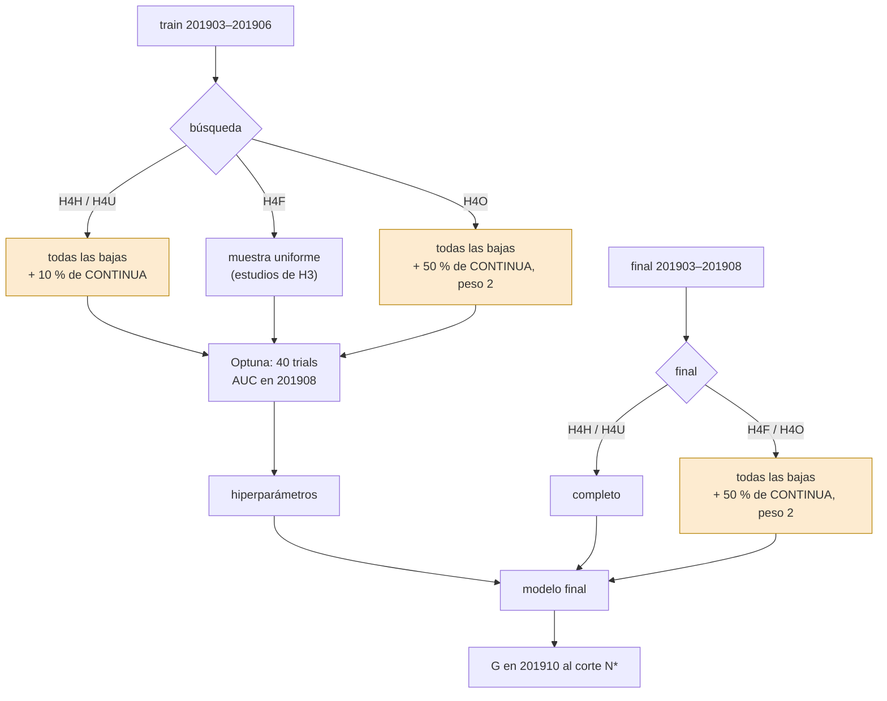
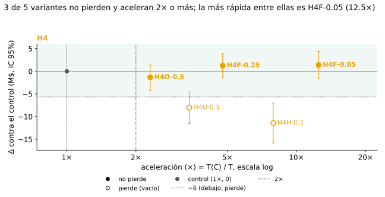
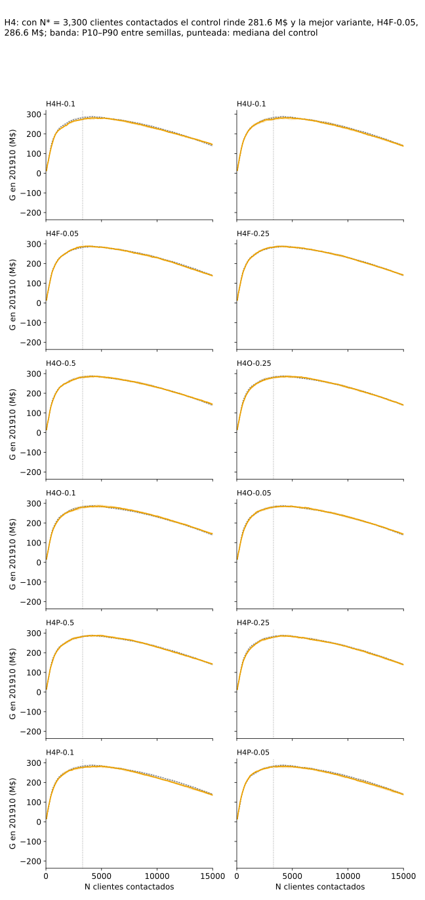
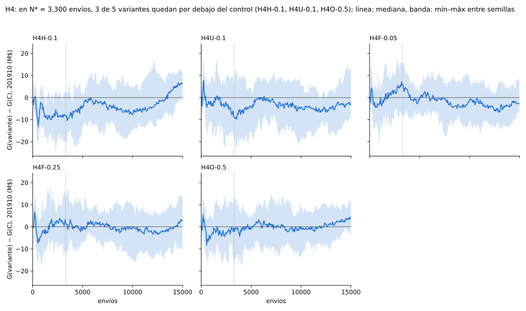

# H4 · Muestras informadas por clase

H4 prueba si conviene que la muestra que acelera el pipeline conserve todas las bajas, en la búsqueda de Optuna o en el
modelo final.

## Idea

[H1](../h1/README.md) y [H3](../h3/README.md) muestrean filas al azar, así que la muestra pierde bajas en la misma
proporción que CONTINUA. Las bajas son pocas y son las que el modelo tiene que encontrar. H4 las conserva todas y recorta
solo CONTINUA, de dos maneras:

- **En la búsqueda** (`H4H-0.1`, `H4U-0.1`): Optuna corre sobre todas las bajas y el 10 % de CONTINUA, elegido dentro de
  un pozo de negativos difíciles o al azar. El final es completo.
- **En el final** (`H4F-*`, fast-retrain): Optuna corre sobre una muestra uniforme, como H3, y el final entrena con todas
  las bajas y la mitad de CONTINUA, con peso 2 en CONTINUA para restituir la proporción ponderada del train.

`H4O-0.5` usa la receta del final también para optimizar, como pide la consigna de reoptimizar siempre que cambia el
dataset (Zulip 211718).

## Predicción

Las reglas comunes (G, Δ, δ, T, A, N\*, veredictos) están en [Control y reglas](../control/README.md). Las réplicas de
optimización (réplica k, Ḡ_{v,k}, Δ con réplicas con IC de Welch) y los valores fijos δ = 5,52 M$, N\* = 3.300 y R = 8
réplicas (k = 0…7) son los de [H3](../h3/README.md); tampoco se repiten ni se recalculan.

### H4

!!! info "Predicción"
    Fijada el 9-nov (cambio `incorporar-aportes`, commit `c390beb`), antes de cualquier corrida real de sus variantes, y
    revisada en sesión limpia antes de la primera.

!!! warning "Las variantes salen de mirar 201910"
    Las cuatro variantes de H4 vienen del exploratorio
    [`validacion_50_semillas`](https://github.com/agustinarazanov/dmeyf-experimento-sampling/blob/main/experimentos/sampling_1/exploratorios/validacion_50_semillas/README.md)
    (origen en el commit `9e1889e`), que eligió y descartó estrategias mirando su ganancia en 201910: la búsqueda con
    negativos difíciles como la de mayor ganancia (+7,19 M$), la búsqueda con CONTINUA uniforme como descarte
    (−2,31 M$) y el fast-retrain como la arquitectura de producción (283,25 M$ contra 276,65 M$ del control a tiempo
    igual). No se sabe con qué mes se fijaron el pozo del 35 % ni el 10 % de CONTINUA; se mantienen como los dejó el
    exploratorio.

    Por eso el resultado de H4 no cuenta con un mes de test que no se haya mirado: 201910 ya influyó en qué se prueba.
    Se sigue la consigna (Zulip 208135) y no se usa otro mes. Para acotar el sesgo, las cuatro variantes entran juntas,
    con predicción y regla escritas antes de correr, y ninguna se elige ni se descarta por su resultado en 201910; los
    contrastes principales quedan fijados de antemano (§ Comparaciones múltiples); y las Limitaciones de H4 y de
    Resultados listan este origen.

- **Variable**: cómo se arma la muestra (búsqueda con todas las bajas y CONTINUA difícil o uniforme; final con todas
  las bajas y la mitad de CONTINUA con peso 2).
- **Métrica que decide**: el veredicto de cada variante con Δ con réplicas contra `C` (reglas comunes, δ = 5,52 M$) y,
  para `H4F-*`, la aceleración A con T como mediana entre las 8 réplicas.
- **Predicción**: conservar todas las bajas en la búsqueda o en el final mantiene la ganancia y acelera.

1. **Búsqueda informada** (`H4H-0.1` y `H4U-0.1`).
   - **Predicción**: las dos *no pierden* con réplicas: cota inferior del IC de Welch de Δ con réplicas ≥ −δ.
   - **Se confirma** si las dos cumplen eso; **se refuta** si alguna sale *pierde* (media de Δ con réplicas < −δ);
     **ninguna de las dos** en otro caso (alguna *indeterminado*).
2. **Difícil contra uniforme.** D_HU = media_k Ḡ_{`H4H-0.1`,k} − media_k Ḡ_{`H4U-0.1`,k}, con IC 95% de Welch entre las
   8 réplicas de cada una (sin aparear: la réplica k de una y otra no comparten la muestra de búsqueda).
   - **Ayuda** si la cota inferior del IC de D_HU es > 0; **empeora** si la cota superior es < 0; **no cambia** en otro
     caso.
   - **Predicción**: *ayuda*, que es lo que reporta el exploratorio.
3. **Fast-retrain** (`H4F-0.05` y `H4F-0.25`). Tres condiciones por variante:
   - (a) *no pierde* con réplicas: cota inferior del IC de Welch de Δ con réplicas ≥ −δ;
   - (b) acelera más que la H3 de la misma tasa: A(`H4F-0.05`) > A(`H3-0.05`) y A(`H4F-0.25`) > A(`H3-0.25`), con cada T
     como mediana entre sus 8 réplicas;
   - (c) a tiempo igual *gana*: la cota inferior del IC t 95% entre réplicas del tiempo igual (ensamble de K semillas de
     la variante contra la media de `C` en la misma réplica, como lo calcula el generador de Resultados) es > 0.
   - **Predicción**: las dos cumplen (a), (b) y (c).
   - **Se confirma** para una variante si cumple las tres; **se refuta** si sale *pierde* o si A no supera a la de su H3;
     si no, *indeterminado*.

La respuesta de H4 sale de las reglas 1 y 3; la regla 2 explica el mecanismo de la búsqueda y no decide. No hay un
veredicto único que junte las dos: el veredicto da el de la regla 1 y el de la regla 3 por variante, y la respuesta del
experimento usa los contrastes principales.

### `H4O-0.5`

!!! info "Predicción"
    Fijada el 12-nov (cambio `final-con-julio-agosto`, commit `159ee0d`), antes del tag `corridas-v4` y de cualquier
    corrida de la variante. Solo existe en la ronda 201903–201908, con N\* = 3.300 y δ = 0,02 · Ḡ_C de los `C` de esa
    ronda.

**De dónde viene.** La consigna pide reoptimizar siempre que cambia el dataset («siempre OP», Zulip 211718). `H4F-0.05`
busca sobre una muestra uniforme del 5 % y entrena con otra receta, así que no cumple esa indicación. `H4O-0.5` usa la
receta del final también para optimizar. La idea viene de 211718, no de mirar 201910.

4. **`H4O-0.5` contra `C`**, con Δ con réplicas. **Predicción**: *no pierde* (cota inferior ≥ −δ, con el δ de la ronda).
   **Se refuta** si sale *pierde*; *indeterminado* en otro caso.
5. **Reoptimizar sobre el set del final.** D_OF = media_k Ḡ_{`H4O-0.5`,k} − media_k Ḡ_{`H4F-0.05`,k}, con IC 95% de Welch
   entre las 8 réplicas de cada una (sin aparear: las búsquedas no comparten muestra). **Ayuda** si la cota inferior es
   > 0; **empeora** si la cota superior es < 0; **no cambia** en otro caso.
   - **Predicción**: *no cambia*. En la ronda anterior `H4F-0.05` ya *no pierde* con réplicas (IC [−0,83; 4,54] M$) y su
     búsqueda sobre el 5 % es de la misma familia que la de `H3`, que tampoco pierde; no se espera que buscar sobre la
     receta del final mueva la ganancia más que el ruido entre réplicas.
   - Se informa además A(`H4O-0.5`) junto a A(`H4F-0.05`): A no decide la regla 5; dice cuánto cuesta seguir el
     «siempre OP».

El contraste `H4O-0.5` contra `H4F-0.05` es un resultado del experimento, no una limitación. Es secundario.

### Comparaciones múltiples

Entre `h4` y las extensiones de `h3` hay más de diez contrastes, sin corrección por comparaciones múltiples: con un 5 %
de error por contraste, alguno puede salir significativo por azar. La respuesta del experimento se apoya solo en los
**contrastes principales**, fijados acá antes de correr:

- `H3-0.1` contra `C`, con réplicas;
- `H4H-0.1` contra `C`, con réplicas (regla 1);
- `H4F-0.05` contra `C`, con réplicas y a tiempo igual (regla 3).

El resto de los contrastes se informa como secundario.

## Diseño

Lo que no se dice acá (máquina, parámetros fijos de LightGBM, espacio de Optuna) es lo del
[control](../control/README.md); las réplicas, los nombres `@k` y los dueños de `U{r}@k`, lo de [H3](../h3/README.md).

### Variantes

Un *estudio* es una búsqueda de Optuna: `NH0.1` busca sobre todas las bajas y el 10 % de CONTINUA, y `NH0.1@k` es la
misma búsqueda repetida con semilla k. Esas repeticiones son las *réplicas*, que miden cuánto depende el resultado de la
suerte de la búsqueda; la réplica 0 es la búsqueda original.

| variante | búsqueda de hiperparámetros | dueño del estudio | final |
|---|---|---|---|
| `H4H-0.1` | `NH0.1` / `NH0.1@k` | `h4` | completo (r = 1) |
| `H4U-0.1` | `NU0.1` / `NU0.1@k` | `h4` | completo (r = 1) |
| `H4F-0.05` | `U0.05` / `U0.05@k` | `h1` / `h3` | todas las bajas + 50 % de CONTINUA, peso 2 |
| `H4F-0.25` | `U0.25` / `U0.25@k` | `h1` / `h3` | todas las bajas + 50 % de CONTINUA, peso 2 |
| `H4O-0.5` | `F0.5` / `F0.5@k` | `h4` | todas las bajas + 50 % de CONTINUA, peso 2 |

Las filas de las cinco van a `experimentos/h4/ledger/`; los hiperparámetros de `NH0.1`, `NU0.1`, `F0.5` y sus `@k`, a
`experimentos/h4/ledger/hp/`. Los hiperparámetros del estudio se usan tal cual en el final, sin reescalar.

### Muestras

Positivo = BAJA+1 ∪ BAJA+2; negativo = CONTINUA. Las búsquedas son sobre el train 201903–201906.

- **Búsqueda difícil (`NH0.1`)**, en la réplica k:
  1. **Sonda**: LightGBM de 40 árboles, 31 hojas y `learning_rate` 0,08 (resto como el control), entrenado sobre el
     10 % uniforme del train sorteado con semilla k; la semilla de LightGBM de la sonda también es k.
  2. **Pozo**: el 35 % de los negativos del train con mayor probabilidad según la sonda.
  3. **Muestra**: todos los positivos + una cantidad de negativos igual al 10 % de los negativos del train, sorteados sin
     reposición dentro del pozo con semilla k.
  4. Optuna de 40 trials sobre esa muestra, TPE con semilla k, maximiza el AUC en 201908.
- **Búsqueda uniforme (`NU0.1`)**: igual, sin sonda: los negativos se sortean entre todos con semilla k. Misma cantidad
  de positivos y de negativos que `NH0.1` en la misma réplica.
- **Búsqueda sobre la receta del final (`F0.5@k`)**: todos los positivos + 50 % de los negativos, sorteados con semilla
  k, con peso 2 en los negativos en el `Dataset` de cada trial; AUC en 201908 completo y sin pesos.
- **Final fast-retrain (`H4F-*`, `H4O-0.5`)**: todos los positivos + el 50 % de los negativos del final, sorteados con la
  semilla final, con peso 1/0,5 = 2 en los negativos (`weight` del `lgb.Dataset`). Se registra la cantidad de filas.

La sonda y el sorteo dentro del pozo son una reconstrucción: el script del exploratorio define la sonda y el pozo, pero
no el sorteo ni el estudio que produjo sus hiperparámetros.

### Tiempo

T es el del control (optimización + media del final). En `H4H-0.1` la optimización suma el tiempo de la sonda: es parte
de la variante. En `H4F-*` la optimización es la de su estudio `U{r}` / `U{r}@k`, medida cuando lo corrió `h1` o `h3`.

### Grilla

- **Primera tanda** (fase 6, `corridas-v3`): `H4H-0.1`, `H4U-0.1`, `H4F-0.05` y `H4F-0.25` × 8 réplicas, con 16
  estudios propios (`NH0.1`, `NU0.1` y sus `@k`). Estimado: ~2,6 h de VM.
- **Ronda vigente** (fase 7, `corridas-v4`): las cinco variantes × 8 réplicas × 20 semillas = 40 celdas, 800 finales, y 8
  estudios nuevos (`F0.5`, `F0.5@1…7`), que van primero en cada lista `fase7_r<k>` ([Corridas](../sampling_1/corridas.md)).
  `NH0.1`, `NU0.1` y los `U{r}@k` se reusan; las sondas no se repiten.
- **Fuera de la grilla**: otras fracciones de CONTINUA, otros tamaños de pozo u otra sonda (no están en el exploratorio);
  las dos variantes de la propuesta original de H4 (20 % de CONTINUA elegido por un algoritmo; 10 % al azar con pesos),
  que quedaron sin definir; los ensambles de más de 10 semillas o el presupuesto de 900 s, que son del exploratorio.

### Rondas

En la ronda 201903–201906 había 4 variantes con 10 semillas. La ronda vigente suma `H4O-0.5` y repite los finales con la
ventana y las 20 semillas nuevas; las finales de `H4F-*` y `H4O-0.5` sortean la mitad de CONTINUA sobre los seis meses.

## Dependencias

- `control`: finales de `C` y de sus réplicas `C@1…7`, N\* y δ.
- `h1`: los estudios `U0.05` y `U0.25` de la réplica 0 (`ledger/hp/U0.05.json`, `ledger/hp/U0.25.json`), que usan
  `H4F-0.05` y `H4F-0.25`.
- `h3`: las réplicas `U0.05@k` y `U0.25@k` (k = 1…7), de `h3` por la regla de dueños.

## Resultado

<!-- generado:resultado -->
Generado por `comun/reporte.py` el 2026-11-13; no editar.

Final entrenado con 201903-201908, 20 semillas; N* = 3,300 clientes contactados (fijo, de la ronda anterior); δ = 5.65 M$. Vale la pena: no pierde y acelera 2× o más.

<table><tr><th>variante</th><th>G media (M$)</th><th>Δ [IC 95%] (M$)</th><th>semillas ganadas</th><th>ΔAUC [IC 95%]</th><th>T (s)</th><th>aceleración (×)</th><th>ganancia contra el control</th><th>vale la pena (no pierde y ≥ 2×)</th></tr><tr><td>C</td><td>282.48</td><td>—</td><td>—</td><td>—</td><td>797</td><td>1.00</td><td>—</td><td>—</td></tr><tr><td>H4H-0.1</td><td>273.30</td><td class='sig-neg'>-9.19[-12.06; -6.31]</td><td>2/20</td><td class='sig-neg'>-0.0012[-0.0016; -0.0009]</td><td>130</td><td>6.12</td><td>pierde</td><td>no</td></tr><tr><td>H4U-0.1</td><td>274.78</td><td class='sig-neg'>-7.70[-10.81; -4.59]</td><td>2/20</td><td class='sig-neg'>-0.0033[-0.0037; -0.0029]</td><td>254</td><td>3.13</td><td>pierde</td><td>no</td></tr><tr><td>H4F-0.05</td><td>286.66</td><td class='sig-pos mejor'>4.18[1.11; 7.25]</td><td>15/20</td><td class='sig-neg'>-0.0022[-0.0024; -0.0019]</td><td>84</td><td class='mejor'>9.45</td><td>gana</td><td>sí</td></tr><tr><td>H4F-0.25</td><td>283.52</td><td>1.04[-2.02; 4.11]</td><td>11/20</td><td class='sig-neg'>-0.0006[-0.0010; -0.0003]</td><td>170</td><td>4.68</td><td>no pierde</td><td>sí</td></tr><tr><td>H4O-0.5</td><td>281.76</td><td>-0.71[-3.83; 2.40]</td><td>8/20</td><td>-0.0000[-0.0004; +0.0004]</td><td>394</td><td>2.02</td><td>no pierde</td><td>sí</td></tr></table>
Todas las variantes con 20 semillas.

<!-- /generado:resultado -->

Las tablas con réplicas, la varianza entre réplicas y las diferencias entre variantes están en
[Resultados](../sampling_1/README.md).

## Veredicto

!!! success "Conclusión"
    Conservar todas las bajas en la búsqueda no sirve: `H4H-0.1` y `H4U-0.1` pierden contra el control con réplicas, y
    elegir los negativos difíciles no cambia nada contra elegirlos al azar. Conservarlas en el final sí: `H4F-0.05`
    (búsqueda sobre el 5 % uniforme, final con todas las bajas y la mitad de CONTINUA con peso 2) no pierde, acelera
    12,50 veces y gana a tiempo igual; con el final de seis meses `H4F-0.25` también cumple las tres condiciones.
    Reoptimizar sobre la receta del final (`H4O-0.5`) no pierde contra el control, pero no mejora a `H4F-0.05` y es más
    de 5 veces más lento. Lo que el exploratorio reportaba como ganador (la búsqueda difícil) es lo que pierde; su
    arquitectura de producción (fast-retrain) es la que se sostiene.

Las reglas se aplican tal como quedaron escritas, con el δ de la ronda (5,65 M$; las reglas 1 a 3 se escribieron con el
de la ronda anterior, y la regla de δ dice que su valor sale del control de cada ronda).

- **1. Búsqueda informada: refutada.** Las dos variantes *pierden* con réplicas: la media de Δ con réplicas queda debajo de −5,65 M$ en `H4H-0.1`
    (−11,41 M$, IC [−15,80; −7,03]) y en `H4U-0.1` (−8,02 M$, IC [−11,52; −4,53]). En esta ronda los dos IC enteros
    quedan debajo de −δ. Optimizar sobre una muestra con todas las bajas y el 10 % de CONTINUA rinde peor que optimizar
    sobre una muestra uniforme del 10 % (`H3-0.1`, Δ con réplicas 1,71 M$). Una explicación posible, que no se probó, es
    que la proporción de clases distorsionada en la búsqueda lleva a hiperparámetros que no sirven para el train
    completo.

- **2. Difícil contra uniforme: no cambia.** D_HU = −3,39 M$, IC de Welch [−8,06; 1,28]. La predicción (*ayuda*) no se cumple; si algo, la media va en contra.
    Elegir negativos difíciles no rescata a la búsqueda informada.

- **3. Fast-retrain: confirmada en las dos tasas.**

    - **`H4F-0.05`**: (a) *no pierde*, cota inferior del IC de Welch −1,58 ≥ −5,65 M$; (b) A = 12,50 > 10,56 de
      `H3-0.05` (T mediana 80 s contra 95 s); (c) a tiempo igual *gana*, IC t entre réplicas [0,77; 8,50] M$.
    - **`H4F-0.25`**: (a) cota inferior −1,42 ≥ −5,65 M$; (b) A = 4,77 > 4,38 de `H3-0.25`; (c) IC t a tiempo igual
      [2,09; 7,73] M$. En la ronda anterior (c) no se cumplía y quedaba *indeterminado*.

- **4 y 5. `H4O-0.5`: no pierde y no cambia contra `H4F-0.05`.** *No pierde* contra `C`: cota inferior del IC de Welch de Δ con réplicas −4,27 ≥ −5,65 M$ (Δ = −1,33 M$). D_OF =
    −2,74 M$, IC de Welch [−5,69; 0,21]: contiene a 0, como se predijo. Buscar sobre la receta del final, como pide el
    «siempre OP» (211718), no mejora a buscar sobre el 5 % uniforme, y cuesta: A(`H4O-0.5`) = 2,31 contra
    A(`H4F-0.05`) = 12,50 (T mediana 434 s contra 80 s). Es la respuesta a 211718 para `H4F`: con los hiperparámetros
    elegidos sobre una muestra uniforme, el final con otra receta no pierde nada medible.

Con los contrastes principales fijados de antemano: `H4H-0.1` contra `C` *pierde*, y `H4F-0.05` contra `C` *no pierde*
con réplicas y *gana* a tiempo igual. Las reglas 4 y 5 son secundarias.

**AUC y ganancia.** El veredicto es el de ganancia (Zulip 208135). En `H4F-0.05` van en direcciones distintas: ΔAUC
−0,0019 con Δ de ganancia 1,41 M$; en `H4O-0.5`, al revés: ΔAUC +0,0004 con Δ de ganancia −1,33 M$. En los dos casos los
IC contienen a 0. En `H4H-0.1` y `H4U-0.1` van juntas: las dos bajan (ΔAUC −0,0045 y −0,0037, IC debajo de 0).

**Lo que no decide.**

- Δ réplica 0 ya anticipaba la búsqueda informada (−9,19 y −7,70 M$), pero con réplicas baja más: −11,41 y −8,02 M$.
  `H4H-0.1` tiene mucha varianza entre réplicas (48 %, sd 4,91 M$): la sonda y el sorteo dentro del pozo suman suerte a
  la de Optuna.
- `H4U-0.1` tiene la T mediana más alta de las cuatro primeras (293 s, A = 3,41). A tiempo igual su IC contiene a 0
  ([−1,40; 9,29] M$) aunque pierda con réplicas: el tiempo igual compara el ensamble de las semillas de la variante que
  entran en el tiempo del control contra un modelo del control, y ensamblar suma ganancia por sí solo. No cambia la regla
  1, que no usa el tiempo igual.
- La diferencia de `H4F-0.05` con `H3-0.05` es solo el final (comparten estudios): Δ con réplicas parecido (1,41 y
  2,08 M$) con un final más barato. La ganancia a tiempo igual sale de ahí: más semillas en el mismo tiempo.

## Limitaciones

- **Test ya mirado.** Las cuatro primeras variantes salen de estrategias que el exploratorio eligió o descartó mirando su ganancia en
    201910, y no hay otro mes de test. Entraron todas juntas, con reglas escritas antes de correr, y ninguna se eligió ni
    se descartó acá por 201910; aun así, el resultado de H4 no cuenta con un mes de test que no se haya mirado. En este
    caso el sesgo esperable (a favor de lo que eligió el exploratorio) no se vio: su elegida, la búsqueda difícil,
    *pierde*.

- **Comparaciones múltiples.** Entre `h4` y las extensiones de `h3` hay más de diez contrastes sin corrección. Las conclusiones se apoyan en los
    contrastes principales; el resto es secundario. La ganancia a tiempo igual de `H4F-0.05` es un contraste principal,
    con cota inferior (0,77 M$) cerca de 0.

- **Estudios compartidos con H3.** `H4F-0.05` y `H4F-0.25` comparten los estudios de `H3-0.05` y `H3-0.25`: no son evidencia independiente sobre la
    búsqueda.

- **Proporción de clases.** La búsqueda de `H4H-0.1`, `H4U-0.1` y `H4O-0.5` cambia la proporción de clases, que es el terreno de Sampling_2
    (undersampling de la clase mayoritaria). Es la excepción declarada a la regla de Sampling_1 de no tocar la
    proporción: H4 sigue midiendo velocidad, con el final completo (`H4H-0.1`, `H4U-0.1`) o con la proporción ponderada
    restituida por el peso 2 (`H4F-*`, `H4O-0.5`), y no compara proporciones de clases entre sí. Optuna ve
    probabilidades descalibradas; G se mide con un corte por cantidad de clientes contactados (N\*), que depende solo del orden.

- **Final con la mitad de CONTINUA.** En `H4F-*` y `H4O-0.5` el final usa la mitad de CONTINUA, además de los hiperparámetros elegidos con cuatro meses,
    así que el número de filas del final cambia en los dos sentidos. La sonda de `H4H-0.1` tiene la semilla de la
    réplica: su suerte entra en el IC y su tiempo cuenta en T.
