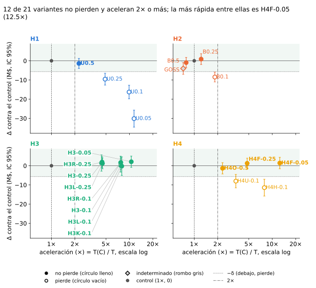
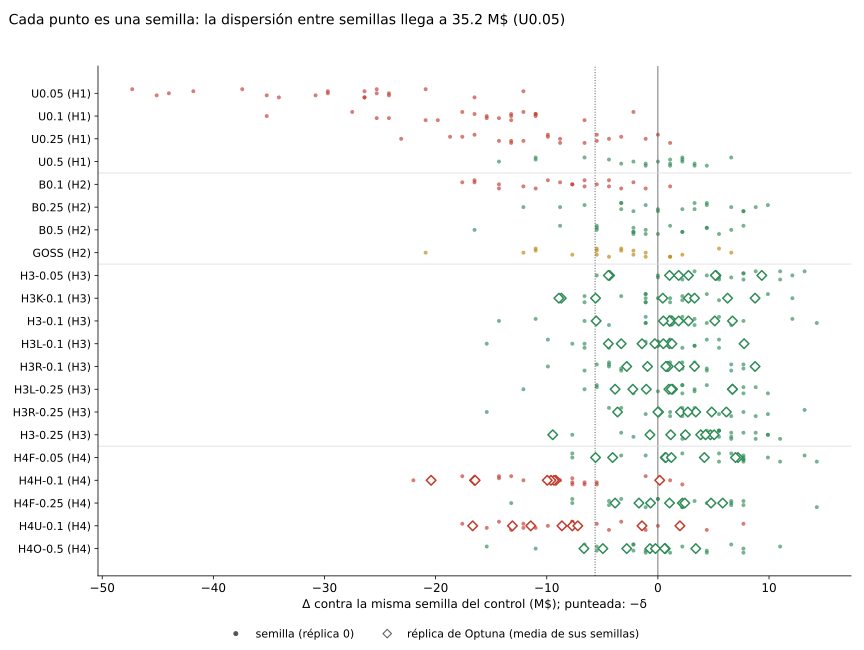
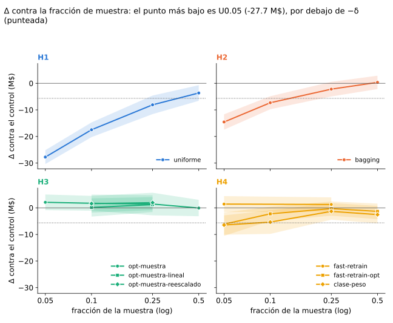
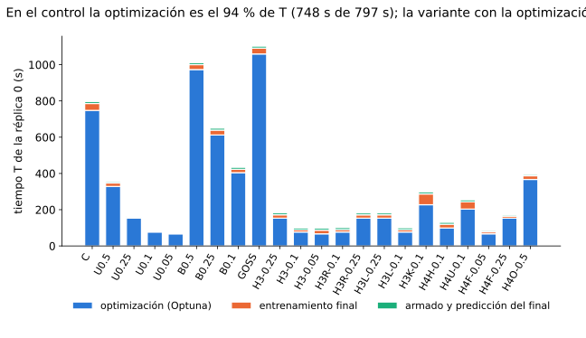
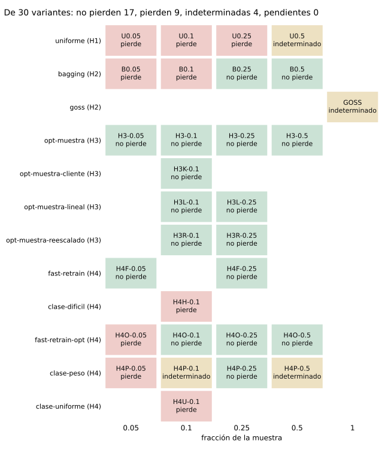
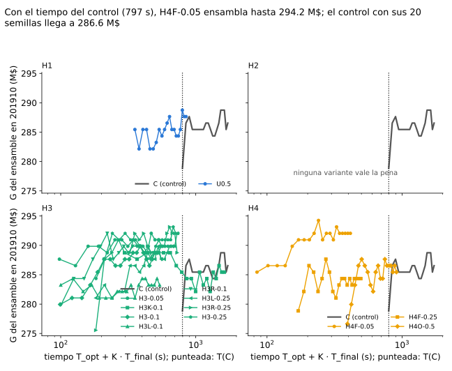
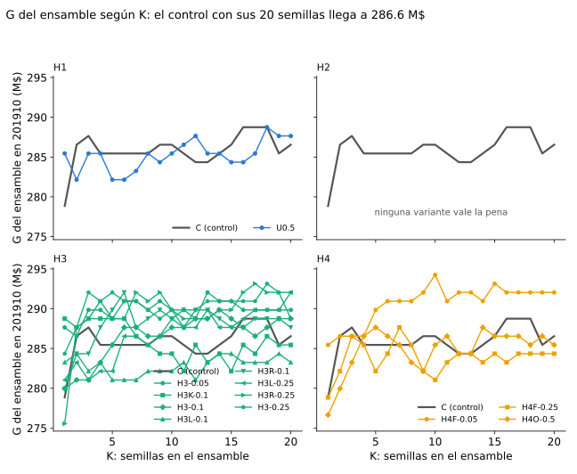
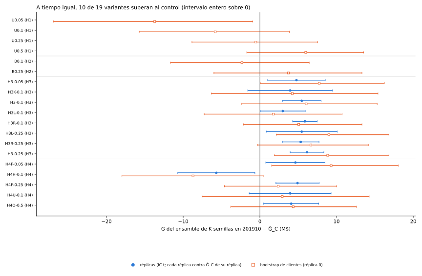

# Resultados

Todas las variantes de las cuatro hipótesis contra el control, con la respuesta a la pregunta del experimento.

## Pregunta

**¿Vale la pena el tradeoff entre velocidad y pérdida de performance?** (Zulip 208986, 1-nov.)

Sobre el baseline (Zulip 208135), ¿cuánto tiempo se ahorra y cuánta ganancia se pierde en test (201910) si se usan menos
filas para entrenar u optimizar? En H1, H2 y H3 la proporción de BAJA+1 ∪ BAJA+2 queda igual, en esperanza, en todas las
variantes; el undersampling de la clase mayoritaria lo estudia Sampling_2. H4 es la excepción declarada: conserva todas
las bajas y recorta solo CONTINUA.

| hipótesis | qué achica | página |
|---|---|---|
| H1 | el train, al azar, en la búsqueda y en el final | [H1](../h1/README.md) |
| H2 | las filas que ve cada árbol (`bagging_fraction`, GOSS) | [H2](../h2/README.md) |
| H3 | solo la búsqueda de Optuna; el final entrena con todo | [H3](../h3/README.md) |
| H4 | CONTINUA, conservando todas las bajas, en la búsqueda o en el final | [H4](../h4/README.md) |

Una variante **vale la pena** si *no pierde* contra el control y además es al menos 2 veces más rápida (A ≥ 2). Las
reglas (G, Δ, δ, T, A, N\*, veredictos) están en [Control y reglas](../control/README.md).

## Respuesta

!!! success "Respuesta"
    Vale la pena achicar la **optimización**, al azar: correr Optuna sobre el 10 % de las filas y entrenar el final con
    todas no pierde contra el control y es casi 8 veces más rápido. Si además se quiere un final más rápido, conservar
    todas las bajas y la mitad de CONTINUA con peso 2 tampoco pierde. Ninguna de las dos es una mejora de ganancia por
    modelo: es lo mismo, más rápido, y el tiempo que sobra se puede gastar en ensamblar.

<!-- generado:mapa -->
Generado por `comun/reporte.py` el 2026-11-13; no editar.

<!-- /generado:mapa -->

## Predicción

!!! info "Predicción"
    Fijada el 2026-11-01 en `sampling_1/docs/hipotesis.md` (commit `2f05cae`), antes de cualquier corrida real. Las
    predicciones de cada hipótesis están en su página.

- **Qué vale la pena**: H3 con ambas tasas y H1 con r = 0,25. Para un pipeline acotado en tiempo, como el de la segunda
  entrega, lo que más sirve es H3 con r_opt = 0,1, porque la optimización domina el tiempo total.
- **A tiempo igual**: la pregunta no es velocidad contra ganancia sino qué se hace con el tiempo ahorrado. Si no se
  reinvierte, no vale la pena perder ni un 1 %. Por eso, además de la comparación a datos iguales, hay una comparación a
  tiempo igual: el control completo contra la variante rápida con el tiempo sobrante gastado en más semillas (ensamble
  de K modelos de la variante, con K tal que el tiempo total iguale al del control). Predicción: a tiempo igual la
  variante rápida gana, y H3 es la que más rinde. (Nota del 2-nov, después de las fases 1 a 3 y antes de ver ningún
  ensamble: el ledger guardaba curvas y no predicciones, así que se agregó una fase que repite los finales guardando
  predicciones. La predicción no cambió.)
- **Contrastes principales** (9-nov, cambio `incorporar-aportes`, antes de correr H4 y las extensiones de H3): con cuatro
  hipótesis hay más de diez contrastes sin corrección por comparaciones múltiples, así que la respuesta se apoya en
  `H3-0.1`, `H4H-0.1` y `H4F-0.05` contra `C`, con réplicas (y `H4F-0.05` también a tiempo igual), fijados en
  [H4](../h4/README.md). El resto se informa como secundario.
- **Ronda 201903–201908** (12-nov): ningún veredicto cambia de lado, el IC por semilla se angosta del orden de √2 y el de
  réplicas menos. Reglas en [Control y reglas](../control/README.md).

## Comparación entre hipótesis

Las variantes `U*`, `B*` y `GOSS` no tienen réplicas (pierden o no aceleran, y las réplicas no cambian eso). En `C`, H3
y H4, el veredicto sale de Δ con 8 réplicas de la optimización.

<!-- generado:bloque-a -->
Generado por `comun/reporte.py` el 2026-11-13; no editar.

Final entrenado con 201903-201908, 20 semillas por réplica; N* = 3,300 clientes contactados; Ḡ_C (réplica 0) = 282.48 M$; Ḡ_C con réplicas = 281.78 M$ (R=8); ensamble de 20 semillas del control = 286.55 M$.

Ḡ, T y la aceleración salen de la réplica 0 en las variantes sin réplicas; en las que tienen réplicas (columna R), Ḡ es la media entre réplicas, T la mediana entre réplicas y la aceleración = T_C / T con T_C también mediana entre réplicas, así que se comparan con Ḡ_C con réplicas y no con Ḡ_C de la réplica 0.

=== "Valen la pena"

    <table><tr><th>variante</th><th>hipótesis</th><th>R</th><th>Δ [IC 95%] (M$)</th><th>aceleración (×)</th><th>ganancia contra el control</th></tr><tr><td>U0.5</td><td>H1</td><td>—a</td><td>-1.38[-3.99; 1.24]</td><td>2.25</td><td>no pierde</td></tr><tr><td>H3-0.05</td><td>H3</td><td>8</td><td class='mejor'>2.08[-0.87; 5.02]</td><td>10.56</td><td>no pierde</td></tr><tr><td>H3K-0.1</td><td>H3</td><td>8</td><td>-0.21[-5.05; 4.63]</td><td>7.98</td><td>no pierde</td></tr><tr><td>H3-0.1</td><td>H3</td><td>8</td><td>1.71[-1.07; 4.49]</td><td>7.76</td><td>no pierde</td></tr><tr><td>H3L-0.1</td><td>H3</td><td>8</td><td>0.14[-3.30; 3.57]</td><td>7.73</td><td>no pierde</td></tr><tr><td>H3R-0.1</td><td>H3</td><td>8</td><td>1.59[-1.80; 4.98]</td><td>7.71</td><td>no pierde</td></tr><tr><td>H3L-0.25</td><td>H3</td><td>8</td><td>1.22[-1.59; 4.03]</td><td>4.51</td><td>no pierde</td></tr><tr><td>H3R-0.25</td><td>H3</td><td>8</td><td>1.95[-0.85; 4.74]</td><td>4.46</td><td>no pierde</td></tr><tr><td>H3-0.25</td><td>H3</td><td>8</td><td>1.42[-2.82; 5.67]</td><td>4.38</td><td>no pierde</td></tr><tr><td>H4F-0.05</td><td>H4</td><td>8</td><td>1.41[-1.58; 4.40]</td><td class='mejor'>12.50</td><td>no pierde</td></tr><tr><td>H4F-0.25</td><td>H4</td><td>8</td><td>1.26[-1.42; 3.94]</td><td>4.77</td><td>no pierde</td></tr><tr><td>H4O-0.5</td><td>H4</td><td>8</td><td>-1.33[-4.27; 1.60]</td><td>2.31</td><td>no pierde</td></tr></table>
a sin réplicas de optimización: Δ, A y el veredicto salen de la réplica 0 (Δ apareado por semilla).

=== "H1"

    <table><tr><th>variante</th><th>hipótesis</th><th>R</th><th>Δ [IC 95%] (M$)</th><th>aceleración (×)</th><th>ganancia contra el control</th></tr><tr><td>U0.05</td><td>H1</td><td>—a</td><td class='sig-neg'>-30.14[-34.56; -25.72]</td><td>11.45</td><td>pierde</td></tr><tr><td>U0.1</td><td>H1</td><td>—a</td><td class='sig-neg'>-16.28[-19.83; -12.73]</td><td>9.89</td><td>pierde</td></tr><tr><td>U0.25</td><td>H1</td><td>—a</td><td class='sig-neg'>-9.57[-12.65; -6.49]</td><td>4.87</td><td>pierde</td></tr><tr><td>U0.5</td><td>H1</td><td>—a</td><td class='mejor'>-1.38[-3.99; 1.24]</td><td class='mejor'>2.25</td><td>no pierde</td></tr></table>
a sin réplicas de optimización: Δ, A y el veredicto salen de la réplica 0 (Δ apareado por semilla).

=== "H2"

    <table><tr><th>variante</th><th>hipótesis</th><th>R</th><th>Δ [IC 95%] (M$)</th><th>aceleración (×)</th><th>ganancia contra el control</th></tr><tr><td>B0.1</td><td>H2</td><td>—a</td><td class='sig-neg'>-8.47[-11.02; -5.92]</td><td>1.84</td><td>pierde</td></tr><tr><td>B0.25</td><td>H2</td><td>—a</td><td class='mejor'>0.88[-1.95; 3.71]</td><td class='mejor'>1.23</td><td>no pierde</td></tr><tr><td>B0.5</td><td>H2</td><td>—a</td><td>-0.94[-3.62; 1.75]</td><td>0.79</td><td>no pierde</td></tr><tr><td>GOSS</td><td>H2</td><td>—a</td><td class='sig-neg'>-4.01[-7.03; -1.00]</td><td>0.72</td><td>indeterminado</td></tr></table>
a sin réplicas de optimización: Δ, A y el veredicto salen de la réplica 0 (Δ apareado por semilla).

=== "H3"

    <table><tr><th>variante</th><th>hipótesis</th><th>R</th><th>Δ [IC 95%] (M$)</th><th>aceleración (×)</th><th>ganancia contra el control</th></tr><tr><td>H3-0.05</td><td>H3</td><td>8</td><td class='mejor'>2.08[-0.87; 5.02]</td><td class='mejor'>10.56</td><td>no pierde</td></tr><tr><td>H3K-0.1</td><td>H3</td><td>8</td><td>-0.21[-5.05; 4.63]</td><td>7.98</td><td>no pierde</td></tr><tr><td>H3-0.1</td><td>H3</td><td>8</td><td>1.71[-1.07; 4.49]</td><td>7.76</td><td>no pierde</td></tr><tr><td>H3L-0.1</td><td>H3</td><td>8</td><td>0.14[-3.30; 3.57]</td><td>7.73</td><td>no pierde</td></tr><tr><td>H3R-0.1</td><td>H3</td><td>8</td><td>1.59[-1.80; 4.98]</td><td>7.71</td><td>no pierde</td></tr><tr><td>H3L-0.25</td><td>H3</td><td>8</td><td>1.22[-1.59; 4.03]</td><td>4.51</td><td>no pierde</td></tr><tr><td>H3R-0.25</td><td>H3</td><td>8</td><td>1.95[-0.85; 4.74]</td><td>4.46</td><td>no pierde</td></tr><tr><td>H3-0.25</td><td>H3</td><td>8</td><td>1.42[-2.82; 5.67]</td><td>4.38</td><td>no pierde</td></tr></table>

=== "H4"

    <table><tr><th>variante</th><th>hipótesis</th><th>R</th><th>Δ [IC 95%] (M$)</th><th>aceleración (×)</th><th>ganancia contra el control</th></tr><tr><td>H4F-0.05</td><td>H4</td><td>8</td><td class='mejor'>1.41[-1.58; 4.40]</td><td class='mejor'>12.50</td><td>no pierde</td></tr><tr><td>H4H-0.1</td><td>H4</td><td>8</td><td class='sig-neg'>-11.41[-15.80; -7.03]</td><td>7.93</td><td>pierde</td></tr><tr><td>H4F-0.25</td><td>H4</td><td>8</td><td>1.26[-1.42; 3.94]</td><td>4.77</td><td>no pierde</td></tr><tr><td>H4U-0.1</td><td>H4</td><td>8</td><td class='sig-neg'>-8.02[-11.52; -4.53]</td><td>3.41</td><td>pierde</td></tr><tr><td>H4O-0.5</td><td>H4</td><td>8</td><td>-1.33[-4.27; 1.60]</td><td>2.31</td><td>no pierde</td></tr></table>

Detalle del bloque A

<table><tr><th>variante</th><th>Ḡ (M$)</th><th>Δ réplica 0 [IC] (M$)</th><th>Δ con réplicas [IC] (M$)</th><th>ΔAUC en 201910 [IC]</th><th>T mediana (s)</th><th>tiempo igual, réplicas [IC t] (M$)</th><th>tiempo igual, bootstrap de clientes [IC] (M$)</th></tr><tr><td>U0.05</td><td>252.34</td><td class='sig-neg'>-30.14[-34.56; -25.72]</td><td>—a</td><td class='sig-neg'>-0.0176[-0.0186; -0.0166]</td><td>70</td><td>—a</td><td class='sig-neg'>-13.72[-26.90; -0.92]</td></tr><tr><td>U0.1</td><td>266.20</td><td class='sig-neg'>-16.28[-19.83; -12.73]</td><td>—a</td><td class='sig-neg'>-0.0103[-0.0111; -0.0095]</td><td>81</td><td>—a</td><td>-5.82[-15.73; 3.85]</td></tr><tr><td>U0.25</td><td>272.91</td><td class='sig-neg'>-9.57[-12.65; -6.49]</td><td>—a</td><td class='sig-neg'>-0.0055[-0.0060; -0.0050]</td><td>164</td><td>—a</td><td>-0.52[-8.86; 7.54]</td></tr><tr><td>U0.5</td><td>281.11</td><td>-1.38[-3.99; 1.24]</td><td>—a</td><td class='sig-neg'>-0.0019[-0.0023; -0.0015]</td><td>354</td><td>—a</td><td>5.98[-1.71; 13.53]</td></tr><tr><td>B0.1</td><td>274.01</td><td class='sig-neg'>-8.47[-11.02; -5.92]</td><td>—a</td><td class='sig-neg'>-0.0088[-0.0094; -0.0083]</td><td>434</td><td>—a</td><td>-2.34[-11.66; 6.44]</td></tr><tr><td>B0.25</td><td>283.36</td><td>0.88[-1.95; 3.71]</td><td>—a</td><td class='sig-neg'>-0.0044[-0.0047; -0.0041]</td><td>650</td><td>—a</td><td>3.72[-6.00; 13.31]</td></tr><tr><td>B0.5</td><td>281.55</td><td>-0.94[-3.62; 1.75]</td><td>—a</td><td class='sig-neg'>-0.0012[-0.0017; -0.0008]</td><td>1,011</td><td>—a</td><td>—b</td></tr><tr><td>GOSS</td><td>278.46</td><td class='sig-neg'>-4.01[-7.03; -1.00]</td><td>—a</td><td class='sig-pos'>+0.0005[+0.0003; +0.0008]</td><td>1,102</td><td>—a</td><td>—b</td></tr><tr><td>H3-0.05</td><td>283.86</td><td class='sig-pos'>5.22[2.96; 7.49]</td><td>2.08[-0.87; 5.02]</td><td>-0.0020[-0.0041; +0.0000]</td><td>95</td><td class='sig-pos'>4.77[1.01; 8.53]</td><td class='sig-pos'>7.74[0.06; 16.23]</td></tr><tr><td>H3K-0.1</td><td>281.57</td><td>0.44[-1.91; 2.79]</td><td>-0.21[-5.05; 4.63]</td><td class='sig-neg'>-0.0033[-0.0050; -0.0017]</td><td>126</td><td>3.95[-1.58; 9.47]</td><td>4.24[-6.33; 15.40]</td></tr><tr><td>H3-0.1</td><td>283.49</td><td>1.26[-1.95; 4.48]</td><td>1.71[-1.07; 4.49]</td><td class='sig-neg'>-0.0017[-0.0030; -0.0003]</td><td>129</td><td class='sig-pos'>5.46[2.93; 7.98]</td><td>6.04[-2.37; 15.30]</td></tr><tr><td>H3L-0.1</td><td>281.92</td><td>-1.43[-4.02; 1.16]</td><td>0.14[-3.30; 3.57]</td><td>-0.0005[-0.0020; +0.0010]</td><td>130</td><td class='sig-pos'>2.98[0.05; 5.92]</td><td>1.76[-7.26; 10.72]</td></tr><tr><td>H3R-0.1</td><td>283.37</td><td>0.82[-1.79; 3.44]</td><td>1.59[-1.80; 4.98]</td><td>-0.0008[-0.0023; +0.0006]</td><td>130</td><td class='sig-pos'>5.87[4.27; 7.47]</td><td>5.06[-2.15; 13.31]</td></tr><tr><td>H3L-0.25</td><td>283.00</td><td>1.32[-1.36; 4.00]</td><td>1.22[-1.59; 4.03]</td><td>+0.0004[-0.0008; +0.0016]</td><td>222</td><td class='sig-pos'>5.46[0.83; 10.08]</td><td class='sig-pos'>9.00[2.14; 16.83]</td></tr><tr><td>H3R-0.25</td><td>283.72</td><td>2.04[-0.81; 4.88]</td><td>1.95[-0.85; 4.74]</td><td>+0.0000[-0.0011; +0.0011]</td><td>225</td><td class='sig-pos'>5.32[2.93; 7.71]</td><td>6.65[-0.28; 14.19]</td></tr><tr><td>H3-0.25</td><td>283.20</td><td class='sig-pos'>4.73[2.48; 6.98]</td><td>1.42[-2.82; 5.67]</td><td>-0.0009[-0.0021; +0.0004]</td><td>229</td><td class='sig-pos'>6.15[3.95; 8.34]</td><td class='sig-pos'>8.85[1.87; 16.83]</td></tr><tr><td>H4F-0.05</td><td>283.19</td><td class='sig-pos'>4.18[1.11; 7.25]</td><td>1.41[-1.58; 4.40]</td><td>-0.0019[-0.0041; +0.0003]</td><td>80</td><td class='sig-pos'>4.63[0.77; 8.50]</td><td class='sig-pos'>9.29[1.53; 18.04]</td></tr><tr><td>H4H-0.1</td><td>270.37</td><td class='sig-neg'>-9.19[-12.06; -6.31]</td><td class='sig-neg'>-11.41[-15.80; -7.03]</td><td class='sig-neg'>-0.0045[-0.0062; -0.0028]</td><td>126</td><td class='sig-neg'>-5.68[-10.71; -0.65]</td><td>-8.72[-17.99; 0.44]</td></tr><tr><td>H4F-0.25</td><td>283.04</td><td>1.04[-2.02; 4.11]</td><td>1.26[-1.42; 3.94]</td><td>-0.0002[-0.0013; +0.0009]</td><td>210</td><td class='sig-pos'>4.91[2.09; 7.73]</td><td>2.39[-4.62; 10.01]</td></tr><tr><td>H4U-0.1</td><td>273.76</td><td class='sig-neg'>-7.70[-10.81; -4.59]</td><td class='sig-neg'>-8.02[-11.52; -4.53]</td><td class='sig-neg'>-0.0037[-0.0054; -0.0021]</td><td>293</td><td>3.95[-1.40; 9.29]</td><td>2.91[-7.54; 14.25]</td></tr><tr><td>H4O-0.5</td><td>280.44</td><td>-0.71[-3.83; 2.40]</td><td>-1.33[-4.27; 1.60]</td><td>+0.0004[-0.0007; +0.0015]</td><td>434</td><td class='sig-pos'>4.08[0.49; 7.67]</td><td>4.34[-3.79; 12.60]</td></tr></table>
a sin réplicas de optimización: Δ, A y el veredicto salen de la réplica 0 (Δ apareado por semilla).

b no aplica: K &lt; 2, en el tiempo del control no entra un segundo modelo final de la variante.

<!-- /generado:bloque-a -->

- **H1, ninguna de las dos** ([H1](../h1/README.md)): `U0.5` *no pierde* y `U0.25` ya *pierde*; la frontera observada es
  r = 0,5. La pérdida crece a medida que baja r.
- **H2, refutada** ([H2](../h2/README.md)): con f = 0,1 pierde y con 0,5 y 0,25 casi no acelera (A ≤ 1,23). GOSS es
  descriptiva y queda *indeterminado*.
- **H3, confirmada también con réplicas** ([H3](../h3/README.md)): `H3-0.1` y `H3-0.25` no pierden con réplicas (cotas
  inferiores −1,07 y −2,82 M$, contra −δ = −5,65 M$) y aceleran 7,76 y 4,38 veces. La réplica 0 sola movía Δ en los dos
  sentidos: de 4,73 a 1,42 M$ con réplicas en `H3-0.25`, de 1,26 a 1,71 M$ en `H3-0.1`. El mecanismo (la muestra
  regulariza o el control tuvo mala suerte) queda sin resolver. `H3-0.05` también se confirma (A = 10,56) y reescalar
  `min_data_in_leaf` no cambia.
- **Extensiones de H3** (secundarias): las cuatro no pierden contra el control. La raíz no mejora a no reescalar; le
  gana a la lineal en r = 0,1 y no en r = 0,25; buscar sobre el 10 % de los clientes no cambia contra el 10 % de las
  filas.
- **H4, búsqueda informada: refutada** ([H4](../h4/README.md)). `H4H-0.1` y `H4U-0.1` *pierden* con réplicas (−11,41 y
  −8,02 M$, con los IC enteros debajo de −δ). Elegir negativos difíciles en vez de uniformes no cambia.
- **H4, fast-retrain: confirmada en las dos tasas.** `H4F-0.05` no pierde, acelera 12,50 veces (más que `H3-0.05`,
  10,56) y a tiempo igual *gana*. `H4F-0.25` también cumple las tres condiciones.
- **`H4O-0.5`, reoptimizar sobre el set del final** (respuesta a Zulip 211718): no pierde contra el control y no cambia
  contra `H4F-0.05`, con A = 2,31 contra 12,50. Seguir el «siempre OP» en fast-retrain cuesta más de 5 veces el tiempo y
  no suma ganancia medible.
- `U0.25` y `H3-0.25` comparten el estudio de Optuna de la réplica 0, o sea los mismos hiperparámetros. `U0.25` pierde y
  `H3-0.25` no, así que en H1 lo que se pierde es por entrenar el final con menos filas, no por optimizar sobre una
  muestra.
- **Vale la pena** (no pierde y A ≥ 2): las ocho variantes de H3, las de fast-retrain (`H4F-0.05`, `H4F-0.25` y
  `H4O-0.5`) y, en esta ronda, `U0.5` (A = 2,25). Ninguna de H2 (las que no pierden, `B0.25` y `B0.5`, tienen A < 2) ni de
  la búsqueda informada de H4, que pierde. La predicción acertó con H3 y falló con `U0.25`.
- **AUC y ganancia.** El veredicto es el de ganancia (Zulip 208135). En H3 y `H4F-0.05` el ΔAUC es negativo o cercano a
  0 (`H3L-0.25` y `H3R-0.25`) mientras la ganancia no pierde: en `H3-0.1` la caída de AUC es distinguible de 0 y el Δ de
  ganancia no. En GOSS va al revés. El AUC mide el orden de todos los clientes; G, solo los 3.300 de arriba. En H1, `B0.1` y la búsqueda informada
  de H4 las dos bajan juntas.

### Varianza entre réplicas y entre semillas

<!-- generado:semillas -->
Generado por `comun/reporte.py` el 2026-11-13; no editar.

<!-- /generado:semillas -->

**¿Alcanzan más semillas finales?** No, con un solo estudio de Optuna: entre el 24 % (`H3-0.1`) y el 58 % (`H3K-0.1`) de
la varianza de G es suerte de la optimización (25 % en `C`), y esa parte no baja con más semillas finales. Pasar de 10 a
20 semillas angostó el IC por semilla pero no el de réplicas (§ Rondas). Las cuentas están en [H3](../h3/README.md).

Las tablas de varianza y de diferencias entre variantes están en el [Anexo](anexo.md).

### Más figuras

<!-- generado:fraccion -->
Generado por `comun/reporte.py` el 2026-11-13; no editar.

<!-- /generado:fraccion -->

<!-- generado:desglose -->
Generado por `comun/reporte.py` el 2026-11-13; no editar.

<!-- /generado:desglose -->

<!-- generado:grilla -->
Generado por `comun/reporte.py` el 2026-11-13; no editar.

<!-- /generado:grilla -->

## A tiempo igual

<!-- generado:ensamble -->
Generado por `comun/reporte.py` el 2026-11-13; no editar.

<!-- /generado:ensamble -->

Cada variante gasta el tiempo que le sobra respecto del control en un ensamble de K semillas finales, K = ⌊(T(C) −
T_opt) / T_final⌋ acotado a las semillas que hay, y se mide la ganancia en 201910 al corte N\* del promedio de sus
probabilidades. Con réplicas, el IC es t entre réplicas; el bootstrap de clientes de 201910 mide el ruido del mes de test.

<!-- generado:tiempo-igual -->
Generado por `comun/reporte.py` el 2026-11-13; no editar.

Se le da a cada variante el tiempo del control: después de su optimización, el sobrante se gasta en K modelos finales con semillas distintas, K = ⌊(T(C) − T_opt) / T_final⌋, acotado a las 20 semillas que hay. T_final es la media de <code>tiempo_entrenamiento_s</code> de la variante y T_opt = T − T_final. Para K ≥ 2 se promedia fila a fila <code>prob</code> de las primeras K semillas (en el orden de <code>semillas_pedidas</code>) y se mide la ganancia en 201910 al corte N*. Se compara con Ḡ_C (un modelo del control, media de sus 10 semillas) y, como referencia, con el ensamble de las 20 semillas del control.

Ḡ_C = 282.48 M$; ensamble de 20 semillas del control = 286.55 M$.
<table><tr><th>variante</th><th>T_opt (s)</th><th>T_final (s)</th><th>K</th><th>G del ensamble en 201910 (M$)</th><th>G − Ḡ_C (M$)</th><th>G − ensamble 20 de C (M$)</th></tr><tr><td>U0.5</td><td>328</td><td>25.9</td><td>18</td><td>288.75</td><td>6.27</td><td>2.20</td></tr><tr><td>U0.25</td><td>153</td><td>10.3</td><td>62 (se usan 20)</td><td>281.05</td><td>-1.43</td><td>-5.50</td></tr><tr><td>U0.1</td><td>77</td><td>3.7</td><td>194 (se usan 20)</td><td>276.65</td><td>-5.83</td><td>-9.90</td></tr><tr><td>U0.05</td><td>67</td><td>2.7</td><td>273 (se usan 20)</td><td>267.85</td><td>-14.63</td><td>-18.70</td></tr><tr><td>B0.5</td><td>973</td><td>37.6</td><td>0</td><td>no aplica (K &lt; 2)</td><td>no aplica (K &lt; 2)</td><td>no aplica (K &lt; 2)</td></tr><tr><td>B0.25</td><td>612</td><td>37.4</td><td>4</td><td>285.45</td><td>2.97</td><td>-1.10</td></tr><tr><td>B0.1</td><td>404</td><td>29.4</td><td>13</td><td>278.85</td><td>-3.63</td><td>-7.70</td></tr><tr><td>GOSS</td><td>1,059</td><td>43.0</td><td>0</td><td>no aplica (K &lt; 2)</td><td>no aplica (K &lt; 2)</td><td>no aplica (K &lt; 2)</td></tr><tr><td>H3-0.25</td><td>153</td><td>29.3</td><td>21 (se usan 20)</td><td>292.05</td><td>9.57</td><td>5.50</td></tr><tr><td>H3-0.1</td><td>77</td><td>22.2</td><td>32 (se usan 20)</td><td>288.75</td><td>6.27</td><td>2.20</td></tr><tr><td>H3-0.05</td><td>67</td><td>30.9</td><td>23 (se usan 20)</td><td>289.85</td><td>7.37</td><td>3.30</td></tr><tr><td>H3R-0.1</td><td>77</td><td>24.0</td><td>29 (se usan 20)</td><td>287.65</td><td>5.17</td><td>1.10</td></tr><tr><td>H3R-0.25</td><td>153</td><td>28.7</td><td>22 (se usan 20)</td><td>288.75</td><td>6.27</td><td>2.20</td></tr><tr><td>H3L-0.25</td><td>153</td><td>28.7</td><td>22 (se usan 20)</td><td>292.05</td><td>9.57</td><td>5.50</td></tr><tr><td>H3L-0.1</td><td>77</td><td>23.2</td><td>31 (se usan 20)</td><td>283.25</td><td>0.77</td><td>-3.30</td></tr><tr><td>H3K-0.1</td><td>227</td><td>70.0</td><td>8</td><td>285.45</td><td>2.97</td><td>-1.10</td></tr><tr><td>H4H-0.1</td><td>99</td><td>31.2</td><td>22 (se usan 20)</td><td>274.45</td><td>-8.03</td><td>-12.10</td></tr><tr><td>H4U-0.1</td><td>203</td><td>50.8</td><td>11</td><td>285.45</td><td>2.97</td><td>-1.10</td></tr><tr><td>H4F-0.05</td><td>67</td><td>17.4</td><td>42 (se usan 20)</td><td>292.05</td><td>9.57</td><td>5.50</td></tr><tr><td>H4F-0.25</td><td>153</td><td>17.1</td><td>37 (se usan 20)</td><td>284.35</td><td>1.87</td><td>-2.20</td></tr><tr><td>H4O-0.5</td><td>367</td><td>27.1</td><td>15</td><td>286.55</td><td>4.07</td><td>0.00</td></tr></table>

<!-- /generado:tiempo-igual -->

Con réplicas, todas las H3 salvo `H3K-0.1` y las tres de fast-retrain quedan arriba del control; `H4U-0.1` tiene IC que
contiene a 0 aunque pierda con réplicas, porque el ensamble suma ganancia por sí solo, y `H4H-0.1` queda abajo. El
bootstrap de clientes da IC de unos ±8 M$ o más. Con 20 semillas ensamblar el control sí suma, así que la ventaja a
tiempo igual es en buena parte ensamble. La predicción (a tiempo igual la variante rápida gana y H3 es la que más rinde)
se cumple para las variantes que valen la pena, pero las que pierden a datos iguales no se rescatan ensamblando.

## Rondas

El gráfico y la tabla de las dos rondas están en el [Anexo](anexo.md#rondas).

- **Veredictos estables: se confirma.** 0 cambios de lado. Cambian 8 veredictos, todos desde o hacia *indeterminado* o
  entre *gana* y *no pierde* (por semilla); con réplicas no cambia ninguno.
- **IC más angosto: se confirma.** La mediana de la razón de anchos del IC por semilla (ronda anterior / vigente) es
  1,44, dentro de [1,2; 1,9].
- **Con réplicas el ancho baja menos: se confirma.** La mediana de la razón con réplicas es 0,96: con 8 réplicas el IC
  prácticamente no se angosta, porque la suerte de Optuna no depende de las semillas finales.
- T y A no se comparan entre rondas: el final de seis meses es más largo y se midió en otras VMs.

## Exploratorios

Tres estudios con su propio protocolo, replicados en las VMs del experimento, motivaron las réplicas de Optuna, H4 y las
extensiones de H3. Sus cifras no se comparan una a una con las de arriba; están en
[Exploratorios](exploratorios/README.md).

## Diseño

Cada variante tiene su Optuna (40 trials, train 201903–201906, AUC en validación, 201908) y un final que entrena con
201903–201908 y se evalúa en test (201910) con 20 semillas. Decide la ganancia al corte N\* = 3.300 envíos; el AUC va al
lado. `C`, H3 y H4 tienen 8 réplicas de la optimización (otra semilla de Optuna y otra muestra). Las fases, el reparto por
máquina y el costo están en [Corridas](corridas.md); los apartamientos del baseline, con su id, en
[Control y reglas](../control/README.md).

## Dependencias

Lee los ledgers de todos los experimentos para la comparación conjunta:

- `control`
- `h1`
- `h2`
- `h3`
- `h4`

Una hipótesis nueva suma su línea acá: es la única que se toca fuera de su carpeta y de `comun/`.

## Limitaciones comunes

Las propias de cada hipótesis están en su página.

!!! warning "Hiperparámetros de cuatro meses en un final de seis"
    Se usan sin cambios, incluido `min_data_in_leaf`, que es absoluto y ahora se aplica sobre más filas. Reescalarlo
    sería una variante nueva (la idea está en `H3R` y `H3L`).

!!! warning "Test ya mirado"
    H4 (salvo `H4O-0.5`) y las extensiones de H3 salen de un exploratorio que eligió y descartó estrategias mirando su
    ganancia en 201910, y no hay otro mes de test (la consigna lo reserva para la comparación). Entraron todas juntas,
    con reglas escritas antes de correr, y ninguna se eligió ni se descartó acá por 201910; aun así, esos resultados no
    cuentan con un mes de test que no se haya mirado.

!!! warning "Comparaciones múltiples"
    Entre H4 y las extensiones de H3 hay más de diez contrastes sin corrección: con un 5 % de error por contraste, alguno
    puede salir significativo por azar. Las conclusiones se apoyan en los contrastes principales; el resto es
    secundario.

!!! warning "Réplicas solo en parte de las variantes"
    Solo `C`, H3 y H4 tienen réplicas de Optuna. Para `U*`, `B*` y GOSS, Δ sigue incluyendo la suerte de una sola
    optimización; como pierden por mucho o no aceleran, no cambia la respuesta (`U0.5`, que vale la pena por poco, es la
    excepción: su veredicto es de una sola búsqueda). Ocho réplicas alcanzan para decidir *no pierde*, pero no para
    separar de 0 una ventaja de 1,42 a 2,08 M$.

!!! warning "Evidencia no independiente"
    `U0.25`/`H3-0.25` y `U0.1`/`H3-0.1` comparten el estudio de la réplica 0; `H3R`, `H3L` y H3 de la misma tasa comparten
    todos, y `H4F-0.05`/`H4F-0.25` comparten los de `H3-0.05`/`H3-0.25`.

!!! warning "Un mes, un año, una máquina"
    Un solo año (2019) y un solo mes de test (201910): el bootstrap de clientes muestra que el ruido de ese mes es mayor
    que el de las réplicas. A N\* fijo la ganancia se mueve en pasos de 1,1 M$, así que diferencias de uno o dos BAJA+2 no
    se distinguen del ruido. El corte N\* sale de 201908: si la tasa de bajas de 201910 es distinta, todas las variantes
    pagan igual. Los tiempos valen para `n2-highmem-8` (VMs distintas; T es la mediana entre réplicas), y en otra máquina
    solo se trasladan las aceleraciones relativas. `num_iterations = 100` fijo y `force_col_wise`: T(C) no es el tiempo
    del baseline con la configuración automática. La réplica del control (`C-rep`) se corrió en otra VM de la misma
    cuenta.

## Conclusiones

El tradeoff vale la pena si lo que se achica es la **optimización**, no el entrenamiento del modelo final. Optimizar
sobre el 5 %, 10 % o 25 % de las filas y entrenar con todas las de 201903–201908 no pierde contra el control, también
cuando se mide la suerte de Optuna con 8 réplicas, y es de 4,38 a 10,56 veces más rápido. Entrenar el final con menos
filas al azar pierde desde r = 0,25 (r = 0,5 no pierde y acelera 2,25 veces), y dentro de LightGBM pierde con f = 0,1.
Por qué: la optimización es lo que domina T, y los hiperparámetros que elige Optuna sobre la muestra sirven para el
total.

Lo que las réplicas corrigen es el tamaño de la ventaja: con una sola optimización, H3 puede parecer que le gana al
control o que empata, según la suerte del estudio; con 8 réplicas la diferencia queda entre 1,42 y 2,08 M$ y su IC
contiene a 0. La respuesta práctica no cambia (H3 no pierde y acelera), pero no hay que venderla como una mejora de
ganancia. Para comparar variantes con Optuna, más semillas finales no alcanzan: hay que repetir la optimización.

Con los tres contrastes principales, fijados antes de correr H4:

- **`H3-0.1` contra el control: no pierde** (1,71 M$ [−1,07; 4,49] con réplicas) y acelera 7,76 veces.
- **`H4H-0.1` contra el control: pierde** (−11,41 M$ [−15,80; −7,03]). Achicar la búsqueda conservando todas las bajas y
  recortando CONTINUA rinde peor que achicarla al azar, elijan como se elijan los negativos. La ventaja que reportaba el
  exploratorio no se sostiene al repetir la búsqueda.
- **`H4F-0.05` contra el control: no pierde** (1,41 M$ [−1,58; 4,40]), acelera 12,50 veces y **a tiempo igual gana**
  (4,63 M$ [0,77; 8,50]). Achicar también el final, conservando todas las bajas y la mitad de CONTINUA con peso 2,
  agrega velocidad sin perder; con el tiempo que sobra se ensamblan más semillas. Esta variante viene de una idea vista
  en 201910, y reoptimizarla sobre su propio set (`H4O-0.5`) no la mejora.

Con el final de seis meses y 20 semillas la respuesta es la misma que con cuatro meses y 10.

## Qué sigue

- Otro mes de test, para separar el ruido de 201910 del efecto de las variantes y para tener uno que no se haya mirado al
  elegir H4 y las extensiones de H3.
- Fast-retrain sobre otras búsquedas (por ejemplo, `H3-0.1`) y con otras fracciones de CONTINUA, con réplicas desde el
  principio: la suerte de la optimización es del mismo orden que las diferencias entre variantes.

## Bibliografía

- Ke, G. et al. (2017). *LightGBM: A Highly Efficient Gradient Boosting Decision Tree*. NeurIPS 30. (GOSS)
- Friedman, J. H. (2002). *Stochastic Gradient Boosting*. Computational Statistics & Data Analysis 38(4). (bagging por
  iteración)
- Akiba, T. et al. (2019). *Optuna: A Next-generation Hyperparameter Optimization Framework*. KDD.
- Bergstra, J. et al. (2011). *Algorithms for Hyper-Parameter Optimization*. NeurIPS 24. (TPE)
- Baseline oficial del experimento colaborativo, Zulip 208135 (28-oct-2026).
