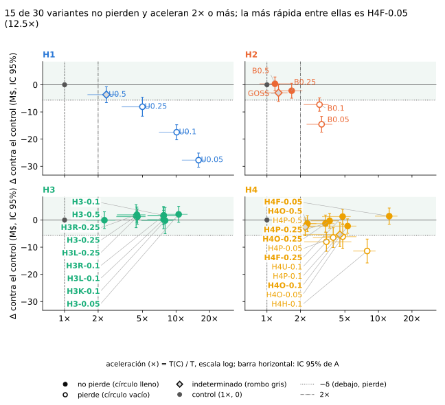
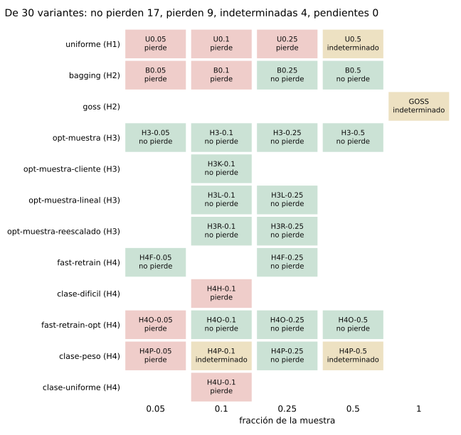
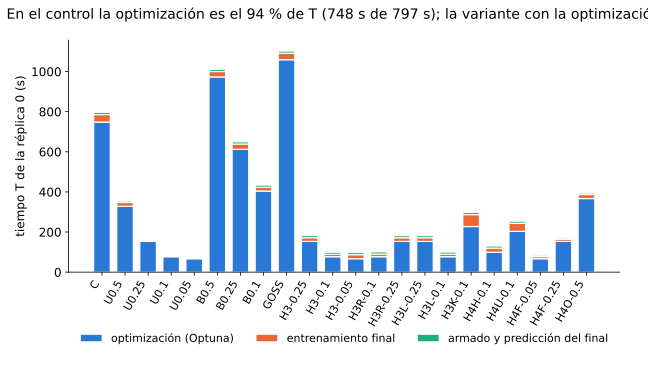
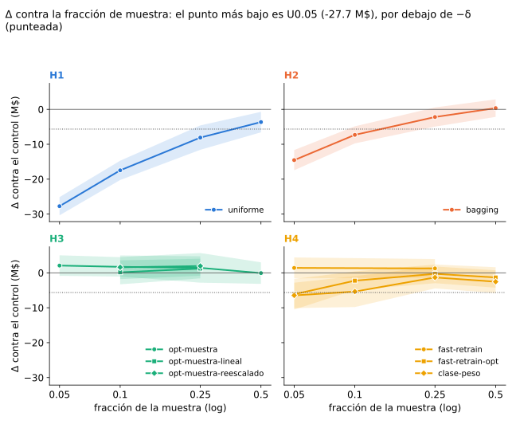
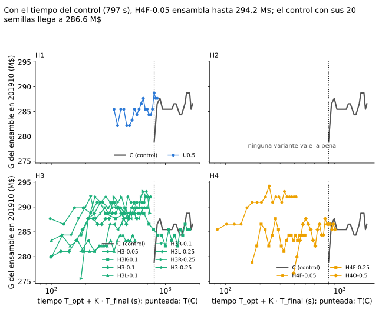
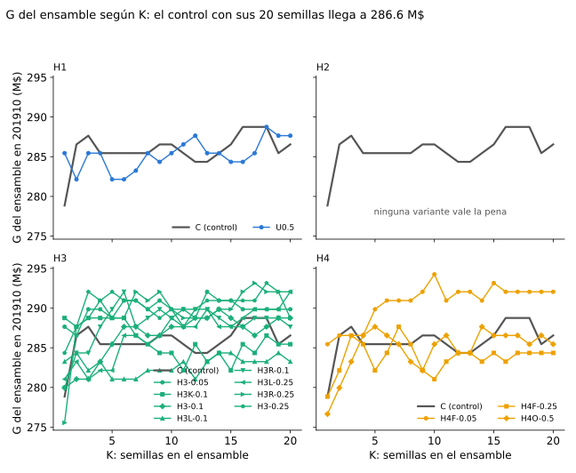
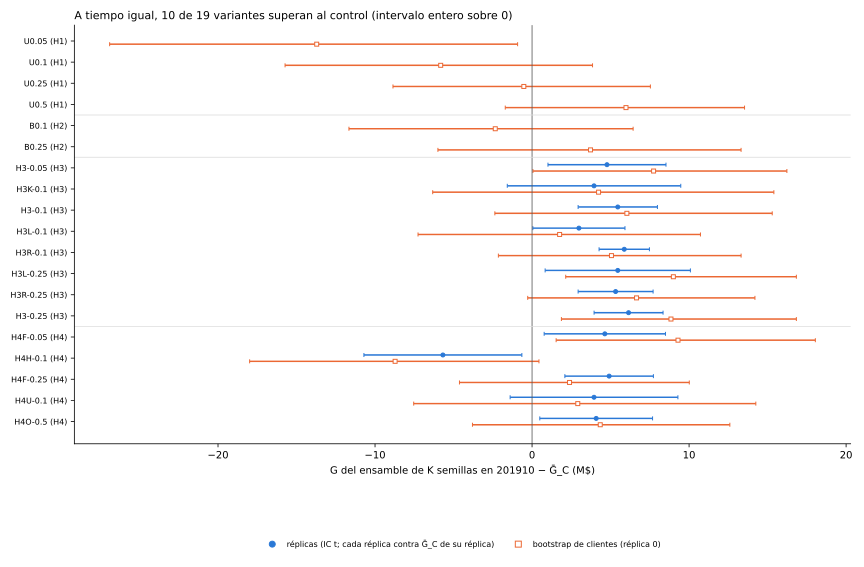
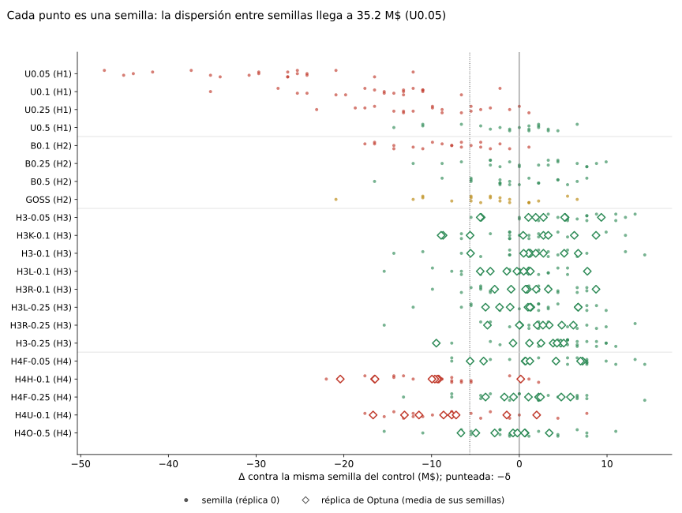

# Resultados

Todas las variantes de las cuatro hipótesis contra el control, con la respuesta a la pregunta del experimento.

## Pregunta e hipótesis

**¿Vale la pena el tradeoff entre velocidad y pérdida de performance?** Sobre el baseline (Zulip 208135), ¿cuánto tiempo
se ahorra y cuánta ganancia se pierde en test (201910) si se usan menos filas para entrenar u optimizar?

**Hipótesis general:** hay una forma de usar menos filas que *vale la pena*, es decir, que *no pierde* ganancia contra el
control y es al menos 2 veces más rápida (aceleración ≥ 2). Las reglas (G, Δ, δ, T, aceleración, N\*, veredictos) están
en [Control y reglas](../control/README.md). Cada hipótesis prueba un lugar distinto donde achicar:

| hipótesis | qué achica |
|---|---|
| [H1](../h1/README.md) | el train, al azar, en la búsqueda y en el final |
| [H2](../h2/README.md) | las filas que ve cada árbol (`bagging_fraction`, GOSS) |
| [H3](../h3/README.md) | solo la búsqueda de Optuna; el final entrena con todo |
| [H4](../h4/README.md) | CONTINUA, conservando todas las bajas, en la búsqueda o en el final |

En H1, H2 y H3 la proporción de BAJA+1 ∪ BAJA+2 queda igual, en esperanza, en todas las variantes; el undersampling de
la clase mayoritaria lo estudia Sampling_2. H4 es la excepción declarada: conserva todas las bajas y recorta solo
CONTINUA, así que cambia la proporción. Solo en la búsqueda (`H4H`, `H4U`, `H4P`) el final entrena con todas las filas;
en `H4F` y `H4O` el final también usa la muestra, y CONTINUA lleva peso 1/f para restituir la proporción ponderada del
train.

## Configuración común

Lo que comparten el control y todas las variantes; cada hipótesis cambia solo lo que dice su fila de la tabla de arriba.

| aspecto | valor |
|---|---|
| datos | 2019; positivo BAJA+1 ∪ BAJA+2; lags y deltas de orden 2 |
| búsqueda | Optuna, 40 trials, TPE, sobre 5 hiperparámetros de LightGBM; entrena con 201903–201906 y elige por AUC en validación (201908) |
| réplicas de la búsqueda | 8 estudios de Optuna por variante, con semillas del sampler 0 a 7 |
| modelo final | LightGBM con los hiperparámetros elegidos, `num_iterations = 100` y sin early stopping; entrena con 201903–201908 |
| semillas finales | 20 por réplica, las mismas en todas las variantes |
| test | 201910, solo para comparar |
| corte de envíos | N\* = 3.300 clientes, el mismo en todas las variantes |
| margen de «no pierde» | δ = 2 % de la ganancia media del control = 5,65 M$ |
| tasas | r ∈ {0,5; 0,25; 0,1; 0,05} |
| máquina | `n2-highmem-8` (8 vCPU), un trabajo por VM |

El espacio de búsqueda y los parámetros fijos de LightGBM están en [Control y reglas](../control/README.md#baseline);
cómo se corrió, en [Corridas](corridas.md#protocolo).

## Respuesta

!!! success "Respuesta"
    Vale la pena achicar la **optimización**, al azar: correr Optuna sobre el 10 % de las filas y entrenar el final con
    todas no pierde contra el control y es casi 8 veces más rápido. Si además se quiere un final más rápido, conservar
    todas las bajas y la mitad de CONTINUA con peso 2 tampoco pierde. Ninguna de las dos es una mejora de ganancia por
    modelo: es lo mismo, más rápido, y el tiempo que sobra se puede gastar en ensamblar.

<!-- generado:mapa -->

<!-- /generado:mapa -->

<!-- generado:bloque-a -->

Los números del mapa

Final entrenado con 201903-201908, 20 semillas por réplica; N* = 3,300 clientes contactados; Ḡ_C (réplica 0) = 282.48 M$; Ḡ_C con réplicas = 281.78 M$ (R=8); ensamble de 20 semillas del control = 286.55 M$.

Ḡ es la media entre réplicas y T la mediana entre réplicas (columna R), así que se comparan con Ḡ_C con réplicas. La aceleración es la misma referencia en todas las filas: A = T_C / T, con T_C la mediana de T de todas las réplicas del control. El intervalo de A es un bootstrap por percentiles (95 %) del cociente de medianas: se remuestrean las réplicas del control y, por separado, las de la variante. Mide la variación entre réplicas, que junta la de Optuna y la de la VM (la calibración dice cuánto es de la VM); con 8 réplicas la mediana remuestreada toma pocos valores y una réplica rara lo mueve. El tiempo igual sigue apareado por réplica k porque ahí el ensamble de la réplica k se compara con la ganancia del control de esa misma réplica. Una variante sin réplicas, si la hubiera, lleva una nota al pie en las celdas que salen de la réplica 0.

=== "Lo mejor de cada hipótesis"

    <table><tr><th>variante</th><th>hipótesis</th><th>R</th><th>Δ [IC 95%] (M$)</th><th>aceleración (×)</th><th>ganancia contra el control</th></tr><tr><td>U0.5</td><td>H1</td><td>8</td><td class='sig-neg'>-3.64[-6.58; -0.71]</td><td>2.37[1.60; 2.98]</td><td>indeterminado</td></tr><tr><td>B0.5</td><td>H2</td><td>8</td><td>0.35[-2.16; 2.86]</td><td>1.18[0.86; 1.64]</td><td>no pierde</td></tr><tr><td>H3-0.05</td><td>H3</td><td>8</td><td class='mejor'>2.08[-0.87; 5.02]</td><td>10.56[8.00; 12.69]</td><td>no pierde</td></tr><tr><td>H4F-0.05</td><td>H4</td><td>8</td><td>1.41[-1.58; 4.40]</td><td class='mejor'>12.50[9.31; 14.82]</td><td>no pierde</td></tr></table>

=== "H1"

    <table><tr><th>variante</th><th>hipótesis</th><th>R</th><th>Δ [IC 95%] (M$)</th><th>aceleración (×)</th><th>ganancia contra el control</th></tr><tr><td>U0.05</td><td>H1</td><td>8</td><td class='sig-neg'>-27.74[-30.35; -25.13]</td><td>15.94[11.28; 18.29]</td><td>pierde</td></tr><tr><td>U0.1</td><td>H1</td><td>8</td><td class='sig-neg'>-17.47[-20.23; -14.71]</td><td>10.13[7.02; 12.69]</td><td>pierde</td></tr><tr><td>U0.25</td><td>H1</td><td>8</td><td class='sig-neg'>-8.09[-11.58; -4.60]</td><td>4.99[3.26; 5.84]</td><td>pierde</td></tr><tr><td>U0.5</td><td>H1</td><td>8</td><td class='sig-neg'>-3.64[-6.58; -0.71]</td><td>2.37[1.60; 2.98]</td><td>indeterminado</td></tr></table>

=== "H2"

    <table><tr><th>variante</th><th>hipótesis</th><th>R</th><th>Δ [IC 95%] (M$)</th><th>aceleración (×)</th><th>ganancia contra el control</th></tr><tr><td>B0.05</td><td>H2</td><td>8</td><td class='sig-neg'>-14.55[-17.44; -11.66]</td><td>3.09[2.27; 3.86]</td><td>pierde</td></tr><tr><td>B0.1</td><td>H2</td><td>8</td><td class='sig-neg'>-7.31[-9.76; -4.86]</td><td>2.96[2.13; 3.57]</td><td>pierde</td></tr><tr><td>B0.25</td><td>H2</td><td>8</td><td>-2.20[-4.95; 0.55]</td><td class='mejor'>1.67[1.23; 2.08]</td><td>no pierde</td></tr><tr><td>GOSS</td><td>H2</td><td>8</td><td>-2.96[-6.13; 0.21]</td><td>1.27[0.91; 1.53]</td><td>indeterminado</td></tr><tr><td>B0.5</td><td>H2</td><td>8</td><td class='mejor'>0.35[-2.16; 2.86]</td><td>1.18[0.86; 1.64]</td><td>no pierde</td></tr></table>

=== "H3"

    <table><tr><th>variante</th><th>hipótesis</th><th>R</th><th>Δ [IC 95%] (M$)</th><th>aceleración (×)</th><th>ganancia contra el control</th></tr><tr><td>H3-0.05</td><td>H3</td><td>8</td><td class='mejor'>2.08[-0.87; 5.02]</td><td class='mejor'>10.56[8.00; 12.69]</td><td>no pierde</td></tr><tr><td>H3K-0.1</td><td>H3</td><td>8</td><td>-0.21[-5.05; 4.63]</td><td>7.98[4.89; 9.46]</td><td>no pierde</td></tr><tr><td>H3-0.1</td><td>H3</td><td>8</td><td>1.71[-1.07; 4.49]</td><td>7.76[5.56; 10.04]</td><td>no pierde</td></tr><tr><td>H3L-0.1</td><td>H3</td><td>8</td><td>0.14[-3.30; 3.57]</td><td>7.73[5.52; 9.93]</td><td>no pierde</td></tr><tr><td>H3R-0.1</td><td>H3</td><td>8</td><td>1.59[-1.80; 4.98]</td><td>7.71[5.53; 9.99]</td><td>no pierde</td></tr><tr><td>H3L-0.25</td><td>H3</td><td>8</td><td>1.22[-1.59; 4.03]</td><td>4.51[2.91; 5.32]</td><td>no pierde</td></tr><tr><td>H3R-0.25</td><td>H3</td><td>8</td><td>1.95[-0.85; 4.74]</td><td>4.46[2.95; 5.32]</td><td>no pierde</td></tr><tr><td>H3-0.25</td><td>H3</td><td>8</td><td>1.42[-2.82; 5.67]</td><td>4.38[2.93; 5.33]</td><td>no pierde</td></tr><tr><td>H3-0.5</td><td>H3</td><td>8</td><td>-0.08[-3.17; 3.00]</td><td>2.28[1.55; 2.85]</td><td>no pierde</td></tr></table>

=== "H4"

    <table><tr><th>variante</th><th>hipótesis</th><th>R</th><th>Δ [IC 95%] (M$)</th><th>aceleración (×)</th><th>ganancia contra el control</th></tr><tr><td>H4F-0.05</td><td>H4</td><td>8</td><td class='mejor'>1.41[-1.58; 4.40]</td><td class='mejor'>12.50[9.31; 14.82]</td><td>no pierde</td></tr><tr><td>H4H-0.1</td><td>H4</td><td>8</td><td class='sig-neg'>-11.41[-15.80; -7.03]</td><td>7.93[5.94; 9.43]</td><td>pierde</td></tr><tr><td>H4O-0.1</td><td>H4</td><td>8</td><td>-2.25[-4.91; 0.41]</td><td>5.29[2.28; 6.35]</td><td>no pierde</td></tr><tr><td>H4O-0.05</td><td>H4</td><td>8</td><td class='sig-neg'>-6.14[-10.53; -1.75]</td><td>4.78[3.16; 6.35]</td><td>pierde</td></tr><tr><td>H4F-0.25</td><td>H4</td><td>8</td><td>1.26[-1.42; 3.94]</td><td>4.77[3.12; 5.64]</td><td>no pierde</td></tr><tr><td>H4P-0.1</td><td>H4</td><td>8</td><td class='sig-neg'>-5.37[-9.81; -0.93]</td><td>4.51[1.99; 5.32]</td><td>indeterminado</td></tr><tr><td>H4P-0.05</td><td>H4</td><td>8</td><td class='sig-neg'>-6.47[-10.11; -2.83]</td><td>3.93[2.58; 4.98]</td><td>pierde</td></tr><tr><td>H4O-0.25</td><td>H4</td><td>8</td><td>-0.30[-2.97; 2.38]</td><td>3.65[2.47; 4.40]</td><td>no pierde</td></tr><tr><td>H4U-0.1</td><td>H4</td><td>8</td><td class='sig-neg'>-8.02[-11.52; -4.53]</td><td>3.41[2.16; 5.72]</td><td>pierde</td></tr><tr><td>H4P-0.25</td><td>H4</td><td>8</td><td>-1.33[-4.46; 1.81]</td><td>3.35[2.28; 4.04]</td><td>no pierde</td></tr><tr><td>H4O-0.5</td><td>H4</td><td>8</td><td>-1.33[-4.27; 1.60]</td><td>2.31[1.64; 2.77]</td><td>no pierde</td></tr><tr><td>H4P-0.5</td><td>H4</td><td>8</td><td>-2.55[-5.82; 0.72]</td><td>2.20[1.58; 2.69]</td><td>indeterminado</td></tr></table>

<!-- /generado:bloque-a -->

## ¿Qué conviene achicar?

La optimización domina el tiempo del control, así que achicarla es lo que más acelera. La grilla dice qué variantes
pierden en cada forma de muestrear y cada tasa; el desglose, dónde se va el tiempo.

<!-- generado:grilla -->

<!-- /generado:grilla -->

<!-- generado:desglose -->

<!-- /generado:desglose -->

Desde la grilla común las 30 variantes y `C` tienen 8 réplicas de la optimización: el veredicto sale de Δ con réplicas, y
A, de la mediana de T contra la del control, con su intervalo (los números, plegados debajo del mapa). La mejor
variante de cada hipótesis, valga la pena o no: la de H1, `U0.5`, queda *indeterminada*, y la de H2, `B0.5`, no pierde pero acelera 1,18
veces. La más rápida de H2 que no pierde, `B0.25`, acelera 1,67 veces [1,23; 2,08]: tampoco llega a 2.

- **H1, ninguna de las dos** ([H1](../h1/README.md)). Predecía que r = 0,5 y 0,25 no pierden y que r = 0,05
  pierde: con réplicas `U0.5` queda *indeterminado* (−3,64 M$ [−6,58; −0,71]) y `U0.25` ya *pierde*, así que no queda
  frontera observada (con la réplica 0 sola, `U0.5` no perdía). La pérdida crece a medida que baja r.
- **H2, refutada** ([H2](../h2/README.md)): con f = 0,1 y 0,05 pierde, y con 0,5 y 0,25 no pierde pero acelera menos de 2
  veces (1,18 y 1,67; el intervalo de `B0.25` llega a 2,08). GOSS es descriptiva y queda *indeterminado*.
- **H3, confirmada también con réplicas** ([H3](../h3/README.md)): `H3-0.1` y `H3-0.25` no pierden con réplicas (cotas
  inferiores −1,07 y −2,82 M$, contra −δ = −5,65 M$) y aceleran 7,76 y 4,38 veces. La réplica 0 sola movía Δ en los dos
  sentidos: de 4,73 a 1,42 M$ con réplicas en `H3-0.25`, de 1,26 a 1,71 M$ en `H3-0.1`. El mecanismo (la muestra
  regulariza o el control tuvo mala suerte) queda sin resolver. `H3-0.05` también se confirma (aceleración 10,56), y
  `H3-0.5`, de la grilla común, no pierde y acelera 2,28 veces.
- **Extensiones de H3** (secundarias): las cinco no pierden contra el control. La raíz no mejora a no reescalar; le
  gana a la lineal en r = 0,1 y no en r = 0,25; buscar sobre el 10 % de los clientes no cambia contra el 10 % de las
  filas.
- **H4, búsqueda informada: refutada** ([H4](../h4/README.md)). `H4H-0.1` y `H4U-0.1` *pierden* con réplicas (−11,41 y
  −8,02 M$): el IC de `H4H-0.1` queda entero debajo de −δ y `H4U-0.1` pierde por la media. Elegir negativos difíciles en vez de uniformes no cambia.
- **H4, fast-retrain: confirmada en las dos tasas.** `H4F-0.05` no pierde, acelera 12,50 veces (más que `H3-0.05`,
  10,56) y a tiempo igual *gana*. `H4F-0.25` también cumple las tres condiciones.
- **`H4O-0.5`, reoptimizar sobre el set del final**: no pierde contra el control y no cambia contra `H4F-0.05`, con
  aceleración 2,31 contra 12,50. Reoptimizar sobre la receta del final cuesta más de 5 veces el tiempo y no suma
  ganancia medible.
- **H4, grilla común** ([H4](../h4/README.md) § Grilla común). Conservar las bajas con peso en la búsqueda y el final
  (`H4O-{r}`) no pierde en 0,5, 0,25 y 0,1 y pierde en 0,05 (−6,14 M$). Solo en la búsqueda (`H4P-{r}`), no pierde en
  0,25, queda *indeterminado* en 0,5 y 0,1 y pierde en 0,05.
- `U{r}` y `H3-{r}` comparten los estudios de Optuna en las cuatro tasas y las 8 réplicas, o sea los mismos
  hiperparámetros. `U{r}` pierde contra `H3-{r}` en las cuatro (tabla de diferencias del [Anexo](anexo.md)), así que en
  H1 lo que se pierde es por entrenar el final con menos filas, no por optimizar sobre una muestra.
- **Vale la pena** (no pierde y aceleración ≥ 2): 15 de las 30 variantes. Las nueve de H3, las de fast-retrain
  (`H4F-0.05`, `H4F-0.25` y `H4O-0.5`) y, de la grilla común, `H4O-0.25`, `H4O-0.1` y `H4P-0.25` (A de 3,65; 5,29 y
  3,35). `U0.5` sale de la lista: con réplicas queda *indeterminado*, aunque acelere 2,37 veces. Ninguna de H2 (las que
  no pierden, `B0.25` y `B0.5`, aceleran menos de 2 veces) ni de la búsqueda informada de H4, que pierde.

## ¿Cuánto se puede achicar?

Depende de qué se achique. Si es solo la búsqueda (H3), hasta el 5 % de las filas no pierde. Si es también el final al
azar (H1), la pérdida crece a medida que baja la fracción y ninguna tasa queda en *no pierde* (r = 0,5 es
*indeterminado*). Si el final conserva todas las bajas y recorta solo CONTINUA con peso (`H4O`), no pierde hasta el 10 %.

<!-- generado:fraccion -->

<!-- /generado:fraccion -->

### ¿Importa qué filas se conservan?

Sí, y cada vez más a medida que baja la tasa. Los cuatro pares `H4O-{r}` − `U{r}` se declararon antes de correr: las
dos variantes achican la búsqueda y el final a la misma tasa de CONTINUA, una conservando todas las bajas con peso y la
otra al azar.

| r | filas de `H4O-{r}` / `U{r}` | `H4O-{r}` − `U{r}` | `H4O-{r}` contra el control | `U{r}` contra el control |
|---|---|---|---|---|
| 0,5 | 388.132 / 384.250 | *no cambia* | no pierde (−1,33) | indeterminado (−3,64) |
| 0,25 | 197.949 / 192.125 | *mejora* | no pierde (−0,30) | pierde (−8,09) |
| 0,1 | 83.839 / 76.850 | *mejora* | no pierde (−2,25) | pierde (−17,47) |
| 0,05 | 45.803 / 38.425 | *mejora* | pierde (−6,14) | pierde (−27,74) |

Δ con réplicas en M$; la magnitud y el IC de cada par están en el [Anexo](anexo.md#diferencias-entre-variantes). Los
pares no aíslan una sola cosa: `H4O-{r}` tiene más filas (las bajas que la muestra al azar no tendría), otra proporción de
clases y peso en CONTINUA. Conservar las bajas con peso rinde más que muestrear al azar desde r = 0,25. Lo que separa a
H4 de H1 es el final: si se achica solo la búsqueda, `H4P-{r}` no le gana a `H3-{r}` (no cambia en 0,5 y 0,25, empeora en
0,1 y 0,05), y el peso en la búsqueda (`H4P-0.1` − `H4U-0.1`) no cambia.

## ¿Qué se hace con el tiempo ahorrado?

Cada variante gasta el tiempo que le sobra respecto del control en un ensamble de K semillas finales, K = ⌊(T(C) −
T_opt) / T_final⌋ acotado a las semillas que hay, y se mide la ganancia en 201910 al corte N\* del promedio de sus
probabilidades. Con réplicas, el IC es t entre réplicas; el bootstrap de clientes de 201910 mide el ruido del mes de test.

<!-- generado:ensamble -->

<!-- /generado:ensamble -->

<!-- generado:tiempo-igual -->

<!-- /generado:tiempo-igual -->

Con réplicas, todas las H3 salvo `H3K-0.1` y `H3-0.5`, las tres de fast-retrain y todas las de la grilla común de H4
salvo `H4P-0.5` quedan arriba del control; también `U0.5` y `B0.5`. `H4U-0.1` tiene IC que contiene a 0 aunque pierda
con réplicas, porque el ensamble suma ganancia por sí solo, y `H4H-0.1`, `U0.05` y `B0.05` quedan abajo. El bootstrap de
clientes da IC de unos ±8 M$ o más. Con 20 semillas ensamblar el control sí suma, así que la ventaja a tiempo igual es
en buena parte ensamble. Las que pierden a datos iguales en H1, H2 y la búsqueda informada no se rescatan ensamblando;
en la grilla común de H4 sí: `H4O-0.05` y `H4P-0.05` pierden a datos iguales y quedan arriba a tiempo igual (5,60 y
5,46 M$): lo que suma el ensamble supera lo que pierden.

## ¿Cuánto del tiempo es tamaño de datos?

<!-- generado:tiempos -->
Predicciones de `control/docs/hipotesis.md` § Medición de tiempos; la medición es exploratoria y no cambia veredictos: dice cuánto del A del bloque A es tamaño de datos y cuánto es la elección de Optuna. Las VMs corrieron en horarios distintos, así que el CV entre VMs junta la VM y la hora; cada ancla es una sola medición vieja.

<table><tr><th>r</th><th>filas (al azar)</th><th>A fijo, al azar [mín; máx entre juegos]</th><th>A de U{r} (bloque A)</th><th>filas (bajas con peso)</th><th>A fijo, bajas con peso [mín; máx]</th><th>A de H4O-{r} (bloque A)</th><th>T bajas / T azar</th><th>filas bajas / filas azar</th><th>CV entre repeticiones (mediana)</th></tr><tr><td>0.5</td><td>253,436</td><td>2.16 [1.57; 2.43]</td><td>2.37</td><td>256,092</td><td>2.14 [1.55; 2.47]</td><td>2.31</td><td>1.01</td><td>1.01</td><td>2.9 %</td></tr><tr><td>0.25</td><td>126,718</td><td>4.43 [3.47; 5.96]</td><td>4.99</td><td>130,703</td><td>4.73 [3.19; 5.43]</td><td>3.65</td><td>1.00</td><td>1.03</td><td>3.7 %</td></tr><tr><td>0.1</td><td>50,687</td><td>12.97 [9.10; 15.93]</td><td>10.13</td><td>55,469</td><td>11.89 [8.81; 14.82]</td><td>5.29</td><td>1.08</td><td>1.09</td><td>1.8 %</td></tr><tr><td>0.05</td><td>25,344</td><td>20.70 [15.79; 32.54]</td><td>15.94</td><td>30,391</td><td>21.07 [16.83; 28.88]</td><td>4.78</td><td>1.09</td><td>1.20</td><td>1.7 %</td></tr></table>

<!-- /generado:tiempos -->

A igual r, `H4O-{r}` acelera menos que `U{r}` (3,65 contra 4,99 en 0,25; 5,29 contra 10,13 en 0,1), aunque con los
mismos hiperparámetros la muestra con bajas tarda casi lo mismo que la muestra al azar. La diferencia de A viene de los
hiperparámetros que elige Optuna sobre cada muestra, no del tamaño de datos. La calibración de las VMs y la búsqueda y
el final de cada variante están en el [Anexo](anexo.md#tiempos-tablas-completas).

## ¿Qué tan estable es?

<!-- generado:semillas -->

<!-- /generado:semillas -->

**¿Alcanzan más semillas finales?** No, con un solo estudio de Optuna: con 8 réplicas en las 30 variantes, entre el 6 %
(`U0.05`) y el 58 % (`H3K-0.1`) de la varianza de G es suerte de la optimización (25 % en `C`), y esa parte no baja con
más semillas finales. Pasar de 10 a
20 semillas angostó el IC por semilla pero no el de réplicas. Las cuentas están en [H3](../h3/README.md); las tablas de
varianza y de diferencias entre variantes, en el [Anexo](anexo.md).

**Entre rondas** (final de cuatro meses contra final de seis; el detalle, con el gráfico y la tabla, en el
[Anexo](anexo.md#rondas)):

- ningún veredicto cambia de lado;
- el IC por semilla se angosta (mediana de la razón de anchos 1,44);
- con réplicas el IC prácticamente no se angosta (0,96), porque la suerte de Optuna no depende de las semillas finales.

**AUC y ganancia.** El veredicto es el de ganancia (Zulip 208135). En las cuatro variantes de la primera tanda de H3
y en `H4F-0.05` el ΔAUC es negativo mientras el Δ de ganancia es positivo: en `H3-0.1` la caída de AUC es distinguible de 0 y el Δ de
ganancia no. En GOSS va al revés. El AUC mide el orden de todos los clientes; G, solo los 3.300 de arriba. En H1, `B0.1`
y la búsqueda informada de H4 las dos bajan juntas.

## Limitaciones comunes

Las propias de cada hipótesis están en su página.

- **Hiperparámetros de cuatro meses en un final de seis.** Se usan sin cambios, incluido `min_data_in_leaf`, que es
  absoluto y ahora se aplica sobre más filas. Reescalarlo sería una variante nueva (la idea está en `H3R` y `H3L`).
- **Test ya mirado.** H4 (salvo `H4O-0.5`) y las extensiones de H3 salen de un exploratorio que eligió y descartó
  estrategias mirando su ganancia en 201910, y no hay otro mes de test (la consigna lo reserva para la comparación).
  Entraron todas juntas, con reglas escritas antes de correr, y ninguna se eligió ni se descartó acá por 201910; aun
  así, esos resultados no cuentan con un mes de test que no se haya mirado.
- **Comparaciones múltiples.** Entre H4 y las extensiones de H3 hay más de diez contrastes sin corrección: con un 5 % de
  error por contraste, alguno puede salir significativo por azar. Las conclusiones se apoyan en los contrastes
  principales; el resto es secundario.
- **Ocho réplicas.** Todas las variantes tienen 8 réplicas de Optuna desde la grilla común. Alcanzan para decidir *no
  pierde*, pero no para separar de 0 una ventaja de 1,42 a 2,08 M$.
- **Evidencia no independiente.** `U{r}` y `H3-{r}` comparten los estudios de Optuna en las cuatro tasas; `H3R`, `H3L`
  y H3 de la misma tasa también, y `H4F-0.05`/`H4F-0.25` reusan los de `H3-0.05`/`H3-0.25`, que son los de
  `U0.05`/`U0.25`. `H4O-{r}` y `H4P-{r}` comparten los suyos.
- **Cómo se midió el tiempo.** Todas las corridas usaron la misma CPU (`n2-highmem-8`, un trabajo por VM). Dentro de
  una VM el mismo final tarda casi lo mismo de una repetición a otra; entre VMs varía más, y como corrieron en horarios
  distintos, ese CV mezcla la VM con la hora. Contra las fases anteriores, las anclas de calibración (una sola medición
  vieja cada una) quedan corridas, así que T compara bien dentro de la grilla común y peor contra rondas viejas. El
  intervalo de A junta la suerte de Optuna con la de la VM. La medición a hiperparámetros fijos separa el tamaño de datos
  de la elección de Optuna y es exploratoria: no cambia veredictos. T no incluye la preparación de la muestra (a lo
  sumo medio segundo). Las cifras están en § ¿Cuánto del tiempo es tamaño de datos?
- **Corte N\* y pares.** N\* = 3.300 vale tal cual para las variantes que entrenan el final con la proporción original
  (`U*`, `B*`, H3, `H4H`, `H4U`, `H4P`); en `H4F` y `H4O` lo sostiene el peso 1/f de CONTINUA, que deja comparable el
  orden de los primeros 3.300, pero el corte no se reajusta. H2 no entra en los pares directos: en `B*`,
  `bagging_fraction` sale del espacio de Optuna, así que la comparación con `U*` es descriptiva; la grilla de veredictos
  la muestra al lado.
- **Un mes, un año, una máquina.** Un solo año (2019) y un solo mes de test (201910): el bootstrap de clientes muestra
  que el ruido de ese mes es mayor que el de las réplicas. A N\* fijo la ganancia se mueve en pasos de 1,1 M$, así que
  diferencias de uno o dos BAJA+2 no se distinguen del ruido. El corte N\* sale de 201908: si la tasa de bajas de 201910
  es distinta, todas las variantes pagan igual. Los tiempos valen para `n2-highmem-8` (VMs distintas; T es la mediana
  entre réplicas), y en otra máquina solo se trasladan las aceleraciones relativas. `num_iterations = 100` fijo y
  `force_col_wise`: T(C) no es el tiempo del baseline con la configuración automática. La réplica del control (`C-rep`)
  se corrió en otra VM de la misma cuenta.

## Conclusiones

El tradeoff vale la pena si lo que se achica es la **optimización**, no el entrenamiento del modelo final. Optimizar
sobre el 5 %, 10 % o 25 % de las filas y entrenar con todas las de 201903–201908 no pierde contra el control, también
cuando se mide la suerte de Optuna con 8 réplicas, y es de 4,38 a 10,56 veces más rápido. Entrenar el final con menos
filas al azar pierde desde r = 0,25, y en r = 0,5 queda *indeterminado* con réplicas (acelera 2,37 veces, pero no
alcanza para decir que no pierde); conservando todas las bajas con peso no pierde hasta r = 0,1. Dentro de LightGBM
pierde con f = 0,1.
Por qué: la optimización es lo que domina T, y los hiperparámetros que elige Optuna sobre la muestra sirven para el
total.

Lo que las réplicas corrigen es el tamaño de la ventaja: con una sola optimización, H3 puede parecer que le gana al
control o que empata, según la suerte del estudio; con 8 réplicas la diferencia queda entre 1,42 y 2,08 M$ y su IC
contiene a 0. La respuesta práctica no cambia (H3 no pierde y acelera), pero no hay que venderla como una mejora de
ganancia. Para comparar variantes con Optuna, más semillas finales no alcanzan: hay que repetir la optimización.

Con los tres contrastes principales, fijados antes de correr H4:

- **`H3-0.1` contra el control: no pierde** (1,71 M$ [−1,07; 4,49] con réplicas) y acelera 7,76 veces.
- **`H4H-0.1` contra el control: pierde** (−11,41 M$ [−15,80; −7,03]). Achicar la búsqueda conservando todas las bajas y
  recortando CONTINUA rinde peor que achicarla al azar, elijan como se elijan los negativos. La ventaja que reportaba el
  exploratorio no se sostiene al repetir la búsqueda.
- **`H4F-0.05` contra el control: no pierde** (1,41 M$ [−1,58; 4,40]), acelera 12,50 veces y **a tiempo igual gana**
  (4,63 M$ [0,77; 8,50]). Achicar también el final, conservando todas las bajas y la mitad de CONTINUA con peso 2,
  agrega velocidad sin perder; con el tiempo que sobra se ensamblan más semillas. Esta variante viene de una idea vista
  en 201910, y reoptimizarla sobre su propio set (`H4O-0.5`) no la mejora.

Con el final de seis meses y 20 semillas la respuesta es la misma que con cuatro meses y 10.

**La predicción** ([Predicción del experimento](../control/README.md#prediccion-del-experimento-1-nov)):

- **Qué vale la pena: acertó con H3 y falló con H1.** H3 vale la pena con las dos tasas, pero `U0.25` pierde; en H1
  no vale la pena ninguna, porque `U0.5` queda *indeterminado* con réplicas.
- **A tiempo igual: acertó para las variantes que valen la pena.** Las rápidas que no pierden quedan arriba del control
  ensamblando. Las que pierden a datos iguales no se rescatan, salvo `H4O-0.05` y `H4P-0.05` en la grilla común.
- **Ronda 201903–201908: acertó en las tres reglas** (detalle en el [Anexo](anexo.md#rondas)).

## Qué sigue

- Otro mes de test, para separar el ruido de 201910 del efecto de las variantes y para tener uno que no se haya mirado al
  elegir H4 y las extensiones de H3.
- Fast-retrain sobre otras búsquedas (por ejemplo, `H3-0.1`) y con otras fracciones de CONTINUA, con réplicas desde el
  principio: la suerte de la optimización es del mismo orden que las diferencias entre variantes.

## Exploratorios

Tres estudios con su propio protocolo motivaron las réplicas de Optuna, H4 y las extensiones de H3; sus cifras no se
comparan una a una con las de arriba y están en [Exploratorios](exploratorios/README.md).

## Dependencias

Lee los ledgers de todos los experimentos para la comparación conjunta:

- `control`
- `h1`
- `h2`
- `h3`
- `h4`

Una hipótesis nueva suma su línea acá: es la única que se toca fuera de su carpeta y de `comun/`.
