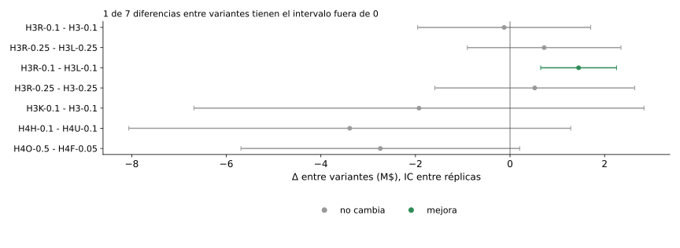
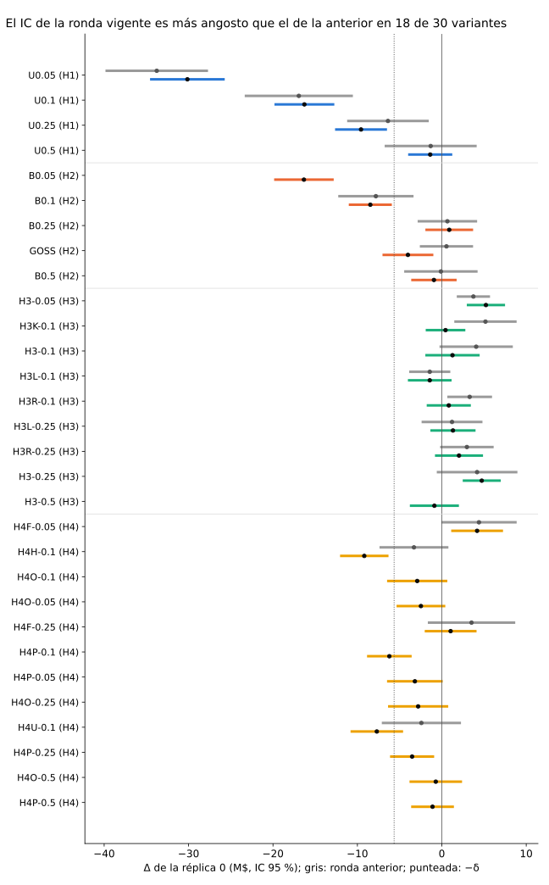

# Anexo de resultados

Las tablas de consulta de [Resultados](README.md): cada una sale de los ledgers (`comun/reporte.py`) y no se edita a mano.

## Tablas completas del bloque A

Las 30 variantes con todas las columnas, la varianza por variante y las diferencias entre variantes, como texto.

<!-- generado:bloque-a-completo -->
Generado por `comun/reporte.py` el 2026-11-14; no editar.

Tablas completas del bloque A

#### Bloque A: mismo protocolo

Final entrenado con 201903-201908, 20 semillas por réplica; N* = 3,300 clientes contactados; Ḡ_C (réplica 0) = 282.48 M$; Ḡ_C con réplicas = 281.78 M$ (R=8); ensamble de 20 semillas del control = 286.55 M$.

Ḡ es la media entre réplicas y T la mediana entre réplicas (columna R), así que se comparan con Ḡ_C con réplicas. La aceleración es la misma referencia en todas las filas: A = T_C / T, con T_C la mediana de T de todas las réplicas del control. El intervalo de A es un bootstrap por percentiles (95 %) del cociente de medianas: se remuestrean las réplicas del control y, por separado, las de la variante. Mide la variación entre réplicas, que junta la de Optuna y la de la VM (la calibración dice cuánto es de la VM); con 8 réplicas la mediana remuestreada toma pocos valores y una réplica rara lo mueve. El tiempo igual sigue apareado por réplica k porque ahí el ensamble de la réplica k se compara con la ganancia del control de esa misma réplica. Una variante sin réplicas, si la hubiera, lleva una nota al pie en las celdas que salen de la réplica 0.

| variante | hipótesis | Ḡ (M$) | Δ réplica 0 [IC] (M$) | Δ con réplicas [IC] (M$) | ΔAUC en 201910 [IC] | T mediana (s) | aceleración (×) | tiempo igual, réplicas [IC t] (M$) | tiempo igual, bootstrap de clientes [IC] (M$) | ganancia contra el control (fuente) | IC de la aceleración (×) |
|---|---|---|---|---|---|---|---|---|---|---|---|
| U0.05 | H1 | 254.04 (R=8) | -30.14 [-34.56; -25.72] | -27.74 [-30.35; -25.13] (R=8) | -0.0166 [-0.0184; -0.0149] (R=8) | 63 | 15.94 | -8.70 [-13.09; -4.32] (R=8) | -13.72 [-26.90; -0.92] | pierde (con réplicas (8)) | [11.28; 18.29] |
| U0.1 | H1 | 264.31 (R=8) | -16.28 [-19.83; -12.73] | -17.47 [-20.23; -14.71] (R=8) | -0.0108 [-0.0123; -0.0094] (R=8) | 99 | 10.13 | -4.58 [-9.22; 0.06] (R=8) | -5.82 [-15.73; 3.85] | pierde (con réplicas (8)) | [7.02; 12.69] |
| U0.25 | H1 | 273.69 (R=8) | -9.57 [-12.65; -6.49] | -8.09 [-11.58; -4.60] (R=8) | -0.0054 [-0.0066; -0.0042] (R=8) | 201 | 4.99 | 1.33 [-1.60; 4.27] (R=8) | -0.52 [-8.86; 7.54] | pierde (con réplicas (8)) | [3.26; 5.84] |
| U0.5 | H1 | 278.13 (R=8) | -1.38 [-3.99; 1.24] | -3.64 [-6.58; -0.71] (R=8) | -0.0018 [-0.0029; -0.0007] (R=8) | 423 | 2.37 | 3.67 [0.64; 6.71] (R=8) | 5.98 [-1.71; 13.53] | indeterminado (con réplicas (8)) | [1.60; 2.98] |
| B0.05 | H2 | 267.23 (R=8) | -16.34 [-19.86; -12.81] | -14.55 [-17.44; -11.66] (R=8) | -0.0109 [-0.0124; -0.0093] (R=8) | 324 | 3.09 | -8.57 [-11.78; -5.35] (R=8) | -4.49 [-14.85; 6.55] | pierde (con réplicas (8)) | [2.27; 3.86] |
| B0.1 | H2 | 274.47 (R=8) | -8.47 [-11.02; -5.92] | -7.31 [-9.76; -4.86] (R=8) | -0.0068 [-0.0079; -0.0056] (R=8) | 338 | 2.96 | -2.38 [-5.13; 0.37] (R=8) | -2.34 [-11.66; 6.44] | pierde (con réplicas (8)) | [2.13; 3.57] |
| B0.25 | H2 | 279.58 (R=8) | 0.88 [-1.95; 3.71] | -2.20 [-4.95; 0.55] (R=8) | -0.0026 [-0.0038; -0.0015] (R=8) | 601 | 1.67 | 3.12 [-0.09; 6.33] (R=8) | 3.72 [-6.00; 13.31] | no pierde (con réplicas (8)) | [1.23; 2.08] |
| GOSS | H2 | 278.82 (R=8) | -4.01 [-7.03; -1.00] | -2.96 [-6.13; 0.21] (R=8) | +0.0003 [-0.0008; +0.0014] (R=8) | 790 | 1.27 | 1.58 [-1.83; 4.99] (R=6) | no aplica (K<2) | indeterminado (con réplicas (8)) | [0.91; 1.53] |
| B0.5 | H2 | 282.13 (R=8) | -0.94 [-3.62; 1.75] | 0.35 [-2.16; 2.86] (R=8) | -0.0005 [-0.0015; +0.0004] (R=8) | 849 | 1.18 | 5.05 [0.65; 9.45] (R=6) | no aplica (K<2) | no pierde (con réplicas (8)) | [0.86; 1.64] |
| H3-0.05 | H3 | 283.86 (R=8) | 5.22 [2.96; 7.49] | 2.08 [-0.87; 5.02] (R=8) | -0.0020 [-0.0041; +0.0000] (R=8) | 95 | 10.56 | 4.77 [1.01; 8.53] (R=8) | 7.74 [0.06; 16.23] | no pierde (con réplicas (8)) | [8.00; 12.69] |
| H3K-0.1 | H3 | 281.57 (R=8) | 0.44 [-1.91; 2.79] | -0.21 [-5.05; 4.63] (R=8) | -0.0033 [-0.0050; -0.0017] (R=8) | 126 | 7.98 | 3.95 [-1.58; 9.47] (R=8) | 4.24 [-6.33; 15.40] | no pierde (con réplicas (8)) | [4.89; 9.46] |
| H3-0.1 | H3 | 283.49 (R=8) | 1.26 [-1.95; 4.48] | 1.71 [-1.07; 4.49] (R=8) | -0.0017 [-0.0030; -0.0003] (R=8) | 129 | 7.76 | 5.46 [2.93; 7.98] (R=8) | 6.04 [-2.37; 15.30] | no pierde (con réplicas (8)) | [5.56; 10.04] |
| H3L-0.1 | H3 | 281.92 (R=8) | -1.43 [-4.02; 1.16] | 0.14 [-3.30; 3.57] (R=8) | -0.0005 [-0.0020; +0.0010] (R=8) | 130 | 7.73 | 2.98 [0.05; 5.92] (R=8) | 1.76 [-7.26; 10.72] | no pierde (con réplicas (8)) | [5.52; 9.93] |
| H3R-0.1 | H3 | 283.37 (R=8) | 0.82 [-1.79; 3.44] | 1.59 [-1.80; 4.98] (R=8) | -0.0008 [-0.0023; +0.0006] (R=8) | 130 | 7.71 | 5.87 [4.27; 7.47] (R=8) | 5.06 [-2.15; 13.31] | no pierde (con réplicas (8)) | [5.53; 9.99] |
| H3L-0.25 | H3 | 283.00 (R=8) | 1.32 [-1.36; 4.00] | 1.22 [-1.59; 4.03] (R=8) | +0.0004 [-0.0008; +0.0016] (R=8) | 222 | 4.51 | 5.46 [0.83; 10.08] (R=8) | 9.00 [2.14; 16.83] | no pierde (con réplicas (8)) | [2.91; 5.32] |
| H3R-0.25 | H3 | 283.72 (R=8) | 2.04 [-0.81; 4.88] | 1.95 [-0.85; 4.74] (R=8) | +0.0000 [-0.0011; +0.0011] (R=8) | 225 | 4.46 | 5.32 [2.93; 7.71] (R=8) | 6.65 [-0.28; 14.19] | no pierde (con réplicas (8)) | [2.95; 5.32] |
| H3-0.25 | H3 | 283.20 (R=8) | 4.73 [2.48; 6.98] | 1.42 [-2.82; 5.67] (R=8) | -0.0009 [-0.0021; +0.0004] (R=8) | 229 | 4.38 | 6.15 [3.95; 8.34] (R=8) | 8.85 [1.87; 16.83] | no pierde (con réplicas (8)) | [2.93; 5.33] |
| H3-0.5 | H3 | 281.70 (R=8) | -0.88 [-3.79; 2.03] | -0.08 [-3.17; 3.00] (R=8) | -0.0000 [-0.0010; +0.0010] (R=8) | 440 | 2.28 | 2.98 [-0.53; 6.49] (R=8) | 3.82 [-4.51; 12.33] | no pierde (con réplicas (8)) | [1.55; 2.85] |
| H4F-0.05 | H4 | 283.19 (R=8) | 4.18 [1.11; 7.25] | 1.41 [-1.58; 4.40] (R=8) | -0.0019 [-0.0041; +0.0003] (R=8) | 80 | 12.50 | 4.63 [0.77; 8.50] (R=8) | 9.29 [1.53; 18.04] | no pierde (con réplicas (8)) | [9.31; 14.82] |
| H4H-0.1 | H4 | 270.37 (R=8) | -9.19 [-12.06; -6.31] | -11.41 [-15.80; -7.03] (R=8) | -0.0045 [-0.0062; -0.0028] (R=8) | 126 | 7.93 | -5.68 [-10.71; -0.65] (R=8) | -8.72 [-17.99; 0.44] | pierde (con réplicas (8)) | [5.94; 9.43] |
| H4O-0.1 | H4 | 279.53 (R=8) | -2.92 [-6.48; 0.65] | -2.25 [-4.91; 0.41] (R=8) | -0.0003 [-0.0014; +0.0009] (R=8) | 189 | 5.29 | 6.56 [3.65; 9.46] (R=8) | 2.17 [-7.92; 13.04] | no pierde (con réplicas (8)) | [2.28; 6.35] |
| H4O-0.05 | H4 | 275.64 (R=8) | -2.48 [-5.36; 0.41] | -6.14 [-10.53; -1.75] (R=8) | -0.0009 [-0.0024; +0.0006] (R=8) | 210 | 4.78 | 5.60 [2.69; 8.50] (R=8) | 6.06 [-3.09; 16.12] | pierde (con réplicas (8)) | [3.16; 6.35] |
| H4F-0.25 | H4 | 283.04 (R=8) | 1.04 [-2.02; 4.11] | 1.26 [-1.42; 3.94] (R=8) | -0.0002 [-0.0013; +0.0009] (R=8) | 210 | 4.77 | 4.91 [2.09; 7.73] (R=8) | 2.39 [-4.62; 10.01] | no pierde (con réplicas (8)) | [3.12; 5.64] |
| H4P-0.1 | H4 | 276.41 (R=8) | -6.21 [-8.86; -3.57] | -5.37 [-9.81; -0.93] (R=8) | -0.0035 [-0.0053; -0.0016] (R=8) | 222 | 4.51 | 4.91 [1.57; 8.24] (R=8) | 0.98 [-9.79; 11.66] | indeterminado (con réplicas (8)) | [1.99; 5.32] |
| H4P-0.05 | H4 | 275.31 (R=8) | -3.19 [-6.49; 0.11] | -6.47 [-10.11; -2.83] (R=8) | -0.0034 [-0.0045; -0.0024] (R=8) | 255 | 3.93 | 5.46 [0.55; 10.37] (R=8) | 0.72 [-11.16; 12.54] | pierde (con réplicas (8)) | [2.58; 4.98] |
| H4O-0.25 | H4 | 281.48 (R=8) | -2.81 [-6.37; 0.76] | -0.30 [-2.97; 2.38] (R=8) | -0.0000 [-0.0011; +0.0011] (R=8) | 274 | 3.65 | 4.36 [0.54; 8.17] (R=8) | 1.36 [-6.88; 9.85] | no pierde (con réplicas (8)) | [2.47; 4.40] |
| H4U-0.1 | H4 | 273.76 (R=8) | -7.70 [-10.81; -4.59] | -8.02 [-11.52; -4.53] (R=8) | -0.0037 [-0.0054; -0.0021] (R=8) | 293 | 3.41 | 3.95 [-1.40; 9.29] (R=8) | 2.91 [-7.54; 14.25] | pierde (con réplicas (8)) | [2.16; 5.72] |
| H4P-0.25 | H4 | 280.45 (R=8) | -3.52 [-6.13; -0.91] | -1.33 [-4.46; 1.81] (R=8) | -0.0021 [-0.0036; -0.0006] (R=8) | 299 | 3.35 | 6.01 [2.88; 9.14] (R=8) | 5.76 [-3.08; 14.75] | no pierde (con réplicas (8)) | [2.28; 4.04] |
| H4O-0.5 | H4 | 280.44 (R=8) | -0.71 [-3.83; 2.40] | -1.33 [-4.27; 1.60] (R=8) | +0.0004 [-0.0007; +0.0015] (R=8) | 434 | 2.31 | 4.08 [0.49; 7.67] (R=8) | 4.34 [-3.79; 12.60] | no pierde (con réplicas (8)) | [1.64; 2.77] |
| H4P-0.5 | H4 | 279.23 (R=8) | -1.10 [-3.63; 1.43] | -2.55 [-5.82; 0.72] (R=8) | -0.0008 [-0.0022; +0.0007] (R=8) | 455 | 2.20 | 3.26 [-0.49; 7.01] (R=8) | 2.73 [-6.00; 11.88] | indeterminado (con réplicas (8)) | [1.58; 2.69] |

#### Varianza entre réplicas y entre semillas

| variante | réplicas | corridas | sd entre réplicas (M$) | sd entre semillas (M$) | varianza entre réplicas |
|---|---|---|---|---|---|
| C | 8 | 160 | 2.78 | 4.53 | 25 % |
| U0.05 | 8 | 160 | 1.98 | 7.15 | 6 % |
| U0.1 | 8 | 160 | 2.35 | 5.20 | 15 % |
| U0.25 | 8 | 160 | 3.64 | 5.09 | 32 % |
| U0.5 | 8 | 160 | 2.69 | 5.14 | 19 % |
| B0.05 | 8 | 160 | 2.61 | 5.35 | 18 % |
| B0.1 | 8 | 160 | 1.45 | 4.79 | 8 % |
| B0.25 | 8 | 160 | 2.31 | 4.40 | 20 % |
| B0.5 | 8 | 160 | 1.67 | 4.02 | 14 % |
| GOSS | 8 | 160 | 3.12 | 4.58 | 29 % |
| H3-0.05 | 8 | 160 | 2.71 | 3.75 | 32 % |
| H3-0.1 | 8 | 160 | 2.38 | 3.94 | 24 % |
| H3-0.25 | 8 | 160 | 4.72 | 4.45 | 50 % |
| H3-0.5 | 8 | 160 | 2.97 | 4.05 | 33 % |
| H3K-0.1 | 8 | 160 | 5.51 | 4.31 | 58 % |
| H3L-0.1 | 8 | 160 | 3.55 | 3.58 | 47 % |
| H3L-0.25 | 8 | 160 | 2.45 | 3.90 | 26 % |
| H3R-0.1 | 8 | 160 | 3.48 | 3.57 | 46 % |
| H3R-0.25 | 8 | 160 | 2.41 | 3.68 | 28 % |
| H4F-0.05 | 8 | 160 | 2.80 | 3.96 | 31 % |
| H4F-0.25 | 8 | 160 | 2.15 | 4.43 | 17 % |
| H4H-0.1 | 8 | 160 | 4.91 | 4.83 | 48 % |
| H4O-0.05 | 8 | 160 | 4.92 | 5.09 | 46 % |
| H4O-0.1 | 8 | 160 | 2.10 | 5.63 | 11 % |
| H4O-0.25 | 8 | 160 | 2.14 | 5.07 | 14 % |
| H4O-0.5 | 8 | 160 | 2.69 | 4.50 | 25 % |
| H4P-0.05 | 8 | 160 | 3.86 | 5.60 | 30 % |
| H4P-0.1 | 8 | 160 | 4.98 | 5.56 | 42 % |
| H4P-0.25 | 8 | 160 | 3.06 | 4.76 | 27 % |
| H4P-0.5 | 8 | 160 | 3.28 | 4.78 | 30 % |
| H4U-0.1 | 8 | 160 | 3.65 | 5.57 | 28 % |

#### Diferencias entre variantes

| diferencia | Δ [IC entre réplicas] (M$) | réplicas | IC | veredicto |
|---|---|---|---|---|
| H3R-0.1 - H3-0.1 | -0.12 [-1.95; 1.71] | 8 | t, apareado | no cambia |
| H3R-0.25 - H3L-0.25 | 0.72 [-0.90; 2.35] | 8 | t, apareado | no cambia |
| H3R-0.1 - H3L-0.1 | 1.45 [0.65; 2.25] | 8 | t, apareado | mejora |
| H3R-0.25 - H3-0.25 | 0.52 [-1.59; 2.64] | 8 | t, apareado | no cambia |
| H3K-0.1 - H3-0.1 | -1.93 [-6.68; 2.83] | 8 | Welch, sin aparear | no cambia |
| H4O-0.5 - H4P-0.5 | 1.22 [-0.27; 2.70] | 8 | t, apareado | no cambia |
| H4O-0.25 - H4P-0.25 | 1.03 [-0.30; 2.37] | 8 | t, apareado | no cambia |
| H4O-0.1 - H4P-0.1 | 3.12 [0.01; 6.24] | 8 | t, apareado | mejora |
| H4O-0.05 - H4P-0.05 | 0.33 [-1.77; 2.43] | 8 | t, apareado | no cambia |
| H4H-0.1 - H4U-0.1 | -3.39 [-8.06; 1.28] | 8 | Welch, sin aparear | no cambia |
| H4O-0.5 - H4F-0.05 | -2.74 [-5.69; 0.21] | 8 | Welch, sin aparear | no cambia |
| H4P-0.1 - H4U-0.1 | 2.65 [-2.06; 7.37] | 8 | Welch, sin aparear | no cambia |

<!-- /generado:bloque-a-completo -->

## Cobertura de la grilla

<!-- generado:cobertura -->
Generado por `comun/reporte.py` el 2026-11-14; no editar.

<table><tr><th>forma de muestrear</th><th>0.5</th><th>0.25</th><th>0.1</th><th>0.05</th></tr><tr><td>U: al azar, búsqueda y final</td><td class='ind'>U0.5indeterminado</td><td class='pierde'>U0.25pierde</td><td class='pierde'>U0.1pierde</td><td class='pierde'>U0.05pierde</td></tr><tr><td>H3: al azar, solo búsqueda</td><td class='ok'>H3-0.5no pierde</td><td class='ok'>H3-0.25no pierde</td><td class='ok'>H3-0.1no pierde</td><td class='ok'>H3-0.05no pierde</td></tr><tr><td>H4O: bajas y una fracción de CONTINUA con peso, búsqueda y final</td><td class='ok'>H4O-0.5no pierde</td><td class='ok'>H4O-0.25no pierde</td><td class='ok'>H4O-0.1no pierde</td><td class='pierde'>H4O-0.05pierde</td></tr><tr><td>H4P: bajas y una fracción de CONTINUA con peso, solo búsqueda</td><td class='ind'>H4P-0.5indeterminado</td><td class='ok'>H4P-0.25no pierde</td><td class='ind'>H4P-0.1indeterminado</td><td class='pierde'>H4P-0.05pierde</td></tr><tr><td>B: dentro de LightGBM, por árbol</td><td class='ok'>B0.5no pierde</td><td class='ok'>B0.25no pierde</td><td class='pierde'>B0.1pierde</td><td class='pierde'>B0.05pierde</td></tr></table>

Fuera de la grilla:

- `GOSS`: muestreo de gradientes dentro de LightGBM, sin tasa
- `H3R-0.1`: búsqueda al azar con `min_data_in_leaf` reescalado con la raíz en el final
- `H3R-0.25`: búsqueda al azar con `min_data_in_leaf` reescalado con la raíz en el final
- `H3L-0.25`: búsqueda al azar con `min_data_in_leaf` reescalado linealmente en el final
- `H3L-0.1`: búsqueda al azar con `min_data_in_leaf` reescalado linealmente en el final
- `H3K-0.1`: búsqueda por cliente (todas las filas de los clientes sorteados)
- `H4H-0.1`: búsqueda con bajas y CONTINUA difíciles, sin peso
- `H4U-0.1`: búsqueda con bajas y CONTINUA al azar, sin peso
- `H4F-0.05`: búsqueda al azar con final de las bajas y la mitad de las CONTINUA
- `H4F-0.25`: búsqueda al azar con final de las bajas y la mitad de las CONTINUA

<!-- /generado:cobertura -->

## Varianza entre réplicas y entre semillas

Qué parte de la varianza de G es suerte de la optimización (entre réplicas) y qué parte es suerte del final.

<!-- generado:varianza -->
Generado por `comun/reporte.py` el 2026-11-14; no editar.

<table><tr><th>variante</th><th>réplicas</th><th>corridas</th><th>sd entre réplicas (M$)</th><th>sd entre semillas (M$)</th><th>varianza entre réplicas</th></tr><tr><td>C</td><td>8</td><td>160</td><td>2.78</td><td>4.53</td><td>25 %</td></tr><tr><td>U0.05</td><td>8</td><td>160</td><td>1.98</td><td>7.15</td><td>6 %</td></tr><tr><td>U0.1</td><td>8</td><td>160</td><td>2.35</td><td>5.20</td><td>15 %</td></tr><tr><td>U0.25</td><td>8</td><td>160</td><td>3.64</td><td>5.09</td><td>32 %</td></tr><tr><td>U0.5</td><td>8</td><td>160</td><td>2.69</td><td>5.14</td><td>19 %</td></tr><tr><td>B0.05</td><td>8</td><td>160</td><td>2.61</td><td>5.35</td><td>18 %</td></tr><tr><td>B0.1</td><td>8</td><td>160</td><td>1.45</td><td>4.79</td><td>8 %</td></tr><tr><td>B0.25</td><td>8</td><td>160</td><td>2.31</td><td>4.40</td><td>20 %</td></tr><tr><td>B0.5</td><td>8</td><td>160</td><td>1.67</td><td>4.02</td><td>14 %</td></tr><tr><td>GOSS</td><td>8</td><td>160</td><td>3.12</td><td>4.58</td><td>29 %</td></tr><tr><td>H3-0.05</td><td>8</td><td>160</td><td>2.71</td><td>3.75</td><td>32 %</td></tr><tr><td>H3-0.1</td><td>8</td><td>160</td><td>2.38</td><td>3.94</td><td>24 %</td></tr><tr><td>H3-0.25</td><td>8</td><td>160</td><td>4.72</td><td>4.45</td><td>50 %</td></tr><tr><td>H3-0.5</td><td>8</td><td>160</td><td>2.97</td><td>4.05</td><td>33 %</td></tr><tr><td>H3K-0.1</td><td>8</td><td>160</td><td>5.51</td><td>4.31</td><td>58 %</td></tr><tr><td>H3L-0.1</td><td>8</td><td>160</td><td>3.55</td><td>3.58</td><td>47 %</td></tr><tr><td>H3L-0.25</td><td>8</td><td>160</td><td>2.45</td><td>3.90</td><td>26 %</td></tr><tr><td>H3R-0.1</td><td>8</td><td>160</td><td>3.48</td><td>3.57</td><td>46 %</td></tr><tr><td>H3R-0.25</td><td>8</td><td>160</td><td>2.41</td><td>3.68</td><td>28 %</td></tr><tr><td>H4F-0.05</td><td>8</td><td>160</td><td>2.80</td><td>3.96</td><td>31 %</td></tr><tr><td>H4F-0.25</td><td>8</td><td>160</td><td>2.15</td><td>4.43</td><td>17 %</td></tr><tr><td>H4H-0.1</td><td>8</td><td>160</td><td>4.91</td><td>4.83</td><td>48 %</td></tr><tr><td>H4O-0.05</td><td>8</td><td>160</td><td>4.92</td><td>5.09</td><td>46 %</td></tr><tr><td>H4O-0.1</td><td>8</td><td>160</td><td>2.10</td><td>5.63</td><td>11 %</td></tr><tr><td>H4O-0.25</td><td>8</td><td>160</td><td>2.14</td><td>5.07</td><td>14 %</td></tr><tr><td>H4O-0.5</td><td>8</td><td>160</td><td>2.69</td><td>4.50</td><td>25 %</td></tr><tr><td>H4P-0.05</td><td>8</td><td>160</td><td>3.86</td><td>5.60</td><td>30 %</td></tr><tr><td>H4P-0.1</td><td>8</td><td>160</td><td>4.98</td><td>5.56</td><td>42 %</td></tr><tr><td>H4P-0.25</td><td>8</td><td>160</td><td>3.06</td><td>4.76</td><td>27 %</td></tr><tr><td>H4P-0.5</td><td>8</td><td>160</td><td>3.28</td><td>4.78</td><td>30 %</td></tr><tr><td>H4U-0.1</td><td>8</td><td>160</td><td>3.65</td><td>5.57</td><td>28 %</td></tr></table>

<!-- /generado:varianza -->

## Diferencias entre variantes

Contrastes entre variantes de H3 y de H4, sin pasar por el control.

<!-- generado:diferencias -->
Generado por `comun/reporte.py` el 2026-11-14; no editar.

<table><tr><th>diferencia</th><th>qué aísla</th><th>principal</th><th>filas de cada lado</th><th>Δ [IC] (M$)</th><th>réplicas</th><th>IC</th><th>veredicto</th></tr><tr><td>H4O-0.5 - U0.5</td><td>conservar las bajas, en búsqueda y final</td><td>sí</td><td>388,132 / 384,250</td><td>2.31[-0.58; 5.20]</td><td>8</td><td>Welch, sin aparear</td><td>no cambia</td></tr><tr><td>H4O-0.25 - U0.25</td><td>conservar las bajas, en búsqueda y final</td><td>sí</td><td>197,949 / 192,125</td><td class='sig-pos'>7.80[4.52; 11.07]</td><td>8</td><td>Welch, sin aparear</td><td>mejora</td></tr><tr><td>H4O-0.1 - U0.1</td><td>conservar las bajas, en búsqueda y final</td><td>sí</td><td>83,839 / 76,850</td><td class='sig-pos'>15.22[12.83; 17.61]</td><td>8</td><td>Welch, sin aparear</td><td>mejora</td></tr><tr><td>H4O-0.05 - U0.05</td><td>conservar las bajas, en búsqueda y final</td><td>sí</td><td>45,803 / 38,425</td><td class='sig-pos'>21.60[17.38; 25.83]</td><td>8</td><td>Welch, sin aparear</td><td>mejora</td></tr><tr><td>H3R-0.1 - H3-0.1</td><td>reescalar min_data_in_leaf con la raíz en el final</td><td>no</td><td>768,499 / 768,499</td><td>-0.12[-1.95; 1.71]</td><td>8</td><td>t, apareado</td><td>no cambia</td></tr><tr><td>H3R-0.25 - H3L-0.25</td><td>reescalado con raíz contra lineal en r = 0,25</td><td>no</td><td>768,499 / 768,499</td><td>0.72[-0.90; 2.35]</td><td>8</td><td>t, apareado</td><td>no cambia</td></tr><tr><td>H3R-0.1 - H3L-0.1</td><td>reescalado con raíz contra lineal en r = 0,1</td><td>no</td><td>768,499 / 768,499</td><td class='sig-pos'>1.45[0.65; 2.25]</td><td>8</td><td>t, apareado</td><td>mejora</td></tr><tr><td>H3R-0.25 - H3-0.25</td><td>reescalar con la raíz contra no reescalar en r = 0,25</td><td>no</td><td>768,499 / 768,499</td><td>0.52[-1.59; 2.64]</td><td>8</td><td>t, apareado</td><td>no cambia</td></tr><tr><td>U0.5 - H3-0.5</td><td>muestrear también el final, al azar</td><td>no</td><td>384,250 / 768,499</td><td class='sig-neg'>-3.56[-5.54; -1.58]</td><td>8</td><td>t, apareado</td><td>empeora</td></tr><tr><td>U0.25 - H3-0.25</td><td>muestrear también el final, al azar</td><td>no</td><td>192,125 / 768,499</td><td class='sig-neg'>-9.52[-11.71; -7.32]</td><td>8</td><td>t, apareado</td><td>empeora</td></tr><tr><td>U0.1 - H3-0.1</td><td>muestrear también el final, al azar</td><td>no</td><td>76,850 / 768,499</td><td class='sig-neg'>-19.18[-20.59; -17.77]</td><td>8</td><td>t, apareado</td><td>empeora</td></tr><tr><td>U0.05 - H3-0.05</td><td>muestrear también el final, al azar</td><td>no</td><td>38,425 / 768,499</td><td class='sig-neg'>-29.82[-33.23; -26.41]</td><td>8</td><td>t, apareado</td><td>empeora</td></tr><tr><td>H4O-0.5 - H4P-0.5</td><td>muestrear también el final, con bajas</td><td>no</td><td>388,132 / 768,499</td><td>1.22[-0.27; 2.70]</td><td>8</td><td>t, apareado</td><td>no cambia</td></tr><tr><td>H4O-0.25 - H4P-0.25</td><td>muestrear también el final, con bajas</td><td>no</td><td>197,949 / 768,499</td><td>1.03[-0.30; 2.37]</td><td>8</td><td>t, apareado</td><td>no cambia</td></tr><tr><td>H4O-0.1 - H4P-0.1</td><td>muestrear también el final, con bajas</td><td>no</td><td>83,839 / 768,499</td><td class='sig-pos'>3.12[0.01; 6.24]</td><td>8</td><td>t, apareado</td><td>mejora</td></tr><tr><td>H4O-0.05 - H4P-0.05</td><td>muestrear también el final, con bajas</td><td>no</td><td>45,803 / 768,499</td><td>0.33[-1.77; 2.43]</td><td>8</td><td>t, apareado</td><td>no cambia</td></tr><tr><td>H4H-0.1 - H4U-0.1</td><td>CONTINUA difíciles contra al azar en la búsqueda</td><td>no</td><td>768,499 / 768,499</td><td>-3.39[-8.06; 1.28]</td><td>8</td><td>Welch, sin aparear</td><td>no cambia</td></tr><tr><td>H3K-0.1 - H3-0.1</td><td>muestrear por cliente contra por fila en la búsqueda</td><td>no</td><td>768,499 / 768,499</td><td>-1.93[-6.68; 2.83]</td><td>8</td><td>Welch, sin aparear</td><td>no cambia</td></tr><tr><td>H4O-0.5 - H4F-0.05</td><td>reoptimizar sobre la receta de H4F (estudio propio) contra reusar `U0.05`</td><td>no</td><td>388,132 / 388,132</td><td>-2.74[-5.69; 0.21]</td><td>8</td><td>Welch, sin aparear</td><td>no cambia</td></tr><tr><td>H4P-0.5 - H3-0.5</td><td>conservar las bajas, solo en la búsqueda</td><td>no</td><td>768,499 / 768,499</td><td>-2.47[-5.83; 0.89]</td><td>8</td><td>Welch, sin aparear</td><td>no cambia</td></tr><tr><td>H4P-0.25 - H3-0.25</td><td>conservar las bajas, solo en la búsqueda</td><td>no</td><td>768,499 / 768,499</td><td>-2.75[-7.09; 1.59]</td><td>8</td><td>Welch, sin aparear</td><td>no cambia</td></tr><tr><td>H4P-0.1 - H3-0.1</td><td>conservar las bajas, solo en la búsqueda</td><td>no</td><td>768,499 / 768,499</td><td class='sig-neg'>-7.08[-11.42; -2.74]</td><td>8</td><td>Welch, sin aparear</td><td>empeora</td></tr><tr><td>H4P-0.05 - H3-0.05</td><td>conservar las bajas, solo en la búsqueda</td><td>no</td><td>768,499 / 768,499</td><td class='sig-neg'>-8.55[-12.16; -4.93]</td><td>8</td><td>Welch, sin aparear</td><td>empeora</td></tr><tr><td>H4P-0.1 - H4U-0.1</td><td>el peso en la búsqueda (misma muestra)</td><td>no</td><td>768,499 / 768,499</td><td>2.65[-2.06; 7.37]</td><td>8</td><td>Welch, sin aparear</td><td>no cambia</td></tr></table>

<!-- /generado:diferencias -->

## Tiempos: tablas completas

<!-- generado:tiempos-completos -->
Generado por `comun/reporte.py` el 2026-11-14; no editar.

Predicciones de `control/docs/hipotesis.md` § Medición de tiempos; la medición es exploratoria y no cambia veredictos: dice cuánto del A del bloque A es tamaño de datos y cuánto es la elección de Optuna. Las VMs corrieron en horarios distintos, así que el CV entre VMs junta la VM y la hora; cada ancla es una sola medición vieja.

**Tiempo a hiperparámetros fijos.**

<table><tr><th>r</th><th>filas (al azar)</th><th>A fijo, al azar [mín; máx entre juegos]</th><th>A de U{r} (bloque A)</th><th>filas (bajas con peso)</th><th>A fijo, bajas con peso [mín; máx]</th><th>A de H4O-{r} (bloque A)</th><th>T bajas / T azar</th><th>filas bajas / filas azar</th><th>CV entre repeticiones (mediana)</th></tr><tr><td>0.5</td><td>253,436</td><td>2.16 [1.57; 2.43]</td><td>2.37</td><td>256,092</td><td>2.14 [1.55; 2.47]</td><td>2.31</td><td>1.01</td><td>1.01</td><td>2.9 %</td></tr><tr><td>0.25</td><td>126,718</td><td>4.43 [3.47; 5.96]</td><td>4.99</td><td>130,703</td><td>4.73 [3.19; 5.43]</td><td>3.65</td><td>1.00</td><td>1.03</td><td>3.7 %</td></tr><tr><td>0.1</td><td>50,687</td><td>12.97 [9.10; 15.93]</td><td>10.13</td><td>55,469</td><td>11.89 [8.81; 14.82]</td><td>5.29</td><td>1.08</td><td>1.09</td><td>1.8 %</td></tr><tr><td>0.05</td><td>25,344</td><td>20.70 [15.79; 32.54]</td><td>15.94</td><td>30,391</td><td>21.07 [16.83; 28.88]</td><td>4.78</td><td>1.09</td><td>1.20</td><td>1.7 %</td></tr></table>

**Calibración de las VMs.**

<table><tr><th>tipo</th><th>VM</th><th>t medio (s)</th><th>fin / inicio</th><th>contra el ancla del trial (fase 1) o del final de la fase 7</th><th>contra el final de C-rep</th></tr><tr><td>trial</td><td>sampling-f8-medicion</td><td>24.29</td><td>nan</td><td>0.894</td><td>—</td></tr><tr><td>trial</td><td>sampling-f8-r0-a</td><td>24.60</td><td>1.015</td><td>0.906</td><td>—</td></tr><tr><td>trial</td><td>sampling-f8-r0-b</td><td>25.09</td><td>1.019</td><td>0.924</td><td>—</td></tr><tr><td>trial</td><td>sampling-f8-r1-a</td><td>24.96</td><td>1.013</td><td>0.919</td><td>—</td></tr><tr><td>trial</td><td>sampling-f8-r1-b</td><td>24.67</td><td>0.998</td><td>0.909</td><td>—</td></tr><tr><td>trial</td><td>sampling-f8-r2-a</td><td>24.85</td><td>nan</td><td>0.915</td><td>—</td></tr><tr><td>trial</td><td>sampling-f8-r2-b</td><td>23.93</td><td>0.998</td><td>0.882</td><td>—</td></tr><tr><td>trial</td><td>sampling-f8-r3-a</td><td>26.82</td><td>0.979</td><td>0.988</td><td>—</td></tr><tr><td>trial</td><td>sampling-f8-r3-b</td><td>25.41</td><td>0.983</td><td>0.936</td><td>—</td></tr><tr><td>trial</td><td>sampling-f8-r4-a</td><td>25.33</td><td>nan</td><td>0.933</td><td>—</td></tr><tr><td>trial</td><td>sampling-f8-r4-b</td><td>25.16</td><td>1.018</td><td>0.927</td><td>—</td></tr><tr><td>trial</td><td>sampling-f8-r5-a</td><td>29.15</td><td>0.952</td><td>1.074</td><td>—</td></tr><tr><td>trial</td><td>sampling-f8-r5-b</td><td>24.96</td><td>0.993</td><td>0.919</td><td>—</td></tr><tr><td>trial</td><td>sampling-f8-r6-a</td><td>25.73</td><td>0.959</td><td>0.948</td><td>—</td></tr><tr><td>trial</td><td>sampling-f8-r6-b</td><td>24.53</td><td>0.991</td><td>0.903</td><td>—</td></tr><tr><td>trial</td><td>sampling-f8-r7-a</td><td>24.25</td><td>0.997</td><td>0.893</td><td>—</td></tr><tr><td>trial</td><td>sampling-f8-r7-b</td><td>24.36</td><td>0.980</td><td>0.897</td><td>—</td></tr><tr><td>final</td><td>sampling-f8-medicion</td><td>44.03</td><td>nan</td><td>0.878</td><td>0.976</td></tr><tr><td>final</td><td>sampling-f8-r0-a</td><td>43.40</td><td>1.032</td><td>0.865</td><td>0.962</td></tr><tr><td>final</td><td>sampling-f8-r0-b</td><td>43.47</td><td>1.009</td><td>0.867</td><td>0.963</td></tr><tr><td>final</td><td>sampling-f8-r1-a</td><td>44.73</td><td>1.007</td><td>0.892</td><td>0.991</td></tr><tr><td>final</td><td>sampling-f8-r1-b</td><td>43.34</td><td>1.016</td><td>0.864</td><td>0.960</td></tr><tr><td>final</td><td>sampling-f8-r2-a</td><td>43.51</td><td>nan</td><td>0.867</td><td>0.964</td></tr><tr><td>final</td><td>sampling-f8-r2-b</td><td>42.09</td><td>1.000</td><td>0.839</td><td>0.933</td></tr><tr><td>final</td><td>sampling-f8-r3-a</td><td>46.12</td><td>0.995</td><td>0.919</td><td>1.022</td></tr><tr><td>final</td><td>sampling-f8-r3-b</td><td>43.88</td><td>0.966</td><td>0.875</td><td>0.972</td></tr><tr><td>final</td><td>sampling-f8-r4-a</td><td>44.33</td><td>nan</td><td>0.884</td><td>0.982</td></tr><tr><td>final</td><td>sampling-f8-r4-b</td><td>43.91</td><td>1.026</td><td>0.875</td><td>0.973</td></tr><tr><td>final</td><td>sampling-f8-r5-a</td><td>48.68</td><td>1.000</td><td>0.970</td><td>1.079</td></tr><tr><td>final</td><td>sampling-f8-r5-b</td><td>43.56</td><td>0.997</td><td>0.868</td><td>0.965</td></tr><tr><td>final</td><td>sampling-f8-r6-a</td><td>44.86</td><td>0.998</td><td>0.894</td><td>0.994</td></tr><tr><td>final</td><td>sampling-f8-r6-b</td><td>42.70</td><td>1.004</td><td>0.851</td><td>0.946</td></tr><tr><td>final</td><td>sampling-f8-r7-a</td><td>42.78</td><td>0.977</td><td>0.853</td><td>0.948</td></tr><tr><td>final</td><td>sampling-f8-r7-b</td><td>42.40</td><td>0.992</td><td>0.845</td><td>0.939</td></tr></table>

**Calibración, resumen.**

<table><tr><th>tipo</th><th>VMs</th><th>CV entre VMs</th><th>fin / inicio [mín; máx]</th><th>VMs fuera de [0,9; 1,1]</th><th>contra el ancla del trial (fase 1) o del final de la fase 7</th><th>contra el final de C-rep</th></tr><tr><td>trial</td><td>17</td><td>4.9 %</td><td>1.00 [0.95; 1.02]</td><td>0 de 14</td><td>0.92 [0.88; 1.07]</td><td>—</td></tr><tr><td>final</td><td>17</td><td>3.5 %</td><td>1.00 [0.97; 1.03]</td><td>0 de 14</td><td>0.87 [0.84; 0.97]</td><td>0.97 [0.93; 1.08]</td></tr></table>

**Búsqueda y final por variante.**

<table><tr><th>variante</th><th>hipótesis</th><th>búsqueda, mediana (s)</th><th>final, mediana (s)</th><th>fracción de T que es búsqueda</th><th>preparación, mediana (s; no entra en T)</th></tr><tr><td>U0.5</td><td>H1</td><td>397</td><td>27.6</td><td>94 %</td><td>0.5</td></tr><tr><td>U0.25</td><td>H1</td><td>190</td><td>10.9</td><td>95 %</td><td>0.3</td></tr><tr><td>U0.1</td><td>H1</td><td>94</td><td>4.8</td><td>95 %</td><td>0.2</td></tr><tr><td>U0.05</td><td>H1</td><td>60</td><td>2.6</td><td>96 %</td><td>0.1</td></tr><tr><td>B0.5</td><td>H2</td><td>799</td><td>40.4</td><td>94 %</td><td>0.0</td></tr><tr><td>B0.25</td><td>H2</td><td>571</td><td>33.9</td><td>94 %</td><td>0.0</td></tr><tr><td>B0.1</td><td>H2</td><td>321</td><td>23.0</td><td>94 %</td><td>0.0</td></tr><tr><td>B0.05</td><td>H2</td><td>301</td><td>21.0</td><td>93 %</td><td>0.0</td></tr><tr><td>GOSS</td><td>H2</td><td>754</td><td>38.7</td><td>95 %</td><td>0.0</td></tr><tr><td>H3-0.5</td><td>H3</td><td>397</td><td>44.3</td><td>90 %</td><td>0.0</td></tr><tr><td>H3-0.25</td><td>H3</td><td>190</td><td>31.6</td><td>86 %</td><td>0.0</td></tr><tr><td>H3-0.1</td><td>H3</td><td>94</td><td>29.1</td><td>76 %</td><td>0.0</td></tr><tr><td>H3-0.05</td><td>H3</td><td>60</td><td>29.4</td><td>67 %</td><td>0.0</td></tr><tr><td>H3R-0.1</td><td>H3</td><td>94</td><td>29.3</td><td>75 %</td><td>0.0</td></tr><tr><td>H3R-0.25</td><td>H3</td><td>190</td><td>31.1</td><td>86 %</td><td>0.0</td></tr><tr><td>H3L-0.25</td><td>H3</td><td>190</td><td>32.1</td><td>86 %</td><td>0.0</td></tr><tr><td>H3L-0.1</td><td>H3</td><td>94</td><td>29.9</td><td>75 %</td><td>0.0</td></tr><tr><td>H3K-0.1</td><td>H3</td><td>100</td><td>27.4</td><td>78 %</td><td>0.0</td></tr><tr><td>H4H-0.1</td><td>H4</td><td>99</td><td>21.8</td><td>82 %</td><td>0.0</td></tr><tr><td>H4U-0.1</td><td>H4</td><td>232</td><td>49.5</td><td>79 %</td><td>0.0</td></tr><tr><td>H4F-0.05</td><td>H4</td><td>60</td><td>16.5</td><td>78 %</td><td>0.5</td></tr><tr><td>H4F-0.25</td><td>H4</td><td>190</td><td>19.0</td><td>91 %</td><td>0.5</td></tr><tr><td>H4O-0.5</td><td>H4</td><td>408</td><td>26.4</td><td>94 %</td><td>0.5</td></tr><tr><td>H4O-0.25</td><td>H4</td><td>259</td><td>15.3</td><td>95 %</td><td>0.3</td></tr><tr><td>H4O-0.1</td><td>H4</td><td>180</td><td>11.0</td><td>95 %</td><td>0.2</td></tr><tr><td>H4O-0.05</td><td>H4</td><td>196</td><td>10.5</td><td>96 %</td><td>0.2</td></tr><tr><td>H4P-0.5</td><td>H4</td><td>408</td><td>43.3</td><td>90 %</td><td>0.0</td></tr><tr><td>H4P-0.25</td><td>H4</td><td>259</td><td>38.1</td><td>87 %</td><td>0.0</td></tr><tr><td>H4P-0.1</td><td>H4</td><td>180</td><td>46.9</td><td>81 %</td><td>0.0</td></tr><tr><td>H4P-0.05</td><td>H4</td><td>196</td><td>68.2</td><td>79 %</td><td>0.0</td></tr></table>

<!-- /generado:tiempos-completos -->

## Rondas

La ronda anterior (final con 201903–201906 y 10 semillas) contra la vigente (201903–201908 y 20 semillas), con el
resultado de la predicción de la ronda ([Control y reglas](../control/README.md#prediccion-de-la-ronda-201903201908)):

- **Veredictos estables: se confirma.** 0 cambios de lado. Cambian 8 veredictos, todos desde o hacia *indeterminado* o
  entre *gana* y *no pierde* (por semilla); con réplicas no cambia ninguno.
- **IC más angosto: se confirma.** La mediana de la razón de anchos del IC por semilla (ronda anterior / vigente) es
  1,44, dentro de [1,2; 1,9].
- **Con réplicas el ancho baja menos: se confirma.** La mediana de la razón con réplicas es 0,96: con 8 réplicas el IC
  prácticamente no se angosta, porque la suerte de Optuna no depende de las semillas finales.
- T y la aceleración no se comparan entre rondas: el final de seis meses es más largo y se midió en otras VMs.

<!-- generado:ic-rondas -->
Generado por `comun/reporte.py` el 2026-11-14; no editar.

<!-- /generado:ic-rondas -->

<!-- generado:rondas -->
Generado por `comun/reporte.py` el 2026-11-14; no editar.

Generado por `python scripts/comparar_rondas.py`; no editar a mano. Cada ronda se lee de su propio `apareado.csv` y `replicas.csv` (G, Δ y δ salen del control de esa ronda); T y A no se comparan entre rondas.

- Ronda 201903-201906 (final con 4 meses, 10 semillas, N* de validación): δ = 5.52 M$.
- Ronda 201903-201908 (final con 6 meses, 20 semillas, N* fijo): δ = 5.65 M$.

Δ en M$ al corte N* de cada ronda, con IC 95%.

| variante | Δ réplica 0 201903-201906 | veredicto | Δ con réplicas | veredicto | Δ réplica 0 201903-201908 | veredicto | Δ con réplicas | veredicto | ¿cambia el veredicto? |
|---|---|---|---|---|---|---|---|---|---|
| B0.1 | -7.81 [-12.27; -3.35] | pierde | — | — | -8.47 [-11.02; -5.92] | pierde | -7.31 [-9.76; -4.86] | pierde | no |
| B0.25 | 0.66 [-2.86; 4.18] | no pierde | — | — | 0.88 [-1.95; 3.71] | no pierde | -2.20 [-4.95; 0.55] | no pierde | no |
| B0.5 | -0.11 [-4.46; 4.24] | no pierde | — | — | -0.94 [-3.62; 1.75] | no pierde | 0.35 [-2.16; 2.86] | no pierde | no |
| GOSS | 0.55 [-2.60; 3.70] | no pierde | — | — | -4.01 [-7.03; -1.00] | indeterminado | -2.96 [-6.13; 0.21] | indeterminado | sí |
| H3-0.05 | 3.74 [1.77; 5.71] | gana | 1.87 [-1.02; 4.76] | no pierde | 5.22 [2.96; 7.49] | gana | 2.08 [-0.87; 5.02] | no pierde | no |
| H3-0.1 | 4.07 [-0.27; 8.41] | no pierde | 2.30 [-0.88; 5.47] | no pierde | 1.26 [-1.95; 4.48] | no pierde | 1.71 [-1.07; 4.49] | no pierde | no |
| H3-0.25 | 4.18 [-0.60; 8.96] | no pierde | 1.81 [-1.78; 5.41] | no pierde | 4.73 [2.48; 6.98] | gana | 1.42 [-2.82; 5.67] | no pierde | sí |
| H3K-0.1 | 5.17 [1.48; 8.86] | gana | 1.28 [-3.42; 5.98] | no pierde | 0.44 [-1.91; 2.79] | no pierde | -0.21 [-5.05; 4.63] | no pierde | sí |
| H3L-0.1 | -1.43 [-3.86; 1.00] | no pierde | -1.46 [-4.73; 1.81] | no pierde | -1.43 [-4.02; 1.16] | no pierde | 0.14 [-3.30; 3.57] | no pierde | no |
| H3L-0.25 | 1.21 [-2.40; 4.82] | no pierde | 0.25 [-2.02; 2.51] | no pierde | 1.32 [-1.36; 4.00] | no pierde | 1.22 [-1.59; 4.03] | no pierde | no |
| H3R-0.1 | 3.30 [0.65; 5.95] | gana | 1.76 [-1.21; 4.73] | no pierde | 0.82 [-1.79; 3.44] | no pierde | 1.59 [-1.80; 4.98] | no pierde | sí |
| H3R-0.25 | 2.97 [-0.20; 6.14] | no pierde | 1.53 [-1.92; 4.97] | no pierde | 2.04 [-0.81; 4.88] | no pierde | 1.95 [-0.85; 4.74] | no pierde | no |
| H4F-0.05 | 4.40 [-0.07; 8.87] | no pierde | 1.86 [-0.83; 4.54] | no pierde | 4.18 [1.11; 7.25] | gana | 1.41 [-1.58; 4.40] | no pierde | sí |
| H4F-0.25 | 3.52 [-1.66; 8.70] | no pierde | 1.39 [-1.87; 4.65] | no pierde | 1.04 [-2.02; 4.11] | no pierde | 1.26 [-1.42; 3.94] | no pierde | no |
| H4H-0.1 | -3.30 [-7.38; 0.78] | indeterminado | -8.61 [-12.78; -4.43] | pierde | -9.19 [-12.06; -6.31] | pierde | -11.41 [-15.80; -7.03] | pierde | sí |
| H4U-0.1 | -2.42 [-7.11; 2.27] | indeterminado | -5.54 [-8.94; -2.14] | pierde | -7.70 [-10.81; -4.59] | pierde | -8.02 [-11.52; -4.53] | pierde | sí |
| U0.05 | -33.77 [-39.84; -27.70] | pierde | — | — | -30.14 [-34.56; -25.72] | pierde | -27.74 [-30.35; -25.13] | pierde | no |
| U0.1 | -16.94 [-23.35; -10.53] | pierde | — | — | -16.28 [-19.83; -12.73] | pierde | -17.47 [-20.23; -14.71] | pierde | no |
| U0.25 | -6.38 [-11.21; -1.55] | pierde | — | — | -9.57 [-12.65; -6.49] | pierde | -8.09 [-11.58; -4.60] | pierde | no |
| U0.5 | -1.32 [-6.77; 4.13] | indeterminado | — | — | -1.38 [-3.99; 1.24] | no pierde | -3.64 [-6.58; -0.71] | indeterminado | sí |

Las variantes que solo existen en la ronda 201903-201908 (`B0.05`, `H3-0.5`, `H4O-0.05`, `H4O-0.1`, `H4O-0.25`, `H4O-0.5`, `H4P-0.05`, `H4P-0.1`, `H4P-0.25`, `H4P-0.5`) no tienen con qué compararse y no entran en la tabla; el control tampoco, porque es la referencia de cada ronda.

<!-- /generado:rondas -->
