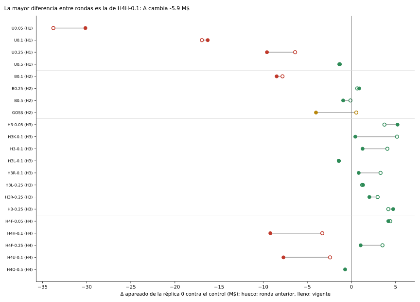

# Anexo de resultados

Las tablas de consulta de [Resultados](README.md): cada una sale de los ledgers (`comun/reporte.py`) y no se edita a mano.

## Tablas completas del bloque A

<!-- generado:bloque-a-completo -->
Generado por `comun/reporte.py` el 2026-11-13; no editar.

Tablas completas del bloque A

#### Bloque A: mismo protocolo

Final entrenado con 201903-201908, 20 semillas por réplica; N* = 3,300 envíos; Ḡ_C (réplica 0) = 282.48 M$; Ḡ_C con réplicas = 281.78 M$ (R=8); ensamble de 20 semillas del control = 286.55 M$.

Ḡ, T y A salen de la réplica 0 en las variantes sin réplicas; en las marcadas (R=n), Ḡ es la media entre réplicas, T la mediana entre réplicas y A = T_C / T con T_C también mediana entre réplicas, así que se comparan con Ḡ_C con réplicas y no con Ḡ_C de la réplica 0.

| variante | hipótesis | Ḡ (M$) | Δ réplica 0 [IC] (M$) | Δ con réplicas [IC] (M$) | ΔAUC en 201910 [IC] | T mediana (s) | A | tiempo igual, réplicas [IC t] (M$) | tiempo igual, bootstrap de clientes [IC] (M$) | veredicto (fuente) |
|---|---|---|---|---|---|---|---|---|---|---|
| U0.05 | H1 | 252.34 | -30.14 [-34.56; -25.72] | — | -0.0176 [-0.0186; -0.0166] (réplica 0) | 70 | 11.45 | sin réplicas | -13.72 [-26.90; -0.92] | pierde (réplica 0) |
| U0.1 | H1 | 266.20 | -16.28 [-19.83; -12.73] | — | -0.0103 [-0.0111; -0.0095] (réplica 0) | 81 | 9.89 | sin réplicas | -5.82 [-15.73; 3.85] | pierde (réplica 0) |
| U0.25 | H1 | 272.91 | -9.57 [-12.65; -6.49] | — | -0.0055 [-0.0060; -0.0050] (réplica 0) | 164 | 4.87 | sin réplicas | -0.52 [-8.86; 7.54] | pierde (réplica 0) |
| U0.5 | H1 | 281.11 | -1.38 [-3.99; 1.24] | — | -0.0019 [-0.0023; -0.0015] (réplica 0) | 354 | 2.25 | sin réplicas | 5.98 [-1.71; 13.53] | no pierde (réplica 0) |
| B0.1 | H2 | 274.01 | -8.47 [-11.02; -5.92] | — | -0.0088 [-0.0094; -0.0083] (réplica 0) | 434 | 1.84 | sin réplicas | -2.34 [-11.66; 6.44] | pierde (réplica 0) |
| B0.25 | H2 | 283.36 | 0.88 [-1.95; 3.71] | — | -0.0044 [-0.0047; -0.0041] (réplica 0) | 650 | 1.23 | sin réplicas | 3.72 [-6.00; 13.31] | no pierde (réplica 0) |
| B0.5 | H2 | 281.55 | -0.94 [-3.62; 1.75] | — | -0.0012 [-0.0017; -0.0008] (réplica 0) | 1,011 | 0.79 | sin réplicas | no aplica (K<2) | no pierde (réplica 0) |
| GOSS | H2 | 278.46 | -4.01 [-7.03; -1.00] | — | +0.0005 [+0.0003; +0.0008] (réplica 0) | 1,102 | 0.72 | sin réplicas | no aplica (K<2) | indeterminado (réplica 0) |
| H3-0.05 | H3 | 283.86 (R=8) | 5.22 [2.96; 7.49] | 2.08 [-0.87; 5.02] (R=8) | -0.0020 [-0.0041; +0.0000] (R=8) | 95 | 10.56 | 4.77 [1.01; 8.53] (R=8) | 7.74 [0.06; 16.23] | no pierde (con réplicas (8)) |
| H3K-0.1 | H3 | 281.57 (R=8) | 0.44 [-1.91; 2.79] | -0.21 [-5.05; 4.63] (R=8) | -0.0033 [-0.0050; -0.0017] (R=8) | 126 | 7.98 | 3.95 [-1.58; 9.47] (R=8) | 4.24 [-6.33; 15.40] | no pierde (con réplicas (8)) |
| H3-0.1 | H3 | 283.49 (R=8) | 1.26 [-1.95; 4.48] | 1.71 [-1.07; 4.49] (R=8) | -0.0017 [-0.0030; -0.0003] (R=8) | 129 | 7.76 | 5.46 [2.93; 7.98] (R=8) | 6.04 [-2.37; 15.30] | no pierde (con réplicas (8)) |
| H3L-0.1 | H3 | 281.92 (R=8) | -1.43 [-4.02; 1.16] | 0.14 [-3.30; 3.57] (R=8) | -0.0005 [-0.0020; +0.0010] (R=8) | 130 | 7.73 | 2.98 [0.05; 5.92] (R=8) | 1.76 [-7.26; 10.72] | no pierde (con réplicas (8)) |
| H3R-0.1 | H3 | 283.37 (R=8) | 0.82 [-1.79; 3.44] | 1.59 [-1.80; 4.98] (R=8) | -0.0008 [-0.0023; +0.0006] (R=8) | 130 | 7.71 | 5.87 [4.27; 7.47] (R=8) | 5.06 [-2.15; 13.31] | no pierde (con réplicas (8)) |
| H3L-0.25 | H3 | 283.00 (R=8) | 1.32 [-1.36; 4.00] | 1.22 [-1.59; 4.03] (R=8) | +0.0004 [-0.0008; +0.0016] (R=8) | 222 | 4.51 | 5.46 [0.83; 10.08] (R=8) | 9.00 [2.14; 16.83] | no pierde (con réplicas (8)) |
| H3R-0.25 | H3 | 283.72 (R=8) | 2.04 [-0.81; 4.88] | 1.95 [-0.85; 4.74] (R=8) | +0.0000 [-0.0011; +0.0011] (R=8) | 225 | 4.46 | 5.32 [2.93; 7.71] (R=8) | 6.65 [-0.28; 14.19] | no pierde (con réplicas (8)) |
| H3-0.25 | H3 | 283.20 (R=8) | 4.73 [2.48; 6.98] | 1.42 [-2.82; 5.67] (R=8) | -0.0009 [-0.0021; +0.0004] (R=8) | 229 | 4.38 | 6.15 [3.95; 8.34] (R=8) | 8.85 [1.87; 16.83] | no pierde (con réplicas (8)) |
| H4F-0.05 | H4 | 283.19 (R=8) | 4.18 [1.11; 7.25] | 1.41 [-1.58; 4.40] (R=8) | -0.0019 [-0.0041; +0.0003] (R=8) | 80 | 12.50 | 4.63 [0.77; 8.50] (R=8) | 9.29 [1.53; 18.04] | no pierde (con réplicas (8)) |
| H4H-0.1 | H4 | 270.37 (R=8) | -9.19 [-12.06; -6.31] | -11.41 [-15.80; -7.03] (R=8) | -0.0045 [-0.0062; -0.0028] (R=8) | 126 | 7.93 | -5.68 [-10.71; -0.65] (R=8) | -8.72 [-17.99; 0.44] | pierde (con réplicas (8)) |
| H4F-0.25 | H4 | 283.04 (R=8) | 1.04 [-2.02; 4.11] | 1.26 [-1.42; 3.94] (R=8) | -0.0002 [-0.0013; +0.0009] (R=8) | 210 | 4.77 | 4.91 [2.09; 7.73] (R=8) | 2.39 [-4.62; 10.01] | no pierde (con réplicas (8)) |
| H4U-0.1 | H4 | 273.76 (R=8) | -7.70 [-10.81; -4.59] | -8.02 [-11.52; -4.53] (R=8) | -0.0037 [-0.0054; -0.0021] (R=8) | 293 | 3.41 | 3.95 [-1.40; 9.29] (R=8) | 2.91 [-7.54; 14.25] | pierde (con réplicas (8)) |
| H4O-0.5 | H4 | 280.44 (R=8) | -0.71 [-3.83; 2.40] | -1.33 [-4.27; 1.60] (R=8) | +0.0004 [-0.0007; +0.0015] (R=8) | 434 | 2.31 | 4.08 [0.49; 7.67] (R=8) | 4.34 [-3.79; 12.60] | no pierde (con réplicas (8)) |

Notas:

- `U0.05`: sin réplicas
- `U0.1`: sin réplicas
- `U0.25`: sin réplicas
- `U0.5`: sin réplicas
- `B0.1`: sin réplicas
- `B0.25`: sin réplicas
- `B0.5`: sin réplicas
- `GOSS`: sin réplicas

#### Varianza entre réplicas y entre semillas

| variante | réplicas | corridas | sd entre réplicas (M$) | sd entre semillas (M$) | varianza entre réplicas |
|---|---|---|---|---|---|
| C | 8 | 160 | 2.78 | 4.53 | 25 % |
| H3-0.05 | 8 | 160 | 2.71 | 3.75 | 32 % |
| H3-0.1 | 8 | 160 | 2.38 | 3.94 | 24 % |
| H3-0.25 | 8 | 160 | 4.72 | 4.45 | 50 % |
| H3K-0.1 | 8 | 160 | 5.51 | 4.31 | 58 % |
| H3L-0.1 | 8 | 160 | 3.55 | 3.58 | 47 % |
| H3L-0.25 | 8 | 160 | 2.45 | 3.90 | 26 % |
| H3R-0.1 | 8 | 160 | 3.48 | 3.57 | 46 % |
| H3R-0.25 | 8 | 160 | 2.41 | 3.68 | 28 % |
| H4F-0.05 | 8 | 160 | 2.80 | 3.96 | 31 % |
| H4F-0.25 | 8 | 160 | 2.15 | 4.43 | 17 % |
| H4H-0.1 | 8 | 160 | 4.91 | 4.83 | 48 % |
| H4O-0.5 | 8 | 160 | 2.69 | 4.50 | 25 % |
| H4U-0.1 | 8 | 160 | 3.65 | 5.57 | 28 % |

#### Diferencias entre variantes

| diferencia | Δ [IC entre réplicas] (M$) | réplicas | IC | veredicto |
|---|---|---|---|---|
| H3R-0.1 - H3-0.1 | -0.12 [-1.95; 1.71] | 8 | t, apareado | no cambia |
| H3R-0.25 - H3L-0.25 | 0.72 [-0.90; 2.35] | 8 | t, apareado | no cambia |
| H3R-0.1 - H3L-0.1 | 1.45 [0.65; 2.25] | 8 | t, apareado | mejora |
| H3R-0.25 - H3-0.25 | 0.52 [-1.59; 2.64] | 8 | t, apareado | no cambia |
| H3K-0.1 - H3-0.1 | -1.93 [-6.68; 2.83] | 8 | Welch, sin aparear | no cambia |
| H4H-0.1 - H4U-0.1 | -3.39 [-8.06; 1.28] | 8 | Welch, sin aparear | no cambia |
| H4O-0.5 - H4F-0.05 | -2.74 [-5.69; 0.21] | 8 | Welch, sin aparear | no cambia |

<!-- /generado:bloque-a-completo -->

## Varianza entre réplicas y entre semillas

<!-- generado:varianza -->
Generado por `comun/reporte.py` el 2026-11-13; no editar.

<table><tr><th>variante</th><th>réplicas</th><th>corridas</th><th>sd entre réplicas (M$)</th><th>sd entre semillas (M$)</th><th>varianza entre réplicas</th></tr><tr><td>C</td><td>8</td><td>160</td><td>2.78</td><td>4.53</td><td>25 %</td></tr><tr><td>H3-0.05</td><td>8</td><td>160</td><td>2.71</td><td>3.75</td><td>32 %</td></tr><tr><td>H3-0.1</td><td>8</td><td>160</td><td>2.38</td><td>3.94</td><td>24 %</td></tr><tr><td>H3-0.25</td><td>8</td><td>160</td><td>4.72</td><td>4.45</td><td>50 %</td></tr><tr><td>H3K-0.1</td><td>8</td><td>160</td><td>5.51</td><td>4.31</td><td>58 %</td></tr><tr><td>H3L-0.1</td><td>8</td><td>160</td><td>3.55</td><td>3.58</td><td>47 %</td></tr><tr><td>H3L-0.25</td><td>8</td><td>160</td><td>2.45</td><td>3.90</td><td>26 %</td></tr><tr><td>H3R-0.1</td><td>8</td><td>160</td><td>3.48</td><td>3.57</td><td>46 %</td></tr><tr><td>H3R-0.25</td><td>8</td><td>160</td><td>2.41</td><td>3.68</td><td>28 %</td></tr><tr><td>H4F-0.05</td><td>8</td><td>160</td><td>2.80</td><td>3.96</td><td>31 %</td></tr><tr><td>H4F-0.25</td><td>8</td><td>160</td><td>2.15</td><td>4.43</td><td>17 %</td></tr><tr><td>H4H-0.1</td><td>8</td><td>160</td><td>4.91</td><td>4.83</td><td>48 %</td></tr><tr><td>H4O-0.5</td><td>8</td><td>160</td><td>2.69</td><td>4.50</td><td>25 %</td></tr><tr><td>H4U-0.1</td><td>8</td><td>160</td><td>3.65</td><td>5.57</td><td>28 %</td></tr></table>

<!-- /generado:varianza -->

## Diferencias entre variantes

<!-- generado:diferencias -->
Generado por `comun/reporte.py` el 2026-11-13; no editar.

<table><tr><th>diferencia</th><th>Δ [IC entre réplicas] (M$)</th><th>réplicas</th><th>IC</th><th>veredicto</th></tr><tr><td>H3R-0.1 - H3-0.1</td><td>-0.12[-1.95; 1.71]</td><td>8</td><td>t, apareado</td><td>no cambia</td></tr><tr><td>H3R-0.25 - H3L-0.25</td><td>0.72[-0.90; 2.35]</td><td>8</td><td>t, apareado</td><td>no cambia</td></tr><tr><td>H3R-0.1 - H3L-0.1</td><td class='sig-pos'>1.45[0.65; 2.25]</td><td>8</td><td>t, apareado</td><td>mejora</td></tr><tr><td>H3R-0.25 - H3-0.25</td><td>0.52[-1.59; 2.64]</td><td>8</td><td>t, apareado</td><td>no cambia</td></tr><tr><td>H3K-0.1 - H3-0.1</td><td>-1.93[-6.68; 2.83]</td><td>8</td><td>Welch, sin aparear</td><td>no cambia</td></tr><tr><td>H4H-0.1 - H4U-0.1</td><td>-3.39[-8.06; 1.28]</td><td>8</td><td>Welch, sin aparear</td><td>no cambia</td></tr><tr><td>H4O-0.5 - H4F-0.05</td><td>-2.74[-5.69; 0.21]</td><td>8</td><td>Welch, sin aparear</td><td>no cambia</td></tr></table>

<!-- /generado:diferencias -->

## Rondas

IC por ronda y tabla de las dos rondas.

<!-- generado:ic-rondas -->
Generado por `comun/reporte.py` el 2026-11-13; no editar.

<!-- /generado:ic-rondas -->

<!-- generado:rondas -->
Generado por `comun/reporte.py` el 2026-11-13; no editar.

Generado por `python scripts/comparar_rondas.py`; no editar a mano. Cada ronda se lee de su propio `apareado.csv` y `replicas.csv` (G, Δ y δ salen del control de esa ronda); T y A no se comparan entre rondas.

- Ronda 201903-201906 (final con 4 meses, 10 semillas, N* de validación): δ = 5.52 M$.
- Ronda 201903-201908 (final con 6 meses, 20 semillas, N* fijo): δ = 5.65 M$.

Δ en M$ al corte N* de cada ronda, con IC 95%.

| variante | Δ réplica 0 201903-201906 | veredicto | Δ con réplicas | veredicto | Δ réplica 0 201903-201908 | veredicto | Δ con réplicas | veredicto | ¿cambia el veredicto? |
|---|---|---|---|---|---|---|---|---|---|
| B0.1 | -7.81 [-12.27; -3.35] | pierde | — | — | -8.47 [-11.02; -5.92] | pierde | — | — | no |
| B0.25 | 0.66 [-2.86; 4.18] | no pierde | — | — | 0.88 [-1.95; 3.71] | no pierde | — | — | no |
| B0.5 | -0.11 [-4.46; 4.24] | no pierde | — | — | -0.94 [-3.62; 1.75] | no pierde | — | — | no |
| C | pendiente | pendiente | — | — | pendiente | pendiente | — | — | pendiente |
| GOSS | 0.55 [-2.60; 3.70] | no pierde | — | — | -4.01 [-7.03; -1.00] | indeterminado | — | — | sí |
| H3-0.05 | 3.74 [1.77; 5.71] | gana | 1.87 [-1.02; 4.76] | no pierde | 5.22 [2.96; 7.49] | gana | 2.08 [-0.87; 5.02] | no pierde | no |
| H3-0.1 | 4.07 [-0.27; 8.41] | no pierde | 2.30 [-0.88; 5.47] | no pierde | 1.26 [-1.95; 4.48] | no pierde | 1.71 [-1.07; 4.49] | no pierde | no |
| H3-0.25 | 4.18 [-0.60; 8.96] | no pierde | 1.81 [-1.78; 5.41] | no pierde | 4.73 [2.48; 6.98] | gana | 1.42 [-2.82; 5.67] | no pierde | sí |
| H3K-0.1 | 5.17 [1.48; 8.86] | gana | 1.28 [-3.42; 5.98] | no pierde | 0.44 [-1.91; 2.79] | no pierde | -0.21 [-5.05; 4.63] | no pierde | sí |
| H3L-0.1 | -1.43 [-3.86; 1.00] | no pierde | -1.46 [-4.73; 1.81] | no pierde | -1.43 [-4.02; 1.16] | no pierde | 0.14 [-3.30; 3.57] | no pierde | no |
| H3L-0.25 | 1.21 [-2.40; 4.82] | no pierde | 0.25 [-2.02; 2.51] | no pierde | 1.32 [-1.36; 4.00] | no pierde | 1.22 [-1.59; 4.03] | no pierde | no |
| H3R-0.1 | 3.30 [0.65; 5.95] | gana | 1.76 [-1.21; 4.73] | no pierde | 0.82 [-1.79; 3.44] | no pierde | 1.59 [-1.80; 4.98] | no pierde | sí |
| H3R-0.25 | 2.97 [-0.20; 6.14] | no pierde | 1.53 [-1.92; 4.97] | no pierde | 2.04 [-0.81; 4.88] | no pierde | 1.95 [-0.85; 4.74] | no pierde | no |
| H4F-0.05 | 4.40 [-0.07; 8.87] | no pierde | 1.86 [-0.83; 4.54] | no pierde | 4.18 [1.11; 7.25] | gana | 1.41 [-1.58; 4.40] | no pierde | sí |
| H4F-0.25 | 3.52 [-1.66; 8.70] | no pierde | 1.39 [-1.87; 4.65] | no pierde | 1.04 [-2.02; 4.11] | no pierde | 1.26 [-1.42; 3.94] | no pierde | no |
| H4H-0.1 | -3.30 [-7.38; 0.78] | indeterminado | -8.61 [-12.78; -4.43] | pierde | -9.19 [-12.06; -6.31] | pierde | -11.41 [-15.80; -7.03] | pierde | sí |
| H4U-0.1 | -2.42 [-7.11; 2.27] | indeterminado | -5.54 [-8.94; -2.14] | pierde | -7.70 [-10.81; -4.59] | pierde | -8.02 [-11.52; -4.53] | pierde | sí |
| U0.05 | -33.77 [-39.84; -27.70] | pierde | — | — | -30.14 [-34.56; -25.72] | pierde | — | — | no |
| U0.1 | -16.94 [-23.35; -10.53] | pierde | — | — | -16.28 [-19.83; -12.73] | pierde | — | — | no |
| U0.25 | -6.38 [-11.21; -1.55] | pierde | — | — | -9.57 [-12.65; -6.49] | pierde | — | — | no |
| U0.5 | -1.32 [-6.77; 4.13] | indeterminado | — | — | -1.38 [-3.99; 1.24] | no pierde | — | — | sí |

<!-- /generado:rondas -->
