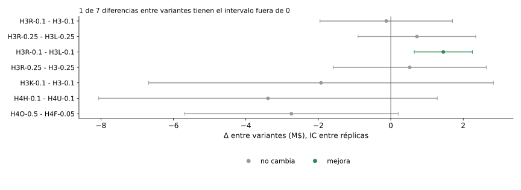
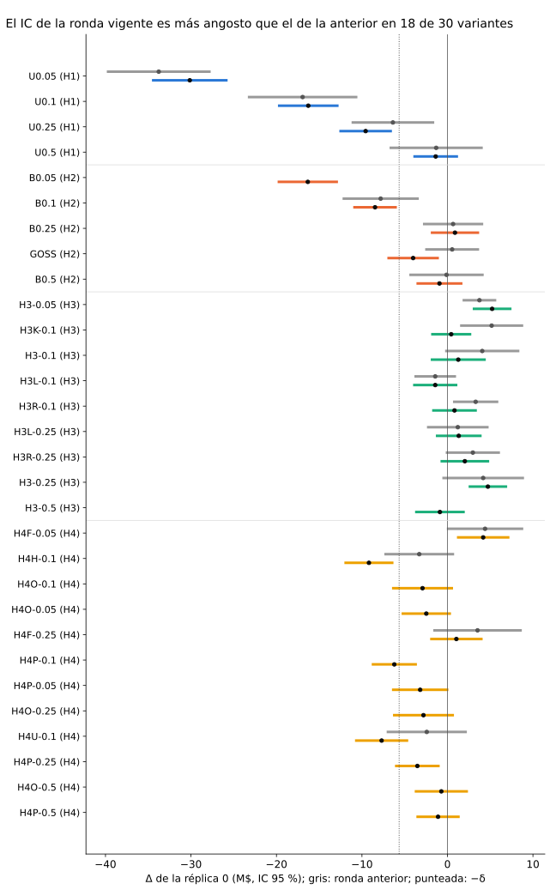

# Anexo de resultados

Las tablas de consulta de [Resultados](README.md): cada una sale de los ledgers (`comun/reporte.py`) y no se edita a mano.

## Tablas completas del bloque A

Las 21 variantes con todas las columnas, la varianza por variante y las diferencias entre variantes, como texto.

<!-- generado:bloque-a-completo -->
Generado por `comun/reporte.py` el 2026-11-14; no editar.

Tablas completas del bloque A

#### Bloque A: mismo protocolo

Final entrenado con 201903-201908, 20 semillas por réplica; N* = 3,300 clientes contactados; Ḡ_C (réplica 0) = 282.48 M$; Ḡ_C con réplicas = 281.78 M$ (R=8); ensamble de 20 semillas del control = 286.55 M$.

Ḡ, T y la aceleración salen de la réplica 0 en las variantes sin réplicas; en las marcadas (R=n), Ḡ es la media entre réplicas, T la mediana entre réplicas y la aceleración = T_C / T con T_C también mediana entre réplicas, así que se comparan con Ḡ_C con réplicas y no con Ḡ_C de la réplica 0.

| variante | hipótesis | Ḡ (M$) | Δ réplica 0 [IC] (M$) | Δ con réplicas [IC] (M$) | ΔAUC en 201910 [IC] | T mediana (s) | aceleración (×) | tiempo igual, réplicas [IC t] (M$) | tiempo igual, bootstrap de clientes [IC] (M$) | ganancia contra el control (fuente) |
|---|---|---|---|---|---|---|---|---|---|---|
| U0.05 | H1 | 254.04 (R=8) | -30.14 [-34.56; -25.72] | -27.74 [-30.35; -25.13] (R=8) | -0.0166 [-0.0184; -0.0149] (R=8) | 63 | 15.94 | -8.70 [-13.09; -4.32] (R=8) | -13.72 [-26.90; -0.92] | pierde (con réplicas (8)) |
| U0.1 | H1 | 264.31 (R=8) | -16.28 [-19.83; -12.73] | -17.47 [-20.23; -14.71] (R=8) | -0.0108 [-0.0123; -0.0094] (R=8) | 99 | 10.13 | -4.58 [-9.22; 0.06] (R=8) | -5.82 [-15.73; 3.85] | pierde (con réplicas (8)) |
| U0.25 | H1 | 273.69 (R=8) | -9.57 [-12.65; -6.49] | -8.09 [-11.58; -4.60] (R=8) | -0.0054 [-0.0066; -0.0042] (R=8) | 201 | 4.99 | 1.33 [-1.60; 4.27] (R=8) | -0.52 [-8.86; 7.54] | pierde (con réplicas (8)) |
| U0.5 | H1 | 278.13 (R=8) | -1.38 [-3.99; 1.24] | -3.64 [-6.58; -0.71] (R=8) | -0.0018 [-0.0029; -0.0007] (R=8) | 423 | 2.37 | 3.67 [0.64; 6.71] (R=8) | 5.98 [-1.71; 13.53] | indeterminado (con réplicas (8)) |
| B0.05 | H2 | 267.23 (R=8) | -16.34 [-19.86; -12.81] | -14.55 [-17.44; -11.66] (R=8) | -0.0109 [-0.0124; -0.0093] (R=8) | 324 | 3.09 | -8.57 [-11.78; -5.35] (R=8) | -4.49 [-14.85; 6.55] | pierde (con réplicas (8)) |
| B0.1 | H2 | 274.47 (R=8) | -8.47 [-11.02; -5.92] | -7.31 [-9.76; -4.86] (R=8) | -0.0068 [-0.0079; -0.0056] (R=8) | 338 | 2.96 | -2.38 [-5.13; 0.37] (R=8) | -2.34 [-11.66; 6.44] | pierde (con réplicas (8)) |
| B0.25 | H2 | 279.58 (R=8) | 0.88 [-1.95; 3.71] | -2.20 [-4.95; 0.55] (R=8) | -0.0026 [-0.0038; -0.0015] (R=8) | 601 | 1.67 | 3.12 [-0.09; 6.33] (R=8) | 3.72 [-6.00; 13.31] | no pierde (con réplicas (8)) |
| GOSS | H2 | 278.82 (R=8) | -4.01 [-7.03; -1.00] | -2.96 [-6.13; 0.21] (R=8) | +0.0003 [-0.0008; +0.0014] (R=8) | 790 | 1.27 | 1.58 [-1.83; 4.99] (R=6) | no aplica (K<2) | indeterminado (con réplicas (8)) |
| B0.5 | H2 | 282.13 (R=8) | -0.94 [-3.62; 1.75] | 0.35 [-2.16; 2.86] (R=8) | -0.0005 [-0.0015; +0.0004] (R=8) | 849 | 1.18 | 5.05 [0.65; 9.45] (R=6) | no aplica (K<2) | no pierde (con réplicas (8)) |
| H3-0.05 | H3 | 283.86 (R=8) | 5.22 [2.96; 7.49] | 2.08 [-0.87; 5.02] (R=8) | -0.0020 [-0.0041; +0.0000] (R=8) | 95 | 10.56 | 4.77 [1.01; 8.53] (R=8) | 7.74 [0.06; 16.23] | no pierde (con réplicas (8)) |
| H3K-0.1 | H3 | 281.57 (R=8) | 0.44 [-1.91; 2.79] | -0.21 [-5.05; 4.63] (R=8) | -0.0033 [-0.0050; -0.0017] (R=8) | 126 | 7.98 | 3.95 [-1.58; 9.47] (R=8) | 4.24 [-6.33; 15.40] | no pierde (con réplicas (8)) |
| H3-0.1 | H3 | 283.49 (R=8) | 1.26 [-1.95; 4.48] | 1.71 [-1.07; 4.49] (R=8) | -0.0017 [-0.0030; -0.0003] (R=8) | 129 | 7.76 | 5.46 [2.93; 7.98] (R=8) | 6.04 [-2.37; 15.30] | no pierde (con réplicas (8)) |
| H3L-0.1 | H3 | 281.92 (R=8) | -1.43 [-4.02; 1.16] | 0.14 [-3.30; 3.57] (R=8) | -0.0005 [-0.0020; +0.0010] (R=8) | 130 | 7.73 | 2.98 [0.05; 5.92] (R=8) | 1.76 [-7.26; 10.72] | no pierde (con réplicas (8)) |
| H3R-0.1 | H3 | 283.37 (R=8) | 0.82 [-1.79; 3.44] | 1.59 [-1.80; 4.98] (R=8) | -0.0008 [-0.0023; +0.0006] (R=8) | 130 | 7.71 | 5.87 [4.27; 7.47] (R=8) | 5.06 [-2.15; 13.31] | no pierde (con réplicas (8)) |
| H3L-0.25 | H3 | 283.00 (R=8) | 1.32 [-1.36; 4.00] | 1.22 [-1.59; 4.03] (R=8) | +0.0004 [-0.0008; +0.0016] (R=8) | 222 | 4.51 | 5.46 [0.83; 10.08] (R=8) | 9.00 [2.14; 16.83] | no pierde (con réplicas (8)) |
| H3R-0.25 | H3 | 283.72 (R=8) | 2.04 [-0.81; 4.88] | 1.95 [-0.85; 4.74] (R=8) | +0.0000 [-0.0011; +0.0011] (R=8) | 225 | 4.46 | 5.32 [2.93; 7.71] (R=8) | 6.65 [-0.28; 14.19] | no pierde (con réplicas (8)) |
| H3-0.25 | H3 | 283.20 (R=8) | 4.73 [2.48; 6.98] | 1.42 [-2.82; 5.67] (R=8) | -0.0009 [-0.0021; +0.0004] (R=8) | 229 | 4.38 | 6.15 [3.95; 8.34] (R=8) | 8.85 [1.87; 16.83] | no pierde (con réplicas (8)) |
| H3-0.5 | H3 | 281.70 (R=8) | -0.88 [-3.79; 2.03] | -0.08 [-3.17; 3.00] (R=8) | -0.0000 [-0.0010; +0.0010] (R=8) | 440 | 2.28 | 2.98 [-0.53; 6.49] (R=8) | 3.82 [-4.51; 12.33] | no pierde (con réplicas (8)) |
| H4F-0.05 | H4 | 283.19 (R=8) | 4.18 [1.11; 7.25] | 1.41 [-1.58; 4.40] (R=8) | -0.0019 [-0.0041; +0.0003] (R=8) | 80 | 12.50 | 4.63 [0.77; 8.50] (R=8) | 9.29 [1.53; 18.04] | no pierde (con réplicas (8)) |
| H4H-0.1 | H4 | 270.37 (R=8) | -9.19 [-12.06; -6.31] | -11.41 [-15.80; -7.03] (R=8) | -0.0045 [-0.0062; -0.0028] (R=8) | 126 | 7.93 | -5.68 [-10.71; -0.65] (R=8) | -8.72 [-17.99; 0.44] | pierde (con réplicas (8)) |
| H4O-0.1 | H4 | 279.53 (R=8) | -2.92 [-6.48; 0.65] | -2.25 [-4.91; 0.41] (R=8) | -0.0003 [-0.0014; +0.0009] (R=8) | 189 | 5.29 | 6.56 [3.65; 9.46] (R=8) | 2.17 [-7.92; 13.04] | no pierde (con réplicas (8)) |
| H4O-0.05 | H4 | 275.64 (R=8) | -2.48 [-5.36; 0.41] | -6.14 [-10.53; -1.75] (R=8) | -0.0009 [-0.0024; +0.0006] (R=8) | 210 | 4.78 | 5.60 [2.69; 8.50] (R=8) | 6.06 [-3.09; 16.12] | pierde (con réplicas (8)) |
| H4F-0.25 | H4 | 283.04 (R=8) | 1.04 [-2.02; 4.11] | 1.26 [-1.42; 3.94] (R=8) | -0.0002 [-0.0013; +0.0009] (R=8) | 210 | 4.77 | 4.91 [2.09; 7.73] (R=8) | 2.39 [-4.62; 10.01] | no pierde (con réplicas (8)) |
| H4P-0.1 | H4 | 276.41 (R=8) | -6.21 [-8.86; -3.57] | -5.37 [-9.81; -0.93] (R=8) | -0.0035 [-0.0053; -0.0016] (R=8) | 222 | 4.51 | 4.91 [1.57; 8.24] (R=8) | 0.98 [-9.79; 11.66] | indeterminado (con réplicas (8)) |
| H4P-0.05 | H4 | 275.31 (R=8) | -3.19 [-6.49; 0.11] | -6.47 [-10.11; -2.83] (R=8) | -0.0034 [-0.0045; -0.0024] (R=8) | 255 | 3.93 | 5.46 [0.55; 10.37] (R=8) | 0.72 [-11.16; 12.54] | pierde (con réplicas (8)) |
| H4O-0.25 | H4 | 281.48 (R=8) | -2.81 [-6.37; 0.76] | -0.30 [-2.97; 2.38] (R=8) | -0.0000 [-0.0011; +0.0011] (R=8) | 274 | 3.65 | 4.36 [0.54; 8.17] (R=8) | 1.36 [-6.88; 9.85] | no pierde (con réplicas (8)) |
| H4U-0.1 | H4 | 273.76 (R=8) | -7.70 [-10.81; -4.59] | -8.02 [-11.52; -4.53] (R=8) | -0.0037 [-0.0054; -0.0021] (R=8) | 293 | 3.41 | 3.95 [-1.40; 9.29] (R=8) | 2.91 [-7.54; 14.25] | pierde (con réplicas (8)) |
| H4P-0.25 | H4 | 280.45 (R=8) | -3.52 [-6.13; -0.91] | -1.33 [-4.46; 1.81] (R=8) | -0.0021 [-0.0036; -0.0006] (R=8) | 299 | 3.35 | 6.01 [2.88; 9.14] (R=8) | 5.76 [-3.08; 14.75] | no pierde (con réplicas (8)) |
| H4O-0.5 | H4 | 280.44 (R=8) | -0.71 [-3.83; 2.40] | -1.33 [-4.27; 1.60] (R=8) | +0.0004 [-0.0007; +0.0015] (R=8) | 434 | 2.31 | 4.08 [0.49; 7.67] (R=8) | 4.34 [-3.79; 12.60] | no pierde (con réplicas (8)) |
| H4P-0.5 | H4 | 279.23 (R=8) | -1.10 [-3.63; 1.43] | -2.55 [-5.82; 0.72] (R=8) | -0.0008 [-0.0022; +0.0007] (R=8) | 455 | 2.20 | 3.26 [-0.49; 7.01] (R=8) | 2.73 [-6.00; 11.88] | indeterminado (con réplicas (8)) |

#### Varianza entre réplicas y entre semillas

| variante | réplicas | corridas | sd entre réplicas (M$) | sd entre semillas (M$) | varianza entre réplicas |
|---|---|---|---|---|---|
| C | 8 | 160 | 2.78 | 4.53 | 25 % |
| U0.05 | 8 | 160 | 1.98 | 7.15 | 6 % |
| U0.1 | 8 | 160 | 2.35 | 5.20 | 15 % |
| U0.25 | 8 | 160 | 3.64 | 5.09 | 32 % |
| U0.5 | 8 | 160 | 2.69 | 5.14 | 19 % |
| B0.05 | 8 | 160 | 2.61 | 5.35 | 18 % |
| B0.1 | 8 | 160 | 1.45 | 4.79 | 8 % |
| B0.25 | 8 | 160 | 2.31 | 4.40 | 20 % |
| B0.5 | 8 | 160 | 1.67 | 4.02 | 14 % |
| GOSS | 8 | 160 | 3.12 | 4.58 | 29 % |
| H3-0.05 | 8 | 160 | 2.71 | 3.75 | 32 % |
| H3-0.1 | 8 | 160 | 2.38 | 3.94 | 24 % |
| H3-0.25 | 8 | 160 | 4.72 | 4.45 | 50 % |
| H3-0.5 | 8 | 160 | 2.97 | 4.05 | 33 % |
| H3K-0.1 | 8 | 160 | 5.51 | 4.31 | 58 % |
| H3L-0.1 | 8 | 160 | 3.55 | 3.58 | 47 % |
| H3L-0.25 | 8 | 160 | 2.45 | 3.90 | 26 % |
| H3R-0.1 | 8 | 160 | 3.48 | 3.57 | 46 % |
| H3R-0.25 | 8 | 160 | 2.41 | 3.68 | 28 % |
| H4F-0.05 | 8 | 160 | 2.80 | 3.96 | 31 % |
| H4F-0.25 | 8 | 160 | 2.15 | 4.43 | 17 % |
| H4H-0.1 | 8 | 160 | 4.91 | 4.83 | 48 % |
| H4O-0.05 | 8 | 160 | 4.92 | 5.09 | 46 % |
| H4O-0.1 | 8 | 160 | 2.10 | 5.63 | 11 % |
| H4O-0.25 | 8 | 160 | 2.14 | 5.07 | 14 % |
| H4O-0.5 | 8 | 160 | 2.69 | 4.50 | 25 % |
| H4P-0.05 | 8 | 160 | 3.86 | 5.60 | 30 % |
| H4P-0.1 | 8 | 160 | 4.98 | 5.56 | 42 % |
| H4P-0.25 | 8 | 160 | 3.06 | 4.76 | 27 % |
| H4P-0.5 | 8 | 160 | 3.28 | 4.78 | 30 % |
| H4U-0.1 | 8 | 160 | 3.65 | 5.57 | 28 % |

#### Diferencias entre variantes

| diferencia | Δ [IC entre réplicas] (M$) | réplicas | IC | veredicto |
|---|---|---|---|---|
| H3R-0.1 - H3-0.1 | -0.12 [-1.95; 1.71] | 8 | t, apareado | no cambia |
| H3R-0.25 - H3L-0.25 | 0.72 [-0.90; 2.35] | 8 | t, apareado | no cambia |
| H3R-0.1 - H3L-0.1 | 1.45 [0.65; 2.25] | 8 | t, apareado | mejora |
| H3R-0.25 - H3-0.25 | 0.52 [-1.59; 2.64] | 8 | t, apareado | no cambia |
| H3K-0.1 - H3-0.1 | -1.93 [-6.68; 2.83] | 8 | Welch, sin aparear | no cambia |
| H4O-0.5 - H4P-0.5 | 1.22 [-0.27; 2.70] | 8 | t, apareado | no cambia |
| H4O-0.25 - H4P-0.25 | 1.03 [-0.30; 2.37] | 8 | t, apareado | no cambia |
| H4O-0.1 - H4P-0.1 | 3.12 [0.01; 6.24] | 8 | t, apareado | mejora |
| H4O-0.05 - H4P-0.05 | 0.33 [-1.77; 2.43] | 8 | t, apareado | no cambia |
| H4H-0.1 - H4U-0.1 | -3.39 [-8.06; 1.28] | 8 | Welch, sin aparear | no cambia |
| H4O-0.5 - H4F-0.05 | -2.74 [-5.69; 0.21] | 8 | Welch, sin aparear | no cambia |
| H4P-0.1 - H4U-0.1 | 2.65 [-2.06; 7.37] | 8 | Welch, sin aparear | no cambia |

<!-- /generado:bloque-a-completo -->

## Varianza entre réplicas y entre semillas

Qué parte de la varianza de G es suerte de la optimización (entre réplicas) y qué parte es suerte del final.

<!-- generado:varianza -->
Generado por `comun/reporte.py` el 2026-11-14; no editar.

<table><tr><th>variante</th><th>réplicas</th><th>corridas</th><th>sd entre réplicas (M$)</th><th>sd entre semillas (M$)</th><th>varianza entre réplicas</th></tr><tr><td>C</td><td>8</td><td>160</td><td>2.78</td><td>4.53</td><td>25 %</td></tr><tr><td>U0.05</td><td>8</td><td>160</td><td>1.98</td><td>7.15</td><td>6 %</td></tr><tr><td>U0.1</td><td>8</td><td>160</td><td>2.35</td><td>5.20</td><td>15 %</td></tr><tr><td>U0.25</td><td>8</td><td>160</td><td>3.64</td><td>5.09</td><td>32 %</td></tr><tr><td>U0.5</td><td>8</td><td>160</td><td>2.69</td><td>5.14</td><td>19 %</td></tr><tr><td>B0.05</td><td>8</td><td>160</td><td>2.61</td><td>5.35</td><td>18 %</td></tr><tr><td>B0.1</td><td>8</td><td>160</td><td>1.45</td><td>4.79</td><td>8 %</td></tr><tr><td>B0.25</td><td>8</td><td>160</td><td>2.31</td><td>4.40</td><td>20 %</td></tr><tr><td>B0.5</td><td>8</td><td>160</td><td>1.67</td><td>4.02</td><td>14 %</td></tr><tr><td>GOSS</td><td>8</td><td>160</td><td>3.12</td><td>4.58</td><td>29 %</td></tr><tr><td>H3-0.05</td><td>8</td><td>160</td><td>2.71</td><td>3.75</td><td>32 %</td></tr><tr><td>H3-0.1</td><td>8</td><td>160</td><td>2.38</td><td>3.94</td><td>24 %</td></tr><tr><td>H3-0.25</td><td>8</td><td>160</td><td>4.72</td><td>4.45</td><td>50 %</td></tr><tr><td>H3-0.5</td><td>8</td><td>160</td><td>2.97</td><td>4.05</td><td>33 %</td></tr><tr><td>H3K-0.1</td><td>8</td><td>160</td><td>5.51</td><td>4.31</td><td>58 %</td></tr><tr><td>H3L-0.1</td><td>8</td><td>160</td><td>3.55</td><td>3.58</td><td>47 %</td></tr><tr><td>H3L-0.25</td><td>8</td><td>160</td><td>2.45</td><td>3.90</td><td>26 %</td></tr><tr><td>H3R-0.1</td><td>8</td><td>160</td><td>3.48</td><td>3.57</td><td>46 %</td></tr><tr><td>H3R-0.25</td><td>8</td><td>160</td><td>2.41</td><td>3.68</td><td>28 %</td></tr><tr><td>H4F-0.05</td><td>8</td><td>160</td><td>2.80</td><td>3.96</td><td>31 %</td></tr><tr><td>H4F-0.25</td><td>8</td><td>160</td><td>2.15</td><td>4.43</td><td>17 %</td></tr><tr><td>H4H-0.1</td><td>8</td><td>160</td><td>4.91</td><td>4.83</td><td>48 %</td></tr><tr><td>H4O-0.05</td><td>8</td><td>160</td><td>4.92</td><td>5.09</td><td>46 %</td></tr><tr><td>H4O-0.1</td><td>8</td><td>160</td><td>2.10</td><td>5.63</td><td>11 %</td></tr><tr><td>H4O-0.25</td><td>8</td><td>160</td><td>2.14</td><td>5.07</td><td>14 %</td></tr><tr><td>H4O-0.5</td><td>8</td><td>160</td><td>2.69</td><td>4.50</td><td>25 %</td></tr><tr><td>H4P-0.05</td><td>8</td><td>160</td><td>3.86</td><td>5.60</td><td>30 %</td></tr><tr><td>H4P-0.1</td><td>8</td><td>160</td><td>4.98</td><td>5.56</td><td>42 %</td></tr><tr><td>H4P-0.25</td><td>8</td><td>160</td><td>3.06</td><td>4.76</td><td>27 %</td></tr><tr><td>H4P-0.5</td><td>8</td><td>160</td><td>3.28</td><td>4.78</td><td>30 %</td></tr><tr><td>H4U-0.1</td><td>8</td><td>160</td><td>3.65</td><td>5.57</td><td>28 %</td></tr></table>

<!-- /generado:varianza -->

## Diferencias entre variantes

Contrastes entre variantes de H3 y de H4, sin pasar por el control.

<!-- generado:diferencias -->
Generado por `comun/reporte.py` el 2026-11-14; no editar.

<table><tr><th>diferencia</th><th>Δ [IC entre réplicas] (M$)</th><th>réplicas</th><th>IC</th><th>veredicto</th></tr><tr><td>H3R-0.1 - H3-0.1</td><td>-0.12[-1.95; 1.71]</td><td>8</td><td>t, apareado</td><td>no cambia</td></tr><tr><td>H3R-0.25 - H3L-0.25</td><td>0.72[-0.90; 2.35]</td><td>8</td><td>t, apareado</td><td>no cambia</td></tr><tr><td>H3R-0.1 - H3L-0.1</td><td class='sig-pos'>1.45[0.65; 2.25]</td><td>8</td><td>t, apareado</td><td>mejora</td></tr><tr><td>H3R-0.25 - H3-0.25</td><td>0.52[-1.59; 2.64]</td><td>8</td><td>t, apareado</td><td>no cambia</td></tr><tr><td>H3K-0.1 - H3-0.1</td><td>-1.93[-6.68; 2.83]</td><td>8</td><td>Welch, sin aparear</td><td>no cambia</td></tr><tr><td>H4O-0.5 - H4P-0.5</td><td>1.22[-0.27; 2.70]</td><td>8</td><td>t, apareado</td><td>no cambia</td></tr><tr><td>H4O-0.25 - H4P-0.25</td><td>1.03[-0.30; 2.37]</td><td>8</td><td>t, apareado</td><td>no cambia</td></tr><tr><td>H4O-0.1 - H4P-0.1</td><td class='sig-pos'>3.12[0.01; 6.24]</td><td>8</td><td>t, apareado</td><td>mejora</td></tr><tr><td>H4O-0.05 - H4P-0.05</td><td>0.33[-1.77; 2.43]</td><td>8</td><td>t, apareado</td><td>no cambia</td></tr><tr><td>H4H-0.1 - H4U-0.1</td><td>-3.39[-8.06; 1.28]</td><td>8</td><td>Welch, sin aparear</td><td>no cambia</td></tr><tr><td>H4O-0.5 - H4F-0.05</td><td>-2.74[-5.69; 0.21]</td><td>8</td><td>Welch, sin aparear</td><td>no cambia</td></tr><tr><td>H4P-0.1 - H4U-0.1</td><td>2.65[-2.06; 7.37]</td><td>8</td><td>Welch, sin aparear</td><td>no cambia</td></tr></table>

<!-- /generado:diferencias -->

## Rondas

La ronda anterior (final con 201903–201906 y 10 semillas) contra la vigente (201903–201908 y 20 semillas), con el
resultado de la predicción de la ronda ([Control y reglas](../control/README.md#prediccion-de-la-ronda-201903201908)):

- **Veredictos estables: se confirma.** 0 cambios de lado. Cambian 8 veredictos, todos desde o hacia *indeterminado* o
  entre *gana* y *no pierde* (por semilla); con réplicas no cambia ninguno.
- **IC más angosto: se confirma.** La mediana de la razón de anchos del IC por semilla (ronda anterior / vigente) es
  1,44, dentro de [1,2; 1,9].
- **Con réplicas el ancho baja menos: se confirma.** La mediana de la razón con réplicas es 0,96: con 8 réplicas el IC
  prácticamente no se angosta, porque la suerte de Optuna no depende de las semillas finales.
- T y la aceleración no se comparan entre rondas: el final de seis meses es más largo y se midió en otras VMs.

<!-- generado:ic-rondas -->
Generado por `comun/reporte.py` el 2026-11-14; no editar.

<!-- /generado:ic-rondas -->

<!-- generado:rondas -->
Generado por `comun/reporte.py` el 2026-11-13; no editar.

Generado por `python scripts/comparar_rondas.py`; no editar a mano. Cada ronda se lee de su propio `apareado.csv` y `replicas.csv` (G, Δ y δ salen del control de esa ronda); T y A no se comparan entre rondas.

- Ronda 201903-201906 (final con 4 meses, 10 semillas, N* de validación): δ = 5.52 M$.
- Ronda 201903-201908 (final con 6 meses, 20 semillas, N* fijo): δ = 5.65 M$.

Δ en M$ al corte N* de cada ronda, con IC 95%.

| variante | Δ réplica 0 201903-201906 | veredicto | Δ con réplicas | veredicto | Δ réplica 0 201903-201908 | veredicto | Δ con réplicas | veredicto | ¿cambia el veredicto? |
|---|---|---|---|---|---|---|---|---|---|
| B0.1 | -7.81 [-12.27; -3.35] | pierde | — | — | -8.47 [-11.02; -5.92] | pierde | — | — | no |
| B0.25 | 0.66 [-2.86; 4.18] | no pierde | — | — | 0.88 [-1.95; 3.71] | no pierde | — | — | no |
| B0.5 | -0.11 [-4.46; 4.24] | no pierde | — | — | -0.94 [-3.62; 1.75] | no pierde | — | — | no |
| C | pendiente | pendiente | — | — | pendiente | pendiente | — | — | pendiente |
| GOSS | 0.55 [-2.60; 3.70] | no pierde | — | — | -4.01 [-7.03; -1.00] | indeterminado | — | — | sí |
| H3-0.05 | 3.74 [1.77; 5.71] | gana | 1.87 [-1.02; 4.76] | no pierde | 5.22 [2.96; 7.49] | gana | 2.08 [-0.87; 5.02] | no pierde | no |
| H3-0.1 | 4.07 [-0.27; 8.41] | no pierde | 2.30 [-0.88; 5.47] | no pierde | 1.26 [-1.95; 4.48] | no pierde | 1.71 [-1.07; 4.49] | no pierde | no |
| H3-0.25 | 4.18 [-0.60; 8.96] | no pierde | 1.81 [-1.78; 5.41] | no pierde | 4.73 [2.48; 6.98] | gana | 1.42 [-2.82; 5.67] | no pierde | sí |
| H3K-0.1 | 5.17 [1.48; 8.86] | gana | 1.28 [-3.42; 5.98] | no pierde | 0.44 [-1.91; 2.79] | no pierde | -0.21 [-5.05; 4.63] | no pierde | sí |
| H3L-0.1 | -1.43 [-3.86; 1.00] | no pierde | -1.46 [-4.73; 1.81] | no pierde | -1.43 [-4.02; 1.16] | no pierde | 0.14 [-3.30; 3.57] | no pierde | no |
| H3L-0.25 | 1.21 [-2.40; 4.82] | no pierde | 0.25 [-2.02; 2.51] | no pierde | 1.32 [-1.36; 4.00] | no pierde | 1.22 [-1.59; 4.03] | no pierde | no |
| H3R-0.1 | 3.30 [0.65; 5.95] | gana | 1.76 [-1.21; 4.73] | no pierde | 0.82 [-1.79; 3.44] | no pierde | 1.59 [-1.80; 4.98] | no pierde | sí |
| H3R-0.25 | 2.97 [-0.20; 6.14] | no pierde | 1.53 [-1.92; 4.97] | no pierde | 2.04 [-0.81; 4.88] | no pierde | 1.95 [-0.85; 4.74] | no pierde | no |
| H4F-0.05 | 4.40 [-0.07; 8.87] | no pierde | 1.86 [-0.83; 4.54] | no pierde | 4.18 [1.11; 7.25] | gana | 1.41 [-1.58; 4.40] | no pierde | sí |
| H4F-0.25 | 3.52 [-1.66; 8.70] | no pierde | 1.39 [-1.87; 4.65] | no pierde | 1.04 [-2.02; 4.11] | no pierde | 1.26 [-1.42; 3.94] | no pierde | no |
| H4H-0.1 | -3.30 [-7.38; 0.78] | indeterminado | -8.61 [-12.78; -4.43] | pierde | -9.19 [-12.06; -6.31] | pierde | -11.41 [-15.80; -7.03] | pierde | sí |
| H4U-0.1 | -2.42 [-7.11; 2.27] | indeterminado | -5.54 [-8.94; -2.14] | pierde | -7.70 [-10.81; -4.59] | pierde | -8.02 [-11.52; -4.53] | pierde | sí |
| U0.05 | -33.77 [-39.84; -27.70] | pierde | — | — | -30.14 [-34.56; -25.72] | pierde | — | — | no |
| U0.1 | -16.94 [-23.35; -10.53] | pierde | — | — | -16.28 [-19.83; -12.73] | pierde | — | — | no |
| U0.25 | -6.38 [-11.21; -1.55] | pierde | — | — | -9.57 [-12.65; -6.49] | pierde | — | — | no |
| U0.5 | -1.32 [-6.77; 4.13] | indeterminado | — | — | -1.38 [-3.99; 1.24] | no pierde | — | — | sí |

<!-- /generado:rondas -->
