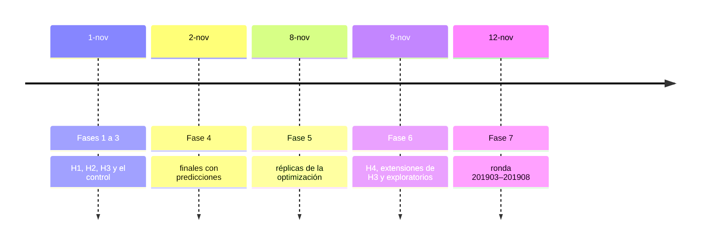
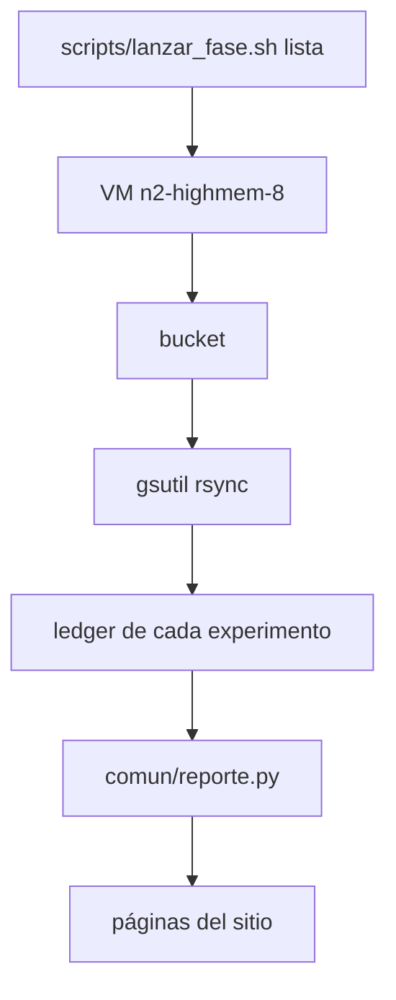

# Corridas

Cómo se corren, retoman y consolidan las corridas de todas las hipótesis, en qué máquina y en qué fases. Todos los
comandos se corren desde la raíz del repo.

## Protocolo

Cada variante tiene su Optuna (40 trials, train 201903–201906, AUC en validación, 201908) y un final que entrena con
201903–201908 y se evalúa en test (201910) con 20 semillas. Decide la ganancia al corte N\* = 3.300 clientes
contactados; el AUC va al lado. `C`, H3 y H4 tienen 8 réplicas de la optimización (otra semilla de Optuna y otra
muestra). Las fases, el reparto por máquina y el costo están abajo; los apartamientos del baseline, con su id, en
[Control y reglas](../control/README.md).

## Máquina

- Todas las corridas que cuentan van en **`n2-highmem-8`** (8 vCPU, 64 GB) con CPU **Intel Ice Lake**, que es lo que
  define T en las [reglas](../control/README.md). Cada fila del ledger registra el modelo de CPU de `/proc/cpuinfo`, y el
  análisis de tiempos descarta las filas con otra CPU.
- El curso no tiene un template `n2-highmem-8`. La VM se crea desde **`to-064ram-08vcpu`** (imagen `labo-family`, disco
  de 256 GB, script de arranque) y se sobrescriben el tipo y la plataforma:

  ```bash
  # T=projects/<proyecto>/regions/northamerica-northeast2/
  #   instanceTemplates/to-064ram-08vcpu
  gcloud compute instances create <nombre> \
    --zone=northamerica-northeast2-b \
    --source-instance-template="$T" \
    --machine-type=n2-highmem-8 \
    --min-cpu-platform="Intel Ice Lake"
  ```

  e2 queda descartada porque no deja fijar la plataforma de CPU. Región `northamerica-northeast2`, donde están los
  templates del curso; si no hay capacidad en la zona `-b`, se usa `-a` o `-c` (las tres tienen Ice Lake).
- Las fases 1 a 7 corrieron en VMs spot. Hoy `scripts/vm.sh` crea las VMs **a pedido** por defecto, porque las spot se
  reclaman a los minutos cuando falta capacidad; `PROVISIONING=SPOT` usa el template tal cual.
- La cuota del trial es de 32 vCPU por proyecto (`CPUS_ALL_REGIONS`): 4 VMs de 8 vCPU a la vez. Las fases grandes van en
  tandas.
- Una corrida por VM a la vez, en secuencia. Se registra el `load average` al iniciar cada corrida.
- Lo que tiene que sobrevivir a la VM se copia al bucket: el **SQLite de Optuna** al terminar cada trial (no se abre
  sobre gcsfuse, porque SQLite necesita locking), el **panel 2019 en Parquet** una vez después de armarlo (una VM nueva lo
  baja en vez de rehacer la media hora de preparación) y las **filas de `ledger/corridas/` y `ledger/curvas/`** al
  terminar cada corrida.
- Cada fase sale de un único commit con tag (`corridas-v1` … `corridas-v4`). Si hay que corregir código a mitad de
  camino, se crea un tag nuevo, se anota en la bitácora y se repiten las corridas afectadas.

## Una configuración

```bash
# estudio U0.25 (h1/ledger)
python -m comun.correr --metodo uniforme --tasa 0.25 \
  --semilla 0 --etapa optimizar
# variante U0.25, todas las semillas
python -m comun.correr --metodo uniforme --tasa 0.25 \
  --semilla todas --etapa final
# variante H3-0.25 (h3/ledger)
python -m comun.correr --metodo opt-muestra --tasa 0.25 \
  --semilla todas --etapa final
# réplica del control con los hiperparámetros de C
python -m comun.correr --metodo uniforme --tasa 1 \
  --semilla todas --etapa final --variante C-rep \
  --hp experimentos/control/ledger/hp/C.json
```

| método | `--tasa` | estudio | variante |
|---|---|---|---|
| `uniforme` | r | `C` (r = 1) o `U<r>` | igual al estudio |
| `bagging` | f | `B<f>` | igual al estudio |
| `goss` | 1 | `GOSS` | `GOSS` |
| `opt-muestra` | r_opt | el de `uniforme` con la misma tasa | `H3-<r_opt>` |

- `opt-muestra --etapa optimizar` corre el estudio de `uniforme` con esa tasa, que H1 y H3 comparten. El resto de los
  métodos (reescalados, por cliente, los de H4) está en `comun/metodos.py` y su nombre en `comun/variantes.py`.
- `--etapa final` usa `hp/<estudio>.json` del ledger del dueño del estudio (H3 lee el de `h1`) salvo que se pase `--hp`.
  `--semilla todas` son las semillas del diseño; una lista con comas también vale. Las que ya tienen fila válida se
  saltean. `--replica k` corre la réplica k de la optimización.
- El estudio de Optuna es un SQLite en `$DATOS_DIR/optuna/`. Si la corrida se corta, el mismo comando retoma los trials
  que faltan. `--tras-trial 'cmd {db}'` corre un comando después de cada trial (la VM lo usa para copiarlo al bucket).

## Qué cuenta y qué no

Una fila es **válida** (`valida = true`) si el árbol estaba limpio (los archivos de `ledger/` no cuentan), no se usó
`--filas` y los trials son 40. Lo demás es exploratorio: va a `ledger/exploracion/` (ignorado por git) y su id lleva
`exp-` y la hora, así que nunca se saltea. `consolidar` solo mira `ledger/corridas/`. Las corridas en la Mac
(`--filas 20000`) son pruebas.

Tiempos de una fila final: `tiempo_entrenamiento_s` es `Dataset` + entrenamiento + predicción en 201910;
`tiempo_lgbtrain_s`, solo `lgb.train`. En una invocación con varias semillas, la primera fila lleva además la carga de
datos y el panel (`tiempo_preparacion_s`); las otras, solo su muestreo. En una fila `optimizar`, `tiempo_optimizacion_s`
es la suma de la duración de los trials más el armado del `Dataset`.

## Consolidar y regenerar

```bash
# resultados.csv, reemplazadas.csv, estudios.csv y apareado.csv de h1
python -m comun.consolidar --experimento h1
# los de todos los dueños de variantes
python -m comun.consolidar
# bloques generados de cada página (--figuras DIR guarda también los PNG)
python -m comun.reporte --todos
# bloque rondas del Anexo
python -m scripts.comparar_rondas
```

`apareado.csv` trae N\*, δ, Δ de ganancia por variante (media, desvío, IC 95%, semillas ganadas, veredicto), Δ de AUC, T
y la aceleración. Los tiempos solo se comparan con el control si la máquina, la CPU y los hilos coinciden; si no, la
columna `nota` lo dice.

## VM

```bash
# una VM por lista; vuelve enseguida y deja la VM trabajando
scripts/lanzar_fase.sh <lista>
# muestra qué haría, sin crear nada
scripts/vm.sh configuraciones.txt --en-seco
```

`PROYECTO` y `BUCKET` salen de `.env` en la raíz del repo (ver `.env.ejemplo`). `vm.sh` crea la VM con `n2-highmem-8` e
Ice Lake, copia el repo en el commit actual, instala `requirements.txt`, corre la lista con `nohup`, sube el `ledger/` de
cada experimento y los SQLite al bucket, trae los ledgers y **borra la VM** al terminar o fallar. Antes de cada fase:

1. Commit y tag de la fase (las filas con árbol sucio no cuentan).
2. Si una VM muere, volver a correr el mismo comando: baja el panel y los SQLite del bucket, retoma el estudio y saltea
   las finales que ya tienen fila.
3. Después de traer el ledger: commit de `experimentos/*/ledger/{corridas,curvas,hp}`, push y `comun.consolidar`.

## Fases

Las corridas se lanzaron todas desde una sola cuenta.



Recorrido de una corrida, de la lista a las páginas:



| fase | fecha | tag | VMs | carga |
|---|---|---|---|---|
| 1 | 1-nov | `corridas-v1` | A | ~100 u·min |
| 2 | 1-nov | `corridas-v1` | B | ~48 u·min |
| 3 | 1-nov | `corridas-v1` | C | ~120 u·min |
| 4 | 2-nov | `corridas-v1` | D | ~60 u·min |
| 5 | 8-nov | `corridas-v2` | 8 | ~5,6 h |
| 6 | 9-nov | `corridas-v3` | 18 | ~12 h |
| 7 | 12-nov | `corridas-v4` | 8, en dos tandas de 4 | ~24 h |

Qué corrió cada fase:

- **Fase 1**: estudios `C`, `U0.25` y `U0.1`; finales `C`, `H3-0.25`, `H3-0.1`, `U0.25` y `U0.1`.
- **Fase 2**: estudios y finales de `U0.5` y `U0.05`; después `C-rep` (con el JSON de `C`).
- **Fase 3**: estudios y finales de `B0.5`, `B0.25`, `B0.1` y `GOSS`.
- **Fases 1 a 3**: once variantes (el control y las diez de H1–H3) más `C-rep`; 9 estudios × 40 trials y 12 variantes ×
  10 semillas. Cada variante tiene su estudio y sus finales en la misma VM; T(variante) y T(C) vienen de VMs distintas, y
  `C-rep` en otra VM mide cuánto varía el tiempo entre VMs. La fase 1 va primero: calibra u y produce los JSON de `C`,
  `U0.25` y `U0.1`; `C-rep` espera el JSON de `C`.
- **Fase 4** (agregada el 2-nov): solo los finales de las 12 variantes, guardando predicciones. Las fases 1 a 3 guardaron curvas y no predicciones, y el tiempo igual necesita
  promediar probabilidades. Repite los finales en una sola VM guardando `ledger/predicciones/<id>.parquet`. Por la clave
  del ledger esas filas reemplazan a las anteriores: las ganancias son las mismas (determinismo, como mostró `C-rep`) y
  los tiempos finales quedan medidos en la misma máquina.
- **Fase 5**: réplicas de la optimización. `fase5_r1` … `fase5_r7` corren los estudios `C@k`, `U0.25@k`, `U0.1@k` y
  `U0.05@k` y los finales de las 5 variantes en k; `fase5_r0`, `H3-0.05` y `H3R-0.1` en k = 0. Optuna `C@1…7` 7 × 748 s ≈ 87 min; Optuna `U0.25@k`, `U0.1@k`, `U0.05@k` ≈ 35 min; finales 370 × ~35 s
  ≈ 216 min. Cada VM de réplica tarda unos 47 min y el total de pared queda en ~50 min.
- **Fase 6**: `fase6_r0` … `fase6_r7` corren los estudios `K0.1`, `NH0.1` y `NU0.1` y los finales de las 8 variantes
  nuevas en k, y además se replican los exploratorios. Variantes ~5,9 h de VM (~3,3 h de `h3` y ~2,6 h de `h4`); los exploratorios, ~5,8 h más (una VM por
  estrategia de `validacion_50_semillas` y una para `sensibilidad_muestra`). Unas 2 h de pared.
- **Fase 7**: ronda 201903–201908. `fase7_r0` (23 celdas) y `fase7_r1` … `fase7_r7` (14 cada una), cada una empezando
  por el estudio `F0.5@k`. 121 celdas × 20 semillas = 2.420 finales y 8 estudios `F0.5@k`. Los finales con seis meses promediaron
  ~36 s; `fase7_r0` lleva 460 finales (~4,5 h) y las otras 280 (~2,8 h). Unas 7 h de pared. Antes de lanzar, el ledger del
  bucket se migró con `scripts/agregar_meses_final.py` y se verificó bajándolo de nuevo.

**Orden.** Todo espera al cierre de la compuerta de código (`docs/revision.md` § 3) y al tag de la fase. N\* y δ salen
del control, así que los veredictos esperan a que esté su fase completa, pero las corridas no.

**Corridas perdidas.** Si una VM muere, se crea otra, baja el panel y el SQLite del bucket, retoma el estudio y relanza
las finales con la lista de configuraciones. El corredor saltea las que ya tienen fila en `ledger/corridas/`. Si una
variante termina con menos semillas, el apareo usa las que tiene y se anota en la bitácora.

## Costo

- **Estimación inicial** (1-nov): unidad u = un entrenamiento de 100 iteraciones sobre el train completo (~640.000 filas
  × ~470 columnas) más su predicción, supuesta en ~1 min. Factores supuestos: `uniforme` 0,15 + 0,85 r; `bagging`
  0,4 + 0,6 f; `GOSS` 0,7. Daba 268,8 u·min para las fases 1 a 3, ≈ 6 h de VM con el arranque (≈ 15 h si u fuera 3 min).
  Esas aceleraciones estimadas eran para el costo, no predicciones del experimento.
- **Precio**: `n2-highmem-8` cuesta ≈ US$ 0,52/h a pedido en `us-central1`, algo más en `northamerica-northeast2`
  (≈ 10–15 %) y bastante menos en spot. El peor caso de cada fase (a pedido, con un 15 % extra y media hora de arranque
  por VM) quedó debajo de US$ 10 en las fases 1 a 5, de US$ 15 en la 6 y de US$ 17 en la 7, más disco y bucket, dentro
  del crédito del trial. Las horas y el costo reales de cada fase están en la
  [bitácora de sampling_1](https://github.com/agustinarazanov/dmeyf-experimento-sampling/blob/main/experimentos/sampling_1/docs/bitacora.md).
- Al terminar cada fase no queda ninguna VM encendida.
