# Exploratorios

Tres estudios con su propio protocolo, hechos fuera de la grilla y replicados en las VMs del experimento (fase 6 de
[Corridas](../corridas.md)). Motivaron las réplicas de Optuna, H4 y las extensiones de H3, pero no deciden ningún
veredicto: sus cifras salen de otro protocolo, otra muestra u otro entorno, y no se comparan una a una con las de
[Resultados](../README.md).

## `sensibilidad_muestra`

¿Cuánto depende de la muestra la configuración que elige H3? Con 10 muestras del 25 %, la configuración elegida cambia
con la muestra, y la ganancia en 201910 se mueve de −9,9 a +8,8 M$ contra la del control (mediana 0). Es la columna
`delta` de `08_ganancia_por_semilla.csv`, en $; la `delta` de `07_resumen_por_semilla.csv` es diferencia de AUC, no de
ganancia.

Sus pasos 07 y 08 se volvieron a correr en `n2-highmem-8` con otras versiones de Python, LightGBM y numpy, y las
elecciones, los AUC y las ganancias salieron idénticos; solo cambian los tiempos. Va en la misma dirección que las
réplicas de [H3](../../h3/README.md): la suerte de la optimización pesa tanto como la diferencia que se quiere medir. De
acá sale la escala de desvío con la que se eligió R = 8.

Código, reproducción y detalle:
[`experimentos/h3/sensibilidad_muestra/`](https://github.com/agustinarazanov/dmeyf-experimento-sampling/blob/main/experimentos/h3/sensibilidad_muestra/README.md).

## `validacion_50_semillas`

¿Con 50 semillas finales, qué estrategias de H3 y H4 le ganan al control, y cuántas semillas entran en un presupuesto de
900 s? El script se portó al repo, con las piezas sin código reconstruidas y marcadas, y se corrió en `n2-highmem-8`
con sus hiperparámetros. Ordenadas por la ganancia en 201908 (como pide la consigna), el control queda primero y ninguna
estrategia lo supera; el «campeón» de su resumen, elegido mirando 201910, no gana en el mes que decide.

De acá salen H4 y las extensiones de H3, que entraron con reglas escritas antes de correr y declaran que vienen de mirar
201910. Al repetir la búsqueda con réplicas, la búsqueda con negativos difíciles pierde y H3 queda en *no pierde*; la
idea de producción del estudio, el fast-retrain, es la que se sostiene (`H4F-0.05`, en [H4](../../h4/README.md)).

Código, reproducción y detalle:
[`experimentos/sampling_1/exploratorios/validacion_50_semillas/`](https://github.com/agustinarazanov/dmeyf-experimento-sampling/blob/main/experimentos/sampling_1/exploratorios/validacion_50_semillas/README.md).

## `validacion_20_semillas`

¿Cambian los veredictos de H1 a H4 si el control y cada variante se evalúan con 20 semillas finales en lugar de 10? Solo
quedan los HTML de los reportes, sin código ni ledger, así que no se puede reproducir. La pregunta la contesta ahora la
ronda vigente con el protocolo del experimento: 20 semillas publicadas, con réplicas y desde los ledgers. Ningún
veredicto cambia de lado (§ Rondas de [Resultados](../README.md)).

Detalle:
[`experimentos/sampling_1/exploratorios/validacion_20_semillas/`](https://github.com/agustinarazanov/dmeyf-experimento-sampling/blob/main/experimentos/sampling_1/exploratorios/validacion_20_semillas/README.md).

## Cifras

Pregunta, protocolo, cifras principales y advertencia de cada estudio, leídos de su `exploratorio.json` y de sus CSV.

<!-- generado:bloque-b -->
Generado por `comun/reporte.py` el 2026-11-13; no editar.

Las cifras del bloque B no se comparan una a una con las del bloque A: otro protocolo, otra muestra o otro entorno.

### sensibilidad_muestra

!!! question "Pregunta"
    ¿Cuánto depende de la muestra la configuración que elige H3?

**Protocolo.** 20 configuraciones al azar, 10 muestras del 25 %, una semilla final, float64, 4 hilos

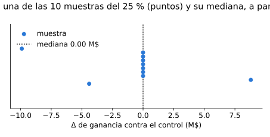

Cifras principales

| cifra | unidad | mediana | mínimo | máximo | n |
|---|---|---|---|---|---|
| Δ de ganancia contra el control | M$ | 0 | -9.9 | 8.8 | 10 |
| Δ de ganancia contra el control | % | 0 | -3.622 | 3.219 | 10 |
| Δ de AUC final contra el control |  | 0 | -8.051e-05 | 0.002227 | 10 |
| Correlación de Spearman de la selección |  | 0.7752 | 0.6647 | 0.8165 | 10 |
| Tiempo de búsqueda | s | 486.65 | 378.20 | 1,064.40 | 10 |

!!! warning "Advertencia"
    10 muestras pero 4 modelos distintos; un solo 201910; no comparable 1:1 con H3-0.25

### validacion_20_semillas

!!! question "Pregunta"
    ¿Cambian los veredictos de H1 a H4 si el control y cada variante se evalúan con 20 semillas finales en lugar de 10?

**Protocolo.** 20 semillas finales por variante (lista no publicada), una búsqueda por estudio, reportes por hipótesis hechos con una versión anterior de comun/reporte.py y editados a mano; sin código ni ledger

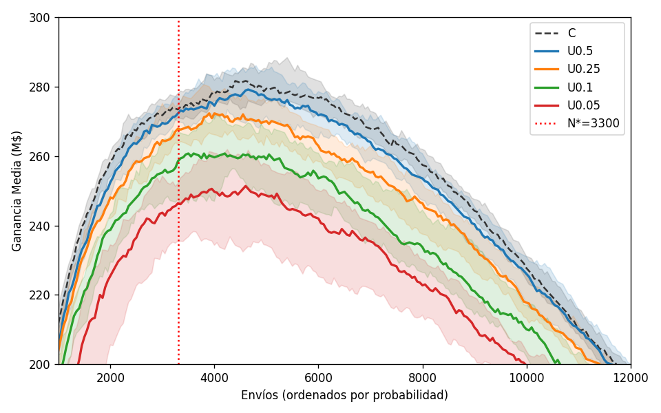

Reporte original de H1 (20 semillas finales): bandas de la curva de ganancia

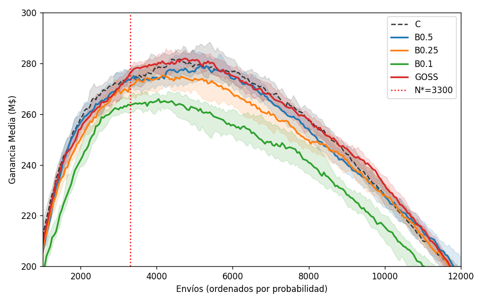

Reporte original de H2 (20 semillas finales): bandas de la curva de ganancia

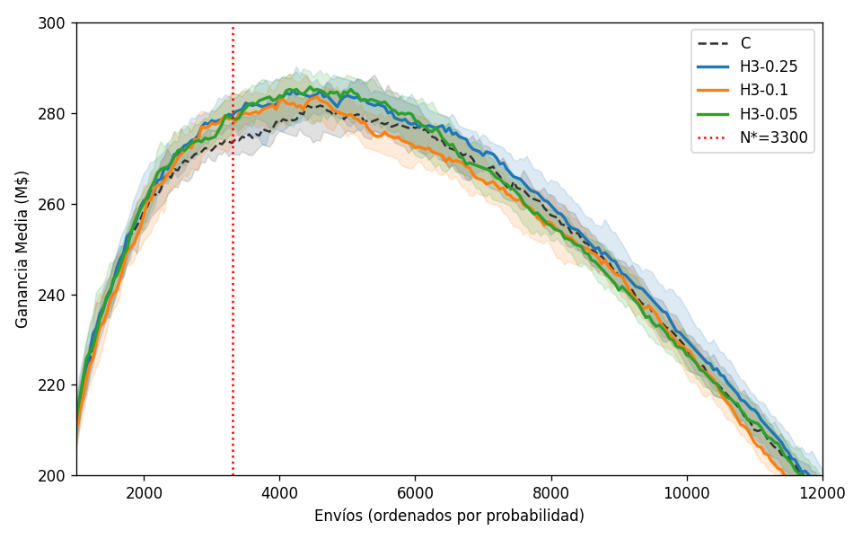

Reporte original de H3 (20 semillas finales): bandas de la curva de ganancia

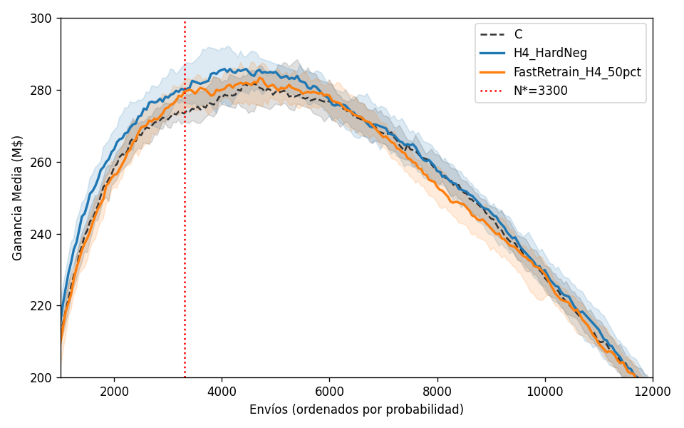

Reporte original de H4 (20 semillas finales): bandas de la curva de ganancia

Cifras principales

| cifra | unidad | mediana | mínimo | máximo | n |
|---|---|---|---|---|---|
| Δ de ganancia, media de 20 semillas | M$ | -0.6 | -30.75 | 6.38 | 13 |
| Tiempo reportado | s | 175.00 | 70.00 | 786.00 | 13 |
| Δ con 20 semillas menos Δ con 10 | M$ | 0.88 | -4.12 | 9.68 | 13 |

!!! warning "Advertencia"
    solo los HTML (commits d8f04b2 y ffe5cae): no se puede reproducir; H4_HardNeg usa los hiperparámetros fijos del script de validacion_50_semillas (no es H4H-0.1); los tiempos de h2 no coinciden con los medidos; no cambia ningún veredicto

### validacion_50_semillas

!!! question "Pregunta"
    ¿Con 50 semillas finales, qué estrategias de las hipótesis 3 y 4 ganan al control y cuántas semillas entran en un presupuesto de 900 s?

**Protocolo.** 9 estrategias con hiperparámetros fijos, 50 semillas finales (10 oficiales + 110017 + i·19937), presupuesto de 900 s; ranking y curva según K en 201908, 201910 solo informado

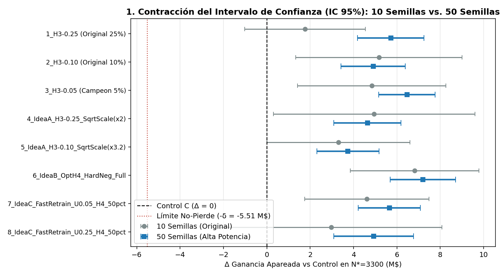

Reporte original (50 semillas, hiperparámetros fijos): contracción del IC 95 % de Δ

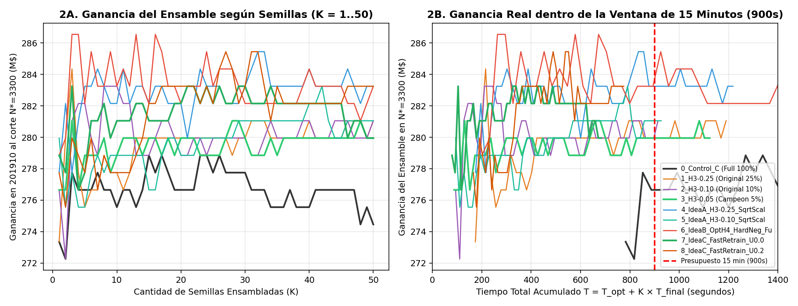

Reporte original (50 semillas, hiperparámetros fijos): ganancia según K y pipeline de 15 minutos

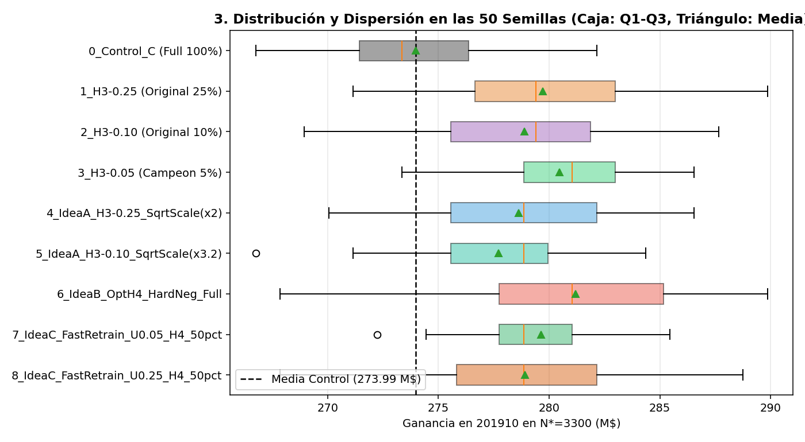

Reporte original (50 semillas, hiperparámetros fijos): ganancia por estrategia con las 50 semillas

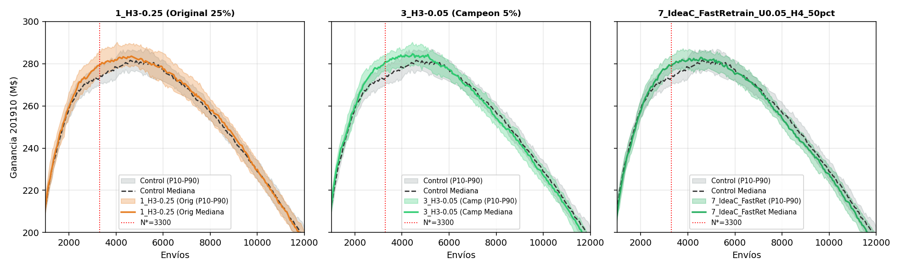

Reporte original (50 semillas, hiperparámetros fijos): bandas de las curvas de ganancia

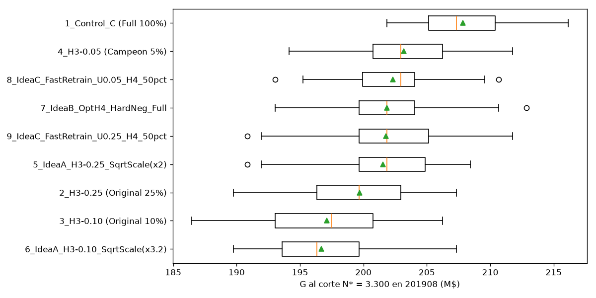

Resumen original de 50 semillas: ganancia en 201908 por estrategia

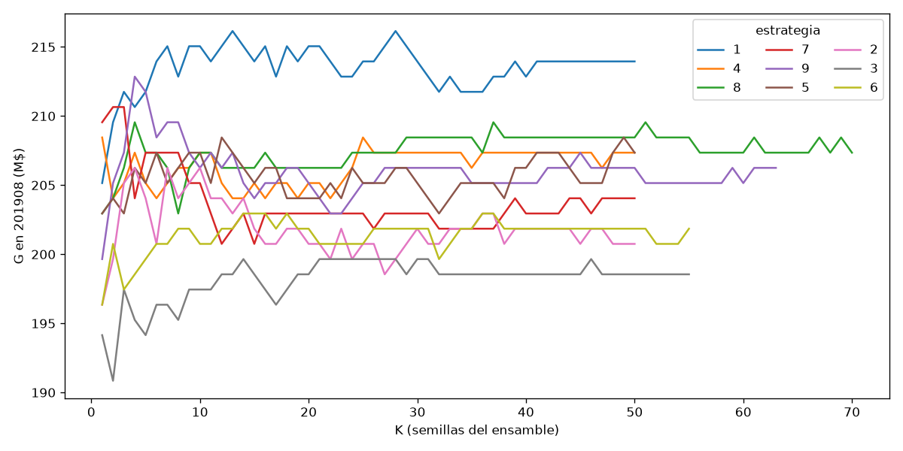

Resumen original de 50 semillas: ganancia en 201908 según K

Cifras principales

| cifra | unidad | mediana | mínimo | máximo | n |
|---|---|---|---|---|---|
| G en 201908 | M$ | 201.85 | 186.45 | 216.15 | 493 |
| G máxima en 201908 | M$ | 207.35 | 196.62 | 218.07 | 493 |
| AUC en 201908 |  | 0.9274 | 0.9236 | 0.9311 | 493 |
| G en 201910 | M$ | 278.85 | 266.75 | 296.45 | 493 |
| AUC en 201910 |  | 0.9328 | 0.9304 | 0.9357 | 493 |
| Tiempo | s | 19.02 | 11.33 | 35.72 | 493 |
| Puesto en 201908 |  | 5 | 1 | 9 | 9 |
| G en 201908 | M$ | 201.76 | 196.69 | 207.86 | 9 |
| Desvío de G en 201908 | M$ | 4.037 | 3.275 | 4.559 | 9 |
| K que entran en el presupuesto |  | 40 | 4 | 70 | 9 |
| G del ensamble en 201908 | M$ | 205.15 | 198.55 | 210.65 | 9 |
| G del ensamble en 201910 | M$ | 281.05 | 278.85 | 284.35 | 9 |

!!! warning "Advertencia"
    origen: commit 9e1889e, script de Colab con su propio panel; el resumen original elige con 201910 (ya mirado) y hay piezas reconstruidas (presupuesto, resumen CSV, H4_Hard); no es una variante ni cambia el veredicto de ninguna hipótesis

<!-- /generado:bloque-b -->
