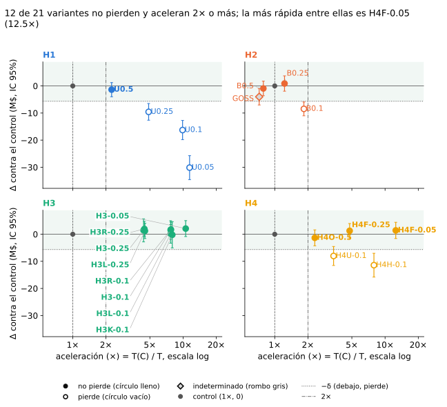
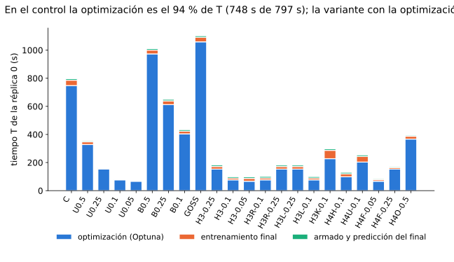
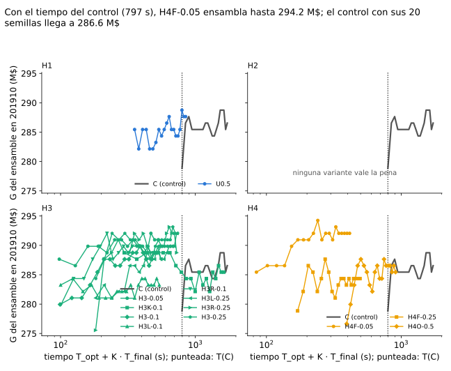
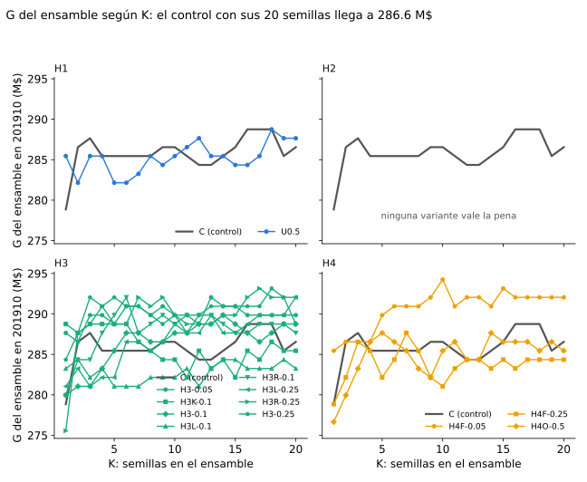

# Sampling_1: velocidad sin tocar la proporción de clases

**¿Vale la pena el tradeoff entre velocidad y pérdida de performance?** Sobre el baseline del curso (2019, LightGBM con
Optuna), cuánto tiempo se ahorra y cuánta ganancia se pierde en test (201910) cuando se usan menos filas.

!!! success "Respuesta"
    Vale la pena achicar la **optimización**: correr Optuna sobre una muestra al azar y entrenar el final con todas las
    filas no pierde contra el control y es varias veces más rápido. Achicar el final al azar sí pierde; conservando todas
    las bajas y la mitad de CONTINUA con peso, no.

## Resultados

### ¿Cuánto se pierde y cuánto se gana?

Un panel por hipótesis y un punto por variante, con su intervalo: a la derecha, más rápida que el control; abajo, pierde
ganancia. Las que valen la pena quedan arriba y a la derecha del 2×, y casi todas achican solo la optimización.

<!-- generado:hallazgo-tradeoff -->
Generado por `comun/reporte.py` el 2026-11-14; no editar.

<!-- /generado:hallazgo-tradeoff -->

### ¿Dónde se va el tiempo?

En el control, la búsqueda de hiperparámetros se lleva el 94 % del tiempo y el modelo final, el resto. Por eso achicar
la búsqueda acelera mucho más que achicar el final, y no toca el modelo que se entrega.

<!-- generado:hallazgo-tiempo -->
Generado por `comun/reporte.py` el 2026-11-14; no editar.

<!-- /generado:hallazgo-tiempo -->

### ¿Y con el tiempo ahorrado?

Con el mismo tiempo que tarda el control, una variante rápida entrena varios modelos finales con semillas distintas y
promedia sus probabilidades. Arriba, la ganancia del ensamble según el tiempo gastado; abajo, según la cantidad de
modelos. Ensamblar el control también suma, así que buena parte de la ventaja es el ensamble.

<!-- generado:hallazgo-ensamble -->
Generado por `comun/reporte.py` el 2026-11-14; no editar.

<!-- /generado:hallazgo-ensamble -->

!!! warning "Limitaciones principales"
    - **Test ya mirado.** H4 y las extensiones de H3 salen de un estudio que miró 201910, y no hay otro mes de test.
    - **Un mes, un año, una máquina.** Solo 2019, solo 201910 como test y tiempos medidos en `n2-highmem-8`.
    - **Réplicas solo en parte de las variantes.** H1 y H2 se deciden con una sola búsqueda de hiperparámetros.

    El resto, en [Resultados § Limitaciones comunes](experimentos/sampling_1/README.md#limitaciones-comunes).

[Ver los resultados](experimentos/sampling_1/README.md){ .md-button .md-button--primary }

## Hipótesis

<!-- generado:tarjetas -->
Generado por `comun/reporte.py` el 2026-11-14; no editar.

-   **[H1 · Submuestreo uniforme del train](experimentos/h1/README.md)**

    ---

    H1 prueba si entrenar con una fracción de las filas de train, tomadas al azar sin mirar la clase, acelera sin perder ganancia.

    4 variantes: 3 pierden, 1 indeterminada.

-   **[H2 · Muestrear dentro de LightGBM](experimentos/h2/README.md)**

    ---

    H2 prueba si dejar que LightGBM muestree filas en cada árbol (`bagging_fraction` fijo y bajo), en lugar de achicar el train antes, acelera sin perder ganancia.

    5 variantes: 2 no pierden, 2 pierden, 1 indeterminada.

-   **[H3 · Optimizar sobre una muestra, entrenar con todo](experimentos/h3/README.md)**

    ---

    H3 prueba si alcanza con correr Optuna sobre una muestra chica del train y entrenar el modelo final con todas las filas.

    9 variantes: 9 no pierden. La más rápida que no pierde: H3-0.05 (10.6×).

-   **[H4 · Muestras informadas por clase](experimentos/h4/README.md)**

    ---

    H4 prueba si conviene que la muestra que acelera el pipeline conserve todas las bajas, en la búsqueda de Optuna o en el modelo final.

    12 variantes: 6 no pierden, 4 pierden, 2 indeterminadas. La más rápida que no pierde: H4F-0.05 (12.5×).

<!-- /generado:tarjetas -->
