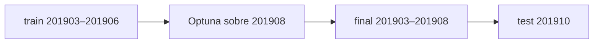

# <HN> · <título corto>

<Una línea: qué se prueba.>

## Idea

<De 2 a 4 párrafos: qué se cambia del baseline y por qué podría acelerar sin perder ganancia.>

<Marcar en el diagrama dónde corta esta hipótesis (con `style` o un nodo propio).>

## Predicción

!!! info "Predicción"
    Fijada el <AAAA-MM-DD>, commit `<hash>`, antes de la primera corrida real. G, Δ, δ, T, A, N\* y los veredictos
    están en [Control y reglas](../control/README.md) y se citan, no se copian.

- **Variable**:
- **Métrica que decide**:
- **Predicción**:
- **Se confirma** si
- **Se refuta** si
- **Ninguna de las dos** si

## Diseño

### Variantes

<Tabla con las variantes que se registran en `comun/variantes.py`: nombre, método, tasa y estudio de Optuna.>

| variante | método | tasa | estudio |
|---|---|---|---|

### Grilla

<Semillas, trials, réplicas y meses. Lo que no cambia del baseline no se repite.>

### Rondas

<Qué ronda vale y qué cambió entre rondas, si hubo más de una.>

## Dependencias

De qué experimentos lee este (uno por línea). `python -m comun.variantes --verificar` lo compara con el registro de
variantes y estudios de `comun/variantes.py`.

- `control`: finales de `C`, N\* y δ.

## Resultado

<!-- generado:resultado -->
<!-- /generado:resultado -->

## Veredicto

!!! success "Veredicto"
    <Escrito a mano, sin números que no estén en el bloque generado.>

## Limitaciones

!!! warning "Limitación"
    <Solo las propias de esta hipótesis. Las comunes van en Resultados.>
